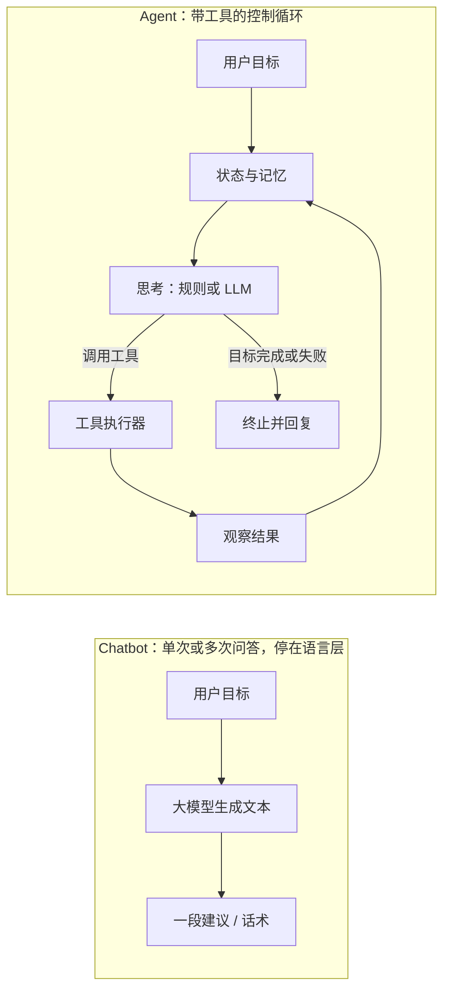
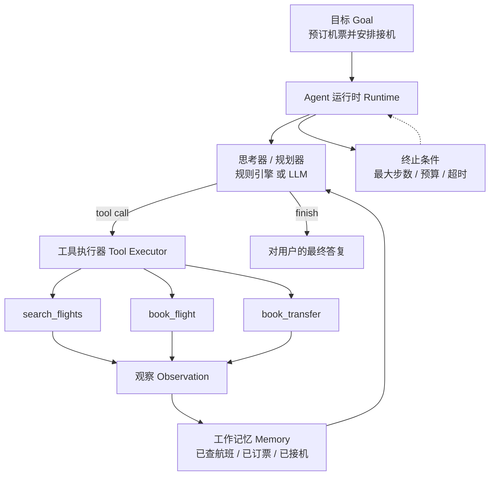

# 第 1 章 什么是 AI Agent：从「会聊天」到「会办事」

> 本章定位：全书的认知地基。读完后，你要能用自己的话讲清 Agent 是什么、它和 Chatbot 差在哪，并能跑通三段代码：规则循环、大模型调用、带工具的最小 Agent。
>
> 前置：会写 Python 函数/类，或会写 Java 17 + Maven。不需要机器学习。
>
> 配套代码：`code/ch01/python/`、`code/ch01/java/`
>
> 图表假设：除非另有说明，流程图描述的是「教学用最小模型」，不是某家云厂商的内部架构。

---

## 1.1 你已经具备的能力，以及还缺的那一块

先说一句让人安心的话：**你不是从零开始。**

如果你能写一个 FastAPI 接口，或能用 Spring Boot 暴露一个 REST 服务，你已经具备 Agent 工程里最被低估的能力——把「外界的请求」变成「程序里的一次调用」，再把结果送回去。企业要的 Agent 工程师，首先是能把模型嵌进业务系统的人，不是会背论文的人。

你缺的通常是三块新积木：

1. **大语言模型（LLM, Large Language Model）** 不再只是聊天窗口里的玩具，而是你代码里的一个「不确定的函数」。它输入文本（以及越来越多的结构化协议），输出文本或工具调用请求。
2. **工具（Tool）** 让模型能查天气、搜文档、改工单、跑 SQL。模型负责「决定调用什么」，你的代码负责「真正执行」。
3. **循环（Loop）** 让程序可以观察结果、再思考、再行动，直到目标完成或主动收手。

Chatbot 通常停在第 1 块。Agent 把三块焊在一起。

很多招聘 JD 会写：「熟悉 LangChain / Agent / RAG」。面试官真正想听的，往往不是你背过哪些框架名词，而是：**你能不能画一张图，说明一次用户目标是如何被拆成模型调用、工具调用和终止条件的。** 本章就训练这件事。

---

## 1.2 直觉解释：Agent 是「能自己完成目标的程序」

**智能体（Agent）** 这个词比「聊天机器人」老得多。在人工智能教科书里，Agent 指「能感知环境、并为了目标采取行动的实体」。2023 年之后，工业界说的 AI Agent，多半特指：**以 LLM 为决策核心，通过工具与环境交互，在多步循环中逼近某个目标的软件系统。**

请把这句话拆开：

- **有目标**：不是陪你闲聊，而是「把这张工单处理完」「根据知识库回答并给出引用」「帮我订票并安排接机」。
- **能感知**：读用户输入、读工具返回、读检索到的文档、读当前业务状态。
- **能行动**：调用 API、写数据库、发邮件、创建工单。行动发生在**你的代码**里，不发生在模型肚子里。
- **会循环**：一次模型调用往往不够。它必须根据观察结果决定下一步。
- **会停**：没有终止条件的 Agent 不是智能，是事故。

一个有用的判断句：

> 如果把模型换成一个「会说人话、但偶尔说错」的同事，你是否仍然需要给他工牌、权限、操作手册和汇报节奏？如果需要，你做的就是 Agent；如果只需要他坐在前台回答问题，那是 Chatbot。

注意两个容易滑倒的地方：

- Agent **不是**一种新的神经网络结构。绝大多数项目里，底下仍是普通的 Chat Completions / Messages API。
- Agent **不是**「把 Prompt 写得更长」。Prompt 很重要，但 Agent 的关键增量是**控制流**：谁在什么时候被调用、失败了怎么办、何时交给人。

---

## 1.3 生活类比：前台、私人助理与项目经理

用公司里三种角色来对齐产品形态。这张类比你会在面试里反复用到。

**前台（Chatbot）**  
访客问「你们厕所在哪」，前台根据话术回答。她不替你请假，不替你下采购单。对话可以多轮，但每一轮的本质仍是「问→答」。系统边界停在语言。

**私人助理（Copilot，副驾驶）**  
你写周报时，助理在旁边起草段落、提醒你漏了数据。最终点「发送」的是你。Copilot 强调**人在回路里做决定**。GitHub Copilot、办公套件里的写作助手，大多属于这类。

**项目经理（Agent）**  
老板只说：「下周一客户来访，把行程安排好。」项目经理去查航班、对预算、订会议室、发现酒店满房后再换方案，最后把结果同步回来。老板看到的是目标被推进，不是一串问答。

再补一个更日常的画面。你对伴侣说「晚上想吃火锅」，有三种回应：

- Chatbot：「火锅推荐：海底捞、小龙坎……需要我介绍菜品吗？」
- Copilot：「我列了三家店和排队情况，你选一家我再帮你写预约话术。」
- Agent：「附近 2 公里、人均 150 以内、今晚 7 点有位的店我订好了，确认短信已发到你手机。」

第三种听着最爽，也最危险：订错了谁负责？超预算了谁审批？这就是后面「人类介入（Human-in-the-loop）」和「权限边界」会反复出现的原因。本章先建立直觉：**能力越强，控制面越要先设计。**

---

## 1.4 原理剖析：感知 — 思考 — 行动 — 观察

忘掉框架名字。一只最小 Agent 在运行时只做四件事，然后重复。

1. **感知（Perceive）**：把外界变成程序能读的状态。用户一句话、工具返回的 JSON、检索到的文档片段，都是感知。
2. **思考（Think）**：根据目标 + 当前状态，决定下一步。教学阶段可以用 `if/else`；生产阶段通常把这一步交给 LLM。
3. **行动（Act）**：执行一个工具，或向用户提问，或宣布结束。
4. **观察（Observe）**：把行动结果写回状态 / 记忆，供下一轮思考使用。

这四步组成 **感知-思考-行动-观察循环（Perceive-Think-Act-Observe Loop）**。学术文献里还有「环境（Environment）」「策略（Policy）」等说法，工程上你先记住循环即可。

### 图 1：Chatbot 一次往返 vs Agent 多步循环

下面这张图是本章的第一张架构图。假设场景：用户说「帮我把明天去上海的出差安排好」。Chatbot 只能生成一段建议文本；Agent 会真正去查票、预订、安排接机。



读图时请盯住一个差异：**Chatbot 的箭头在模型输出处结束；Agent 的箭头会回到状态。** 「回到状态」四个字，就是 Agent 工程的起点。

### 图 2：一只教学用 Agent 的内部组件

第二张图把循环拆成组件。假设这是「出差安排 Agent」的逻辑结构，不绑定任何框架。



组件清单（面试可以按这五件套回答）：

| 组件 | 英文 | 它负责什么 | 本章先怎么实现 |
| --- | --- | --- | --- |
| 目标 | Goal | 定义「怎样算做完」 | 字符串 + 明确完成条件 |
| 思考器 | Planner / Policy | 决定下一步 | 先用规则，再换成 LLM |
| 工具 | Tool | 改变外部世界或查询事实 | 三个普通函数 |
| 记忆 | Memory | 让下一步看得到上一步 | 一个列表 + 几个字段 |
| 终止条件 | Stopping criteria | 防止无限转圈 | `max_steps`、成功标志 |

第 2 章会把 Runtime 写成可扩展骨架；第 3 章会把思考器换成 ReAct 等范式；第 4 章会把工具协议讲透。本章只要求你**亲手转完一圈**。

### 三种范式先认个脸（第 3 章展开）

招聘和社区里最常出现的三个词，你现在只需要建立标签，不必实现：

- **ReAct（Reasoning and Acting）**：一边写推理痕迹，一边交替调用工具。像师傅带徒弟：「我先看看库存……库存不够，我改下供应商。」
- **Plan-and-Execute（先规划再执行）**：先列出步骤清单，再逐步执行，必要时改计划。像写施工计划后再开工。
- **Reflexion（反思）**：行动失败或质量不够时，先总结教训再重来。像代码评审后的返工。

选型口诀先记一句：**任务短、环境反馈快，用 ReAct；步骤长、依赖多，用 Plan-and-Execute；允许试错且有评价标准，加 Reflexion。** 第 3 章会用代码把三句话变成三种循环。

---

## 1.5 Agent、Chatbot、Copilot 到底差在哪

对比时请看「谁做决定、谁执行、失败了怎么办」，不要看营销文案里有没有 Agent 两个字。

| 维度 | Chatbot（聊天机器人） | Copilot（副驾驶） | Agent（智能体） |
| --- | --- | --- | --- |
| 典型目标 | 回答问题、陪聊、走话术树 | 提高人的效率 | 在约束下完成一件事 |
| 默认输出 | 自然语言 | 草稿、补全、建议 | 行动 + 最终结论 |
| 是否调用工具 | 通常没有，或仅检索知识 | 偶尔有，但关键动作等人确认 | 核心能力，常多步调用 |
| 控制权 | 用户继续提问 | 人做最终决定 | 系统在授权范围内自主推进 |
| 状态 | 对话历史 | 编辑中的文档 / IDE 上下文 | 目标、槽位、工具结果、业务实体 |
| 失败形态 | 答错、答偏 | 建议不可用，人可以不采纳 | 订错票、写错库、循环打爆账单 |
| 工程重点 | Prompt、安全拒答 | 交互体验、采纳率 | 权限、终止、评测、可观测性 |
| 更接近的岗位关键词 | 对话机器人、客服机器人 | AI 辅助编程 / 办公助手 | Agent 工程师、LLM 应用开发 |

使用这张表时的假设：同一套底层模型（例如某款 2024–2026 年常见的对话模型）可以同时做成三种产品。**产品形态由控制流和权限设计决定，不由模型品牌决定。**

职场上还有一种「假 Agent」：演示时现场只打了一段对话，后台并没有工具，全是模型编的「我已经帮你预订了」。面试官如果追问「预订发生在哪个系统、订单号从哪来」，这类项目会立刻露馅。本章的代码故意把工具写成真实函数，就是为了让你从第一天就站在「真办事」这一边。

---

## 1.6 用代码感受第一次「Agent 循环」

### 环境要求

| 项目 | 版本 / 说明 |
| --- | --- |
| 操作系统 | Windows / macOS / Linux 均可 |
| Python | 3.10+（推荐 3.11） |
| Java | 17+（推荐 17 或 21），Maven 3.9+ |
| 网络 | 示例 1 不需要；示例 2、3 需要能访问你选择的模型 API |
| API Key | 示例 2、3 需要 `OPENAI_API_KEY`；可用 OpenAI，或任意 OpenAI 兼容国产接口 |
| Windows 控制台 | 若中文乱码，先执行 `chcp 65001`，或设置 `PYTHONIOENCODING=utf-8`；Maven 可加 `-Dfile.encoding=UTF-8` |

Python 依赖（`code/ch01/python/requirements.txt`）：

```text
openai>=1.51.0,<2.0.0
python-dotenv>=1.0.1,<2.0.0
```

Java 依赖：`jackson-databind 2.17.2`（见 `code/ch01/java/pom.xml`）。HTTP 调用使用 JDK 自带的 `java.net.http.HttpClient`，不另引 SDK，方便你看清协议本身。

建议先**只跑示例 1**。没有 Key 也能把循环跑明白，这比一上来卡在账单和代理上更重要。

---

### 示例 1（Python）：不靠大模型的规则 Agent

这段程序模拟一个出差助理：必须先搜航班，再订票，再安排接机。思考器是普通函数，不是 LLM。你要观察的是循环，不是「模型聪不聪明」。

完整文件：`code/ch01/python/01_rule_agent.py`

```python
from __future__ import annotations

from dataclasses import dataclass, field
from typing import Any, Callable


@dataclass
class Observation:
    ok: bool
    data: dict[str, Any]
    message: str


@dataclass
class AgentState:
    goal: str
    budget_cny: int
    step: int = 0
    max_steps: int = 8
    memory: list[str] = field(default_factory=list)
    booked_flight: dict[str, Any] | None = None
    booked_transfer: dict[str, Any] | None = None
    finished: bool = False


def search_flights(date: str, dest: str) -> Observation:
    catalog = [
        {"flight_no": "MU5101", "date": date, "dest": dest, "price": 680, "seats": 4},
        {"flight_no": "CA1831", "date": date, "dest": dest, "price": 920, "seats": 1},
        {"flight_no": "9C8801", "date": date, "dest": dest, "price": 450, "seats": 0},
    ]
    available = [item for item in catalog if item["seats"] > 0]
    return Observation(True, {"flights": available}, f"找到 {len(available)} 个有票航班")


def book_flight(flight_no: str, budget_cny: int) -> Observation:
    prices = {"MU5101": 680, "CA1831": 920, "9C8801": 450}
    if flight_no not in prices:
        return Observation(False, {}, f"航班不存在: {flight_no}")
    price = prices[flight_no]
    if flight_no == "9C8801":
        return Observation(False, {}, "该航班已售罄")
    if price > budget_cny:
        return Observation(False, {}, f"价格 {price} 超出预算 {budget_cny}")
    return Observation(True, {"flight_no": flight_no, "price": price}, f"已预订 {flight_no}，花费 {price} 元")


def book_transfer(flight_no: str) -> Observation:
    if not flight_no:
        return Observation(False, {}, "没有航班信息，无法安排接机")
    return Observation(
        True,
        {"car": "沪A·D328", "pickup": "虹桥T2", "flight_no": flight_no},
        f"已为 {flight_no} 安排接机：沪A·D328，虹桥T2",
    )


TOOLS: dict[str, Callable[..., Observation]] = {
    "search_flights": search_flights,
    "book_flight": book_flight,
    "book_transfer": book_transfer,
}


def think(state: AgentState) -> dict[str, Any]:
    if state.booked_flight and state.booked_transfer:
        return {"type": "finish", "reason": "机票和接机都已办妥"}
    if state.booked_flight and not state.booked_transfer:
        return {"type": "tool", "name": "book_transfer", "args": {"flight_no": state.booked_flight["flight_no"]}}
    searched = any(item.startswith("观察[search_flights]") for item in state.memory)
    if not searched:
        return {"type": "tool", "name": "search_flights", "args": {"date": "2026-09-14", "dest": "SHA"}}
    return {"type": "tool", "name": "book_flight", "args": {"flight_no": "MU5101", "budget_cny": state.budget_cny}}


def run_agent(goal: str, budget_cny: int = 800) -> AgentState:
    state = AgentState(goal=goal, budget_cny=budget_cny)
    while not state.finished and state.step < state.max_steps:
        state.step += 1
        decision = think(state)
        if decision["type"] == "finish":
            state.finished = True
            state.memory.append(f"结束: {decision['reason']}")
            break
        observation = TOOLS[decision["name"]](**decision["args"])
        state.memory.append(f"观察[{decision['name']}]: {observation.message}")
        if decision["name"] == "book_flight" and observation.ok:
            state.booked_flight = observation.data
        if decision["name"] == "book_transfer" and observation.ok:
            state.booked_transfer = observation.data
    return state


if __name__ == "__main__":
    final_state = run_agent("预订明天去上海的机票，并安排接机")
    for line in final_state.memory:
        print(line)
```

运行：

```bash
cd code/ch01/python
python 01_rule_agent.py
```

你应该看到类似轨迹（具体打印以脚本为准）：先搜索，再订 `MU5101`，再安排接机，然后结束。把预算改成 `500` 再跑一次——订票会失败。这时规则思考器还不会改选别的航班。**这不是 bug，这是在提醒你：思考器太笨，就轮到 LLM 上场。** 但循环骨架已经是真的。

---

### 示例 1（Java）：同一套循环，换一种语言

Java 版与 Python 版行为对齐，完整代码在 `code/ch01/java/src/main/java/com/agentbook/ch01/RuleAgent.java`。核心循环如下，可直接对照阅读：

```java
static AgentState runAgent(String goal, int budgetCny) {
    AgentState state = new AgentState(goal, budgetCny);
    while (!state.finished && state.step < state.maxSteps) {
        state.step++;
        Map<String, Object> decision = think(state);
        if ("finish".equals(decision.get("type"))) {
            state.finished = true;
            state.memory.add("结束: " + decision.get("reason"));
            break;
        }
        String toolName = String.valueOf(decision.get("name"));
        @SuppressWarnings("unchecked")
        Map<String, Object> toolArgs = (Map<String, Object>) decision.get("args");
        Observation observation = execute(toolName, toolArgs);
        state.memory.add("观察[" + toolName + "]: " + observation.message());
        if ("book_flight".equals(toolName) && observation.ok()) {
            state.bookedFlight = observation.data();
        }
        if ("book_transfer".equals(toolName) && observation.ok()) {
            state.bookedTransfer = observation.data();
        }
    }
    return state;
}
```

运行：

```bash
cd code/ch01/java
mvn -q -DskipTests compile exec:java -Dexec.mainClass=com.agentbook.ch01.RuleAgent
```

PowerShell 下请给 `-D` 参数加引号，避免被拆开：

```powershell
mvn -q -DskipTests compile exec:java "-Dexec.mainClass=com.agentbook.ch01.RuleAgent"
```

**Python / Java 差异（记住就够）：**

- Python 用 dataclass 和字典，改状态很快；Java 用 `record` + 可变 `AgentState`，类型更硬，适合进 Spring 服务。
- Python 用函数字典做工具注册；Java 用 `switch` 分发。生产里两者都会演变成「工具注册表 + 权限注解」。
- 循环逻辑没有语言魔法。谁先写熟循环，谁就不容易被框架带着跑。

---

### 示例 2（Python）：第一次真正调用大模型

现在换上 LLM。这一步**还不是 Agent**，只是把「思考器」换成远程模型。很多人卡在这里，是因为把「会调用 API」和「会做 Agent」当成了同一件事。请刻意分开。

把 `code/ch01/python/.env.example` 复制为 `.env`，填入你的 Key。国产兼容接口通常只需要改 `OPENAI_BASE_URL` 和 `OPENAI_MODEL`。

```python
import os
import sys

from dotenv import load_dotenv
from openai import OpenAI


def build_client() -> OpenAI:
    load_dotenv()
    api_key = os.getenv("OPENAI_API_KEY")
    if not api_key:
        print("缺少 OPENAI_API_KEY。")
        sys.exit(1)
    return OpenAI(
        api_key=api_key,
        base_url=os.getenv("OPENAI_BASE_URL", "https://api.openai.com/v1"),
    )


def ask(question: str) -> str:
    client = build_client()
    model = os.getenv("OPENAI_MODEL", "gpt-4o-mini")
    response = client.chat.completions.create(
        model=model,
        temperature=0.2,
        messages=[
            {"role": "system", "content": "你是一名耐心的技术导师。用中文回答，先给结论，再给理由。"},
            {"role": "user", "content": question},
        ],
    )
    content = response.choices[0].message.content
    if not content:
        raise RuntimeError("模型没有返回文本内容")
    return content


if __name__ == "__main__":
    print(ask("用三句话解释：AI Agent 和 Chatbot 的核心区别是什么？"))
```

```bash
cd code/ch01/python
pip install -r requirements.txt
python 02_llm_hello.py
```

Java 对照实现是 `LlmHello.java`：自己拼 JSON、用 `HttpClient` POST 到 `/chat/completions`。协议字段与 Python SDK 发出去的是同一类东西。运行：

```bash
cd code/ch01/java
mvn -q -DskipTests compile exec:java -Dexec.mainClass=com.agentbook.ch01.LlmHello
```

PowerShell：

```powershell
mvn -q -DskipTests compile exec:java "-Dexec.mainClass=com.agentbook.ch01.LlmHello"
```

如果你在公司内网，还要处理代理、证书和数据出境。那是工程问题，不是 Agent 理论问题。先在自己电脑上用最小示例打通。

---

### 示例 3（Python）：模型负责点菜，代码负责上菜

把示例 1 的「规则思考器」换成 LLM，把工具留下，你就得到 **函数调用（Function Calling）** / **工具使用（Tool Use）** 的最小闭环。模型不会真的查天气，它只会返回：「请调用 `get_weather`，参数是上海。」你的进程执行函数，把 JSON 观察结果再塞回对话。

完整文件：`code/ch01/python/03_tool_calling_agent.py`。下面是去了注释的主干：

```python
import json
import os
from typing import Any

from openai import OpenAI

TOOLS = [
    {
        "type": "function",
        "function": {
            "name": "get_weather",
            "description": "查询某城市当前天气，城市用中文名，例如 上海、北京。",
            "parameters": {
                "type": "object",
                "properties": {"city": {"type": "string"}},
                "required": ["city"],
            },
        },
    },
    {
        "type": "function",
        "function": {
            "name": "get_flight_price",
            "description": "查询某日从出发地到目的地的最低机票价格（人民币）。",
            "parameters": {
                "type": "object",
                "properties": {
                    "date": {"type": "string"},
                    "from_city": {"type": "string"},
                    "to_city": {"type": "string"},
                },
                "required": ["date", "from_city", "to_city"],
            },
        },
    },
]


def get_weather(city: str) -> dict[str, Any]:
    catalog = {
        "上海": {"weather": "小雨", "temp_c": 22, "wind": "东风3级"},
        "北京": {"weather": "晴", "temp_c": 26, "wind": "北风2级"},
    }
    return catalog.get(city, {"weather": "未知", "note": "演示数据未覆盖该城市"})


def get_flight_price(date: str, from_city: str, to_city: str) -> dict[str, Any]:
    price = 680 if from_city == "北京" and to_city == "上海" else 1099
    return {"date": date, "from_city": from_city, "to_city": to_city, "lowest_price": price}


DISPATCH = {
    "get_weather": lambda args: get_weather(city=args["city"]),
    "get_flight_price": lambda args: get_flight_price(
        date=args["date"], from_city=args["from_city"], to_city=args["to_city"]
    ),
}


def run_tool_agent(user_goal: str, max_steps: int = 6) -> str:
    client = OpenAI(
        api_key=os.environ["OPENAI_API_KEY"],
        base_url=os.getenv("OPENAI_BASE_URL", "https://api.openai.com/v1"),
    )
    model = os.getenv("OPENAI_MODEL", "gpt-4o-mini")
    messages: list[dict[str, Any]] = [
        {
            "role": "system",
            "content": "你是出行助手。需要事实信息时必须调用工具，不要编造天气和价格。",
        },
        {"role": "user", "content": user_goal},
    ]

    for _ in range(max_steps):
        response = client.chat.completions.create(
            model=model,
            temperature=0,
            messages=messages,
            tools=TOOLS,
            tool_choice="auto",
        )
        message = response.choices[0].message
        messages.append(message.model_dump(exclude_unset=True))
        if not message.tool_calls:
            return message.content or ""
        for call in message.tool_calls:
            args = json.loads(call.function.arguments or "{}")
            result = DISPATCH[call.function.name](args)
            messages.append(
                {
                    "role": "tool",
                    "tool_call_id": call.id,
                    "content": json.dumps(result, ensure_ascii=False),
                }
            )
    return "达到最大步数，提前结束，避免无限调用。"
```

```bash
python 03_tool_calling_agent.py
```

Java 完整对照：`ToolCallingAgent.java`。协议要点完全一样——请求里带 `tools`，响应里可能带 `tool_calls`，你追加 `role=tool` 的消息再问一轮。

跑通之后，请对照示例 1 问自己三个问题：

1. 思考器在哪里？（模型）
2. 行动在哪里？（`DISPATCH` / `switch`）
3. 观察如何回到下一轮？（`messages` 里追加 tool 结果）

能回答这三问，你就已经超过很多「只会 import LangChain」的简历了。

---

## 1.7 踩坑提醒、职场视角与本章小结

### 踩坑提醒

**坑 1：把模型输出当成已经发生的事实。**  
模型说「我已经预订成功」只是一段文本。没有工具返回值，就没有预订。演示给领导看之前，先看日志里有没有真实的 tool 结果。

**坑 2：没有最大步数。**  
模型可能反复查同一个接口，或在失败时原地打转。示例 1 和示例 3 都写了 `max_steps`。生产里还要加超时、费用上限和幂等键。

**坑 3：工具描述写得像给同事的口头禅。**  
模型靠 `description` 和 JSON Schema 点菜。写「查一下那个东西」等于没有工具。第 4、7 章会专门练怎么写工具契约。

**坑 4：Key 写进代码仓库。**  
只用环境变量或本地 `.env`，且 `.env` 不要提交。企业面试如果听到「Key 写死在仓库里」，安全面基本结束。

**坑 5：第一周就追求框架全家桶。**  
LangChain、LangGraph、AutoGen、CrewAI 都很有用，但它们封装的仍是本章这个循环。第 5 卷再系统对比。现在用框架，是为了少写样板；现在不用框架，是为了面试时能画图。

### 职场 / 面试落点

打开任意一份「AI 应用工程师」JD，你多半会看到这些词：LLM API、Prompt、Function Calling、Agent、RAG、LangChain。本章已经让你对其中四个词有了可演示的理解：

- 你能区分 Agent 与 Chatbot（概念题）。
- 你能画出循环（设计题开场）。
- 你能跑通一次 Function Calling（代码题雏形）。
- 你知道 Agent 的风险在行动层，不在文笔层（加分意识）。

简历上现在还不要写「精通 Agent」。更老实的写法是：

> 手写 Perceive-Think-Act 循环，完成工具调用闭环；能说明为何必须设置最大步数与权限边界。

等第 30–32 章的三个项目做完，再把这句话升级成带业务结果的 STAR 故事。

### 本章小结

- Agent 是**有目标、能调用工具、在循环中逼近完成条件**的程序；LLM 只是思考器的一种实现。
- Chatbot 停在语言，Copilot 强调人做决定，Agent 在授权范围内推进事情。
- 先会写规则循环，再换 LLM，再接线工具，这个顺序能保护你不被框架名词淹没。
- 从第一天起就设计终止条件和「行动必须发生在代码里」。

下一章我们会把今天的脚本拆成可扩展的 Runtime：目标如何显式化、状态如何建模、超时和最大步数如何变成工程开关。

---

## 1.8 常见面试考点

> **高频原题：**「请解释 AI Agent 和 Chatbot 的区别。如果让你给业务方做选型，你怎么讲？」
>
> **60 秒答法：**
> Chatbot 的系统边界是对话，核心是理解问题并生成回复，可以多轮，但默认不改变外部系统。Agent 的系统边界是目标，它把 LLM 当作决策器，通过工具多步感知和行动，直到完成、失败或交给人。选型时看三件事：要不要改数据、允不允许自动执行、失败成本有多高。只咨询用 Chatbot；人确认后执行用 Copilot；授权清晰、可回滚、有评测再用 Agent。
>
> **追问 1：**「Agent 一定要上框架吗？」  
> 不必。框架加速的是编排和生态，不改变循环本质。团队小、链路短，手写 Runtime 往往更好调试。
>
> **追问 2：**「ReAct 是什么？」  
> 一种让模型交替输出推理和行动的范式，适合反馈快的短任务。详细对比放在第 3 章，但你现在就可以用「边想边做」四个字接住。
>
> **追问 3：**「如何避免 Agent 死循环？」  
> 最大步数、超时、重复工具调用检测、费用熔断、以及明确的成功/失败状态。只靠 Prompt 说「请不要循环」不够。

---

## 1.9 课后练习（含答案提示）

**练习 1：画图（必做）**  
选一个你熟悉的业务（请假审批、售后退货、日志排障任选），画一张「Chatbot 做法」和一张「Agent 做法」的流程图。要求出现：目标、至少一个工具、一次观察回到状态、一个终止条件。

- 提示：如果画着画着发现没有工具，你画的仍是 Chatbot。
- 自检：把图发给同事，对方能指出「哪一步会改数据库」。

**练习 2：改代码（必做）**  
在示例 1 中新增工具 `send_itinerary_sms(phone, summary)`，并规定：只有机票和接机都成功后才发短信，然后才能 `finish`。Python 或 Java 做一种即可。

- 提示：思考器里再加一个状态字段 `sms_sent`。完成条件从「两件事」变成「三件事」。
- 延伸：让预算 500 时改订更便宜且有票的航班。你会发现规则迅速变丑——这正是第 3 章要换范式的理由。

**练习 3：对照运行（选做，需要 Key）**  
用同一句用户目标分别跑示例 2 和示例 3。把模型的纯文本回答和带工具的回答贴到笔记里，标出「哪几句是编的，哪几句有工具证据」。

- 提示：示例 2 没有天气和价格的真实来源；示例 3 的数字应来自你写死的字典。
- 面试句：我用有无 tool 观察结果，区分「生成」和「办理」。

**练习 4：30 秒口述（必做）**  
对着手机录音，不看讲义，回答：「Agent 的五件套是什么？」

- 提示：目标、思考器、工具、记忆、终止条件。能多说「观察要写回状态」就加分。

---

## 本章质量自检

| 检查项 | 结论 |
| --- | --- |
| 零基础读者能否不看前文就懂？ | 本章是第 1 章，从岗位技能缺口讲起，概念均给出中英对照。 |
| 代码能否直接复制运行？ | 示例 1 无网可跑；示例 2、3 需 Key。完整工程与正文一致。 |
| 是否有职场 / 面试落点？ | 1.7 给出简历句；1.8 给出 60 秒答法与追问。 |
| 图表是否标注假设？ | 图 1、图 2 与对比表均标明为教学最小模型，不绑定厂商内部实现。 |

---

## 你现在应该能做的事

- [ ] 用自己的话讲清 Agent / Chatbot / Copilot
- [ ] 指出任意 Demo 里「行动发生在模型嘴里还是代码里」
- [ ] 跑通 `01_rule_agent.py` 或 `RuleAgent`
- [ ] （可选）跑通一次真实 LLM 调用和一次工具循环

准备好了就回复 **「继续」**，进入第 2 章：《拆开一只 Agent：核心组件与控制循环》。
