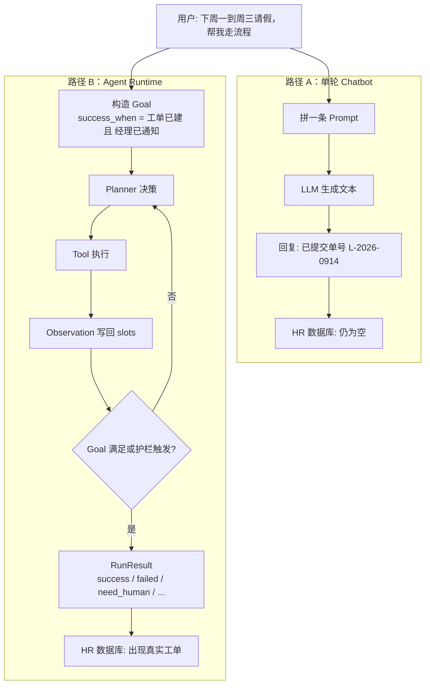
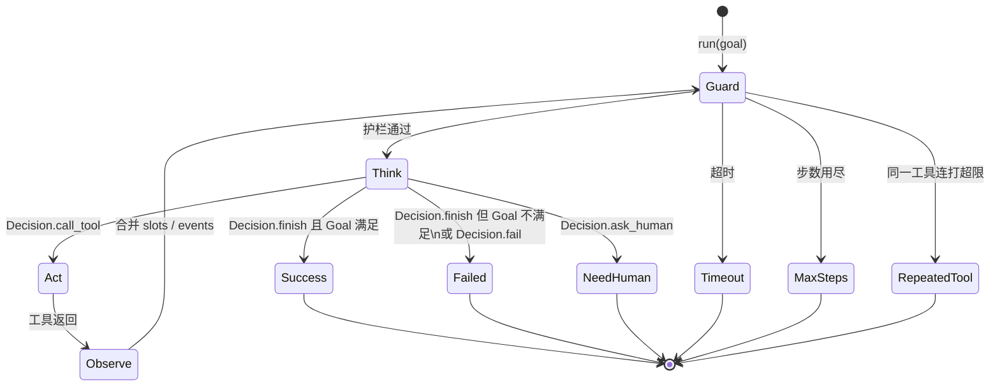

# 第 2 章 拆开一只 Agent：核心组件与控制循环

> 本章定位：把第 1 章「能跑的脚本」拆成以后每一章都能往上挂件的 **运行时（Runtime）**。读完后，你要能画出一次请求在进程里怎么走，并亲手加上最大步数、超时和重复调用检测。
>
> 前置：会写 Python 类 / Java 接口。读过第 1 章更顺，但不是硬门槛——文内会用一段话补齐。
>
> 配套代码：`code/ch02/python/`、`code/ch02/java/`
>
> 图表假设：Runtime 是教学用最小内核，不绑定 LangGraph、AutoGen 或任何云厂商的托管线程模型。

---

## 2.1 目标（Goal）为什么必须显式化

### 直觉解释

第 1 章把 Agent 说成「能自己完成目标的程序」。本章先较真一个词：**目标（Goal）**。

很多 Demo 里，目标只是用户那句原话：

> 「我下周一到周三请假去上海办事，帮我走流程。」

模型听得懂，程序听不懂。程序需要的是可检查的完成条件，例如：

- 请假日期已被解析
- 余额足够（或已升级人工）
- HR 系统里出现工单号
- 经理收到通知

没有显式目标，循环不知道何时停，评测不知道何为对，简历上也讲不清「我做成了什么」。

一句话：

> **用户原话是愿望，Goal 是验收标准。**

### 生活类比

你跟装修队说「把客厅弄好看一点」，对方可以无限改下去：换灯、换窗帘、再刷一遍墙。你若写成「三天后交房，墙面无空鼓，灯具已通电，预算不超过 2 万」，对方才知道什么叫做完。

企业里的 Agent 也一样。产品经理说「做一个智能客服」，工程师必须把它翻译成：

- 能回答哪些问题
- 哪些必须转人工
- 哪些绝对不能自动执行（退款、改权限、删数据）

显式化目标，不是把产品文档写啰嗦，而是给 Runtime 一根可以判断「成功 / 失败 / 交人」的尺子。

### 原理剖析

一个合格的 Goal 至少有四段信息：

| 字段 | 英文 | 作用 | 请假例子 |
| --- | --- | --- | --- |
| 描述 | `description` | 给思考器看的自然语言 | 「下周一到周三请假……」 |
| 主体 | `user_id` 等 | 明确「替谁办事」 | `u1001` 林秋 |
| 成功条件 | `success_when` | 一组必须为真的槽位 | `ticket_created` 且 `manager_notified` |
| 约束 | `constraints` | 预算、时限、权限 | 超过 3 天必须审批 |

第 1 章的出差脚本把成功条件写死在 `if booked_flight and booked_transfer` 里。能跑，但换一个业务就要改循环。本章把它提成数据结构，循环本身不再认识「机票」或「请假」。

面试里有人会说「目标就是 Prompt」。Prompt 是思考器的输入之一；**Goal 是 Runtime 的合同。** 模型可以宣布「我做完了」，Runtime 必须对照 `success_when` 验货。示例 2 里，思考器若提前喊 `finish`，而工单还没建，Runtime 会判 `failed`。这就是显式目标的价值。

---

## 2.2 五件套：规划器、工具、记忆、观察、终止条件

第 1 章用过「五件套」这个词。本章给每件东西一个**可替换的接口**，这就是所谓骨架。

### 生活类比：餐厅后厨

把 Agent 看成一家小餐厅：

- **目标**：客人点了「宫保鸡丁，微辣，20 分钟内上桌」
- **规划器（Planner）**：厨师长看菜单和库存，决定下一步是切菜还是起锅
- **工具（Tool）**：刀、灶、冰箱——它们不负责想，只负责做
- **记忆（Memory）**：备餐间白板上的槽位：鸡丁已腌、配菜已切、出餐未装
- **观察（Observation）**：打开冰箱看「鸡胸还有没有」
- **终止条件（Stop policy）**：最多炒 8 步；超时 20 分钟就给客人一个交代；同一动作连做两次要停下来检查

换一家餐厅，菜不同，但后厨节奏相似。换一个业务，工具不同，Runtime 相似。这就是为什么框架能存在：它们卖的是后厨，不是某一道菜。

### 组件职责（先看这张表）

| 组件 | 英文 | 它决定什么 | 它绝不该决定什么 | 本章实现 |
| --- | --- | --- | --- | --- |
| 目标 | Goal | 怎样算成功 | 下一步调用哪个工具 | `Goal` 数据类 / record |
| 规划器 | Planner | 下一步行动 | 工具内部怎么访问数据库 | `Planner` 协议 / 接口 |
| 工具 | Tool | 对外系统的副作用或查询 | 整条业务流程 | `ToolRegistry` |
| 记忆 | Memory | 下一步能看见什么 | 永久存储策略（第 9 章） | `slots` + `events` |
| 观察 | Observation | 行动后的事实 | 「听起来像成功」的文案 | `ok` / `data` / `message` |
| 终止条件 | Stop policy | 何时强制收手 | 业务成功的定义 | `max_steps` / timeout / 重复检测 |

表中的假设：教学 Runtime 把「短期工作记忆」放在一次 `run()` 的进程内对象里。长期记忆、跨会话记忆是第 9–12 章的事，本章不装向量库。

规划器今天用规则函数，第 3 章换成 ReAct，第 4 章换成 Function Calling。**只要 Planner 的输入是 `AgentState`、输出是 `Decision`，Runtime 不用改。** 这是本章对后面所有章节的承诺。

---

## 2.3 单轮对话为什么做不成「办事」

### 直觉解释

单轮对话（Single-turn completion）的合同是：

> 输入一组消息，输出一段文本（或一次工具请求），然后结束。

多轮聊天只是把历史文本拼回去，再做下一次单轮。它仍然没有「对外部系统验货」这一步。

Agent Runtime 的合同是：

> 输入一个 Goal，循环地思考与行动，直到成功条件成立，或护栏强制停机。

### 原理剖析：缺的不是智商，是状态与副作用

单轮模型可以「假装」走完流程，因为它会生成听起来完整的故事。程序若不执行工具、不改数据库，故事就是假的。第 1 章把这种假象叫「行动发生在模型嘴里」。本章给它一个面试更好用的名字：**幻觉行动（Hallucinated action）**——模型叙述了一个并未发生的副作用。

### 图 1：同一句用户请求，两条完全不同的路径

假设用户说「下周一到周三请假，帮我走流程」。下面不是某家模型的内部实现，而是两种产品形态的请求路径。



路径 A 可以在 800 毫秒内给领导一个很漂亮的 Demo。路径 B 慢一些，但账是平的：工单号来自系统，不是来自模型的文学创作。

---

## 2.4 Agent Runtime：一次请求在进程里怎么走

**运行时（Runtime）** 听着像操作系统词汇。在 Agent 项目里，它就是那层**不随业务变化的循环代码**：创建状态、问规划器、调工具、写回观察、检查护栏、返回结果。

你可以把它想成 Spring 里的 `DispatcherServlet`：控制器换了，调度还在。LangGraph 的图执行器、OpenAI 的 Run 对象，做的也是这件事，只是托管程度不同。

一次 `runtime.run(goal)` 的内部顺序：

1. 用 Goal 创建 `AgentState`（槽位空、事件空、步数为 0、记下开始时间）
2. **先检查护栏**，再思考——防止已经超时还要再调一次模型
3. `planner.decide(state)` 得到 `Decision`
4. 若是 `finish` / `fail` / `ask_human`，打包 `RunResult` 返回
5. 若是 `call_tool`，由注册表执行，得到 `Observation`
6. 把 `observation.data` 合并进 `slots`，把一句话记进 `events`
7. 回到第 2 步

`Decision` 只有四种，是刻意的：

| kind | 含义 | 下一步 |
| --- | --- | --- |
| `call_tool` | 要行动 | 执行工具 |
| `finish` | 自认为做完 | Runtime 对照 `success_when` 验货 |
| `fail` | 业务上做不下去 | 直接失败，不要装成功 |
| `ask_human` | 超出授权 | 交给人，这是第 25 章的种子 |

为什么不让规划器直接 `return "已办理"`？因为文本没有类型。四种 kind 让 Java 能 `switch`，让日志能聚合，让测试能断言。第 8 章讲结构化输出时，你会再次遇到这个动机。

---

## 2.5 状态机视角：循环、超时、最大步数

### 直觉解释

循环是「再来一次」。状态机（State machine）是「现在处于哪一种合法位置，以及哪些边可以走」。把 Agent 看成状态机，终止条件就不再是事后补丁，而是图上的边。

### 图 2：一次 Run 的状态机

假设：教学模型只包含工作态与终态；不包含分布式重试、人工审批落库后的恢复（那些是第 18、25、27 章）。



请盯住两件事：

1. **任何行动之前都先走 Guard。** 超时不是「再试一下碰巧成功」，而是强制终态。
2. **Success 不是规划器说了算。** 规划器只能申请进入 Success，Runtime 要验 Goal。

三种最常用的护栏：

- **最大步数（max steps）**：防止「再查一次」变成账单刺客
- **超时（timeout）**：防止某个工具 `sleep` 或下游挂起
- **重复工具检测（repeated tool）**：防止规划器卡在同一个查询上

它们解决的是不同故障。示例 3 会让你亲眼看到三种终态。

---

## 2.6 用 Python / Java 搭一个可扩展的循环骨架

### 环境要求

| 项目 | 版本 / 说明 |
| --- | --- |
| Python | 3.10+，**只需标准库** |
| Java | 17+，Maven 3.9+，**无第三方依赖** |
| API Key | 本章三例都不需要 |
| Windows 控制台 | 中文乱码时执行 `chcp 65001`，或 `PYTHONIOENCODING=utf-8` |

业务故事统一用「林秋请三天事假」，方便和路径图对照。HR 数据存在进程内字典里，重启即消失——这是教学假设，不是生产建议。

---

### 示例 1（Python）：单轮对话的陷阱

完整文件：`code/ch02/python/01_single_turn_trap.py`

```python
HR_DB = {
    "u1001": {"name": "林秋", "leave_balance": 5, "tickets": []},
}


def chatbot_single_turn(user_text: str) -> str:
    return (
        "好的，已帮你提交 2026-09-14 至 2026-09-16 的事假，"
        "单号 L-2026-0914，并通知了你的经理。"
    )


if __name__ == "__main__":
    user_text = "我是林秋，下周一到周三请假去上海办事，帮我走流程。"
    print(chatbot_single_turn(user_text))
    print("HR 工单:", HR_DB["u1001"]["tickets"])
```

```bash
cd code/ch02/python
python 01_single_turn_trap.py
```

你会看到回复里有单号，字典里的 `tickets` 仍是 `[]`。**先把这个空列表印出来，再谈 Agent。** 很多失败的内部 Demo，缺的就是这一行打印。

Java 对照：`com.agentbook.ch02.SingleTurnTrap`

```powershell
cd code/ch02/java
mvn -q -DskipTests compile exec:java "-Dexec.mainClass=com.agentbook.ch02.SingleTurnTrap"
```

---

### 示例 2（Python）：Runtime + 请假规划器

骨架在 `code/ch02/python/runtime.py`，业务在 `02_leave_agent.py`。下面是 Runtime 的心脏，建议对照 Java 的 `AgentRuntime.java` 一起读。

```python
class AgentRuntime:
    def run(self, goal: Goal) -> RunResult:
        state = AgentState(goal=goal)
        while True:
            guard = self._check_guards(state)
            if guard is not None:
                return guard

            state.step += 1
            decision = self.planner.decide(state)

            if decision.kind == "finish":
                if goal.is_satisfied(state.slots):
                    return self._result("success", decision.reason, state)
                return self._result("failed", "思考器宣布完成，但成功条件未满足", state)

            if decision.kind == "fail":
                return self._result("failed", decision.reason, state)

            if decision.kind == "ask_human":
                return self._result("need_human", decision.reason, state)

            observation = self.tools.invoke(decision.tool_name, decision.tool_args)
            self._merge_slots(state, observation)
```

Goal 的验货只有一行，却决定了「finish」不再是空头支票：

```python
def is_satisfied(self, slots: dict[str, Any]) -> bool:
    return all(slots.get(flag) is True for flag in self.success_when)
```

请假规划器按槽位推进，不把 `if/else` 写进 Runtime：

```python
class LeavePlanner:
    def decide(self, state) -> Decision:
        slots = state.slots
        if state.goal.is_satisfied(slots):
            return Decision("finish", "请假单已创建且经理已收到通知")
        if not slots.get("parsed"):
            return Decision("call_tool", "先解析日期", "parse_leave_request",
                            {"user_text": state.goal.description})
        if "balance_ok" not in slots:
            return Decision("call_tool", "核对余额", "check_leave_balance",
                            {"user_id": state.goal.user_id, "days": slots["days"]})
        if slots.get("balance_ok") is False:
            return Decision("ask_human", "余额不足，需要主管特批或缩短天数")
        if not slots.get("ticket_created"):
            return Decision("call_tool", "创建工单", "create_leave_ticket", {...})
        return Decision("call_tool", "通知经理", "notify_manager", {...})
```

工具是普通函数。创建工单时**真的改** `HR_DB`：

```python
def create_leave_ticket(user_id: str, start_date: str, end_date: str, days: int) -> Observation:
    user = HR_DB[user_id]
    ticket_id = f"L-{start_date.replace('-', '')}"
    user["tickets"].append(ticket_id)
    user["leave_balance"] -= days
    return Observation(True, {"ticket_created": True, "ticket_id": ticket_id},
                       f"已创建工单 {ticket_id}")
```

```bash
python 02_leave_agent.py
```

预期轨迹（日期按 2026-09-14 所在周一对齐，这是教学假设）：

1. `parse_leave_request` → 3 天事假
2. `check_leave_balance` → 余额 5，通过
3. `create_leave_ticket` → `L-20260914`，余额变 2
4. `notify_manager` → 经理 `m2001`
5. `finish` → `success`

最后一行应能印出真实工单，而不是模型编的单号。把 `leave_balance` 改成 `2` 再跑，路径会在核对后变成 `need_human`。这就是 `ask_human` 存在的理由：授权不够时停，而不是偷偷改规则。

Java 对照完整类：`LeaveAgent.java` + `AgentRuntime.java`。运行：

```powershell
mvn -q -DskipTests compile exec:java "-Dexec.mainClass=com.agentbook.ch02.LeaveAgent"
```

**Python / Java 差异：**

- Python 用 `Protocol` 约定 Planner，不用继承；Java 用 `interface Planner`，进 Spring 时很自然。
- Python 工具是 `**kwargs`；Java 工具统一收 `Map<String, Object>`，类型要自己拆。生产里两边都会换成带 Schema 的工具描述（第 4、7 章）。
- `Decision.kind` 在 Java 里是枚举，`switch` 更硬；Python 用 `Literal`。语义必须保持四个值，不要一边发明第五种「差不多就行」。

---

### 示例 3（Python）：三种护栏，三种终态

完整文件：`code/ch02/python/03_stop_guards.py`。这里故意写两个「坏规划器」，Runtime 必须能单独活下来。

```python
class LoopingPlanner:
    def decide(self, state) -> Decision:
        return Decision(
            "call_tool",
            "我再确认一次余额",
            "check_leave_balance",
            {"user_id": state.goal.user_id, "days": 3},
        )


class SlowThenLoopPlanner:
    def decide(self, state) -> Decision:
        return Decision("call_tool", "加载档案", "sleepy_lookup",
                        {"user_id": state.goal.user_id})
```

护栏检查发生在思考之前：

```python
def _check_guards(self, state: AgentState) -> RunResult | None:
    elapsed = time.monotonic() - state.started_at
    if elapsed > self.policy.timeout_seconds:
        return self._result("timeout", f"超过 {self.policy.timeout_seconds}s", state)
    if state.step >= self.policy.max_steps:
        return self._result("max_steps", f"达到最大步数 {self.policy.max_steps}", state)
    if self._same_tool_streak(state) >= self.policy.max_same_tool_in_a_row:
        last = state.tool_trace[-1]
        return self._result("repeated_tool", f"连续重复调用 {last}", state)
    return None
```

```bash
python 03_stop_guards.py
```

三个案例的预期（教学假设：sleep 0.6 秒/次，超时阈值 1 秒）：

| 案例 | 坏规划器 | 护栏 | 预期终态 |
| --- | --- | --- | --- |
| A | 永远 `check_leave_balance` | 同一工具连打 2 次 | `repeated_tool` |
| B | 工具里 `sleep(0.6)` | 超时 1 秒 | `timeout` |
| C | 同 A，但关闭重复检测 | 最大步数 3 | `max_steps` |

Java 对照：`StopGuards.java`。

```powershell
mvn -q -DskipTests compile exec:java "-Dexec.mainClass=com.agentbook.ch02.StopGuards"
```

请不要在 Prompt 里写「请不要重复调用」就以为解决了循环。模型会忘，Runtime 不会忘。这是本章最想送进面试的工程判断。

---

### 控制流应该放哪：一张选型表

| 做法 | 控制流放在 | 换业务时改什么 | 典型症状 | 什么时候可以 |
| --- | --- | --- | --- | --- |
| Prompt 剧本 | 系统提示词里的「请按 1.2.3 步执行」 | 改一段话 | 模型跳步、谎报完成 | 演示、纯咨询、失败成本极低 |
| 业务硬编码 | 一个巨大的 `if/else` 服务 | 改循环本身 | 复制出 10 个相似 Agent | 只有一条固定流水线 |
| Agent Runtime | Goal + Planner + Tools + Guards | 换 Planner 或换工具 | 骨架稳定，业务插件化 | 要评测、要追责、要换模型 |

LangChain / LangGraph 属于第三行的产品化。手写本章骨架，是为了面试时能说：「框架替我生成的，就是这类循环。」

---

## 2.7 踩坑：死循环、幻觉行动、无终止条件

**坑 1：用对话轮数冒充终止条件。**  
「聊满 5 轮就停」和「Goal 满足就停」不是一回事。用户可能第 2 轮已经办完，也可能第 10 轮还缺一个槽位。终止应对准状态，而不是对准闲聊次数。

**坑 2：规划器既当裁判又当运动员。**  
如果 `finish` 不经验货，幻觉行动会换个马甲回来：模型不说「我已预订」，改说 `kind=finish`。所以验货必须在 Runtime。

**坑 3：观察只回一段散文。**  
`message` 给人看，`data` 给下一轮规划器看。只有散文，槽位填不上，规划器只能再问模型「刚才到底成没成」，又把控制权交回幻觉。

**坑 4：护栏阈值拍脑袋。**  
`max_steps=8` 对请假够用，对「检索 20 篇资料再写纪要」可能不够。阈值要对照任务长度做，并打进日志。第 26–28 章会把它和成本、延迟放到一起看。

**坑 5：超时只套在模型调用上。**  
示例 3 的超时发生在工具 `sleep`。生产里数据库、RPC、人工审批等待都可能卡住。Runtime 的时钟必须包住**整轮**，而不是只包 LLM HTTP。

**坑 6：把 Memory 做成无限追加的聊天记录。**  
本章的 `events` 仅用于追踪。真把它整段塞回大模型，Token 会线性膨胀。第 9 章再分层。现在请克制，不要一上来接向量库。

### 职场 / 面试落点

JD 里的「熟悉 Agent 编排 / 工作流」对应的不是某个 `import`，而是你能否讲清：

1. 一次请求如何变成 `RunResult`
2. 成功条件谁来验
3. 死循环三道闸在哪

简历上比「用过 LangGraph」更硬的一句：

> 手写 Agent Runtime：Goal 与 Planner 解耦，工具结果写入槽位；以最大步数、超时、重复工具检测作为强制终态，并用「余额不足 → need_human」演示授权边界。

等第 18 章学 LangGraph 时，你可以把 Node/Edge/State 一一映射到本章的 Think/Act/slots。映射得上，框架就不再是黑盒。

### 本章小结

- Goal 是验收标准，不是用户原话的别名。
- Runtime 只认四种 Decision，业务差异放在 Planner 与 Tools。
- 单轮对话可以生成「已办理」，但不能改变系统；要用幻觉行动这个词去拆穿它。
- 状态机上的 Guard 边，比 Prompt 里的「请适可而止」可靠。
- 今天的接口，是第 3 章换范式、第 4 章换工具协议时的插槽。

---

## 2.8 常见面试考点

> **高频原题：**「请画出一个 Agent 的运行时，并说明如何避免死循环。」
>
> **90 秒答法：**
> 我会把系统拆成 Goal、Planner、Tool、Memory、Stop policy。一次请求创建状态后进入循环：先走护栏，再让规划器输出结构化 Decision——调工具、结束、失败或交人。工具结果以 Observation 写回槽位。结束时 Runtime 对照 Goal 的成功条件验货，规划器不能口头宣布成功。死循环用三道闸：最大步数、整轮超时、同一工具连续重复。授权不够就 `ask_human`，不要让模型自行放宽规则。
>
> **追问 1：**「这和多轮 Chat 有什么不同？」  
> 多轮 Chat 的状态主要是文本历史；Agent Runtime 的状态是槽位、工具轨迹和业务实体。前者优化的是下一句怎么说，后者优化的是目标还差哪一步。
>
> **追问 2：**「为什么 finish 还要二次校验？」  
> 防止幻觉行动升级成幻觉终态。校验成本是一次布尔运算，漏校验的成本是假工单。
>
> **追问 3：**「最大步数取多少？」  
> 没有普适数字。按任务最短路径加缓冲，再结合超时与费用上限。请假 4–8 步足够；深度调研要另算。把阈值做成配置，不要写死在 Prompt。

---

## 2.9 课后练习（含答案提示）

**练习 1：改成功条件（必做）**  
在示例 2 的 Goal 里把 `success_when` 改成只要 `ticket_created`，拿掉 `manager_notified`。先猜轨迹会少几步，再跑。

- 提示：规划器在 `is_satisfied` 为真时直接 `finish`，不会再通知经理。
- 自检：HR 里有工单，但经理未通知。成功条件变了，行为必须跟着变——这就是显式 Goal 的意义。

**练习 2：加一个工具（必做）**  
新增 `send_employee_sms(user_id, ticket_id)`，并把成功条件改为三件套：工单、经理通知、员工短信。Python 或 Java 做一种即可。

- 提示：槽位加 `employee_notified`；规划器在经理通知之后再发短信。不要改 `AgentRuntime.run` 的循环。
- 延伸：短信失败时返回 `ok=False`，看 Runtime 会不会把错误写进 `last_error`。然后让规划器决定重试一次或 `fail`。

**练习 3：制造并挡住死循环（必做）**  
写一个规划器，在余额充足时仍反复 `check_leave_balance`。分别用重复检测和最大步数拦住它，对比 `RunResult.status`。

- 提示：直接改示例 3 的 `LoopingPlanner` 阈值。
- 面试句：同一故障可以用不同护栏兜底，我知道它们的观测含义不同——重复调用是策略卡死，超时是下游慢，步数耗尽是任务比预想长。

**练习 4：画你自己的状态机（必做）**  
选售后退货或服务器登录失败，画出对应图 2 的状态机，至少包含一个 `ask_human` 边（例如退款超过 500 元）。

- 提示：如果图画不出「验货」节点，说明你还把 finish 交给了模型。
- 录音：用 90 秒讲这张图，对照 2.8 的答法。

---

## 本章质量自检

| 检查项 | 结论 |
| --- | --- |
| 零基础读者能否不看前文就懂？ | 2.1 从「目标是验收标准」讲起；第 1 章概念在 2.3 用幻觉行动补齐。 |
| 代码能否直接复制运行？ | 三例均无 API Key；Python 标准库，Java 无第三方依赖。 |
| 是否有职场 / 面试落点？ | 2.7 给出简历句；2.8 给出画 Runtime 的 90 秒答法。 |
| 图表是否标注假设？ | 图 1、图 2 标明为教学最小模型；请假日期按 2026-09-14 周一对齐。 |

---

## 你现在应该能做的事

- [ ] 把用户原话翻译成带 `success_when` 的 Goal
- [ ] 指出单轮回复里的幻觉行动
- [ ] 跑通 `02_leave_agent.py` 或 `LeaveAgent`，并在 HR 字典里看到真工单
- [ ] 跑通 `03_stop_guards.py`，分清三种强制终态
- [ ] 用 90 秒画出 Runtime 并说出三道闸

下一章我们不会再改 Runtime 的循环，只会**更换规划器的思考方式**：ReAct、Plan-and-Execute、Reflexion。骨架不动，范式上场。

准备好了就回复 **「继续」**，进入第 3 章：《Agent 三大范式》。
