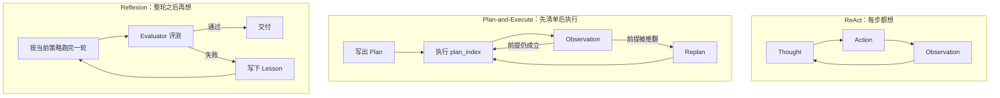

# 第 3 章 Agent 三大范式：ReAct、Plan-and-Execute、Reflexion

> 本章定位：范式不是新框架，而是 **Planner 的思考节奏**。Runtime 继续用第 2 章那一套，只换规划器。读完后，你要能对着同一业务画出三种控制流，并说清什么时候不该用哪一种。
>
> 前置：理解 Goal / Planner / Tool / Observation / 护栏。没读第 2 章也可以：把 Runtime 看成「先护栏、再决策、再执行、再写回槽位」的循环。
>
> 配套代码：`code/ch03/python/`、`code/ch03/java/`
>
> 图表假设：三种范式的示意图是教学控制流，不是 Yao et al. / Shinn et al. 论文里的原图复刻；售后数据是虚构的种子库。

---

## 3.1 为什么企业面试爱问「你用的是哪种范式」

### 直觉解释

面试官问范式，通常不是想听论文名字。他想知道一件更实际的事：

> **当模型下一步想错时，你的系统靠什么把任务拉回来？**

- 边看边改，靠最新观察纠偏——这是 **ReAct（Reasoning and Acting，推理与行动）**
- 先写步骤清单再执行，中途必要时改计划——这是 **Plan-and-Execute（先规划再执行）**
- 整轮跑完用评测打分，失败就写教训再重来——这是 **Reflexion（反思）**

三种都还能再套第 2 章的 Runtime。换的是 Planner 何时想、想多长、失败后把记忆写在哪。

JD 里出现「熟悉 ReAct / Agent 编排」，对应的加分回答不是「我 import 过 `create_react_agent`」，而是：

> 短链路、环境反馈快，我用 ReAct；步骤依赖多、要给业务方看清单，我用 Plan-and-Execute；有明确对错标准、允许试错，我加 Reflexion。

### 生活类比：修车的三种师傅

同一辆车，仪表灯亮了。

- **ReAct 师傅**：打开引擎盖看一眼，拧一下，再看仪表，再决定下一步。每一步都吃最新观察。
- **Plan-and-Execute 师傅**：先在纸上写「查电瓶 → 查发电机 → 查线路」，然后按清单做。做到一半发现是轮胎气压，就把后半张纸划掉，改写计划。
- **Reflexion 师傅**：按自己习惯先换了电瓶，路试失败。晚上写复盘：「没先读故障码。」第二天带着这条教训重来。

三种都能把车修好。贵的是选错节奏：对「仪表灯」这种反馈快的问题写一份 20 步计划，是浪费；对「全车电路改造」只靠边拧边看，会把线绞在一起。

### 本章共用的业务舞台

为了让三种范式能对照，后文都处理同一类售后投诉：

> 「订单一直没发货，帮我处理。」

种子数据（教学假设，不是真实电商）：

| 订单 | 已支付 | 已发货 | 库存 | 已等待 | 正确处置 |
| --- | --- | --- | --- | --- | --- |
| `ORDER-88` | 是 | 否 | SKU-9 = 0 | 4 天 | 按政策退款 |
| `ORDER-99` | 是 | 是（运单 TZ123） | 无关 | 1 天 | 通知运单，**禁止退款** |

工具只有六个：`get_order` / `get_shipment` / `get_inventory` / `search_policy` / `refund_order` / `notify_user`。Runtime 不改，Planner 改。

---

## 3.2 ReAct：边想边做

### 直觉解释

ReAct 把每一轮拆成固定三拍：

1. **Thought（思考）**：根据目标和最新观察，用自然语言说「我现在为什么要做下一步」
2. **Action（行动）**：调用一个工具
3. **Observation（观察）**：工具返回事实，写回状态，进入下一轮 Thought

它反对两种极端：只想不行动（空转推理），和只行动不想（乱点工具）。

论文出处你面试报得出即可：Yao 等人提出 ReAct，把推理轨迹和行动交错写在一起。工程上，你不必复现他们的提示词模板，只要循环里真的出现这三拍。

### 原理剖析

ReAct 的状态可以很少：槽位 + 上一句观察就够。它不要求一开始就看见终点，适合「打开柜子才知道下一件工具是什么」的任务。

代价也清楚：没有全局清单，路径可能绕；每一步都要调用一次思考器（规则或 LLM），步骤一多，延迟和 Token 就线性涨。

### 图 1：ReAct 的一拍三连

假设：每一拍只调用一个工具；并行工具是第 4 章的事。


读图时请盯住：**箭头必须经过 Observation，才能进入下一句 Thought。** 如果 Thought 直接接 Thought，那是在写作文，不是 ReAct。

---

## 3.3 Plan-and-Execute：先计划再执行

### 直觉解释

先产出一份 **计划（Plan）**——有序列表，再由执行器按指针往下走。思考器在「写计划」时贵而少，在「执行一步」时可以更便宜，甚至换成规则或小模型。

这很像项目管理：周一开会排期，周二到周五按排期施工。施工中发现地基有水，再开一次短会改排期，而不是每一颗螺丝都重新开项目会。

### 原理剖析

Plan-and-Execute 多了两个一等公民：

- `plan`：步骤名列表
- `plan_index`：当前执行到哪一步

以及一条关键边：**Replan（改计划）**。观察若推翻了计划的前提（「用户说没发货」其实已经发出），必须丢掉后续步骤，而不是假装清单仍然正确。

它适合：步骤天然有序、要给业务方展示「Agent 打算怎么做」、或计划模型很贵、执行模型可以较小。

它不适合：第一步的观察会强烈改变后续形状，而你又拒绝 replan——那份漂亮清单会把你带进沟里。

---

## 3.4 Reflexion：行动之后的自我反思

### 直觉解释

Reflexion 不在每一步都深度反省，而在 **一次完整尝试（Trial）结束之后**：

1. 按当前策略跑完一轮 Runtime
2. **评测器（Evaluator）** 对照业务规则打分
3. 失败则写 **教训（Lesson / Self-reflection）**
4. 带着教训再开一轮

注意：第 2 章的 Goal 验货只保证「槽位齐了」。`ORDER-99` 被直接退款时，`case_resolved=true`，Goal 会判 success，但售后政策是错的。Reflexion 把「对不对」从 Runtime 里抽到外层评测——这是第 26 章评测体系的种子。

论文出处：Shinn 等人提出 Reflexion，用语言形式的反馈作为记忆。工程上，教训可以是一段话、一条规则，或写进长期记忆（第 9 章）。

### 生活类比

新客服第一天直接给已发货订单点退款，班长回放录音：「先看物流。」第二天他不再犯。Reflexion 就是把班长这一步写成程序。

没有评测器的「反思」只是模型自己夸自己，叫作文，不叫 Reflexion。

---

## 3.5 三种范式的对比、组合与选型

### 图 2：三种控制流画在同一张图上

假设：同一 Runtime；差异只在「计划存放处」和「评测发生的时刻」。



### 选型对比表

| 维度 | ReAct | Plan-and-Execute | Reflexion |
| --- | --- | --- | --- |
| 思考节奏 | 每一步 | 写计划时密集，执行时稀疏 | 整轮结束后 |
| 纠偏方式 | 下一句 Thought 吃观察 | Replan | 换策略再试一次 |
| 额外状态 | 很少 | `plan` + `plan_index` | `lessons` + trial 计数 |
| 延迟 / Token | 步数一多就贵 | 计划可复用，通常更省 | 至少两轮，更贵，但能换正确性 |
| 典型适合 | 排查、检索、工具反馈快 | 已知流水线、要展示步骤 | 有金标或硬规则、允许试错 |
| 典型不适合 | 20+ 步且每步都要大模型 | 前提极易变却禁止改计划 | 没有评测器、或副作用不能回滚 |
| 面试关键词 | Thought/Action/Observation | Plan、Executor、Replan | Trial、Evaluator、Lesson |
| 和框架的关系 | LangChain 默认 Agent 多为此类 | LangGraph 里 Planner 节点 + 子图 | 外层 retry 边 + 记忆 |

组合是常态，不是叛变：

- **Plan-and-Execute 的每一步内部** 可以是一次微型 ReAct（执行器边做边看）
- **ReAct 跑完一轮** 可以交给 Reflexion 评测（先结案，再验收）
- 生产里常见：规划用大模型，执行用小模型，失败用 Reflexion 重试，再加第 2 章的最大步数

口诀先记：

> **反馈快用 ReAct，步骤长用计划，有对错标准且能重来，就加反思。**

---

## 3.6 手写最小实现（不含重量级框架）

### 环境要求

| 项目 | 版本 / 说明 |
| --- | --- |
| Python | 3.10+，只需标准库 |
| Java | 17+，Maven 3.9+，无第三方依赖 |
| API Key | 不需要。思考器是「范式骨架」，不是真实 LLM |
| Windows | 中文乱码时 `chcp 65001` |

为什么先不用模型？因为你要看见控制流，而不是看见一次「碰巧聪明」的补全。第 4 章把 Action 换成 Function Calling 协议后，再把 Thought 交给模型。

---

### 示例 1（Python）：ReAct 处理 ORDER-88

完整文件：`code/ch03/python/01_react.py`，工具在 `shop.py`。规划器每一支都先写 Thought（`Decision.reason`），再选 Action。

```python
class ReactPlanner:
    def decide(self, state) -> Decision:
        order_id = state.goal.constraints["order_id"]
        s = state.slots
        if s.get("case_resolved"):
            return Decision("finish", "观察显示工单已结案，可以结束")
        if not s.get("order_loaded"):
            return Decision(
                "call_tool",
                "用户说一直没发货，先核对订单是否存在以及支付/发货状态。",
                "get_order",
                {"order_id": order_id},
            )
        if not s.get("shipment_checked"):
            return Decision(
                "call_tool",
                "订单在，但不能只信状态字段。下一步查物流，排除已经发出。",
                "get_shipment",
                {"order_id": order_id},
            )
        if s.get("shipped"):
            return Decision(
                "call_tool",
                "物流显示已在途，应告知运单，而不是退款。",
                "notify_user",
                {"order_id": order_id, "message": f"包裹已发出，运单 {s.get('tracking')}"},
            )
        if not s.get("inventory_checked"):
            return Decision("call_tool", "确认未发货。接下来查库存，区分漏发和缺货。",
                            "get_inventory", {"sku": s["sku"]})
        if s.get("stock") == 0 and not s.get("policy_checked"):
            return Decision("call_tool", "库存为 0，先查售后政策再决定退款还是让用户继续等。",
                            "search_policy", {"topic": "缺货未发货"})
        if s.get("stock") == 0 and s.get("days_waiting", 0) >= 3:
            return Decision("call_tool", "政策允许：未发货且缺货等待超过 3 天，执行退款。",
                            "refund_order", {"order_id": order_id})
        return Decision("ask_human", "证据不足，交给人工客服")
```

```bash
cd code/ch03/python
python 01_react.py
```

预期轨迹（教学假设）：

1. Thought：先核对订单 → `get_order` → 未发货  
2. Thought：排除已发出 → `get_shipment` → 尚未发出  
3. Thought：区分漏发/缺货 → `get_inventory` → 库存 0  
4. Thought：查政策 → `search_policy`  
5. Thought：等待已满 4 天 → `refund_order`  
6. Finish；台账出现 `ORDER-88`；政策评测通过  

Java 对照：`ReactDemo.java`

```powershell
cd code/ch03/java
mvn -q -DskipTests compile exec:java "-Dexec.mainClass=com.agentbook.ch03.ReactDemo"
```

把 `constraints["order_id"]` 改成 `ORDER-99` 再跑，ReAct 会在查完物流后走 `notify_user`，不会退款。同一套 Thought→Action 规则，观察不同，路径就不同——这就是「边想边做」。

---

### 示例 2（Python）：Plan-and-Execute 处理 ORDER-99

完整文件：`02_plan_and_execute.py`。先写下「按未发货排查」的默认清单，执行到物流时发现前提错了，于是 replan。

```python
DEFAULT_PLAN = ["get_order", "get_shipment", "get_inventory", "search_policy", "decide_action"]


class PlanAndExecutePlanner:
    def decide(self, state) -> Decision:
        order_id = state.goal.constraints["order_id"]
        s = state.slots
        if s.get("case_resolved"):
            return Decision("finish", "计划中的结案动作已完成")

        if not s.get("has_plan"):
            s["plan"] = list(DEFAULT_PLAN)
            s["plan_index"] = 0
            s["has_plan"] = True
            print(f"Plan: {s['plan']}")

        if s.get("shipment_checked") and s.get("shipped") and not s.get("replanned"):
            s["plan"] = ["notify_in_transit"]
            s["plan_index"] = 0
            s["replanned"] = True
            return Decision(
                "call_tool",
                "观察推翻了「未发货」前提，废弃后续查库存/退款步骤，改计划为通知运单。",
                "notify_user",
                {"order_id": order_id, "message": f"包裹已发出，运单 {s.get('tracking')}"},
            )

        step_name = s["plan"][s["plan_index"]] if s["plan_index"] < len(s["plan"]) else "decide_action"
        s["plan_index"] += 1
        return self._execute_step(step_name, order_id, s)
```

```bash
python 02_plan_and_execute.py
```

预期：先打印 `Plan: [get_order, get_shipment, ...]`；`get_shipment` 之后出现「改计划」；最终计划变成 `['notify_in_transit']`；`replanned=True`；台账退款仍是 `[]`；评测通过。

如果删掉 replan 分支，执行器会继续 `get_inventory` / `search_policy`，甚至在收尾时误退款。这就是「有清单但不会改计划」的事故现场，面试可以拿来讲。

Java 对照：`PlanExecuteDemo.java`

```powershell
mvn -q exec:java "-Dexec.mainClass=com.agentbook.ch03.PlanExecuteDemo"
```

---

### 示例 3（Python）：Reflexion 把错误退款纠正过来

完整文件：`03_reflexion.py`。外层循环才是范式本体，内层 Runtime 只是一次 Trial。

```python
def run_with_reflexion(order_id: str, max_trials: int = 2) -> None:
    lessons: list[str] = []
    for trial in range(1, max_trials + 1):
        db = new_db()
        planner = LessonAwarePlanner(lessons) if lessons else NaivePlanner()
        result = AgentRuntime(planner, build_tools(db), StopPolicy()).run(goal)
        ok, note = evaluate_resolution(order_id, result.slots, db)
        if ok:
            return
        lessons.append(reflect(result, note))
```

第一次 `NaivePlanner` 不查物流，直接 `refund_order`。Runtime 可能回报 `success`——Goal 只看 `case_resolved`。评测器打回：「已发货订单被退款」。`reflect()` 写出教训，第二次 `LessonAwarePlanner` 先 `get_shipment`，再 `notify_user`。

```bash
python 03_reflexion.py
```

预期两段日志：第一段台账里有 `ORDER-99` 且评测失败；第二段台账为空、评测通过。请大声读出这一句：

> **Goal 成功 ≠ 业务正确。Reflexion 依赖的是 Evaluator，不是模型的自我感觉。**

Java 对照：`ReflexionDemo.java`

```powershell
mvn -q exec:java "-Dexec.mainClass=com.agentbook.ch03.ReflexionDemo"
```

**Python / Java 差异：** 控制流一致。Java 用 `List<String> plan` + `plan_index` 存在 `slots` 里，类型要自己拆；Python 更松。生产里计划应建成显式类型（`record PlanStep`），不要长期依赖 `Map`。评测器两边都是纯函数，方便以后丢进 CI（第 16、26 章）。

---

## 3.7 它们和 LangGraph / AutoGen 的关系

先记住映射，第 17–20 章再展开实现。

| 你今天手写的东西 | 在 LangGraph 里 | 在 AutoGen 里 | 在 CrewAI 里 |
| --- | --- | --- | --- |
| Runtime 循环 | 图执行器 + checkpointer | 对话轮转与终止条件 | Process（顺序 / 层级） |
| ReAct Planner | 带环的 thought/action 节点 | 一个 Agent 连续 tool 对话 | 单角色自己决定下一步 |
| Plan + Executor | Planner 节点连子图 | 一个规划 Agent + 一个执行 Agent | 先 Task 拆解再派工 |
| Replan | 条件边回到 Planner | 规划 Agent 再发一条计划 | 任务回滚后重派 |
| Reflexion Trial | 外层 retry 边 | 多轮对话 + 评审 Agent | 评审角色给建议后再干 |
| Evaluator | 单独节点或离线脚本 | 评审 Agent / 人类 | 质检 Task |

AutoGen 把「对话」当一等公民，ReAct 的 Thought 往往表现为对另一个 Agent 说的话。LangGraph 把「状态图」当一等公民，三种范式都是图的形状不同。**框架换皮，范式不换骨。**

面试被问「你用过 LangGraph 吗？」可以回答：

> 用过或准备用。我先手写了 ReAct / Plan-and-Execute / Reflexion 三种 Planner，接到同一 Runtime 上。上框架时，我会把它们映射成环、规划节点和 retry 边，而不是从零堆 Prompt。

---

## 踩坑提醒与职场视角

**坑 1：把 ReAct 写成「先想完再一次性行动」。**  
那是 Plan-and-Execute 的残缺版，还偏要叫 ReAct。ReAct 的定义特征是 **观察之后才有下一句 Thought**。

**坑 2：有计划却禁止改计划。**  
示例 2 的 `ORDER-99` 就是专门打这个点。计划是假说，观察才是证据。

**坑 3：没有 Evaluator 的 Reflexion。**  
让模型写「我反思一下，我做得很好」没有信息增量。教训必须来自外部规则、金标、单元测试或人。

**坑 4：Reflexion 重试不可回滚的副作用。**  
示例 3 每一 Trial 都 `new_db()`，所以退款能当没发生。生产里真退了款，第二轮不能当沙盘。写操作要幂等、要补偿，或第一轮禁止真退（第 4、25、29 章）。

**坑 5：一步里既 Thought 又连续调用五个工具，还声称自己是 ReAct。**  
并行工具可以，但每批行动之后必须观察。否则你只是在批处理。

**坑 6：用范式名词掩盖产品问题。**  
客服场景缺政策表，换再多范式也会乱退款。范式解决控制流，不解决业务规则缺失。

### 简历上可以写的一句

> 在同一 Agent Runtime 上实现 ReAct、Plan-and-Execute、Reflexion 三种规划器；用售后工单对照展示「边观察边决策 / 清单 + 改计划 / 评测失败后带教训重试」。能说明 Goal 验货与业务评测的差别。

等第 30–31 章包装项目时，把「售后工单」换成你的真实业务名即可，结构不用变。

### 本章小结

- 范式是 Planner 的节奏，不是新的 Runtime。
- ReAct：Thought → Action → Observation 交错，吃最新反馈。
- Plan-and-Execute：先清单后执行，前提被推翻必须 replan。
- Reflexion：Trial + Evaluator + Lesson + 再试；Goal 成功不等于政策正确。
- 可以组合；上框架时做映射，不要重新发明循环。

---

## 3.8 常见面试考点

> **高频原题：**「ReAct、Plan-and-Execute、Reflexion 有什么区别？你会怎么选？」
>
> **90 秒答法：**
> 三者都是规划节奏，底下可以是同一套循环。ReAct 每一步都根据最新观察想下一动，适合排查和工具反馈快的任务，步数多时贵。Plan-and-Execute 先出步骤清单再执行，适合长流程和要给业务看计划的场合，但观察若推翻前提必须改计划。Reflexion 在整轮结束后用外部评测写教训再重试，适合有对错标准、且副作用可回滚或可补偿的任务。我通常按「反馈速度、步骤长度、有没有评测器、能不能重来」四件事选型，而不是按哪个名词时髦。
>
> **追问 1：**「ReAct 一定比计划更强吗？」  
> 不一定。任务结构稳定时，计划更省、更好观测。ReAct 强在未知高的环境。
>
> **追问 2：**「Reflexion 和最大步数有什么关系？」  
> 最大步数挡住单轮死循环；Reflexion 挡住「整轮逻辑错了还当成功」。两者叠在一起，不互相替代。
>
> **追问 3：**「LangGraph 属于哪一种？」  
> 它是图执行器，三种都能画。问框架等于哪一种范式，是范畴错误。

---

## 3.9 课后练习（含答案提示）

**练习 1：换订单号（必做）**  
把示例 1 的 `ORDER-88` 改成 `ORDER-99` 跑一遍，把 Thought 抄进笔记。再把示例 2 的订单改成 `ORDER-88`，看它会不会 replan。

- 提示：ReAct 对 99 应在物流后通知；Plan-and-Execute 对 88 前提成立，不应进入 replan 分支，会走到缺货退款。
- 自检：台账退款集合与评测函数一致。

**练习 2：禁止 replan（必做）**  
注释掉示例 2 的改计划分支，再跑 `ORDER-99`。预测终态，再对照评测器。

- 提示：执行器可能继续查库存，收尾逻辑若只看库存也可能误退款。
- 面试句：清单过期而不改计划，比没有清单更危险，因为它看起来很有秩序。

**练习 3：给 Reflexion 加第三轮（选做）**  
让第一次 naive 退款，第二次仍然忘了查物流（故意写坏 `LessonAwarePlanner`），第三次才做对。观察 `lessons` 如何累积。

- 提示：`max_trials=3`。教训列表是记忆，不是装饰。
- 延伸：若 `refund_order` 在 Trial 之间不重置数据库，第二轮会面对「已经退过了」。写下你的补偿策略，留给第 4、29 章。

**练习 4：30 秒口述 + 一笔画（必做）**  
不看讲义，画出图 2，并用一句话说清三种范式各自的纠偏点。录音。

- 提示：纠偏点分别是「下一观察」「改计划」「下一 Trial」。
- 对照 3.8 的 90 秒答法补全选型四问：反馈速度、步骤长度、评测器、能否重来。

---

## 本章质量自检

| 检查项 | 结论 |
| --- | --- |
| 零基础读者能否不看前文就懂？ | 3.1 用修车类比和售后表讲起；Runtime 用一段话复述。 |
| 代码能否直接复制运行？ | 三例无 API Key；Python 标准库，Java 无第三方依赖。 |
| 是否有职场 / 面试落点？ | 3.1 / 3.7 / 3.8 给出 JD 答法、框架映射和简历句。 |
| 图表是否标注假设？ | 图 1、图 2 与订单表均标明为教学数据与教学控制流。 |

---

## 你现在应该能做的事

- [ ] 用自己的话区分三种范式的纠偏点
- [ ] 跑通 `01_react.py` / `02_plan_and_execute.py` / `03_reflexion.py`
- [ ] 指出「Goal success 但政策失败」出现在哪一次 Trial
- [ ] 把三种 Planner 映射到 LangGraph 的环、规划节点、retry 边

下一章不再换节奏，而把 Action 从「函数名字符串」升级成 **Function Calling 协议**：模型如何点菜、参数如何校验、执行器如何回传。骨架仍是今天的 Runtime。

准备好了就回复 **「继续」**，进入第 4 章：《工具调用原理：LLM 如何伸出手》。
