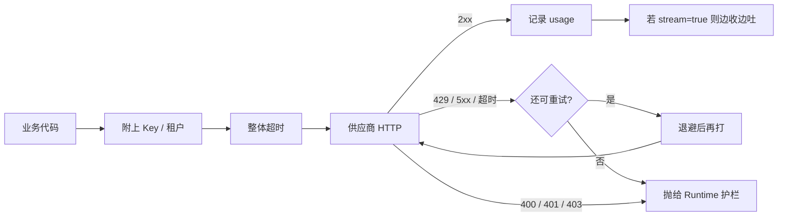
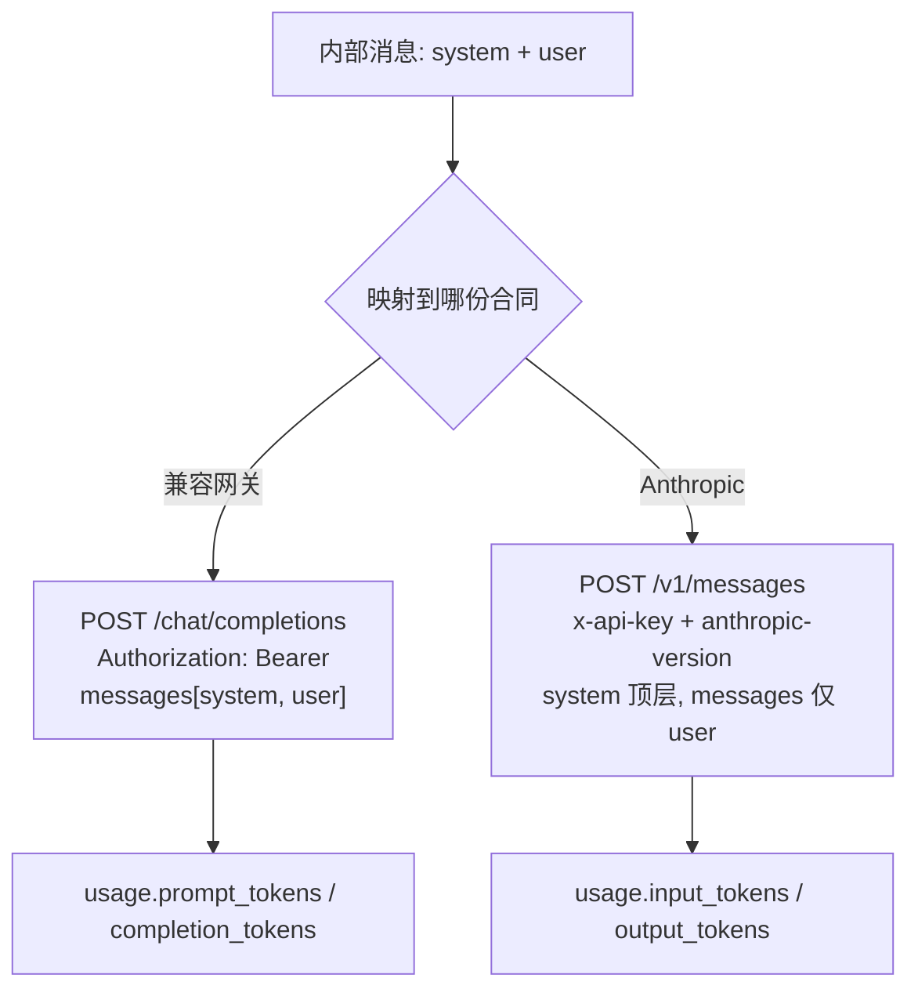

# 第 5 章 第一次调用大模型：OpenAI / Anthropic / 国产接口

> 本章定位：第二卷开篇。第一卷把 Agent 拆成循环和协议；从这里起，思考器换成 **真的远程模型**。读完后，你要能独立打通一家 OpenAI 兼容接口，说清它和 Anthropic 差在哪几个字段，并能解释 Token、流式、超时重试分别解决什么问题。
>
> 前置：会发 HTTP 请求，读过第 1 章「调用一次大模型」更顺。没有 API Key 也能跑本章三例——它们会打印将要发出的请求，并解析教学响应。
>
> 配套代码：`code/ch05/python/`、`code/ch05/java/`
>
> 图表假设：字段按 2026 年仍广泛使用的 Chat Completions 与 Anthropic Messages 描述。模型名、单价、网关地址以各官网为准；文中价格表是 **教学示意价**，不是报价单。

---

## 5.1 大模型 API 到底卖的是什么

### 直觉解释

你买到的不是「一个永远在线、包月加班的同事」，而是三次计费单元叠在一起的远程函数：

1. **输入 Token（Input / Prompt tokens）**：你送进去的系统提示、用户话、历史、工具描述
2. **输出 Token（Output / Completion tokens）**：模型吐出来的字，通常比输入贵
3. **延迟与配额**：同一秒能打多少下、首字多慢、会不会 429

还可以附赠：上下文窗口有多长、是否支持工具协议、是否支持视觉、数据是否用于训练。这些是产品差异，账单上最硬的仍是 Token。

所以「换一个更聪明的模型」在工程上先翻译成三句话：更贵还是更便宜、更慢还是更快、上下文能不能放下我的检索结果。聪明是结果，不是 SKU 名称。

### 生活类比：菜市场，不是包厨

包厨是月薪：人在厨房，你不管他切了多少菜。

大模型 API 更像菜市场：青菜按斤，进口牛肉按克，打包袋另算。你把菜谱（Prompt）和食材（上下文）推过柜台，摊主按 **进货重量 + 成品重量** 收钱。同一道菜，你把冰箱里三年的聊天记录全倒上去，重量会吓你一跳。

流式输出像摊主切一刀递一刀：你先看到第一片姜，不用等整盘炒完。体验好了，但斤两还是要称的——流式一般 **不会更便宜**，只是更早看到字。

### 原理剖析：一次调用在卖什么

一次 `chat/completions` 大致发生这些事（教学模型，不是某家机房内部图）：

1. 鉴权：Key 是否有效、账户是否欠费
2. 安全与策略：输入是否触线、是否超上下文
3. 推理：在 GPU/加速器上生成 Token
4. 计量：写下 `usage`，从余额扣费

你在日志里最该盯的不是「回答好不好」这一句文学评价，而是：

- `usage.prompt_tokens` / `completion_tokens`（Anthropic 叫 `input_tokens` / `output_tokens`）
- `finish_reason`：`stop` 正常结束，`length` 被最大长度截断，`tool_calls` 要点菜
- 延迟：到首字节（TTFT, Time To First Token）和到结束

第 28 章会把这些做成成本看板。本章先让你每次调用都把 `usage` 打出来——这是职业习惯，不是作业要求。

---

## 5.2 OpenAI Chat Completions 最小可运行示例

第 1 章已经用 SDK 打过一次招呼。本章补上 **电线上的地址和字段**，并让国产兼容网关能直接换底座。

默认地址：

```text
POST {OPENAI_BASE_URL}/chat/completions
Authorization: Bearer {OPENAI_API_KEY}
```

官方默认 `OPENAI_BASE_URL=https://api.openai.com/v1`。把 Base URL 和 Key 换成另一家兼容网关，**请求体往往不用改**。这就是「OpenAI 兼容」四个字的含金量。

最小请求体：

```json
{
  "model": "gpt-4o-mini",
  "temperature": 0.2,
  "messages": [
    {"role": "system", "content": "你是技术导师。用中文，先结论后理由。"},
    {"role": "user", "content": "大模型 API 到底在卖什么？"}
  ]
}
```

最小响应里你要会读的三块：`choices[0].message.content`、`choices[0].finish_reason`、`usage`。

`temperature` 接近 0 更稳，适合工具参数和评测；调高更发散，适合头脑风暴。Agent 默认先用低温度，除非产品要「有文采」。

---

## 5.3 Anthropic Messages API 的差异点

Anthropic 不走 `/chat/completions`，而走：

```text
POST https://api.anthropic.com/v1/messages
x-api-key: {ANTHROPIC_API_KEY}
anthropic-version: 2023-06-01
```

同一轮对话，字段要搬家：

| 概念 | OpenAI 兼容 | Anthropic Messages |
| --- | --- | --- |
| 系统提示 | `messages` 里 `role=system` | 顶层字段 `system` |
| 对话 | `user` / `assistant` / `tool` | `user` / `assistant`；工具是 content block |
| 最大长度 | 常可省略，看模型默认 | **通常必填** `max_tokens` |
| 文本结果 | `choices[0].message.content` | `content[]` 里 `type=text` 的块拼起来 |
| 结束原因 | `finish_reason` | `stop_reason`（如 `end_turn`） |
| 用量 | `prompt_tokens` / `completion_tokens` | `input_tokens` / `output_tokens` |
| 鉴权 | `Authorization: Bearer` | `x-api-key` + `anthropic-version` |

不是谁更高档，是两份合同。写适配器的人，工作就是 **把你内部的 Message 模型映射到其中一份合同**。不要在业务代码里直接散落两种字段名。

工具协议的差异第 4 章对比表已经提过：OpenAI 用 `tool_calls`，Anthropic 用 `tool_use` / `tool_result`。本章先把「纯文本一轮」打通。

---

## 5.4 国产模型与 OpenAI 兼容网关

国内常见路径是：申请各家 Key，把 SDK 的 `base_url` 指过去，模型名换成 `deepseek-chat`、`qwen-plus`、`moonshot-v1-8k` 等。

下表是 **2026-09 教学用入口示意**，上线前请核对该公司当前文档（路径、是否必须带 `/v1`、模型名都可能变）。

| 供应商 | 典型兼容 Base URL（示意） | 典型模型名（示意） | 你要核对的坑 |
| --- | --- | --- | --- |
| OpenAI | `https://api.openai.com/v1` | `gpt-4o-mini` 等 | 账号地区、数据驻留 |
| DeepSeek | `https://api.deepseek.com/v1` | `deepseek-chat` | Key 与 URL 必须成对 |
| 阿里云通义 | `https://dashscope.aliyuncs.com/compatible-mode/v1` | `qwen-plus` 等 | 要用 **兼容模式** 地址，不是老 DashScope 路径 |
| 月之暗面 | `https://api.moonshot.cn/v1` | `moonshot-v1-8k` 等 | 上下文档位和价格绑在模型名上 |
| Anthropic | 不走兼容层（见 5.3） | `claude-sonnet-4-5` 等 | 字段与鉴权都不同 |

铁律：

> **A 家的 Key 配 B 家的 Base URL，是本章第一名事故。** 报错可能是 401，也可能是一段让人误会的 HTML。

企业里还有第三种底座：自建网关（把多家模型收成一个内部 OpenAI 形状）。对应用开发者，这仍是改 Base URL。对平台组，这是第 28、32 章的事。

---

## 5.5 鉴权、超时、重试、流式输出

### 图 1：一次调用在客户端该有的外壳

假设：业务代码不直接裸 `requests.post`，外面至少包鉴权、超时、重试分类、用量记录。



**鉴权：** Key 只放环境变量或密钥托管，不进 Git。Java 用 `System.getenv`，Python 用 `.env`（且 `.env` 已在仓库 gitignore）。

**超时：** 要同时设连接超时和读超时。只设连接超时，模型慢慢吐字时线程会挂到天荒地老。Agent 循环的「整轮超时」（第 2 章）必须 **大于** 单次模型超时，否则永远走不到模型返回。

**重试：** 只对瞬时错误。教学名单：`408/409/429/500/502/503/504` 以及网络断开。`400` 是你的请求写错了，`401/403` 是钥匙或权限问题——再试就是重复交学费。第 4 章对 `PERMISSION_DENIED` 禁止重试，是同一原则。

**流式（Streaming）：** 响应变成 **SSE（Server-Sent Events）**。每一行常见形状：

```text
data: {"choices":[{"delta":{"content":"先"}}]}
data: {"choices":[{"delta":{"content":"出字"}}]}
data: [DONE]
```

产品上用来先画「正在输入」。协议上，你仍要拼完整字符串，才能做结构化解析。流式中途断线：要么当失败重试（注意可能已经生成了一半，会多花钱），要么把已收文本当不完整结果交给 Planner。

### 图 2：OpenAI 兼容 vs Anthropic 的请求骨架

假设：同一句系统提示 + 同一句用户问题，不带工具。



---

## 5.6 Python SDK 与 Java HttpClient

### 环境要求

| 项目 | 版本 / 说明 |
| --- | --- |
| Python | 3.10+；`openai>=1.51,<2`，`httpx>=0.27,<1`，`python-dotenv>=1.0.1` |
| Java | 17+，Maven 3.9+，`jackson-databind 2.17.2` |
| Key | 可选。无 Key 走教学解析；有 Key 发真请求 |
| Windows | 中文乱码时 `chcp 65001` |

把 `code/ch05/python/.env.example` 复制为 `.env`。Java 读的是操作系统环境变量，可在 PowerShell 里 `$env:OPENAI_API_KEY="..."`。

Spring WebClient 与 `HttpClient` 在本章是同一条 HTTP，只是回到 Spring 里更好接滤器和指标。示例故意用 JDK `HttpClient`，避免你以为「必须先上 WebFlux」。

---

### 示例 1（Python）：OpenAI 兼容，无 Key 也能看懂电线

完整文件：`code/ch05/python/01_openai_compatible.py`

```python
def payload(question: str, model: str) -> dict:
    return {
        "model": model,
        "temperature": 0.2,
        "messages": [
            {"role": "system", "content": "你是技术导师。用中文，先结论后理由，三句以内。"},
            {"role": "user", "content": question},
        ],
    }
```

有 Key 时：

```python
client = OpenAI(
    api_key=os.environ["OPENAI_API_KEY"],
    base_url=os.getenv("OPENAI_BASE_URL", "https://api.openai.com/v1"),
    timeout=30.0,
)
response = client.chat.completions.create(**payload(question, model))
```

```bash
cd code/ch05/python
python -m pip install -r requirements.txt
python 01_openai_compatible.py
```

Windows 上若提示找不到 `pip`，用上面的 `python -m pip`，不要只敲 `pip`。

无 Key 时你会看到：POST 地址、完整 JSON、粗估输入 Token，以及一份教学响应的 `usage`。换 DeepSeek 只需：

```env
OPENAI_API_KEY=sk-...
OPENAI_BASE_URL=https://api.deepseek.com/v1
OPENAI_MODEL=deepseek-chat
```

Java 对照：`OpenAICompatible.java`

```powershell
cd code/ch05/java
mvn -q -DskipTests compile exec:java "-Dexec.mainClass=com.agentbook.ch05.OpenAICompatible"
```

---

### 示例 2（Python）：同一轮对话，两份合同

完整文件：`02_anthropic_shape.py`。核心不是「调用成功」，而是 **对照打印**。

```python
def as_openai(conv: dict, model: str) -> dict:
    return {
        "model": model,
        "messages": [
            {"role": "system", "content": conv["system"]},
            {"role": "user", "content": conv["user"]},
        ],
    }


def as_anthropic(conv: dict, model: str) -> dict:
    return {
        "model": model,
        "max_tokens": 256,
        "system": conv["system"],
        "messages": [{"role": "user", "content": conv["user"]}],
    }
```

真打 Anthropic 时，示例故意用 `httpx` 而不是官方 SDK，为了让你看见 `x-api-key` 和 `anthropic-version`：

```python
headers = {
    "x-api-key": os.environ["ANTHROPIC_API_KEY"],
    "anthropic-version": os.getenv("ANTHROPIC_VERSION", "2023-06-01"),
    "content-type": "application/json",
}
response = client.post("https://api.anthropic.com/v1/messages", headers=headers, json=body)
```

解析文本时不要假设 `content` 是字符串：

```python
texts = [block["text"] for block in raw.get("content", []) if block.get("type") == "text"]
```

```bash
python 02_anthropic_shape.py
```

Java 对照：`AnthropicShape.java`

```powershell
mvn -q exec:java "-Dexec.mainClass=com.agentbook.ch05.AnthropicShape"
```

**Python / Java 差异：** Python 官方 `openai` SDK 会帮你重试和拼 URL；Java 示例手写 `HttpClient`，URL 漏掉 `/v1` 或多一个斜杠会 404。生产 Java 可以用官方 SDK 或 Spring `WebClient`，但你必须先能手写这一份，面试白板才画得动。

---

### 示例 3（Python / Java）：流式、重试、把 Token 折成钱

完整文件：`03_stream_retry_cost.py`、`billing.py`、`StreamRetryCost.java`。

可重试集合：

```python
def retryable(status_code: int | None) -> bool:
    return status_code in {408, 409, 429, 500, 502, 503, 504}
```

无 Key 时回放 SSE，你会在终端上看到字一个个出来，最后一行是教学示意费用。有 Key 时走真流式；若网关不支持 `stream_options.include_usage`，Python 会降级并改用粗估。

Token 粗估（不能替代官方 tokenizer）：

```python
def estimate_tokens(text: str) -> int:
    ascii_chars = sum(1 for ch in text if ord(ch) < 128)
    other_chars = len(text) - ascii_chars
    return max(1, int(ascii_chars / 4 + other_chars / 1.6))
```

```bash
python 03_stream_retry_cost.py
```

```powershell
mvn -q exec:java "-Dexec.mainClass=com.agentbook.ch05.StreamRetryCost"
```

`billing.py` 里的单价是教学示意。把数字改成你控制台里的报价，这个小函数就能进周报。

---

## 5.7 Token、上下文窗口、价格怎么算

**Token** 是模型的计费与上下文单位，不等于汉字、不等于英文单词。中文常常「几个字一个 Token」，英文常常「一个词一个多 Token」。不要用「字数 ÷ 1」做预算。

**上下文窗口（Context window）** 是单次请求里输入+输出（有的家还含思维链）能装下的上限。窗口是 128K 不代表你应该每次塞 128K：越满越贵、越慢、越容易把关键指令挤到角落。

粗算一笔账：

```text
费用 ≈ 输入Token × 输入单价 + 输出Token × 输出单价
```

Agent 会把这笔账乘上 **步数**。第 3 章 ReAct 走 6 步，就不是「一次聊天的钱」。这是为什么 Runtime 要有最大步数。

`finish_reason=length` 表示被截断：账单已经产生，答案却缺尾巴。对策是提高 `max_tokens`、缩短输入，或改成「先大纲再分段生成」。

教学示意价（USD / 1M Token，假设读取 2026-09，**不是报价**）：

| 模型（示意） | 输入 | 输出 | 适合放哪 |
| --- | --- | --- | --- |
| `gpt-4o-mini` / 多数国产 chat | 较低 | 较低 | 分类、抽槽、日常 Agent 步 |
| 中等 chat（如部分 plus / sonnet 档） | 中 | 中高 | 难推理、长计划 |
| 旗舰档 | 高 | 很高 | 终审、生成长文，不要每步都用 |

真实数字以控制台为准。面试官听的是 **你会不会分级**，不是你背的单价是否精确到分。

---

## 踩坑提醒与职场视角

**坑 1：Key 和 Base URL 张冠李戴。**  
先打印将 POST 的完整 URL（示例 1 已做），再查 401。

**坑 2：只测「能回一句中文」就宣布对接完成。**  
至少断言：`content` 非空、`usage` 可解析、超时会失败、400 不重试。这是最低集成测试。

**坑 3：把思维链或工具参数的流式半成品直接 `json.loads`。**  
流式结束前不要当完整 JSON。结构化输出留给第 8 章，用非流式或拼完再解析。

**坑 4：在循环里对 401 重试 20 次。**  
钥匙错了，重试是刷监控和刷账单。

**坑 5：忽略 `finish_reason`。**  
截断、安全拒绝、要点工具，看起来都像「回了一段话」。不看原因，Agent 会把半截 JSON 当结论。

**坑 6：上下文里堆全文日志。**  
窗口没爆之前，账单先爆。摘要、槽位、检索片段，是第 9、13 章的主题，本章先养成「每次看 usage」的肌肉记忆。

### 简历上可以写的一句

> 打通 OpenAI 兼容与 Anthropic Messages 两套协议；客户端具备超时、分类重试与流式；每次调用记录 usage 并按示意单价估算成本。能说明国产兼容网关只换 Base URL/模型名，不能换错 Key。

第二卷后面的 Prompt、Function Calling 实战、结构化输出，都假设你已经有这个客户端外壳。

### 本章小结

- API 卖 Token、延迟和配额；「聪明」是选用结果。
- OpenAI 兼容是企业默认合同；Anthropic 要改 URL、头和 system 位置。
- 国产大多兼容第一份合同，事故之源是 Key 与 URL 不成对。
- 重试看状态码；流式改善体验不减免计量。
- 每次调用打印 `usage`，Agent 的钱是步数乘出来的。

---

## 5.8 常见面试考点

> **高频原题：**「你们线上怎么接大模型？超时、限流、账单怎么处理？」
>
> **90 秒答法：**
> 应用不直连多家字段，内部先有自己的消息模型，再映射到 OpenAI 兼容或 Anthropic Messages。客户端设连接/读超时，只对 429 和 5xx 做有限退避重试，400/401 直接失败。生产请求打 usage 日志，按输入输出单价估算，Agent 再乘步数。用户侧能流式就流式，但工具参数和 JSON 等拼完再解析。Key 走环境变量或密钥服务，Base URL 与 Key 成对配置。
>
> **追问 1：**「Token 是什么？」  
> 模型的计费和上下文单位，不等于字或词。以响应 usage 为准，本地估算只能做预算。
>
> **追问 2：**「为什么输出比输入贵？」  
> 生成比编码更吃推理；产品上也在抑制废话。所以要限制 `max_tokens`、低温度、能用小模型就不用旗舰。
>
> **追问 3：**「兼容接口是不是 100% 兼容？」  
> 不是。模型名、工具字段子集、流式 usage、最大上下文都可能差。用最小集成测试护住，而不是相信营销页上的「完全兼容」。

---

## 5.9 课后练习（含答案提示）

**练习 1：对照两份 JSON（必做）**  
不改业务含义，把示例 2 的用户问题换成「请用一句话定义 Token」，手写 OpenAI 与 Anthropic 两份请求体（含 system）。

- 提示：Anthropic 必须有 `max_tokens`；system 不在 messages 里。
- 自检：把两份 JSON 给同事，对方能指出鉴权头还少了什么。

**练习 2：换底座（必做，有 Key）**  
用同一脚本分别打官方 OpenAI **或** 一家国产兼容。只改 `.env` 三行，不改 Python/Java 业务代码。把两次 `usage` 记下来。

- 提示：若 401，先核对 URL 是否带 `/v1`、Key 是否属于这家。
- 无 Key：把示例 1 的教学响应改成「只有 content、没有 usage」，补一段防御性解析。

**练习 3：重试白名单（必做）**  
写 6 个断言：400、401、403、429、500、超时，哪些该重试。对照 `retryable()`。

- 提示：只有瞬时失败。把结论写成表格贴进笔记，面试可直接背。
- 延伸：429 要读 `Retry-After`。有则听它，无则指数退避。

**练习 4：给领导算一笔账（必做）**  
假设客服 Agent 每单平均 8 次模型调用，每次 800 输入 + 200 输出 Token，每天 2000 单，用 `gpt-4o-mini` 的教学示意价。算出日费用区间，并写一句降本建议。

- 提示：`billing.cost_usd("gpt-4o-mini", 800, 200) * 8 * 2000`。
- 降本：小模型做分类、缓存重复问、缩短系统提示、限制步数。第 28 章展开。

---

## 本章质量自检

| 检查项 | 结论 |
| --- | --- |
| 零基础读者能否不看前文就懂？ | 从「API 卖 Token」讲起；无 Key 可跑教学路径。 |
| 代码能否直接复制运行？ | 无 Key 走 dry-run；有 Key 发真请求。依赖版本已标明。 |
| 是否有职场 / 面试落点？ | 5.7 分级、5.8 九十秒答法、简历句、练习 4 账单。 |
| 图表是否标注假设？ | 图 1、图 2 与价格表均标明教学示意，入口以官网为准。 |

---

## 你现在应该能做的事

- [ ] 说出 API 卖的三样东西：输入 Token、输出 Token、延迟/配额
- [ ] 默写 OpenAI 兼容与 Anthropic 在 system / 鉴权 / usage 上的差异
- [ ] 跑通三例（无 Key 亦可）
- [ ] 列出可重试与不可重试的状态码
- [ ] 每次调用都想起来看 `usage`

下一章把「messages 里那些句子」当成可测试的接口契约来写：Prompt Engineering 实战。

回复 **「继续」** 进入第 6 章：《Prompt Engineering 实战：让模型听懂你的目标》。
