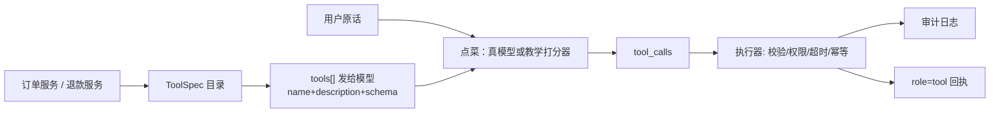
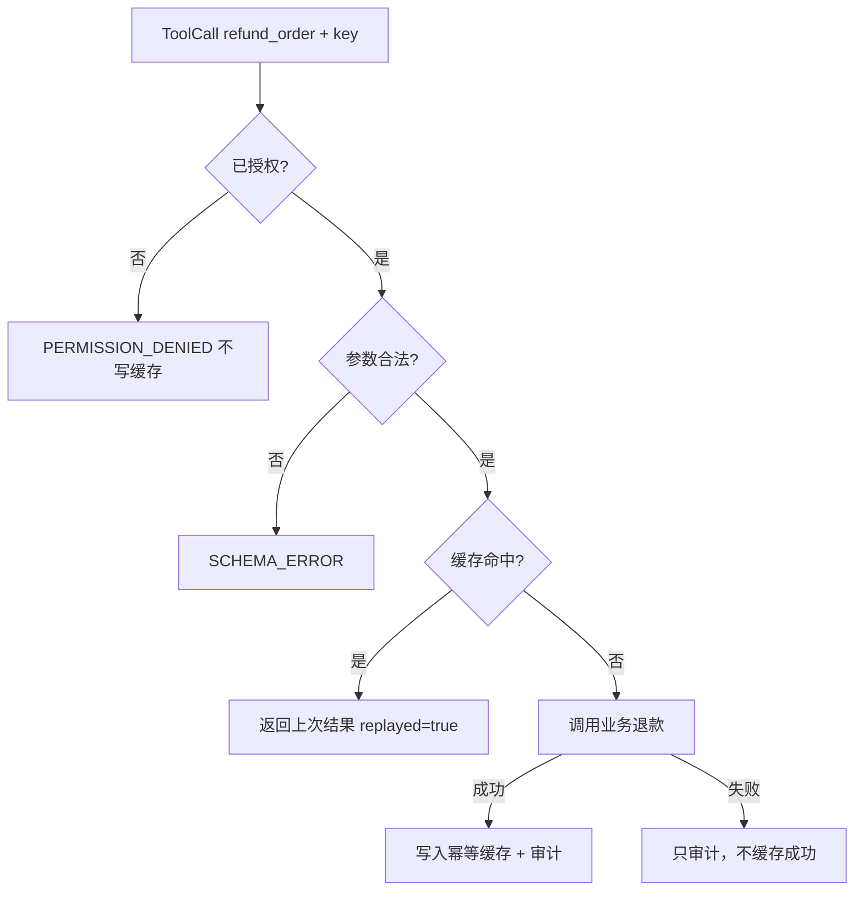

# 第 7 章 Function Calling 深度实践

> 本章定位：第 4 章讲清了电线上的协议；本章把 **业务能力** 包装成模型愿意点、执行器敢跑、出了事故能回放的工具。读完后，你要能写出带「何时用 / 何时不用」的菜单，解释咨询为什么不该点退款，并给写操作加上幂等键和审计。
>
> 前置：知道 `tools` / `tool_calls` / 权限三档。不需要 API Key。点菜器用关键词模拟「只靠说明书选工具」；换真模型后，菜单字段可以原样留下。
>
> 配套代码：`code/ch07/python/`、`code/ch07/java/`
>
> 图表假设：点菜器是教学用打分器，不是某家模型的真实对齐；售后数据为虚构种子。幂等缓存放在单进程内存，不是 Redis。

---

## 7.1 把业务能力包装成工具

### 直觉解释

第 4 章的 handler 已经是真函数。深度实践要问的是另一句：

> **哪些业务能力配出现在菜单上？以多大颗粒度出现？**

不是把 Service 里 80 个方法全暴露。菜单是给模型的 API，模型只会读 `name` + `description` + JSON Schema。颗粒度太大（`do_stuff(q)`）会乱点；太碎（`set_order_field_17`）会让模型不会组合。

一条经验：

- **只读查询** 按资源拆：订单、政策、库存
- **写入** 按用户能理解的业务动作拆：退款、改地址、发通知
- **不要** 把「处理售后」做成一个万能工具

包装时，工具是 **业务能力的门面**，不是数据库列的镜像。门面后面可以调用三个微服务，模型不需要知道。

### 生活类比：餐厅菜单 vs 后厨货架

后厨货架上有 200 种调料。菜单上只有「宫保鸡丁 / 清蒸鱼 / 退单」。客人（模型）按菜单点；厨师长（执行器）决定能不能做、用哪口锅、是否重复下单。

把货架直接复印成菜单，客人会点「十三香 3 克」。那不是好工具设计。

### 原理剖析：一个工具对象要比协议字段更厚

第 4 章的 `ToolSpec` 有 name、description、parameters、risk、handler。本章再补四刀，它们不都发给模型，但都要在仓库里：

| 字段 | 发给模型？ | 作用 |
| --- | --- | --- |
| `when_to_use` / `when_not` | 写进 description | 降低点错菜 |
| `timeout_seconds` | 否 | 单工具超时，别让一轮 Runtime 卡死 |
| `idempotent` | 否 | 写操作能否安全重放 |
| `keywords` / 评测用例 | 否 | 教学点菜、回归「会不会点错」 |

发给模型的 description 建议拼成一句完整说明书：**做什么 + 何时用 + 何时不用**。模型看不到你的 wiki。

---

## 7.2 工具命名、描述质量与参数设计

**命名：** 动词 + 资源，`get_order` / `search_policy` / `refund_order`。避免 `do_stuff`、`handle`、`process`、`tool1`。

**描述：** 写给「没读过你们内部文档的实习生」。包含：副作用有无、典型订单号长什么样、禁止场景。

**参数：** 少而硬。要 `order_id` 就别让模型自由发挥 `q`。枚举能用则用（`leave_type`: 年假/事假）。单位写进 description（人民币、小时）。

**反模式：**

- 一个字符串参数装整段用户原话，内部再解析——那是把工具退回成 Prompt
- 必填参数其实可选，模型乱填默认值
- 两个工具名字像近义词：`refund` 与 `create_refund`，模型会掷骰子

---

## 7.3 多工具选择：模型怎么「点菜」

模型点菜，本质是 **在菜单文本和用户话之间做匹配**。你没有开源它的脑子，但可以当它是一个「只读说明书的实习生」：

- 说明书越像用户的动词，越容易被点
- 咨询语气（「能不能退」）若只出现在 `search_policy` 的使用时机里，就不该点 `refund_order`
- 菜单越短，点错越少——所以权限不够的工具，干脆不要出现在本次 `tools` 里（第 4 章已说）

真模型还会看 few-shot 和历史 tool 结果。本章用关键词打分模拟「说明书匹配」，用来对比坏菜单和好菜单，不冒充评测分数。

### 图 1：从业务方法到一次点菜

假设：用户说「ORDER-88 确认未发货，给我退。」



---

## 7.4 工具执行层：校验、超时、幂等、审计

协议层（第 4 章）保证「点菜单合法」。执行层保证「上菜可追责」。

**校验：** Schema、类型、未声明参数。坏单不进业务。

**超时：** 每个工具自己的超时。库存接口 200ms 该熔断，不要用 Runtime 的 5 秒整轮超时去兜。

**幂等（Idempotency）：** 同一业务意图重试，副作用只发生一次。网络抖动、Agent 重试、用户连点，都会把 `refund_order` 打两遍。执行器若看见相同幂等键且上次成功，直接回放结果，不写第二笔台账。

**审计：** 谁、哪个工具、风险档、耗时、是否回放、错误码。这是第 27 章 Trace 的最小切片，也是事故复盘的第一页。

权限拒绝、Schema 错误 **不要** 当成功写入幂等缓存，否则一次误点会锁死正确重试。

### 图 2：资金工具的幂等路径

假设：两次 `refund_order` 使用同一 `idempotency_key=refund-88-user`。



---

## 7.5 与第 4 章原理的对照

| 第 4 章 | 第 7 章补上的 |
| --- | --- |
| `tool_calls` 是意图 | 意图从哪来：菜单写没写清「何时不用」 |
| Schema + 三档权限 + 瞬时重试 | 单工具超时、幂等键、审计事件 |
| 并行回执按 id | 多工具选择：咨询 vs 执行要拆开 |
| Mock 协议消息 | 业务目录：查单 / 政策 / 退款 |

第 4 章回答「手怎么伸出去」。本章回答「菜单怎么写，后厨怎么不出两份菜」。

---

## 7.6 Python / Java 实现

### 环境要求

| 项目 | 版本 / 说明 |
| --- | --- |
| Python | 3.10+，标准库（超时用 `ThreadPoolExecutor`） |
| Java | 17+，Maven 3.9+，无第三方依赖 |
| API Key | 不需要 |

---

### 示例 1：坏菜单和好菜单

完整文件：`code/ch07/python/01_tool_design.py`、`catalog.py`。

好工具的 description 必须把 `when_not` 拼进去：

```python
def as_openai_tool(self) -> dict[str, Any]:
    description = f"{self.description} 使用时机: {self.when_to_use} 不要用于: {self.when_not}"
    return {"type": "function", "function": {"name": self.name, "description": description, "parameters": self.parameters}}
```

```bash
cd code/ch07/python
python 01_tool_design.py
```

对比 `do_stuff(q)` 和拆开的 `get_order` / `search_policy` / `refund_order`。发给模型的第一份 tools JSON 会被打印出来。

Java：`ToolDesign.java`

```powershell
cd code/ch07/java
mvn -q -DskipTests compile exec:java "-Dexec.mainClass=com.agentbook.ch07.ToolDesign"
```

---

### 示例 2：三句用户话，两种菜单

完整文件：`02_tool_picker.py`。教学打分只看 `keywords` 是否出现在用户话里——这是在模拟「说明书里的动词被点中」。

```python
CASES = [
    "查一下 ORDER-88 发货了吗",
    "未发货缺货，能不能退款？",
    "ORDER-88 确认未发货，给我退。",
]
```

```bash
python 02_tool_picker.py
```

预期（教学假设）：

| 用户话 | 坏菜单 | 好菜单 |
| --- | --- | --- |
| 查发货 | 对不上 / 乱点 | `get_order` |
| 能不能退 | 对不上 / 乱点 | `search_policy`（咨询） |
| 给我退 | 对不上 / 乱点 | `get_order` + `refund_order` |

把「能不能退」和「给我退」写成两个关键词集，是描述设计，不是模型魔法。真模型换上同一份 description，行为应接近这个方向；若总把咨询当成退款，先改菜单再怪模型。

Java：`ToolPicker.java`

```powershell
mvn -q exec:java "-Dexec.mainClass=com.agentbook.ch07.ToolPicker"
```

---

### 示例 3：超时、幂等、权限、审计

完整文件：`03_executor_audit.py`、`executor.py`。

```python
first = executor.execute(ToolCall("c2", "refund_order", {"order_id": "ORDER-88"}, idempotency_key="refund-88-user"))
second = executor.execute(ToolCall("c3", "refund_order", {"order_id": "ORDER-88"}, idempotency_key="refund-88-user"))
```

```bash
python 03_executor_audit.py
```

预期：

1. 查单成功，只读审计
2. 第一次退款，`REFUNDS` 长度为 1
3. 同一 key 再退，`replayed=true`，台账仍为 1
4. 空授权名单 → `PERMISSION_DENIED`
5. `slow_lookup` sleep 0.35s、限额 0.1s → `TIMEOUT`

Java：`ExecutorAudit.java`

```powershell
mvn -q exec:java "-Dexec.mainClass=com.agentbook.ch07.ExecutorAudit"
```

**Python / Java 差异：** 两边都用单线程池 + `future.get(timeout)` 包住 handler。Python 超时后线程可能仍在跑，教学上忽略；生产要用可取消的客户端超时（HTTP read timeout）。幂等缓存生产应落到 Redis / 业务表，带 TTL 和用户维度，不能只放内存。

---

### 对照表：工具设计清单

| 检查项 | 不合格 | 合格 |
| --- | --- | --- |
| 名字 | `do_stuff` / `handle` | `get_order` / `refund_order` |
| 描述 | 「处理用户问题」 | 做什么 + 何时用 + 何时不用 + 有无副作用 |
| 参数 | 万能 `q: string` | 业务主键、枚举、单位 |
| 咨询 vs 执行 | 一个工具两种语气 | 政策查询与退款分开 |
| 重试写操作 | 直接再调 handler | 幂等键 + 缓存/唯一约束 |
| 超时 | 只靠整轮 30s | 每工具独立超时 |
| 出事之后 | 只有模型对话 | 审计：工具、风险、耗时、是否回放 |

---

## 踩坑提醒与职场视角

**坑 1：把内部方法名直接当工具名。** `OrderBizServiceImpl.updateExt` 模型读不懂。

**坑 2：description 写「见内部文档」。** 等于没有工具。

**坑 3：退款接口不幂等，却在 Agent 里对超时自动重试。** 第 5 章的重试白名单遇上资金工具会双倍退款。执行层必须先幂等，再谈重试。

**坑 4：超时后当成功。** 钱可能已经扣了，回执却是 TIMEOUT。资金单要可查询、可对账，不能只信这一次返回。

**坑 5：审计只记「调用了工具」，不记参数哈希和幂等键。** 复盘时分不清是重放还是新单。

**坑 6：菜单随会话膨胀，把用户没权限的工具也放进去。** 靠 Prompt 说「请不要退款」挡不住点菜。

### 简历上可以写的一句

> 将售后能力拆成只读查询与资金动作两套工具，description 写清何时不用；执行器实现权限、单工具超时、幂等键去重与审计。能用用例证明「能不能退」不会触发退款。

这是第 31 章「业务办理工作流」简历项目的工具层骨架。

### 本章小结

- 工具是业务门面，不是 Service 清单。
- 说明书必须含何时不用；咨询和执行要拆开。
- 执行器在协议之上补超时、幂等、审计。
- 写操作的重试前提是幂等，不是勇气。

---

## 7.7 常见面试考点

> **高频原题：**「如何设计 Agent 的工具？如何避免模型乱退款、重复退款？」
>
> **90 秒答法：**
> 按用户能理解的业务动作拆工具，只读与资金分开。description 写清做什么、何时用、何时不用，参数用业务主键而不是万能字符串。本次请求只挂用户有权使用的工具。执行器先做 Schema 和权限，资金工具必须带幂等键，命中则回放；每个工具有独立超时；所有调用写审计。咨询类问句不出现在退款工具的使用时机里。Prompt 只是辅助，闸门在菜单裁剪和执行器。
>
> **追问 1：**「幂等键谁生成？」  
> 最好由业务意图生成：用户 + 订单 + 动作类型，而不是随机 UUID（随机键每次都是新单）。
>
> **追问 2：**「工具是不是越多越智能？」  
> 相反。菜单越长，点错率越高，Token 越贵。先做 5 个准的，再加。
>
> **追问 3：**「和 MCP / 插件市场的关系？」  
> 都是把能力描述给模型。你仍然要描述质量、权限和执行器，不能因为协议叫 MCP 就省略幂等。

---

## 7.8 课后练习（含答案提示）

**练习 1：改一份坏工具（必做）**  
把 `do_stuff` 拆成你熟悉的业务（请假或退货）的 3 个工具，写出 `when_not`。

- 提示：至少一读一写。写工具的 when_not 里要出现「只是问问的时候」。
- 自检：把 description 读给同事听，对方能猜对何时不该点。

**练习 2：补一个「改地址」工具（必做）**  
`update_address(order_id, address)`，risk=write，未发货才能改。给点菜器加关键词，并写：已发货时 handler 应失败还是应先 `get_order`？

- 提示：模型应先查单。执行器也可二次校验 `shipped==false`，双闸。
- 延伸：已发货失败不要写入幂等成功缓存。

**练习 3：幂等键设计（必做）**  
若幂等键改成随机 UUID，再跑示例 3 的两次退款。预测台账长度。

- 提示：会变成 2。所以「每次请求 new UUID」不是幂等。
- 面试句：键必须绑定业务意图。

**练习 4：60 秒口述（必做）**  
画出图 2，并说明 TIMEOUT 之后为什么不能当「没退成」。

- 提示：超时是你没等到回执，不是业务保证回滚。

---

## 本章质量自检

| 检查项 | 结论 |
| --- | --- |
| 零基础读者能否不看前文就懂？ | 从菜单 vs 货架讲起；协议用一句话回扣第 4 章。 |
| 代码能否直接复制运行？ | 三例无 API Key。 |
| 是否有职场 / 面试落点？ | 咨询/执行拆分、幂等、审计、简历句。 |
| 图表是否标注假设？ | 图 1、图 2 标明教学打分器与内存幂等缓存。 |

---

## 你现在应该能做的事

- [ ] 把一个万能 `do_stuff` 拆成合格菜单
- [ ] 解释为什么「能不能退」不该点退款
- [ ] 跑通示例 3，指出台账为何只有一条
- [ ] 说出 TIMEOUT ≠ 未发生副作用

下一章处理另一头：模型不点菜、只说话时，如何逼它吐出可校验的结构。

回复 **「继续」** 进入第 8 章：《结构化输出：让 LLM 说话变得可靠》。
