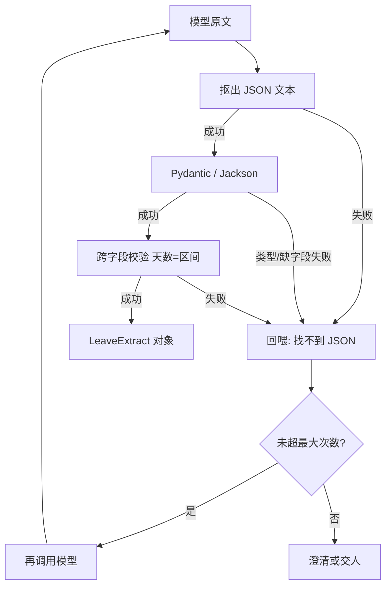
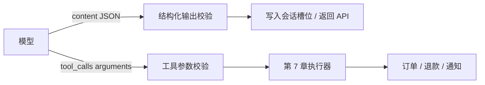

# 第 8 章 结构化输出：让 LLM 说话变得可靠

> 本章定位：第二卷收官。第 6 章把 Prompt 写成契约，第 7 章把工具写成门面；模型若仍用散文交差，下游 Java/Python 服务接不住。本章让「答案」长成 **可校验的对象**。读完后，你要能区分 JSON Mode、Schema、工具强制，并亲手跑通「失败则回喂错误再要一次」的修复循环。
>
> 前置：会 `json.loads` / Jackson `readValue`。不需要 API Key。教学模型按模式吐出散文、残缺 JSON 或合格 JSON。
>
> 配套代码：`code/ch08/python/`、`code/ch08/java/`
>
> 图表假设：供应商能力以 2026 年常见档位描述（JSON Mode、Structured Outputs、tool_choice=required）；具体开关名以官网为准。请假日期按 2026-09-14 周一对齐。

---

## 8.1 为什么「随便生成一段话」进不了生产

### 直觉解释

网页聊天里，一段通顺的中文就是产品。Agent 里，这段话后面往往是：

- 写入数据库的字段
- 下一个工具的参数
- 给前端的状态机事件

散文没有类型。`大概三天` 不能放进 `INT` 列，`下周左右` 不能放进 `DATE`。**结构化输出（Structured Output）** 的意思是：模型的回答必须符合事先声明的形状，并且过得了校验器，否则不准往下走。

第 6 章的输出契约写在 Prompt 里，是软约束。本章把它升级成 **解析 + 校验**，是硬约束。软硬要叠，只靠形容词不够。

### 生活类比：口头报税 vs 报税表

口头说「我今年收入还行，大概几十万」——税务局不收。他们要表格：字段、类型、勾稽关系（天数必须等于起止日期）。

模型是能说人话的填表员。你的工作是：把表头（Schema）递过去，收回来用印章（Pydantic / Jackson）盖「合格 / 退回」。

### 原理剖析：三道会失败的关

1. **根本不是 JSON**：纯散文、前后解释、漏了括号
2. **是 JSON，但缺字段 / 类型错**：`employee` 成了数字，`days` 没了
3. **字段齐，但业务不合法**：周一到周三却写 `days=5`

只做 `json.loads` 只能过第 1 关。生产要过第 3 关。

---

## 8.2 JSON Mode、Schema、工具强制、语法约束解码

工程上常见四条路，从「劝」到「逼」：

| 手段 | 英文 / 常见开关 | 它保证什么 | 它不保证什么 |
| --- | --- | --- | --- |
| Prompt 里写「只输出 JSON」 | Soft prompt | 多数时候像样 | 围栏、前言、字段胡来 |
| JSON Mode | `response_format=json_object` 等 | 大致是一个 JSON 对象 | 字段集合、业务勾稽 |
| Schema / Structured Outputs | 提交 JSON Schema，由服务端约束 | 键、类型、必填更稳 | 跨字段规则（天数=区间）仍要本地校验 |
| 工具强制 | 定义一个「交卷」工具，`tool_choice=required` | 参数按 Schema 走协议 | 这是在点菜，不是在聊天 |
| 语法约束解码 | Constrained decoding / grammar | 生成过程就不允许非法 token | 需要本地推理或特定运行时，成本更高 |

Agent 项目里最实用的组合是：

> **能走 Structured Outputs / 强制工具就走；无论哪条路，落地前用 Pydantic / Jackson 再验一遍，尤其是跨字段规则。**

不要把「开了 JSON Mode」写成简历里的「已保证结构正确」。

---

## 8.3 Pydantic / Jackson 如何接住模型输出

把契约写成类型，而不是写在注释里。

Python（Pydantic v2）示例要点：

```python
class LeaveSlots(BaseModel):
    employee: str = Field(min_length=2)
    start_date: date
    end_date: date
    days: int = Field(ge=1, le=30)
    leave_type: Literal["年假", "事假", "病假"] | None = None

    @model_validator(mode="after")
    def days_match_range(self) -> "LeaveSlots":
        delta = (self.end_date - self.start_date).days + 1
        if delta != self.days:
            raise ValueError(f"days={self.days} 与日期区间 {delta} 天不一致")
        return self
```

`LeaveExtract.model_json_schema()` 可以导出给 Prompt、给 Structured Outputs、给前端文档。**一份契约，三处使用。**

Java 用 record + Jackson 反序列化，再在 `validate()` 里做同样的勾稽。没有 Pydantic 那么「声明式」，但面试官认这个动作：先落到对象，再验业务。

从模型原文到对象，还要一步「抠 JSON」：去掉 ```json 围栏和前后废话。抠出来的字符串仍然可能是坏数据，所以抠完必须进校验器。

---

## 8.4 校验失败后的修复循环

模型第一次交卷不合格，不要直接 500 给用户。常见策略：

1. 把原文和校验错误追加进 messages
2. 明确说「只返回纠正后的 JSON，不要解释」
3. 再要一次，最多 N 次（教学用 3，生产常 1–2）
4. 仍失败则 `need_clarification` 或交人，不要死循环

这和第 3 章 Reflexion 同构：外层评测器是 Schema，教训是 `ValidationError` 文本。也和第 2 章护栏同构：必须有最大次数。

跨字段错误特别适合回喂，因为模型「看」得懂「days=5 但区间只有 3 天」。

### 图 1：从模型原文到业务对象

假设：用户说「下周一到周三请假」。教学路径，不绑定某 SDK 方法名。



---

## 8.5 结构化输出 vs Function Calling：别混为一谈

两者都「长得像 JSON」，面试里最容易被当成一回事。

| 维度 | 结构化输出 | Function Calling |
| --- | --- | --- |
| 目的 | 让 **这一轮答案** 可解析 | 让模型提出 **对外部世界的意图** |
| 典型去向 | 填表、分类、抽槽、路由标签 | 查库、退款、发通知 |
| 副作用 | 默认没有 | 执行器跑起来才有 |
| 协议位置 | `message.content`（或服务端约束后的内容） | `tool_calls[].function.arguments` |
| 校验物 | 答案对象 | 工具参数对象 |
| 失败时 | 修复循环或澄清 | SCHEMA_ERROR 回执，或换工具 |

可以共用 **同一份 Schema**：`LeaveExtract` 既解析聊天内容，也解析某个 `submit_leave_extract` 工具的 arguments。共用的是形状，不是意图。

经验：

- 只要对象、不改世界 → 结构化输出
- 要动手 → Function Calling
- 又要对象又要动手 → 先结构后工具，或工具参数里带齐结构

### 图 2：两种 JSON 的去向



---

## 8.6 Python / Java 完整示例

### 环境要求

| 项目 | 版本 / 说明 |
| --- | --- |
| Python | 3.10+，`pydantic>=2.8,<3` |
| Java | 17+，`jackson-databind` + `jackson-datatype-jsr310` 2.17.2 |
| API Key | 不需要 |

Windows 安装：`python -m pip install -r requirements.txt`

---

### 示例 1：散文、坏 JSON、好 JSON

完整文件：`code/ch08/python/01_prose_fails.py`

```bash
cd code/ch08/python
python -m pip install -r requirements.txt
python 01_prose_fails.py
```

预期：

| 模式 | json.loads | Pydantic |
| --- | --- | --- |
| 纯散文 | 失败 | — |
| 围栏 + `days=5` | 成功 | **拒绝**（区间是 3 天） |
| 字段残缺 | 成功或残缺对象 | 拒绝 |
| 合格 JSON | 成功 | 通过 |

Java：`ProseFails.java`

```powershell
cd code/ch08/java
mvn -q -DskipTests compile exec:java "-Dexec.mainClass=com.agentbook.ch08.ProseFails"
```

---

### 示例 2：一份 Schema，两处接入

完整文件：`02_schema_and_tool.py`。打印 `model_json_schema()`，并证明聊天 JSON 与工具 arguments 能校验成同一个 `LeaveExtract`。

```bash
python 02_schema_and_tool.py
```

Java：`SchemaAndTool.java`（用 Jackson 打出 arguments 再 `validate()`）。

```powershell
mvn -q exec:java "-Dexec.mainClass=com.agentbook.ch08.SchemaAndTool"
```

**Python / Java 差异：** Pydantic 把 Schema 导出、校验、默认值绑在一起；Java 要自己写 `validate()`，并注册 `JavaTimeModule` 才能把 `"2026-09-14"` 变成 `LocalDate`。生产 Java 也可用 `jackson-module-jsonSchema` 或手工维护一份 OpenAPI。重要的是 **对象进系统之前有一关业务校验**。

---

### 示例 3：修复循环

完整文件：`03_repair_loop.py`。教学模型第一次给围栏坏 JSON，看到「校验失败」后改吐合格 JSON。

```python
for attempt in range(1, max_attempts + 1):
    raw = model.complete(messages)
    try:
        return parse_or_raise(raw)
    except (ValidationError, ValueError) as exc:
        messages.append({"role": "assistant", "content": raw})
        messages.append({"role": "user", "content": f"校验失败...错误：{exc}"})
```

```bash
python 03_repair_loop.py
```

预期：第 1 次因 `days` 与区间不一致失败；第 2 次通过；`slots.days == 3`。

Java：`RepairLoop.java`

```powershell
mvn -q exec:java "-Dexec.mainClass=com.agentbook.ch08.RepairLoop"
```

接真模型时，把 `RepairingModel.complete` 换成第 5 章的客户端即可。记得：修复循环会加倍 Token，要计入第 5 章的账单习惯。

---

## 踩坑提醒与职场视角

**坑 1：`json.loads` 成功就 `return`。** 示例 1 的 B 就是给你看的。

**坑 2：开了 JSON Mode 仍把整段日志当 JSON。** 有的模型仍会包一层「好的，如下」。先抠再验。

**坑 3：修复循环不设上限。** 模型和校验器互相抬杠，账单先炸。

**坑 4：把校验错误原文（含系统路径、内部字段）回喂给不可信用户。** 回喂给模型可以，展示给终端用户要翻译成人话。

**坑 5：用结构化输出替代工具执行。** 模型吐出 `{"refunded": true}` 不等于钱已经退。第 4、7 章的闸门还在。

**坑 6：Schema 写 80 个可选字段。** 模型会乱填。必填要少，可选要真的可选。

### 简历上可以写的一句

> 用 Pydantic / Jackson 承接模型输出，校验类型与跨字段规则；失败则有上限的修复循环。能区分结构化输出（答案形状）与 Function Calling（行动意图），两处共用同一份 Schema。

### 第二卷收束

五章拼起来，是「把模型嵌进程序」的最小闭环：

5. 会打 API，会看 usage  
6. Prompt 是可回归的契约  
7. 工具是带幂等和审计的门面  
8. 答案是可校验的对象  

第三卷开始解决「记得住、记得对」：短长期记忆与向量库。

### 本章小结

- 散文不是产品输入；三关：像 JSON、像 Schema、像业务。
- JSON Mode ≠ 业务正确；本地校验不可省。
- 修复循环要有上限，错误要让模型看得懂。
- 结构化输出管答案，Function Calling 管动手，Schema 可以共用。

---

## 8.7 常见面试考点

> **高频原题：**「如何保证 LLM 输出能进你们的 Java / Python 服务？和 Function Calling 有什么区别？」
>
> **90 秒答法：**
> 先定义对象契约，用 Pydantic 或 Jackson 做类型和跨字段校验，不能只 json.loads。能开 Structured Outputs 或强制交卷工具就开，落地仍要本地验。失败则把错误回喂，限制次数，再失败就澄清或交人。Function Calling 是行动意图，结构化输出是答案形状；退款绝不能只靠模型说一句 JSON。两套可以共用 Schema，执行必须走执行器。
>
> **追问 1：**「JSON Mode 够不够？」  
> 只保证大概率是对象，不保证字段和勾稽。不够。
>
> **追问 2：**「校验失败还要不要流式？」  
> 结构任务等拼完再解析。流式适合给用户看的自然语言。
>
> **追问 3：**「日期这种字段怎么防幻觉？」  
> Schema 只能防格式。防编造要靠「不得编造」+ 缺字段走 `need_clarification`，必要时工具去日历服务。第 6 章的拒绝策略仍要保留。

---

## 8.8 课后练习（含答案提示）

**练习 1：加一条勾稽（必做）**  
规定 `end_date >= start_date`，并构造一份结束日更早的 JSON，确认被拒。

- 提示：Pydantic 写在 `days_match_range` 旁；Java 写在 `LeaveSlots.validate`。
- 自检：错误信息要能回喂，不要只抛 `RuntimeException`。

**练习 2：失败形态也结构化（必做）**  
让模型返回 `{"ok": false, "error": "need_clarification"}`（无 slots），补一条解析用例。

- 提示：`LeaveExtract.consistent` 已要求 `ok=false` 必须有 error。
- 延伸：把「缺日期」从第 6 章金标接到这个对象上。

**练习 3：接真模型（选做）**  
用第 5 章客户端，`temperature=0`，把 `LeaveExtract.model_json_schema()` 贴进 system，跑修复循环，记下几次成功、花了多少 usage。

- 提示：有的网关支持 `response_format`。没有就靠 Prompt + 本地校验。
- 账单：修复一次等于多打一轮，写进笔记。

**练习 4：60 秒口述（必做）**  
不看讲义，讲清图 2 两条箭头为什么不能并成一条。录音。

- 对照：左边填表，右边动手。

---

## 本章质量自检

| 检查项 | 结论 |
| --- | --- |
| 零基础读者能否不看前文就懂？ | 从报税表类比讲起；三道关当堂定义。 |
| 代码能否直接复制运行？ | 无 API Key；Pydantic / Jackson 版本已标明。 |
| 是否有职场 / 面试落点？ | 与 FC 辨析、简历句、修复循环成本。 |
| 图表是否标注假设？ | 图 1、图 2 与供应商能力表均为教学模型。 |

---

## 你现在应该能做的事

- [ ] 说出三道关：像 JSON、像 Schema、像业务
- [ ] 跑通三例，指出 B 为什么 loads 成功仍被拒
- [ ] 区分结构化输出与 Function Calling
- [ ] 给修复循环加上上限理由

第二卷结束。回复 **「继续」** 进入第三卷第 9 章：《Agent 的记忆分层》。
