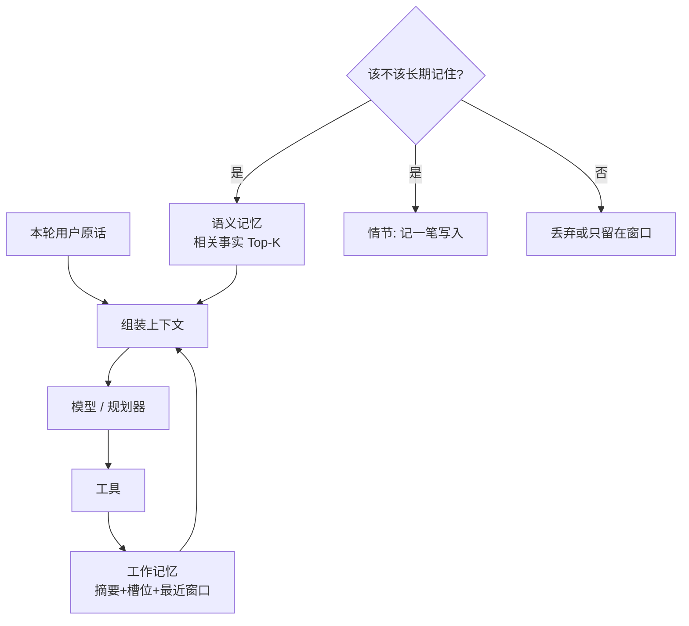
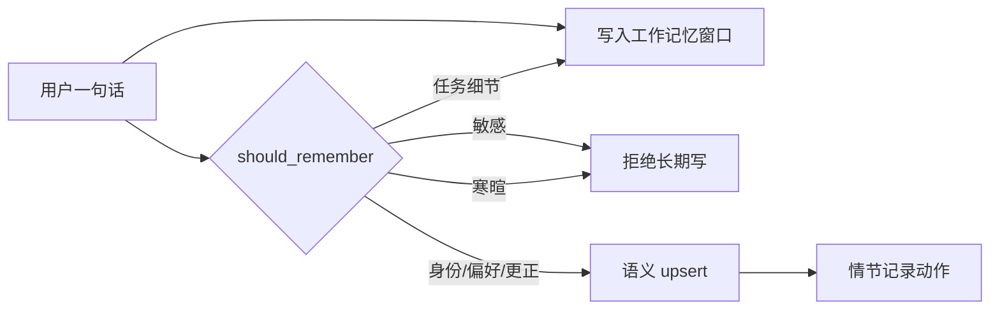

# 第 9 章 Agent 的记忆分层

> 本章定位：第三卷开篇。前面的 Agent 几乎是「金鱼」——一次 `run()` 结束，槽位就消失。读完后，你要能说明为什么聊天记录不是记忆，并能实现最小三层：工作记忆（窗口/摘要/槽位）、情节记忆、语义记忆；还要会写「该不该记住」的闸门。
>
> 前置：理解第 2 章槽位和第 8 章对象校验。不需要向量库、不需要 API Key。第 10 章才上 Chroma。
>
> 配套代码：`code/ch09/python/`、`code/ch09/java/`
>
> 图表假设：分层借用认知科学的工作/情节/语义三分，是工程类比，不是脑科学论文复述。摘要器是截断拼接，不是真 LLM。请假日期按 2026-09-14 周一对齐。

---

## 9.1 为什么 Chat 历史不等于记忆

### 直觉解释

很多人把 `messages` 数组越积越长，称为「给了 Agent 记忆」。那只是 **回放录音**。

真正的记忆要能回答：

- 现在正在办哪张单？（工作状态）
- 上周这人说过什么偏好？（可检索的事实）
- 哪一步曾经失败过？（情节，供反思）
- **哪些东西不该留下？**（密码、验证码、一次性寒暄）

全量历史的问题：

1. **贵**：第 5 章的 Token 按输入计费，回放越长越贵
2. **吵**：关键槽位被「嗯嗯」「在吗」淹没
3. **不安全**：密钥和身份证号会在以后每一轮里反复出现
4. **不可检索**：你没法问「这个用户的工位偏好」，只能把整本日记再喂进去碰运气

所以：**历史是原材料，记忆是提炼后的库存。**

### 生活类比：监控录像 vs 值班日志

监控硬盘里有 24 小时画面，那是历史。值班员写下「林秋，3 天事假，窗口靠过道」才是记忆。领导问情况，你交日志，不交 200GB 录像。

摘要是「昨晚无异常」；槽位是表格字段；情节是「02:13 火警误报已解除」；语义是「本楼消防阀在 B2」。

### 原理剖析：一次请求该带什么

发给模型的上下文，建议只带：

1. 稳定的系统契约（第 6 章）
2. 当前工作记忆打包（摘要 + 槽位 + 最近几轮）
3. 与本轮相关的长期事实（检索结果，第 10 章会换成向量）
4. 本轮用户原话

而不是：开户以来全部对话。

---

## 9.2 工作记忆、情节记忆、语义记忆

工程上够用的三分（名称来自认知科学，**Working / Episodic / Semantic memory**）：

| 层 | 英文 | 保存什么 | 生命周期 | 本章实现 |
| --- | --- | --- | --- | --- |
| 工作记忆 | Working memory | 当前任务的窗口、摘要、槽位 | 一次会话 / 一次办理 | `WorkingMemory` |
| 情节记忆 | Episodic memory | 「发生过什么」带时间戳 | 数天到数月，供审计与反思 | `EpisodicMemory` |
| 语义记忆 | Semantic memory | 稳定事实与偏好 | 跨会话，需冲突策略 | `SemanticMemory` |

工作记忆回答「此刻在干什么」。情节回答「当时怎么走的」。语义回答「这个人/这套规则是什么」。

第 3 章 Reflexion 的 `lessons` 偏情节（这一试怎么失败的）。第 12 章会话状态会把工作记忆做成可恢复的 Session。第 10 章向量库主要强化语义/情节的模糊检索。

### 图 1：三层记忆与一次模型调用

假设：用户接着聊请假，同时库里已有「工位靠过道」。



---

## 9.3 短期记忆：窗口、摘要、关键槽位

短期三件套，常常比一上来上向量库更有用。

**窗口（Sliding window）：** 只保留最近 N 轮原文。实现简单，丢得也狠——第 N+1 轮会忘掉开头那句「我是谁」。

**摘要（Summary）：** 被挤出窗口的内容压成一段话。真项目里用小模型摘要；本章用截断拼接，只为让你看见「折叠发生了」。

**槽位（Slots）：** 结构化字段，如 `employee`、`days`。窗口怎么挤，槽位都还在。这和第 2、8 章的对象是一家亲戚。

三者一起打包进 Prompt，体积远小于全文回放，信息密度更高。

---

## 9.4 长期记忆：写入、检索、遗忘、冲突

长期不是「把摘要再存一遍」。它要有四件事：

1. **写入（Upsert）：** 新事实进库
2. **检索（Retrieve）：** 按键或按关键词（下章按向量）
3. **遗忘（Forget）：** 用户说「不要记工位」，或过期删除
4. **冲突（Conflict）：** 昨天叫凌秋，今天说「其实我是林秋」

冲突策略至少准备三种：新值覆盖、高置信度获胜、保留旧值并标记「待确认」。默认「新值覆盖」最简单，但要在情节里留下旧值，方便审计。

---

## 9.5 「该不该记住」比「怎么存」更难

存储引擎会换（字典 → Chroma → Milvus）。难的是政策：

| 内容 | 建议 | 理由 |
| --- | --- | --- |
| 密码、验证码、证件号、卡号 | 禁止长期写 | 安全与合规 |
| 「在吗 / 嗯嗯」 | 不写 | 无信息 |
| 本单日期、单号 | 工作记忆即可 | 办完即过期 |
| 姓名、稳定偏好、过敏、职级 | 可写语义 | 跨会话仍有用 |
| 用户更正 | 写，且提高置信度 | 冲突时要用 |

面试里说「我们上了向量库」不加分；说「密码进不了长期库，偏好才进，更正会覆盖并记情节」才加分。

### 图 2：一条用户话的分流



---

## 9.6 最小记忆接口的 Python / Java 设计

### 环境要求

| 项目 | 版本 / 说明 |
| --- | --- |
| Python | 3.10+，标准库 |
| Java | 17+，无第三方依赖 |
| API Key / 向量库 | 不需要 |
| Windows 控制台 | `chcp 65001` 后仍可能乱码；逻辑不受影响。可设 `$env:PYTHONIOENCODING='utf-8'`，或把输出重定向到文件用编辑器看 |

接口刻意留小：`WorkingMemory.add/pack`，`SemanticMemory.upsert/search/forget`，`should_remember`。后面换存储，Planner 不用改。

---

### 示例 1：全文回放 vs 打包

完整文件：`code/ch09/python/01_history_is_not_memory.py`

```bash
cd code/ch09/python
python 01_history_is_not_memory.py
```

同一段 10 句对话：左边全量拼接，右边 `摘要 + 槽位 + 最近 4 条`。短对话里打包体积可能更大（摘要和窗口有重叠），这是正常的；练习 1 把对话复制三遍后，全量线性涨、打包近似恒定。关键是槽位里还能看见 `employee` / `days`。

Java：`HistoryIsNotMemory.java`

```powershell
cd code/ch09/java
mvn -q -DskipTests compile exec:java "-Dexec.mainClass=com.agentbook.ch09.HistoryIsNotMemory"
```

---

### 示例 2：窗口挤出后槽位还在

完整文件：`02_short_term.py`。`max_turns=3`，从第 4 句开始出摘要。

```python
def add(self, role: str, content: str) -> None:
    self.turns.append(Turn(role, content))
    self._extract_slots(content)
    while len(self.turns) > self.max_turns:
        evicted = self.turns.pop(0)
        self.summary = summarize(self.summary, evicted)
```

```bash
python 02_short_term.py
```

预期：前几轮摘要为空；窗口顶满后摘要变长；`我是凌秋` 被挤出窗口后，`slots["employee"]` 仍在。

Java：`ShortTerm.java`

```powershell
mvn -q exec:java "-Dexec.mainClass=com.agentbook.ch09.ShortTerm"
```

---

### 示例 3：写入政策、冲突、遗忘

完整文件：`03_long_term_policy.py`

```python
LINES = [
    "在吗",
    "我是凌秋，下周一到周三请假去上海办事",
    "我的密码是 123456，帮我登录邮箱",
    "我喜欢窗口靠过道的工位",
    "其实我是林秋",
]
```

```bash
python 03_long_term_policy.py
```

预期：

- 「在吗」不写
- 「我是凌秋…」写入 `employee=凌秋`（日期不进长期）
- 密码 **拒绝**
- 偏好写入 `preference`
- 「其实我是林秋」`conflict_replaced` → `employee=林秋`
- `forget("preference")` 后键集合只剩身份

Java：`LongTermPolicy.java`

```powershell
mvn -q exec:java "-Dexec.mainClass=com.agentbook.ch09.LongTermPolicy"
```

**Python / Java 差异：** 结构一一对应。生产里 `should_remember` 应变成可配置规则 + 分类小模型，而不是几个正则。正则只负责让你先把闸门摆进架构图。

---

### 对照表：历史 / 工作记忆 / 长期记忆

| 维度 | 聊天历史 | 工作记忆 | 长期语义 |
| --- | --- | --- | --- |
| 形态 | 原文消息数组 | 窗口 + 摘要 + 槽位 | 键值事实 |
| 默认寿命 | 无限堆积 | 会话级 | 跨会话 |
| 检索 | 几乎不能 | 直接读槽位 | 键 / 关键词 / 以后向量 |
| Token 成本 | 随轮次线性涨 | 近似恒定 | 只注入命中的几条 |
| 安全 | 易夹带秘密 | 仍要脱敏 | 必须先过写入闸门 |
| 适合 | 调试回放 | 当前办理 | 偏好、身份、规则 |

---

## 踩坑提醒与职场视角

**坑 0：从助手自己的话里抽槽位。** 「在的，我是请假助手」也会命中 `我是([\u4e00-\u9fff]{2,4})`。生产里只从用户轮次抽取，或给槽位加来源。本章示例靠后一句「我是凌秋」覆盖，教学上能跑，架构上不该靠运气。

**坑 1：把向量库当记忆本身。** 向量库是检索引擎。没有分层和写入政策，只是把垃圾存成可搜索的垃圾。

**坑 2：摘要幻觉。** 真 LLM 摘要可能写错天数。槽位才是准星；摘要只助读。冲突时以槽位和工具观察为准。

**坑 3：长期记住本单状态。** 「这张单还在审批」过期后会骗下一通会话。情节可留，语义慎写时效字段。

**坑 4：遗忘只删向量，不删备份。** 用户行使删除权时，摘要、日志、对象存储都要有策略。第 29 章再展开。

**坑 5：冲突静默覆盖。** 至少记情节。涉及权限或金额的冲突，应 `ask_human`。

### 简历上可以写的一句

> 将 Agent 记忆分成工作 / 情节 / 语义三层：短期用窗口+摘要+槽位控制 Token；长期写入前做敏感信息与寒暄过滤，支持冲突覆盖与遗忘。能说明聊天历史不是记忆。

### 本章小结

- 历史是录像，记忆是值班日志。
- 短期三件套：窗口、摘要、槽位。
- 长期四件事：写、检索、忘、冲突。
- 先回答该不该记，再选 Chroma 还是 Milvus。

---

## 9.7 常见面试考点

> **高频原题：**「Agent 的记忆怎么做？是不是把对话存进向量库就行？」
>
> **90 秒答法：**
> 不是。我先分层。工作记忆管当前槽位、最近窗口和滚动摘要，控制每一次请求的 Token。情节记忆记关键事件，供审计和反思。语义记忆只收跨会话仍有价值的事实。写入前过滤密码和寒暄，冲突要有策略并留痕迹。向量库是语义/情节的检索实现，第 10 章才上，不能替代分层和政策。
>
> **追问 1：**「窗口设多大？」  
> 没有魔术数字。按任务最短路径和模型窗口余量调，并用槽位兜住被挤掉的关键字段。
>
> **追问 2：**「摘要和槽位谁说了算？」  
> 槽位和工具观察说了算。摘要服从它们。
>
> **追问 3：**「多租户怎么隔离？」  
> 事实必须带 `user_id` / 租户键，检索默认过滤。第 12、29 章展开。本章单用户教学库没有隔离，生产不能照抄。

---

## 9.8 课后练习（含答案提示）

**练习 1：量体积（必做）**  
把示例 1 的对话复制三遍模拟「用户很啰嗦」，比较全量历史与 `pack_for_prompt` 的字符数。

- 提示：窗口恒定，全文近似线性增长。
- 面试句：这就是短期记忆的成本曲线。

**练习 2：补一条写入规则（必做）**  
「我过敏头孢」应写入语义，键用 `allergy`。补正则或关键词，并加一条检索。

- 提示：医疗偏好属于高价值、高敏感，写入可以，展示和分享要另设权限。
- 延伸：过敏冲突时不要 `newer_wins` 静默覆盖，改成 `ask_human`。

**练习 3：换冲突策略（必做）**  
对 `employee` 使用 `keep_old`，再跑「凌秋 → 林秋」。预测键值，并想一种产品表现（例如「系统仍显示凌秋，是否更正？」）。

- 提示：`conflict_kept_old`。产品上应露出旧值和新值。
- 对照：金额类冲突更该交人。

**练习 4：60 秒口述（必做）**  
画出图 1，并解释密码为什么进不了语义层。录音。

---

## 本章质量自检

| 检查项 | 结论 |
| --- | --- |
| 零基础读者能否不看前文就懂？ | 从录像 vs 日志讲起。 |
| 代码能否直接复制运行？ | 无 API Key、无向量库。 |
| 是否有职场 / 面试落点？ | 写入政策、冲突、简历句。 |
| 图表是否标注假设？ | 三分法为工程类比；摘要器非真 LLM。 |

---

## 你现在应该能做的事

- [ ] 用一句话区分历史和记忆
- [ ] 说出工作 / 情节 / 语义各管什么
- [ ] 跑通三例：体积对比、窗口挤出、密码被拒与姓名更正
- [ ] 解释为什么不该先上向量库

下一章把语义检索从「字符串包含」升级成 Embedding 相似度，并用 Chroma 落一份真正可重启仍在的长期记忆。

回复 **「继续」** 进入第 10 章：《向量数据库入门：用 Chroma 建立第一份长期记忆》。
