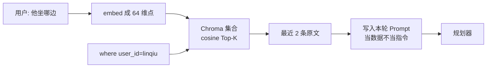
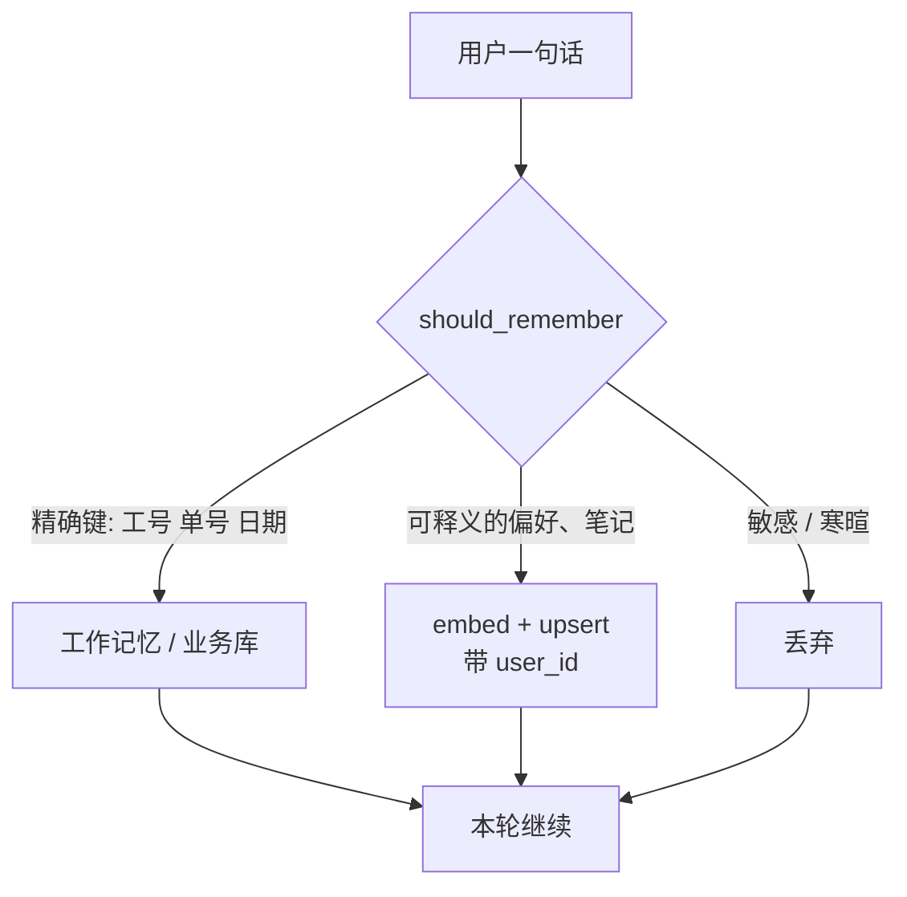

# 第 10 章 向量数据库入门：用 Chroma 建立第一份长期记忆

> 本章定位：第三卷第二站。第 9 章的语义记忆是字典上的「字符串包含」。读完本章，你要能画出「文本 → 坐标 → Top-K」，用 Chroma（或同一契约的落盘库）写入、过滤、删除，并解释 **什么时候不该上向量库**。
>
> 前置：读过第 9 章更顺，但本章自带写入闸门副本。不需要 API Key，不下载商业 Embedding 模型。
>
> 配套代码：`code/ch10/python/`、`code/ch10/java/`
>
> 图表假设：教学嵌入是 **局部哈希坐标**（64 维，MD5 分桶），用来看见几何，不是 OpenAI / MiniLM 的语义效果。Chroma 接口按 1.x `PersistentClient` 描述；Java 官方一等公民是 HTTP，嵌入式客户端是 Python 特产。请假日期仍按 2026-09-14 周一对齐。

---

## 10.1 Embedding（嵌入）在说什么

### 直觉解释

第 9 章检索「工位」靠的是字面包含。用户改口说「走廊一侧的座位」，字典就瞎了。

**嵌入（Embedding）** 把一段文本变成一组数字，也就是空间里的一个点。意思接近的句子，点应该靠得近；订单号和密码，应该离座位偏好远。

向量数据库（Vector database）不「理解」中文。它只做三件事：把点存下来、建索引、按距离找回最近的 K 个。这叫 **Top-K 检索（Top-K retrieval）**。

所以「上了 Chroma」并没有自动拥有记忆。Chroma 是仓库和叉车；记什么、给谁看、何时删除，仍是第 9 章的政策。

### 生活类比：图书馆索书号

索书号不是书评。它只保证「相近主题的书在同一排」。你仍然要先决定这本书该不该进馆（密码进不了）、贴哪一层的标签（`user_id`）、下架时把副本也撕掉（forget）。

Embedding 模型是「编目员」：同一句话换一个编目员，坐标会变，旧库全部失效。本章用固定哈希编目，就是为了让你看清「坐标」两个字，而不是被模型下载卡住。

### 原理剖析：文本怎样变成点

教学算法（Python / Java 同一套）：

1. 切词元：英文按词，中文按单字和双字
2. 每个词元做 MD5，落到 64 个桶里，带正负号
3. 整条向量做 **L2 归一化（L2 normalization）**，长度变成 1

归一化之后，**余弦相似度（Cosine similarity）** 就是点积。越接近 `+1` 越像，接近 `0` 几乎无关，接近 `-1` 方向相反。Chroma 的 cosine 空间里，距离通常是 `1 - 相似度`，所以 **越小越近**。

生产里你会换成 `text-embedding-3-small`、BGE、GTE 等。换模型 = 换坐标系，必须重建集合。本章哈希嵌入 **不能** 写进简历当「语义检索效果」。

---

## 10.2 相似度、距离、Top-K 检索

检索不是「找对」，是「找近」。

| 概念 | 它回答的问题 | 面试里别说成 |
| --- | --- | --- |
| 相似度 | 两个点方向有多像 | 「模型读懂了这句话」 |
| 距离 | 有多远（常与相似度一一对应） | 「距离小就是业务正确」 |
| Top-K | 最近的 K 条是谁 | 「返回了标准答案」 |
| 元数据过滤 | 先划定允许的货架再比远近 | 「Embedding 自己会隔离租户」 |

`K=3` 时，第三条可能已经是跑题的订单情节。Agent 把 Top-K **原文当数据** 塞进 Prompt，不要当指令——第 13、29 章会再打这条。

度量（Metric）常见三种：余弦、欧氏（L2）、内积（IP）。集合创建时选定，和 Embedding 是否归一化要匹配。本章固定 cosine + 已归一化向量。

---

## 10.3 Chroma 本地落地与集合设计

**Chroma** 适合本机实验和中小项目：Python 可嵌入进程，数据落在一个目录里。生产多租户、上亿向量，第 11 章换 Milvus 的思路。

集合（Collection）设计，本章只用一张表：`semantic_facts`。

每条记录四件套：

1. **id**：稳定主键，如 `linqiu:preference`，同一 id 再写即覆盖
2. **document**：将来要塞回 Prompt 的原文
3. **embedding**：坐标（本章自己算好再交给 Chroma）
4. **metadata**：`user_id` / `kind` / `source` —— 过滤和审计用，不参与「意思」

不要一人一个集合，除非你真有那种隔离需求。先用 metadata 过滤，运维更简单。

### 图 1：一次模糊回忆怎么走

假设：库里已有林秋的工位偏好，本轮问「他坐哪边」。



---

## 10.4 写入、查询、元数据过滤、删除

四件套和第 9 章一一对应，只是引擎换了：

| 第 9 章字典 | 本章向量集合 |
| --- | --- |
| `upsert(key, fact)` | `upsert(ids, documents, metadatas, embeddings)` |
| `search("工位")` 字面包含 | `query(向量, n_results, where)` |
| `forget(key)` | `delete(ids=...)` |
| 进程结束即消失 | `PersistentClient(path=...)` 重启还在 |

过滤必须在相似度之前或同时发生。只靠 Top-K，张三「不要过道」可能比林秋「靠过道」更近或更远——那是几何，不是权限。

删除要删向量，不只删业务库一行。用户说「忘掉我的工位」，集合里那条 id 必须 `delete`。

---

## 10.5 什么时候不该上向量库

上向量库的冲动，常常来自「简历上要有这个词」。先过这张表：

| 问题 | 更合适的存储 | 原因 |
| --- | --- | --- |
| 工号、订单号、请假日期 | 数据库 / 槽位 | 需要精确相等，不要「差不多」 |
| 枚举状态：已发货 / 未发货 | 字段 | 向量会把「未发货」和「已发货」当很近的中文 |
| 密码、验证码、证件号 | 不存 | 第 9 章闸门；向量化等于永久可搜的泄露 |
| 只有 20 条稳定偏好 | 字典就够 | 运维成本高于收益 |
| 「ORDER-88 能不能退」 | 工具查订单 | 事实以业务系统为准，回忆只是线索 |

**该上的信号：** 用户用不同的话说同一类事，而且条目会涨到你不想手写 `if "过道" in text`。

向量库是检索引擎，不是记忆本身。这句话请带到面试。

### 图 2：一句话进来先分流，再决定要不要变成点



---

## 10.6 Python 实战 + Java 调用方式说明

### 环境要求

| 项目 | 版本 / 说明 |
| --- | --- |
| Python | 3.10+；`python -m pip install -r requirements.txt` 安装 `chromadb>=1.0,<2.0` |
| Java | 17+，Jackson 2.17.2；**不**嵌入 Chroma 进程 |
| API Key / MiniLM | 不需要。自行传入哈希向量，避免 DefaultEmbeddingFunction 下模型 |
| 装不上 Chroma 时 | `store.py` 会退回 JSON 文件库，三个示例仍可跑通，接口保持一致 |
| Windows 控制台 | 中文可能乱码，逻辑不受影响；可设 `$env:PYTHONIOENCODING='utf-8'` |

**Python / Java 差异（写进面试）：** Python 可用 `PersistentClient` 把库嵌进脚本。Java 主流是 `HttpClient` 打 Chroma REST，或直接连 Milvus。本章 Java 实现同一套坐标和 `upsert/query/delete`，落盘用 JSON，并另给一份 **只打印、不联网** 的 REST 请求形状。

---

### 示例 1：先看见坐标

完整文件：`code/ch10/python/01_embedding_is_coordinates.py`

```bash
cd code/ch10/python
python 01_embedding_is_coordinates.py
```

四句话进同一坐标系：两句说座位、一句 ORDER-88、一句密码。查询「他坐哪边比较靠过道？」时，座位句应排在前面。

```python
query = "他坐哪边比较靠过道？"
q = embed(query)
ranked = sorted(
    ((cosine(q, vec), text) for vec, text in zip(vectors, SENTENCES)),
    reverse=True,
)
```

Java：`EmbeddingIsCoordinates.java`

```powershell
cd code/ch10/java
mvn -q -DskipTests compile exec:java "-Dexec.mainClass=com.agentbook.ch10.EmbeddingIsCoordinates"
```

两边词元规则与 MD5 分桶一致。Java 里 `digest[0]` 必须 `& 0xff`，否则有符号字节会对不上。

---

### 示例 2：写入、Top-K、过滤、删除

完整文件：`02_chroma_crud.py`

```bash
python 02_chroma_crud.py
```

写入四条（含一条不该存在的密码，专门演示删除），然后：

1. 查「工位靠哪边」不过滤 —— 林秋和张三都可能进 Top-K
2. `where={"user_id": "linqiu"}` —— 张三消失
3. `delete` 密码 id 后再查

```python
store.query("工位靠哪边", n_results=3, where={"user_id": "linqiu"})
store.delete(ids=["linqiu-secret-should-not"])
```

Java：`CrudDemo.java`（JSON 文件库，契约相同）

```powershell
mvn -q exec:java "-Dexec.mainClass=com.agentbook.ch10.CrudDemo"
```

---

### 示例 3：闸门 + 重启仍在

完整文件：`03_remember_across_restart.py`

还是第 9 章那五句：在吗、凌秋请假、密码、靠过道、其实我是林秋。

```bash
python 03_remember_across_restart.py
```

预期：

- 寒暄、密码、请假日期 **不进集合**
- `linqiu:employee`、`linqiu:preference` 写入
- `del store` 后重新 `open_store`，条数仍是 2
- 查「他工位喜欢靠哪边」能打到偏好
- `delete("linqiu:preference")` 后再查，不应把偏好找回来

Java：`RememberAcrossRestart.java`

```powershell
mvn -q exec:java "-Dexec.mainClass=com.agentbook.ch10.RememberAcrossRestart"
```

看 HTTP 长什么样（不联网）：

```powershell
mvn -q exec:java "-Dexec.mainClass=com.agentbook.ch10.ChromaRestShapes"
```

路径按 Chroma 1.x 的 `/api/v2/tenants/.../collections/{id}/add|query` **示意**，以你部署的版本文档为准。

---

### 对照表：三种「找回来」

| 维度 | 精确键 | 关键词包含 | 向量 Top-K |
| --- | --- | --- | --- |
| 例子 | `employee=林秋` | `"工位" in text` | 「走廊一侧怎么坐」 |
| 对错标准 | 相等 / 不相等 | 字出现与否 | 谁比较近 |
| 换一种说法 | 失败 | 常常失败 | 有机会命中 |
| 隔离 | 键里带 user_id | 自己过滤 | **必须** metadata |
| 适合 | 槽位、订单、权限 | 调试、极小词表 | 笔记、偏好、情节回忆 |
| 成本 | 最低 | 低 | 嵌入 + 索引 + 运维 |

Agent 里这三种要叠：先键、再过滤、最后才模糊找。

---

## 踩坑提醒与职场视角

**坑 1：用默认 Embedding 却以为「免费」.** Chroma 默认 `all-MiniLM-L6-v2` 会下模型；OpenAI Embedding 要 Key 和钱。本章显式传入向量，就是为了切断这条暗线。

**坑 2：换模型不重建。** 坐标系换了，旧点全废。集合元数据里记下 `embedding_model` 版本。

**坑 3：只存向量，不存原文。** 检索命中后你要的是给人看的句子。`document` 和向量必须一起在。

**坑 4：把 Top-1 当事实。** 近 ≠ 真。订单状态以工具为准；回忆只提供线索。

**坑 5：忘记 `where`。** 相似度不管租户。这是事故，不是功能。

**坑 6：密码进了集合。** 向量库支持按意思搜，泄露面比日志更大。闸门在 `add` 之前。

**坑 7：以为 Java 也能 `PersistentClient`。** 多数团队 Java 进程是调用方，Chroma/Milvus 是独立服务。第 11 章展开。

**坑 8：Windows 装上了 `chromadb` 仍然 ImportError。** 1.x 会拉 `grpcio`。公司电脑的应用控制策略（WDAC / 拦截 DLL）可能挡住 `cygrpc`。本章 `store.py` 会退回 JSON 文件库，三个示例的集合契约不变。不要在卡住的环境里硬编「必须先修好 gRPC」。

### 简历上可以写的一句

> 用向量库做语义记忆的模糊检索：自管 Embedding、按 `user_id` 元数据隔离、写入前过滤敏感信息；能说明精确键与 Top-K 的分工，以及换模型必须重建索引。

### 本章小结

- Embedding 是坐标，向量库是按距离取 Top-K 的仓库。
- 四件套：id、原文、向量、metadata。
- 过滤和闸门比「用了 Chroma」更要紧。
- 单号、日期、密码不要向量化。

---

## 10.7 常见面试考点

> **高频原题：**「长期记忆为什么要用向量库？直接存 MySQL 不行吗？」
>
> **90 秒答法：**
> 精确字段继续放 MySQL。向量库解决的是「用户换一种说法还能找回笔记」。流程是：文本变成嵌入，按距离取 Top-K，再用 metadata 做租户过滤。写入前仍要第 9 章那道闸门。Chroma 适合本地和中小规模；量上来、要分区和运维指标，再看 Milvus。向量库替代不了槽位，也替代不了工具查出的订单真相。
>
> **追问 1：**「余弦和欧氏怎么选？」  
> 看 Embedding 是否归一化、模型文档怎么训的。选完写进集合配置，查询侧不要混用。
>
> **追问 2：**「Top-K 取多少？」  
> 先保证塞进 Prompt 后还留得下系统契约和本轮用户话。K 太大是在花钱买噪音。
>
> **追问 3：**「Chroma 和生产向量库差在哪？」  
> 嵌入式好写 demo；生产看副本、备份、过滤性能、多租户、与现网监控打通。第 11 章展开，不要在这一章吹已经上了亿级。

---

## 10.8 课后练习（含答案提示）

**练习 1：换问法（必做）**  
把示例 1 的查询改成「走廊座位怎么排」。看排名有没有抖动。

- 提示：哈希嵌入对同义词很脆；「走廊」和「过道」只在共享「靠」等字时靠近。这正好说明为什么生产要换真模型。
- 面试句：教学坐标证明几何，不证明效果。

**练习 2：隔离必须测试（必做）**  
在示例 2 再插入 `user_id=lisi` 的偏好，查询时漏写 `where`，把事故截图留下；补上过滤后再跑。

- 提示：这是安全回归，不是功能演示。
- 对照：第 12、29 章会把隔离做成默认参数。

**练习 3：不该向量化的字段（必做）**  
把 `ORDER-88` 的物流状态改成「已发货 / 未发货」两句，用向量去问「发了没有」。观察它会不会答错。

- 提示：近义中文会打架。状态应走工具或字段。
- 产品：回忆可提示「上次谈过退款」，真相以 `get_order` 为准。

**练习 4：60 秒口述（必做）**  
画出图 2，说明密码为什么连 embedding 都不该做。录音。

---

## 本章质量自检

| 检查项 | 结论 |
| --- | --- |
| 零基础读者能否不看前文就懂？ | 从索书号和坐标讲起。 |
| 代码能否直接复制运行？ | 无 API Key；Chroma 可选，失败则 JSON 库。 |
| 是否有职场 / 面试落点？ | 不该上向量库、租户过滤、简历句。 |
| 图表是否标注假设？ | 哈希嵌入非商业模型；REST 路径为 1.x 示意。 |

---

## 你现在应该能做的事

- [ ] 用「坐标 / 距离 / Top-K」解释 Embedding，而不是「它懂中文」
- [ ] 说出集合四件套，并解释 `where` 为什么不是可选装饰
- [ ] 跑通三例：几何直觉、CRUD + 过滤、重启仍在
- [ ] 举出至少两个不该向量化的例子

下一章从玩具库走到生产库：Collection、Partition、Index、Metric，以及 Chroma 和 Milvus 怎么选型。

回复 **「继续」** 进入第 11 章：《面向生产的向量库：Milvus 选型与关键概念》。
