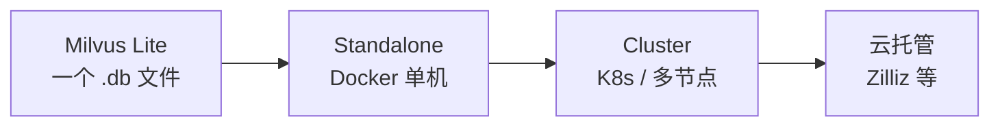
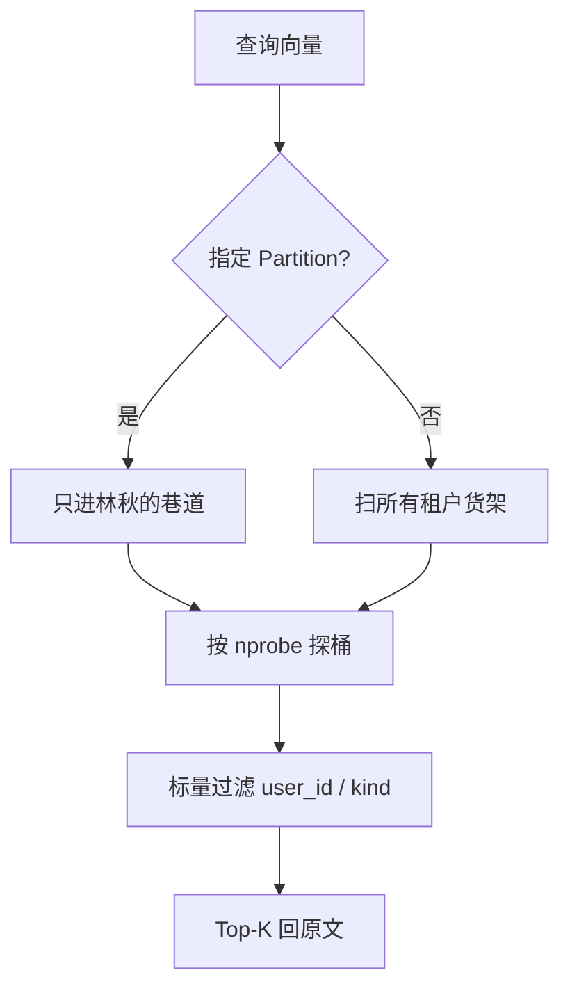

# 第 11 章 面向生产的向量库：Milvus 选型与关键概念

> 本章定位：第三卷第三站。第 10 章用 Chroma（或 JSON 替身）把「点」存下来了。读完本章，你要能说出生产向量库多出来的四个名词——**集合（Collection）、分区（Partition）、索引（Index）、度量（Metric）**——并解释为什么「insert 成功」不等于「搜得到」。
>
> 前置：第 10 章的坐标和 Top-K。不需要 Docker、不需要 API Key、不需要真集群。
>
> 配套代码：`code/ch11/python/`、`code/ch11/java/`
>
> 图表假设：`MiniMilvus` 是状态机教具，IVF 用「绝对值最大的维」分桶，不是 k-means。Milvus Lite 能力小于 Standalone / 集群（官方文档：Lite **不支持 Partition**，一致性只当 Strong）。部署形态和成本是 **教学口径**，不是采购清单。嵌入仍是第 10 章的 64 维哈希。请假日期按 2026-09-14 周一对齐。

---

## 11.1 从玩具库到生产库：规模、一致、运维

### 直觉解释

Chroma 的 `PersistentClient(path=...)` 像把卡片盒放进抽屉：一个人开、一个人关、拷目录就算备份。这足够让 Agent 第一次「隔夜还记得」。

生产库要回答另一组问题：

1. **规模：** 千万到十亿个点，一张表扫到底会把 P99 打爆
2. **一致：** 刚写入的偏好，下一个副本能不能立刻看到
3. **运维：** 谁管磁盘、副本、监控、扩容、半夜告警

**Milvus** 是为这组问题长出来的向量数据库。它不是「更懂语义的 Chroma」，坐标系仍然来自你的 Embedding。它多出来的是：表结构、分区、多种索引、一致性级别、以及一套能独立部署的服务。

### 生活类比：街边小书店 vs 区域总仓

小书店：老板认得每本书在哪，你进门就能拿。这是 Chroma / 教学 JSON 库。

区域总仓：货先按城市分区，再按巷道建索引，叉车只跑几个巷道（`nprobe`），夜班把当天进货封箱（`flush`），早班把索引加载到拣货系统（`load`）。你要的是吞吐和可值班，不是「店里刚好有一张沙发」。

### 原理剖析：三道会单独失败的关

1. **写进去了，但还在 growing segment** —— 没 `flush`，搜索可能看不见
2. **封箱了，但内存里没加载** —— 没 `load`，接口直接拒绝或空结果
3. **加载了，但索引只探了 1 个桶** —— `nprobe` 太小，真近邻被跳过

第 10 章的事故是「不该记的记了、租户没过滤」。本章的事故是「该搜到的搜不到，还以为模型坏了」。

---

## 11.2 Collection、Partition、Index、Metric

四个名词必须能分开讲。混在一起，面试 30 秒就会露馅。

| 名词 | 英文 | 它像什么 | 答错的典型说法 |
| --- | --- | --- | --- |
| 集合 | Collection | 一张表：主键、向量列、标量列 | 「一个 Collection 就是一个向量」 |
| 分区 | Partition | 先剪货架再搜索 | 「Embedding 自己会按用户分开」 |
| 索引 | Index | 怎么加速，会不会漏 | 「建了索引就一定更准」 |
| 度量 | Metric | 远近怎么算：COSINE / L2 / IP | 「三种随便换，数字差不多」 |

**集合** 要在创建时钉死：维度、度量、主键类型、向量列名。换 Embedding 模型 = 换维度或坐标系 = **新建集合并重建**，不要幻想 `alter` 一下就好。

**分区** 是一等公民的剪枝。`user_id=linqiu` 既可以做 metadata 过滤，也可以落成 `partition=linqiu`。过滤是「比完再扔」；分区是「根本不走进张家的巷道」。量小用过滤就够（Chroma 就是这条路）；量大、查询总带着租户键，才值得上分区或 **分区键（Partition key）**。

**索引** 常见三档：

- **FLAT：** 全比一遍，召回高，Lite 和教学默认
- **IVF_FLAT：** 先把点丢进 `nlist` 个桶，查询只探 `nprobe` 个桶。快，会漏
- **HNSW：** 图索引，生产很常见。本章用 IVF 演示漏检，不手写 HNSW

**度量** 必须和 Embedding 训练/归一化方式一致。本章向量已 L2 归一化，集合用 COSINE。查询侧不要偷偷按 L2「再理解一遍」。

Milvus Lite **不支持 Partition**。你在笔记本上跑通 `MilvusClient("./x.db")`，不等于生产架构里已经有租户级分区。

---

## 11.3 部署形态：本地、Docker、云托管

从左到右，能力变强，值班变重。



| 形态 | 你得到什么 | 你失去什么 |
| --- | --- | --- |
| Lite | 熟悉 `MilvusClient` API，无 Docker | 无分区、一致性只 Strong、索引能力裁剪 |
| Standalone | 完整 API、本机或一台服务器 | 单点，备份和监控要自己接 |
| Cluster | 扩容、副本、与现网监控打通 | etcd、对象存储、版本升级都是工作 |
| 云托管 | 少自建，有 SLA 可以谈 | 账单、数据出境、供应商锁定 |

简历写法：写你连的是哪一档，不要写「我们用了 Milvus」却只有一个 Lite 文件。

Java 侧：生产用 `milvus-sdk-java` 走 **gRPC**，URI 形如 `http://localhost:19530`。没有 Python 那种嵌进程的 `PersistentClient`。本章 Java 实现同一套状态机，并打印请求形状。

---

## 11.4 与 Chroma 的能力与成本对比

不是谁淘汰谁，是哪一段路用谁。

| 维度 | Chroma | Milvus Lite | 集群 / 云托管 Milvus |
| --- | --- | --- | --- |
| 定位 | 把长期记忆跑起来 | 用官方 API 做本机实验 | 规模、分区、值班 |
| 嵌入式 | Python 一等公民 | Python `.db` | 否，独立服务 |
| 分区 | metadata `where` | **不支持** | 一等公民 |
| 索引 | 主要 HNSW | 多 FLAT，能力裁剪 | IVF / HNSW / 磁盘索引 |
| 一致性 | 进程内写完即可见 | 仅 Strong | Strong / Bounded / Session / Eventually |
| 运维 | 拷目录 | 拷一个文件 | 组件多，要监控 |
| Java | HTTP 为主 | 仍建议连服务 | gRPC SDK |
| 适合 Agent 的时机 | 简历项目 1 的第一周 | 想对齐官方 API | 多租户、量大、要 SLO |

第 10 章可以不上 Milvus。出现这些信号再迁：过滤扫太宽、单机内存顶不住、需要分区键、Java 服务必须连独立向量集群、值班要有指标。

成本不要只看「实例单价」。Embedding 调用、重建索引的空窗、工程师盯 `load` 失败的时间，都是账单。

---

## 11.5 读写路径与常见性能坑

### 图 1：一条偏好从写入到可搜

假设：林秋说「我喜欢窗口靠过道的工位」。


少任何一截，下一截都会用「空结果」惩罚你。生产里 `flush` 可由服务自动触发，但 **进程重启后必须重新 load** 这条不会自动消失。

### 图 2：一次查询怎么少干活



分区剪的是「进哪些巷道」。`nprobe` 剪的是「巷道里开几盏灯」。metadata 过滤剪的是「灯下哪些箱子合格」。三层都关，才会又快又干净。

常见坑：

1. **忘了 load。** 事故第一名。监控要有「集合未加载」告警。
2. **`nprobe` 过小。** P99 漂亮，召回悄悄烂，Agent 开始一本正经地胡说。
3. **度量与 Embedding 不一致。** 归一化向量却用错度量，排序漂移。
4. **该分区的却全表过滤。** 十个租户还好，一千个租户会把 CPU 烧在别人的数据上。
5. **标量过滤没有标量索引。** 向量很快，`status == "active"` 却变成全扫。
6. **把 Lite 的限制抄进生产设计。** 「我们不用分区，因为 Lite 没有」——这是工具限制，不是领域结论。
7. **一致性选错。** 刚写入立刻要读，Bounded 可能读到旧值。钱和权限相关的读，用 Strong，或根本不要走向量库。

---

## 11.6 最小可运行示例

### 环境要求

| 项目 | 版本 / 说明 |
| --- | --- |
| Python | 3.10+，前三例标准库即可 |
| Java | 17+，Jackson 2.17.2 |
| Docker / 集群 | 不需要 |
| pymilvus | 可选；`lite_optional.py` 连本地 `.db` |
| API Key | 不需要 |

---

### 示例 1：四个名词和三种度量

完整文件：`code/ch11/python/01_four_nouns.py`

```bash
cd code/ch11/python
python 01_four_nouns.py
```

同一对座位句，分别用 COSINE / L2 / IP 算「越小越近」的距离。数字不同；集合创建时选定度量，查询不能换尺子。

Java：`FourNouns.java`

```powershell
cd code/ch11/java
mvn -q -DskipTests compile exec:java "-Dexec.mainClass=com.agentbook.ch11.FourNouns"
```

---

### 示例 2：少一步就搜不到

完整文件：`02_write_read_path.py`

```bash
python 02_write_read_path.py
```

顺序必须是：

```python
db.insert(...)
db.flush("agent_memory")       # growing → sealed
db.create_index("agent_memory")
db.load("agent_memory")        # 不 load 就搜
```

然后 `save` 再 `open`：磁盘上的点还在，`loaded` 被清掉，必须再 load。这就是「重启之后向量库空了」的大多数真相。

Java：`WriteReadPath.java`

```powershell
mvn -q exec:java "-Dexec.mainClass=com.agentbook.ch11.WriteReadPath"
```

---

### 示例 3：分区剪枝和 IVF 漏检

完整文件：`03_partition_and_ivf.py`

林秋 / 张三 / 李四三个人的偏好和情节。FLAT 全表 `compared` 更大；`partition=linqiu` 只比林秋的巷道。IVF `nprobe=1` 可能跳过真近邻，`nprobe=4` 接近全桶。

```bash
python 03_partition_and_ivf.py
```

Java：`PartitionAndIvf.java`

```powershell
mvn -q exec:java "-Dexec.mainClass=com.agentbook.ch11.PartitionAndIvf"
```

看生产 Java 请求长什么样（不联网）：

```powershell
mvn -q exec:java "-Dexec.mainClass=com.agentbook.ch11.MilvusRequestShapes"
```

可选真 Lite（失败不影响前三例）：

```bash
python -m pip install -r requirements.txt
python lite_optional.py
```

**Python / Java 差异：** 教具接口对齐。生产 Python 常用 `pymilvus.MilvusClient`；Java 用官方 gRPC SDK。Lite 是 Python 本机文件；Java 面试应说「连 Standalone / 集群」，不要说「我们在 JVM 里嵌了一个 Milvus」。

---

## 踩坑提醒与职场视角

**坑 1：把 demo 性能当 SLO。** 五条记忆的 FLAT 和五千万条的 HNSW 不是同一种向量库。

**坑 2：用向量库当订单真相。** ORDER-88 发没发货，仍走工具。分区和索引只加速回忆。

**坑 3：分区键选错。** 按「今天星期几」分区，查询却总带 `user_id`，巷道剪错。

**坑 4：重建索引窗口没沟通。** 换模型要新建集合。双写、切读、再下线旧集合，是迁移，不是 `drop` 完转身就走。

**坑 5：监控只看 QPS。** 至少还要：未加载集合、索引滞后、空结果率、按租户的过滤命中。

### 简历上可以写的一句

> 在 Chroma 验证记忆链路后，按 Collection / Partition / Index / Metric 选型 Milvus；能讲清 insert-flush-load 与 `nprobe` 对召回的影响，并说明 Lite 不能代替集群分区。

### 本章小结

- 玩具库解决「记得住」；生产库解决「规模、一致、运维」。
- 四个名词分开讲：表、货架、索引、尺子。
- 写路径是状态机，不是一次 `add`。
- Chroma 起步，Milvus 在信号出现后再上。

---

## 11.7 常见面试考点

> **高频原题：**「Chroma 和 Milvus 怎么选？」
>
> **90 秒答法：**
> 先看数据和值班，不先看官网 logo。十万级、单租户、Python 原型，Chroma 或 Lite 够把记忆链路跑通。要分区剪枝、多种索引、Java 服务连独立集群、还要 SLO，再上 Standalone 或集群 Milvus。两者都只存坐标，不代替第 9 章闸门，也不代替订单工具。Lite 没有 Partition，不能把 Lite 能力清单抄进生产架构。
>
> **追问 1：**「什么是 nprobe？」  
> IVF 查询时探多少个桶。小则快、易漏；大则接近 FLAT。用召回回归盯它，不要只盯延迟。
>
> **追问 2：**「为什么重启后搜不到？」  
> 数据在磁盘，集合没 load 进内存。先查加载状态，再怀疑 Embedding。
>
> **追问 3：**「Bounded 和 Strong 怎么选？」  
> 偏好回忆可用 Bounded；刚写入立刻要读、或涉及权限金额，用 Strong，或走业务库。

---

## 11.8 课后练习（含答案提示）

**练习 1：把 nprobe 当旋钮（必做）**  
在示例 3 把 `nprobe` 从 1 调到 4，记下 `compared`、`skipped_ivf` 和 Top-1 是否仍是林秋偏好。

- 提示：教具 IVF 不是 k-means，漏检可能出现也可能刚好不出现。重点是你能解释「为什么会漏」。
- 面试句：速度旋钮和召回旋钮是同一只。

**练习 2：画部署梯子（必做）**  
默画 Lite → Standalone → Cluster → 云。每级写一句「多了什么 / 多了什么值班」。

- 提示：Lite 多 API 熟悉，少分区；集群多副本，多 etcd 与对象存储。
- 对照：简历只写你真实待过的那一级。

**练习 3：一次「搜不到」排障（必做）**  
故意漏掉 `load`，把报错抄下来；再漏掉 `flush`，对比 `skipped_unflushed`。

- 提示：两种空，原因不同。监控要能区分。
- 产品：不要把空检索直接喂给模型当成「用户没说过」。

**练习 4：60 秒口述（必做）**  
不看稿说出四个名词，并举一个不该上 Milvus 的项目。录音。

---

## 本章质量自检

| 检查项 | 结论 |
| --- | --- |
| 零基础读者能否不看前文就懂？ | 从小书店 vs 总仓讲起。 |
| 代码能否直接复制运行？ | 无 Docker、无 Key；Lite 可选。 |
| 是否有职场 / 面试落点？ | 选型表、load 事故、简历句。 |
| 图表是否标注假设？ | MiniMilvus IVF 非 k-means；Lite ≠ 集群。 |

---

## 你现在应该能做的事

- [ ] 分开解释 Collection / Partition / Index / Metric
- [ ] 画出 insert → flush → index → load → search
- [ ] 说明何时留在 Chroma，何时上 Milvus
- [ ] 解释 nprobe 和「重启后要 load」

下一章把「记得住」收束到对话过程本身：会话、轮次、轨迹，以及槽位怎样在多轮里保持一致。

回复 **「继续」** 进入第 12 章：《对话状态管理：槽位、会话与多轮一致性》。
