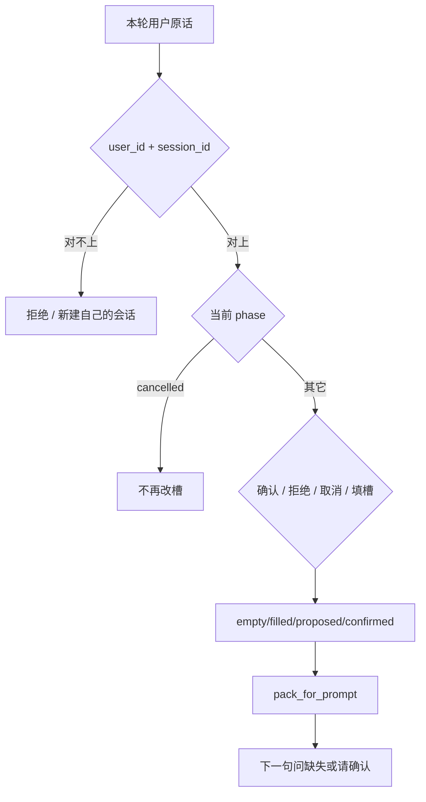
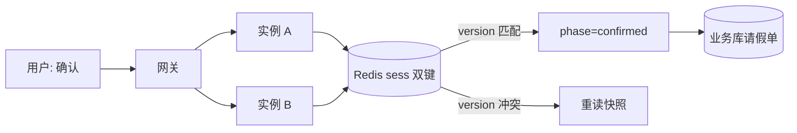

# 第 12 章 对话状态管理：槽位、会话与多轮一致性

> 本章定位：第三卷收官。第 9 章把工作记忆留在一次 `run()` 里，第 10–11 章把长期事实存进向量库。读完本章，你要能画出 **会话（Session）、轮次（Turn）、轨迹（Trace）**，给槽位加上确认策略，并说清热状态放内存、Redis 还是业务库。
>
> 前置：第 2 章 Goal、第 8 章对象校验、第 9 章槽位。不需要 API Key、Redis、Spring Boot。
>
> 配套代码：`code/ch12/python/`、`code/ch12/java/`
>
> 图表假设：抽取规则仍是「周一+周三 → 2026-09-14..16、days=3」。确认词是教学白名单（确认 / 对 / 还是原来的），生产应换成第 8 章的结构化意图。Spring 分层是端口示意，不拉 `spring-boot-starter`。文件库是 Redis / 业务库的教具。

---

## 12.1 会话、轮次、轨迹

### 直觉解释

用户不会一次把假单说完。第一句报姓名，第二句报日期，第三句才说「事假」。如果你把每一句当成一次全新请求，Agent 会反复问「您是哪位」。

三个词必须拆开：

| 词 | 英文 | 它记录什么 | 它不记录什么 |
| --- | --- | --- | --- |
| 会话 | Session | 这一次办理：谁、目标、槽位、阶段 | 公司全部请假制度 |
| 轮次 | Turn | 这一句原文 | 字段是否合法 |
| 轨迹 | Trace | 槽位何时被填、被改、被确认 | 给模型看的全部闲聊 |

第 9 章的工作记忆是「这一次 `run()` 的桌面」。本章把桌面做成 **可恢复的 Session**：换一个 HTTP 请求、换一个进程实例，还是同一张假单。

向量库里的偏好（靠过道）是跨会话的语义记忆。Session 里的 `days=3` 是 **这一单** 的热状态。办完写入业务库，热状态可以过期。

### 生活类比：窗口叫号条

银行叫号条是 Session：号码、柜员、正在办的业务。你说的每一句话是 Turn。柜员在系统里点的「已核对身份证 / 已改金额」是 Trace。你上次来办过理财，那是长期档案，不是这张号条。

拿着别人的号条去改金额，柜员必须对身份证。这就是 `user_id` + `session_id` 双键，第 3 节会再钉一次。

### 原理剖析：一次请求只推进一个 Session

请求进来先认人，再认单，再改槽，再决定下一句问什么。不要把「模型刚刚说了什么」当成状态——模型输出是意图，状态以槽位和轨迹为准。

---

## 12.2 槽位填充与确认策略

**槽位填充（Slot filling）** 不是把用户最后一句覆盖进去。每个槽要有生命周期：

`empty → filled → confirmed`

已确认后再改，先进入 `proposed`（旧值仍在），等用户说「确认」或「还是原来的」。

阶段（Phase）跟着走：

- `collecting`：必填还缺
- `awaiting_confirm`：必填齐了，或有人要改已确认字段
- `confirmed`：可以调 `create_leave` 之类的写工具
- `cancelled`：用户说不用了，或超过 TTL

第 8 章保证「形状合法」。本章保证「用户点过头」。`days=3` 合法，不等于用户承认「就请三天」。金额、日期、权限字段，默认 **先复述再动手**。

只从 **用户轮次** 抽槽。助手说「我是请假助手」不准写进 `employee`——第 9 章的坑，这里收成硬规则。

### 图 1：一句话如何改会话



---

## 12.3 状态该放内存、Redis 还是业务库

不是选一个，是三种寿命叠在一起。

| 位置 | 适合放什么 | 进程重启 | 多实例 | 典型 TTL |
| --- | --- | --- | --- | --- |
| 请求内存 | 本轮解析的临时对象 | 丢 | 单机 | 毫秒 |
| Redis / 会话存储 | 热 Session：槽位、phase、version、最近几轮 | 还在 | 共享 | 30 分钟无操作 |
| 业务库 | 已确认的工单、审计轨迹 | 还在 | 共享 | 年 |

**内存** 只够单测和本章示例 1、2。两个 Spring 实例各改各的 `HashMap`，用户会看到「上一句蒸发了」或「版本对不上」。

**Redis** 适合热状态：键 `sess:{userId}:{sessionId}`，JSON 里带 `version`，TTL 自动收尸。不要把密码写进去。

**业务库** 只在 `phase=confirmed` 之后插入请假单。`collecting` 的半成品不是工单，报表按半成品统计会闹笑话。

轨迹可以双写：热路径留最近 N 条，全量进日志或表，给第 27 章评测和第 31 章事故复盘。

---

## 12.4 并发会话与用户隔离

一个人可以同时有两张号条：请假会话和退款会话。隔离有两层：

1. **人与人：** 张三拿着林秋的 `session_id` 也改不了。`get(user_id, session_id)` 对不上就当不存在，不要回「权限错误详情」给攻击者练手。
2. **单与单：** 同一用户的两个 Session 槽位分开。退款会话里的 ORDER-88 不准写进请假的 `days`。

并发是同一会话被两个请求同时读到 `version=1`。必须 **乐观锁**：写入时核对版本，失败者重读再试，或请用户重说一句。Redis 可用 `WATCH` / 带版本的 `SET`；数据库可用行版本号。

`session_id` 用不可猜测的随机串。仍然不要只凭它取数——泄露一条 URL 不该等于泄露全公司假单。

---

## 12.5 Spring 里怎么设计状态服务

把第 2 章 Runtime 的「记忆」换成可注入的端口，不要在 `Controller` 里改 `Map`。

```
controller  →  SessionService  →  StateStore（端口）
                                  ├ RedisStateStore
                                  └ JdbcTicketStore（只收 confirmed）
```

控制器只做三件事：从登录上下文取 `userId`、校验路径里的 `sessionId`、调用 `handle`。服务负责填槽和确认。仓储负责版本和 TTL。

本章 Java **不**引入 Spring Boot，避免「为了注解先打 40MB 包」。接口形状已经按 Bean 来：`SessionService` + `StateStore`。换 Redis 时只加一个适配器。`SpringStateNotes.java` 把键名和分层打印出来，面试可以照着画。

### 图 2：多实例下一次确认



假设：两个实例同时处理「确认」；只有一个写入成功，另一个必须看见新版本，而不是各写各的内存。

---

### 环境要求

| 项目 | 版本 / 说明 |
| --- | --- |
| Python | 3.10+，标准库 |
| Java | 17+，Jackson 2.17.2 |
| Redis / Spring Boot | 不需要；文件库演示重启，接口演示分层 |

---

### 示例 1：三轮填满必填

完整文件：`code/ch12/python/01_session_turn_trace.py`

```bash
cd code/ch12/python
python 01_session_turn_trace.py
```

```
我是林秋
下周一到周三请假去上海
事假，通知经理就行
```

预期：`employee` / 日期 / `days=3` / `leave_type=事假` 逐步出现；「上海」不进必填槽；phase 变为 `awaiting_confirm`；轨迹里能看到每次 `filled`。

Java：`SessionTurnTrace.java`

```powershell
cd code/ch12/java
mvn -q -DskipTests compile exec:java "-Dexec.mainClass=com.agentbook.ch12.SessionTurnTrace"
```

---

### 示例 2：确认之后不能偷改

完整文件：`02_confirm_and_correct.py`

```bash
python 02_confirm_and_correct.py
```

确认 → `其实只要两天` 变成 `days=3->2(待确认)` → 「还是原来的」回到 3 → 「周四结束」再 proposed → 再次确认才变成 4 天（周一到周四）。

Java：`ConfirmAndCorrect.java`

```powershell
mvn -q exec:java "-Dexec.mainClass=com.agentbook.ch12.ConfirmAndCorrect"
```

---

### 示例 3：隔离、落盘、乐观锁

完整文件：`03_store_and_isolation.py`

```bash
python 03_store_and_isolation.py
```

1. 张三持林秋 `session_id` → `isolation_or_missing`，林秋槽位不动
2. `FileStore` 写入后换一个服务实例，仍能「确认」
3. 两个快照同为 `v=1`，先写者成功，后写者 `VersionConflict`

Java：`StoreAndIsolation.java`，分层说明：`SpringStateNotes.java`

```powershell
mvn -q exec:java "-Dexec.mainClass=com.agentbook.ch12.StoreAndIsolation"
mvn -q exec:java "-Dexec.mainClass=com.agentbook.ch12.SpringStateNotes"
```

**Python / Java 差异：** 状态机一一对应。生产 Python 常见 FastAPI + Redis；Java 把 `StateStore` 收成 `@Repository`。不要在任一侧把 Session 塞进 `ThreadLocal` 当跨请求存储。

---

## 踩坑提醒与职场视角

**坑 1：用聊天记录当槽位。** 最后一句「那就两天吧」可能是试探。没有确认策略，写工具就会按两天提交。

**坑 2：Session 里夹长期记忆。** 靠过道的工位进向量库；本单日期进 Session。混在一起，过期策略会互相踩。

**坑 3：只校验 session_id。** 泄露的链接等于转交编辑权。双键，始终。

**坑 4：多实例无版本号。** 两个「确认」打出两张假单。第 7 章的幂等键要和 Session 版本一起做。

**坑 5：半成品进业务表。** 报表出现大量「未完成请假」。热状态和工单分表。

**坑 6：TTL 太长或太短。** 太长占 Redis 且留下过期槽；太短用户打个电话回来会话没了。按办理时长设，并允许「恢复最近一单」。

### 简历上可以写的一句

> 将 Agent 多轮对话做成带版本的 Session：槽位分 empty/filled/proposed/confirmed，写工具前强制确认；热状态按 user+session 双键隔离，Redis 存会话、业务库只收已确认工单。

### 本章小结

- Session 是这一单，Turn 是原话，Trace 是审计。
- 槽位要确认；已确认的改动先 proposed。
- 内存 / Redis / 业务库叠寿命，不要互相冒充。
- 隔离是双键，并发是版本号。

第三卷到此收束：记得住（分层）、找得回（向量）、办得完（会话状态）。下一卷进入 RAG，先检索再开口。

---

## 12.6 常见面试考点

> **高频原题：**「多轮对话的状态你放哪？怎么保证不串用户？」
>
> **90 秒答法：**
> 我把一次办理做成 Session，里面是槽位、阶段和最近轮次，不是全量聊天记录。热状态放 Redis，键带 userId 和 sessionId，读写都校验双键。已确认的工单进业务库，半成品不过报表。同一会话并发用版本号乐观锁。改日期、改金额必须走 proposed，用户确认才动写工具。长期偏好走第 9–11 章的记忆，不塞进这张号条。
>
> **追问 1：**「用户同时办请假和退款？」  
> 两个 Session。工具和槽位表分开，禁止共用一张可变 Map。
>
> **追问 2：**「模型已经说提交了，要不要落库？」  
> 不要。模型输出是意图。落库看 `phase=confirmed` 并且工具执行成功。
>
> **追问 3：**「Spring 里 Session 用 HttpSession 行不行？」  
> 粘滞会话、难水平扩展、和登录 Session 搅在一起。独立会话存储，自己管 TTL 和版本。

---

## 12.7 课后练习（含答案提示）

**练习 1：补一个必填槽（必做）**  
让 `leave_type` 也成为提交前提。缺类型时 phase 不得进入 `awaiting_confirm`。

- 提示：把 `leave_type` 加入 `REQUIRED`，再跑示例 1 前两句。
- 面试句：验收标准变了，状态机要一起改，不能只改 Prompt。

**练习 2：画双实例时序（必做）**  
画出图 2，标出 version=1 的两次确认谁成功。

- 提示：失败者必须重读，不能「再确认一次」就插入第二张单——配合第 7 章幂等键。
- 对照：钱和假期都是写操作。

**练习 3：过期会话（必做）**  
把 `ttl_turns` 调成 2，发第三句，观察 `cancelled`。思考产品上要不要提示「会话已过期，这是上次槽位，是否恢复」。

- 提示：恢复是新 Session 拷旧槽，仍要确认。
- 安全：恢复也必须双键。

**练习 4：60 秒口述（必做）**  
不看稿区分 Session / Turn / Trace，并说一个不该放进 Session 的字段。录音。

---

## 本章质量自检

| 检查项 | 结论 |
| --- | --- |
| 零基础读者能否不看前文就懂？ | 从叫号条讲起。 |
| 代码能否直接复制运行？ | 无 Redis、无 Spring Boot、无 Key。 |
| 是否有职场 / 面试落点？ | 双键、版本、简历句。 |
| 图表是否标注假设？ | 确认词为白名单；文件库为教具。 |

---

## 你现在应该能做的事

- [ ] 用叫号条比喻讲清 Session / Turn / Trace
- [ ] 给日期和天数加上确认 / 改拟 / 拒绝
- [ ] 说明热状态、Redis、业务库各管一段寿命
- [ ] 用双键和 version 解释不串用户、不双花

第四卷开始：先检索公司知识，再让模型开口。回复 **「继续」** 进入第 13 章：《RAG 原理与最小实现》。
