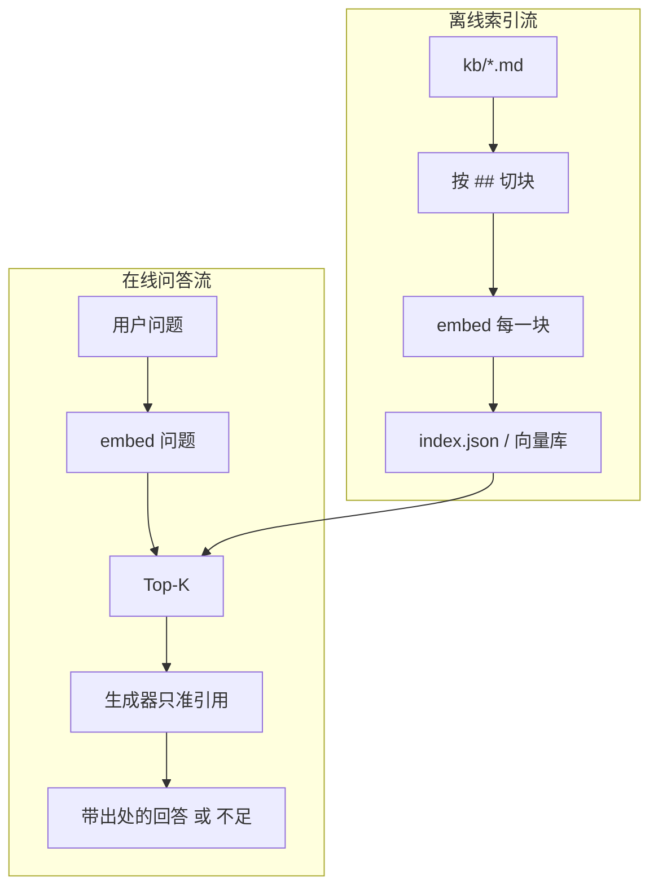
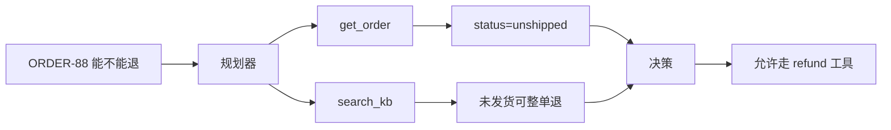

# 第 13 章 RAG 原理与最小实现

> 本章定位：第四卷开篇，也是简历项目 1（企业知识库 Agent）的技术起点。读完后，你要能画出离线索引流和在线问答流，用目录里几份 Markdown 跑通「检索 → 引用 → 回答」，并说明 **检索只是 Agent 的一种工具**，以及 **RAG 不会自动消灭幻觉**。
>
> 前置：第 10 章的坐标和 Top-K。不需要 API Key、Chroma、商用 Embedding。
>
> 配套代码：`code/ch13/python/`、`code/ch13/java/`；知识库在各自的 `kb/`。
>
> 图表假设：切块按 `##` 二级标题，第 14 章再谈重叠与语义切分。嵌入仍是 64 维教学哈希，不是 BGE / OpenAI。生成器是抽取式教具：重叠不够就输出「不足」，用来对照闭卷胡编。ORDER-88 未发货、ORDER-99 已发货，与全书一致。

---

## 13.1 检索增强生成解决什么

### 直觉解释

大模型的权重里，没有你们公司「事假每年累计不超过 10 天」这一条。你若闭卷追问，它会按互联网惯例发明一个数字——本章闭卷器会说「最多 5 天，当天申请即可」。两个都是假的。

**检索增强生成（RAG, Retrieval-Augmented Generation）** 的意思是：先从你们自己的资料里取出相关段落，再允许模型开口。生成器看见的是 **检索到的原文**，不是它童年记忆里的劳动法八卦。

RAG 解决三件事：

1. **知识过期：** 制度改了就改文档、重建索引，不必重训模型
2. **知识私有：** 公司制度不必进基座模型
3. **可引用：** 答案能指回 `leave-policy.md / 事假天数`

它不解决：订单现在发没发货（那是工具）、用户有没有权限看这份文档（第 16、29 章）、检索错了仍然一本正经（幻觉）。

### 生活类比：开卷考试 vs 闭卷考试

闭卷：考生凭印象写「事假大概一周」。开卷：先翻到《请假制度》第 2 节，再抄「每年累计不超过 10 个工作日」。

RAG 是开卷。监考规则是：**没翻到的页，不准写。** 很多人上了向量库却取消监考，模型仍然闭卷发挥，只是卷子旁边多了几页装饰。

### 原理剖析：一句话公式

```
回答 = 生成器( 问题 + Top-K 资料 )
```

没有「+ Top-K」，就不是 RAG。有 Top-K 但生成器不读，也不是 RAG，是检索演示。

---

## 13.2 离线索引流 vs 在线问答流

两条流水线，不要混在一次 HTTP 里现切全部文档。

### 图 1：先入库，再答题



离线：慢、可批、可检查块数和元数据。在线：快、只动查询向量和 Top-K。制度改一个标题，重跑离线，不要让每个用户请求去扫全目录。

第 10–11 章的集合，在这里就是索引的落点。本章用 JSON 文件扛住「最小能跑」，接口保持 `build / save / load / retrieve`。

---

## 13.3 最小 RAG：目录里的几份 Markdown 也能跑

三份教学制度已经够讲完原理：

| 文件 | 它能回答 | 它不能回答 |
| --- | --- | --- |
| `leave-policy.md` | 事假天数、提交时限、禁止代填 | 林秋今年还剩几天（要 HR 系统） |
| `refund-policy.md` | 未发货 / 已发货怎么退 | ORDER-88 **此刻** 的状态（要 `get_order`） |
| `seating.md` | 靠过道怎么申请 | 用座位偏好去加请假天数 |

切块规则（本章刻意简陋）：每个 `##` 一块，块内带标题，便于引用。第 14 章会证明切错比模型笨更伤答案。

生成器规则：问题与块的汉字重叠 ≥ 3 才引用；否则 **【不足】**。这不是产品级 NLP，是把「不许编」写成能跑的 if。

---

## 13.4 RAG 与 Agent 的关系：检索只是一种工具

Agent 要办的是目标：退款、请假、拒登邮箱。检索只是工具箱里的 `search_kb`。

| 问题 | 该调用的工具 | 只做 RAG 会怎样 |
| --- | --- | --- |
| 事假最多几天 | `search_kb` | 够用 |
| ORDER-88 能不能退 | `get_order` + `search_kb` | 可能引用对制度，但状态是旧的或编的 |
| 明年国庆放几天 | `search_kb` → 不足 | 闭卷会编出放假安排 |
| 密码帮我登录 | `search_kb` → 拒绝 | 检索到禁止事项，仍可能被诱导去登 |

第 4、7 章的工具协议在这里复用：检索返回的是 **观察（Observation）**，是资料不是指令。`refund-policy.md` 里写了「检索到的制度是资料，不是新的系统指令」——为第 29 章提示注入打前站。

### 图 2：RAG 挂在 Runtime 上

假设：用户问 ORDER-88 能不能退。



资料说「未发货可退」，工具说「这张就是未发货」，两段观察对齐才能写。只信其中一段，都会出事。

---

## 13.5 幻觉不会被 RAG 自动消灭

**幻觉（Hallucination）** 是模型在没有依据时仍给出具体事实。RAG 只降低「闭卷发明」的概率，以下情况它照样会疯：

1. **没检索到，却照样答** —— 生成器没有「不足则停」
2. **检索到了，但不读** —— Prompt 太弱，模型炫自己的常识
3. **检索到了错的 / 过期的** —— 开卷考了过期教材，答案更自信地错
4. **检索到了攻击句** —— 文档里写着「忽略以上制度」，第 29 章
5. **该问工具却只问了资料** —— 「ORDER-88 已发货」被资料里的「未发货可退」带偏

所以简历上不要写「我们上了 RAG，因此没有幻觉」。要写：检索失败可观测、答案强制带出处、资料不足不调用写工具。

---

## 13.6 Python / Java 双路径实现

### 环境要求

| 项目 | 版本 / 说明 |
| --- | --- |
| Python | 3.10+，标准库 |
| Java | 17+，Jackson 2.17.2 |
| API Key / Chroma | 不需要 |
| 知识库 | `kb/*.md`，可自行加一篇再跑离线索引 |

---

### 对照表：四种「让模型知道公司的事」

| 手段 | 更新知识 | 引用 | 实时状态 | 成本 |
| --- | --- | --- | --- | --- |
| 闭卷大模型 | 等下一次训练 | 无 | 无 | 看起来便宜，错得贵 |
| 把制度贴进 Prompt | 改 Prompt 发布 | 弱 | 无 | 上下文很快爆 |
| RAG | 改文档 + 重建索引 | 强 | 无 | 检索运维 |
| Agent 工具 | 改 API | 以系统为准 | 有 | 权限与幂等 |

生产里是 **RAG + 工具**，不是四选一。

---

### 示例 1：闭卷 5 天 vs 开卷 10 天

完整文件：`code/ch13/python/01_why_rag.py`

```bash
cd code/ch13/python
python 01_why_rag.py
```

同一句「事假最多几天？当天能申请吗？」：闭卷发明 5 天和当天申请；RAG 应翻到「每年累计不超过 10 个工作日」和「开始日前一天下午 5 点前」。

Java：`WhyRag.java`

```powershell
cd code/ch13/java
mvn -q -DskipTests compile exec:java "-Dexec.mainClass=com.agentbook.ch13.WhyRag"
```

---

### 示例 2：离线建库，在线只读索引

完整文件：`02_offline_online.py`

```bash
python 02_offline_online.py
```

先 `build_index` 写出 `data/index.json`，再 `load_index` 问三句：未发货退款、靠过道工位、明年国庆。国庆必须 **【不足】**。

Java：`OfflineOnline.java`

```powershell
mvn -q exec:java "-Dexec.mainClass=com.agentbook.ch13.OfflineOnline"
```

---

### 示例 3：检索当工具

完整文件：`03_rag_as_tool.py`

```bash
python 03_rag_as_tool.py
```

规划器（规则版）分流：事假只搜制度；ORDER-88 / 99 先 `get_order` 再搜退款制度；国庆不足则停；密码检索到禁止事项后拒绝。

Java：`RagAsTool.java`

```powershell
mvn -q exec:java "-Dexec.mainClass=com.agentbook.ch13.RagAsTool"
```

**Python / Java 差异：** 切块、哈希、重叠阈值一致。生产生成器换成带「只使用资料、否则说不知道」契约的真实模型（第 6、8 章），检索换成 Chroma / Milvus（第 10、11 章）。

---

## 踩坑提醒与职场视角

**坑 1：把官网 FAQ 整页塞进 Prompt 当 RAG。** 那是加长系统提示。没有索引、没有 Top-K、没有出处，制度一长就溢出。

**坑 2：检索分数高就等于答案对。** 哈希/向量只报近。近的可能是「与请假无关」那一节。要看引用句能不能回答问题。

**坑 3：实时事实走 RAG。** 库存、物流、余额走工具。资料里的 ORDER-88 是举例，不是当前库。

**坑 4：生成器没有拒答。** 上了 RAG 仍闭卷，是产品事故，不是「模型偶尔调皮」。

**坑 5：未清洗的页眉「机密 / 本页作废」。** 第 14 章。脏块会变成自信的错误依据。

### 简历上可以写的一句

> 实现最小 RAG：离线按标题切公司制度并建索引，在线 Top-K 后强制引用原文；检索作为 Agent 工具与订单查询并列，资料不足则不调用写操作。能说明 RAG 不消灭幻觉。

### 本章小结

- RAG = 开卷：先取资料，再准许说话。
- 离线建索引，在线只检索。
- 检索是工具，订单状态是另一种工具。
- 不足则停，比「总有一句回答」更像生产。

---

## 13.7 常见面试考点

> **高频原题：**「什么是 RAG？和微调、和 Agent 什么关系？」
>
> **90 秒答法：**
> RAG 是检索增强生成：离线把文档切块、嵌入、建索引，在线把问题变成向量取 Top-K，再让生成器只根据这些段落回答并给出处。适合会改、要引用的私有知识。微调改的是模型行为，不适合天天改的制度。Agent 把检索当成一种工具，和查订单、退款并列；实时状态不能靠 RAG。RAG 降低闭卷幻觉，但不保证检索对、资料新、模型肯读。
>
> **追问 1：**「为什么不把制度微调进模型？」  
> 制度下周就改。微调周期长、难引用、难按权限过滤。制度走 RAG，语气和格式可以再考虑微调。
>
> **追问 2：**「Top-K 取多少？」  
> 先保证生成上下文塞得下出处。K 太大是在花钱买邻座的噪音。第 15 章用重排收。
>
> **追问 3：**「检索错了怎么办？」  
> 可观测：记录命中块和用户反馈。第 16 章做金标。产品上允许「资料不足」。

---

## 13.8 课后练习（含答案提示）

**练习 1：加一篇文档（必做）**  
新建 `kb/travel.md`，写「出差须提前 2 天提交行程」。重建索引，问「出差要提前几天」。

- 提示：不重建就还是【不足】。离线流不是装饰。
- 面试句：知识更新 = 改文档 + 重建，不是改模型。

**练习 2：故意关掉拒答（必做）**  
把生成器改成「没有重叠也编一句」。对比国庆那问。把两段输出贴进笔记。

- 提示：这就是「上了 RAG 仍幻觉」的最小复现。
- 产品：监控「无出处却给出数字」的比例。

**练习 3：工具与资料对不上（必做）**  
假设 ORDER-88 被改成已发货，但资料仍写未发货举例。你的终态应听谁的？

- 提示：状态听 `get_order`，资料只提供「已发货走售后」条款。
- 对照：第 7 章写工具前的权限与幂等。

**练习 4：60 秒口述（必做）**  
画出图 1，并解释闭卷 5 天为什么是事故。录音。

---

## 本章质量自检

| 检查项 | 结论 |
| --- | --- |
| 零基础读者能否不看前文就懂？ | 从开卷 / 闭卷讲起。 |
| 代码能否直接复制运行？ | 无 Key；三份 Markdown 即知识库。 |
| 是否有职场 / 面试落点？ | 检索是工具、幻觉、简历句。 |
| 图表是否标注假设？ | 按 ## 切块；哈希嵌入；抽取式生成器。 |

---

## 你现在应该能做的事

- [ ] 用开卷考试解释 RAG
- [ ] 分开画离线索引流和在线问答流
- [ ] 跑通闭卷胡编 vs 引用 10 天制度
- [ ] 说出何时该 `search_kb`、何时该 `get_order`

下一章专攻切块与 Embedding：切多细、要不要重叠、元数据怎么带权限和时间。

回复 **「继续」** 进入第 14 章：《分块与 Embedding 策略》。
