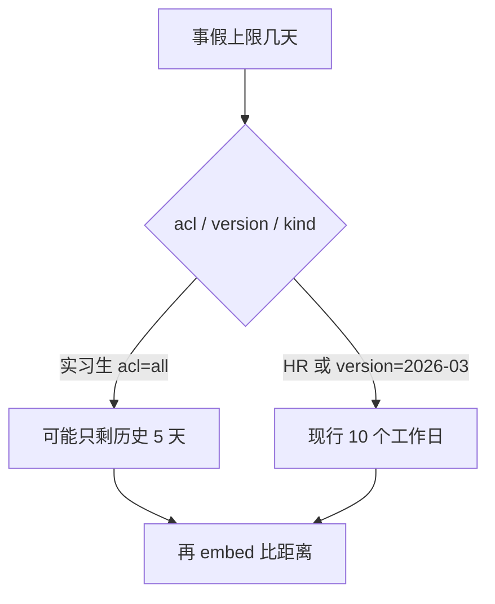

# 第 14 章 分块与 Embedding 策略

> 本章定位：第四卷第二站。第 13 章按 `##` 一切了之。读完本章，你要能说明 **切多细会改答案**，比较固定窗口 / 重叠 / 按标题 / 按句合并，会清洗页眉页脚，并为每块补上权限、版本、来源。
>
> 前置：第 13 章的检索公式。不需要 API Key。语料是一份故意写脏的 `messy_leave.md`。
>
> 配套代码：`code/ch14/python/`、`code/ch14/java/`
>
> 图表假设：教学语义切 = 按句号合并到约 80 字，**不是** embedding 聚类。嵌入仍是 64 维哈希；「仅 ASCII」编目员用来演示中英混合语料选错模型。窗口长度按 Python 字符（一字一长）。请假金标仍是 **10 个工作日**；旧稿 5 天、代码里的 99 都是毒药。

---

## 14.1 为什么「切多细」会改变答案质量

### 直觉解释

检索的对象不是「这篇文档」，是 **块（Chunk）**。切法一变，空间里的点就变，Top-1 跟着变。

- **太粗：** 废止的「最多 5 天」和现行的「10 个工作日」捆在同一向量里。模型两种都看见，幻觉更自信。
- **太细：** 「事假每年累计不超过」和「10 个工作日」被切到两个窗。问「最多几天」可能只命中半句，或命中旧稿。
- **刚好：** 一块里有完整命题，元数据还能说清这是 2026-03 的现行条款。

第 13 章能跑，是因为三份干净 Markdown 碰巧按标题一切就完整。脏文档、长段落、中英混排，运气会用完。

### 生活类比：复印店裁纸

整页塞进信封（太粗）：机密章、作废戳和正文一起寄出。裁成邮票大（太细）：「不超过」在一张，「10 天」在另一张，检索只捡到前半句。沿标题裁、关键句不要从中间撕开——这就是分块策略。

### 原理剖析：块是 Embedding 的句子

Embedding 看见的是块的全部字。噪音（页眉「机密」）、毒药（`MAX_LEAVE_DAYS = 99`）、过期句，都会拉坐标。生成器第 13 章说「只准引用命中块」——命中块若是垃圾，引用就变成合法地错。

---

## 14.2 固定窗口、重叠、按标题、按语义

| 策略 | 怎么切 | 优点 | 代价 |
| --- | --- | --- | --- |
| 整篇一块 | 文件 = 1 向量 | 实现零 | 噪音、超上下文、无法引用小节 |
| 固定窗口 | 每 N 字一块 | 实现简单、长度可控 | 句子从中间断开 |
| 窗口 + 重叠 | 下一步只走 N−overlap | 跨窗句子有完整副本 | 块数变多、重复计费 |
| 按标题 | `##` / 目录 | 引用友好、和作者结构对齐 | 一节过长或过短都不匀 |
| 按句合并（教学语义） | 遇句号切开，拼到约 K 字 | 少撕句子 | 不是真语义聚类；列表/表格会碎 |

生产里的「语义切块」常用小模型找主题边界，成本更高。本章用按句合并让你看见「别在句中切开」，不要写进简历当「我们做了语义 chunker」。

没有万能 N。从标题切起步，对超长节再套带重叠的窗口，是稳妥默认。

### 图 1：重叠在救什么

假设金标句骑在两个窗的接缝上。

```mermaid
flowchart LR
    S[事假每年累计不超过 | 10 个工作日]
    S --> A[窗A: …累计不超过]
    S --> B[窗B: 10 个工作日…]
    S --> C[重叠窗: 不超过 10 个工作日]
    Q[问: 最多几天] --> A
    Q --> B
    Q --> C
    C --> Hit[Top-1 完整命题]
```

---

## 14.3 文档清洗、页眉页脚、表格与代码块

入库前先洗澡，比换 Embedding 模型更便宜。

| 脏东西 | 它为什么有害 | 本章做法 |
| --- | --- | --- |
| 页眉「机密 / Page 3」 | 每页重复，坐标被机密两个字拉开 | 正则丢掉 |
| 页脚「打印于 / 作废」 | 过期提示变成可检索事实 | 丢掉 |
| 围栏代码 `MAX_LEAVE=99` | 调试数字比制度更「像答案」 | 删掉 ` ``` ` 块 |
| Markdown 表 | 模型能读，哈希嵌入读成碎符号 | 保留但 `kind=table`，引用时当结构化 |
| 旧稿章节 | 5 天会赢过 10 天 | `kind=deprecated`，默认不检索 |

表格不要幻想哈希向量能理解列对齐。能解析就变成「personal 上限 10、经理批」这样的句子再嵌入。第 15 章关键词检索会更擅长 `ORDER-88`、`leave_type`。

---

## 14.4 Embedding 模型选型与中英混合语料

编目员必须听得懂语料的语言。

| 模型类型 | 适合 | 不适合 |
| --- | --- | --- |
| 教学哈希 / 仅英文词袋 | 看几何、写测试 | 中文制度、混合问法 |
| 中英双语句向量（BGE / GTE 等） | 公司中文制度 + 少量英文术语 | 要联网、要选维度和版本 |
| OpenAI `text-embedding-3-*` | 有预算、要稳定 SLA | 数据出境、账单 |
| 代码专用嵌入 | 仓库 RAG | 请假制度 |

换模型 = 换坐标系 = **重建全部块**。把 `embedding_model` + `chunk_strategy` + `chunk_version` 写进元数据。中英混合问「personal leave 上限几天」时，只吃 ASCII 的编目员会无视「上限几天」，坐标乱飘。

本章不下载 BGE。用「全语种哈希 vs 仅 ASCII」对照，把选型事故缩成两行输出。

---

## 14.5 元数据设计：来源、权限、时间、版本

块上至少这四类，检索时当 **过滤条件**，不要指望向量自己懂保密。

| 字段 | 例 | 用途 |
| --- | --- | --- |
| source | `messy_leave.md` | 引用溯源 |
| heading | 现行条款 | 给人看的出处 |
| acl | `hr` / `all` | 实习生不该进薪酬表 |
| version / as_of | `2026-03` | 废止稿默认排除 |
| kind | policy / table / code / deprecated | 默认不搜代码和旧稿 |

第 10 章的 `where user_id=` 和第 12 章的双键，在这里变成 `where acl + version`。过滤失败是安全事故，不是召回率问题。

### 图 2：先过滤再比近



教学里把「现行条款」标成 `acl=hr`，是为了让你看见 **过滤会改答案**。产品上现行制度应对全员可见，旧稿用 `version` 排除，薪酬表才锁 `hr`。别把演示配置抄进生产。

---

## 实现：Python / Java 对照实验

### 环境要求

| 项目 | 版本 / 说明 |
| --- | --- |
| Python | 3.10+，标准库 |
| Java | 17+，无第三方依赖 |
| API Key | 不需要 |
| 语料 | `kb/messy_leave.md` |

---

### 示例 1：切块大小

```bash
cd code/ch14/python
python 01_chunk_size.py
```

同一清洗后的正文，三种切法问「事假每年最多几天」。整篇一块会同时含 10 天和 5 天；细窗和按标题都可能先命中旧稿「最多 5 天」（问句和废止句更像）。切块不是终点，还要 `version` 过滤。

Java：`ChunkSize.java`

```powershell
cd code/ch14/java
mvn -q -DskipTests compile exec:java "-Dexec.mainClass=com.agentbook.ch14.ChunkSize"
```

---

### 示例 2：清洗与重叠

```bash
python 02_overlap_and_clean.py
```

未清洗的窗会抬出「机密 / 99 / 5 天」。清洗后再加 `overlap=18`，金标句应重新完整。

Java：`OverlapAndClean.java`

```powershell
mvn -q exec:java "-Dexec.mainClass=com.agentbook.ch14.OverlapAndClean"
```

---

### 示例 3：元数据与中英编目

```bash
python 03_metadata_and_embed.py
```

看 `acl` / `version` 如何换 Top-1；再对比全语种哈希和仅 ASCII 对「personal leave 上限几天」的差异。

Java：`MetadataAndEmbed.java`

```powershell
mvn -q exec:java "-Dexec.mainClass=com.agentbook.ch14.MetadataAndEmbed"
```

**Python / Java 差异：** 窗口按各自语言的 `length`（UTF-16 代码单元 vs Python 字符）在表情符号上可能差 1，本章语料无 emoji，结果应对齐。

---

## 踩坑提醒与职场视角

**坑 1：用 Token 数当唯一 KPI。** 块短省钱，但召回碎。先看金标句在不在 Top-K，再谈账单。

**坑 2：清洗放在线做。** 每个请求去页眉，又慢又不一致。清洗属于离线索引流。

**坑 3：表格当纯文本嵌入后当精确答案。** 列对不齐时应用结构化解析或关键词。

**坑 4：换 Embedding 不改 chunk_version。** 新旧坐标混在一个集合，第 11 章说过必须重建。

**坑 5：把演示用的 acl=hr 抄到现行制度。** 全员制度用版本过滤，不要用权限藏起来。

### 简历上可以写的一句

> 对比标题切、固定窗和重叠窗对请假制度召回的影响；入库前清洗页眉与代码块；块级元数据带 acl/version，检索默认排除废止稿。能说明切块比换模型更先做。

### 本章小结

- 块的边界 = 答案的边界。
- 重叠救跨窗句子；清洗救垃圾坐标。
- 编目员要懂语料的语言。
- 权限和版本是过滤器，不是 Embedding 的天赋。

---

## 14.6 常见面试考点

> **高频原题：**「RAG 的 chunk 你怎么切？为什么？」
>
> **90 秒答法：**
> 我先按文档自身结构切，Markdown 就按标题，保证一块是完整命题、引用时有 heading。超长节再套固定窗，并加重叠，避免数字落在缝上。入库前去掉页眉页脚和代码脏数字。每块带 source、acl、version、kind，检索先过滤再比向量。切法写进版本号，换 Embedding 就重建。没有万能长度，用金标句在不在 Top-K 来调。
>
> **追问 1：**「重叠会不会重复计费？」  
> 会。用召回换 Token。重叠 10–20% 是常见起点，不是教条。
>
> **追问 2：**「语义切块要不要上？」  
> 标题和句边界先做够。主题漂移严重再上模型切，并评估值不值。
>
> **追问 3：**「中英混合怎么办？」  
> 选双语嵌入；专有英文术语保留原文进块，并给关键词检索留后手（第 15 章）。

---

## 14.7 课后练习（含答案提示）

**练习 1：调窗口（必做）**  
把示例 1 的窗长改成 20、40、80，记下 GOLD / 毒药标记。画一条「块数 vs 是否命中 10 个工作日」。

- 提示：不是越长越好，整篇一块会把 5 天捆回来。
- 面试句：这是切块的召回曲线。

**练习 2：给表格单独策略（必做）**  
把对照表解析成两句「personal 上限 10」「annual 按工龄」，再嵌入。用 `personal leave 上限` 查询。

- 提示：结构化优于傻切。
- 对照：第 15 章 BM25 会更稳。

**练习 3：默认排除 deprecated（必做）**  
检索时 `kind != deprecated`。再问「最多几天」，确认 5 天不再出现。

- 提示：过滤是产品默认，不是可选调试开关。
- 安全：旧稿对实习生可见是事故。

**练习 4：60 秒口述（必做）**  
画出图 1，并解释为什么 99 会出现在未清洗的 Top-K。录音。

---

## 本章质量自检

| 检查项 | 结论 |
| --- | --- |
| 零基础读者能否不看前文就懂？ | 从裁纸讲起。 |
| 代码能否直接复制运行？ | 无 Key；一份脏 Markdown。 |
| 是否有职场 / 面试落点？ | 切块曲线、元数据、简历句。 |
| 图表是否标注假设？ | 语义切为按句合并；acl 演示会改答案。 |

---

## 你现在应该能做的事

- [ ] 说明太粗 / 太细如何改写 Top-1
- [ ] 用重叠救回跨窗的「10 个工作日」
- [ ] 列出至少三项入库清洗
- [ ] 给块设计 acl 与 version，并知道演示配置不能照抄生产

下一章补上向量的盲区：专有名词、BM25、混合检索和重排序。

回复 **「继续」** 进入第 15 章：《混合检索与重排序》。
