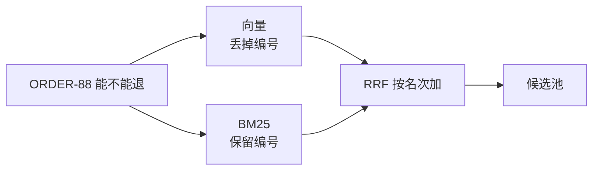
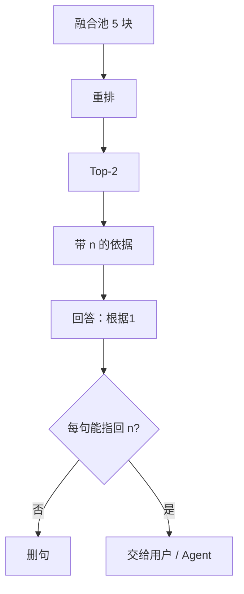

# 第 15 章 混合检索与重排序

> 本章定位：第四卷第三站。第 13–14 章只有一路向量 Top-K。读完本章，你要能说明 **编号和专有名词为什么常被稠密检索漏掉**，用手写 BM25 补位，用 **倒数排名融合（RRF, Reciprocal Rank Fusion）** 合成一路，再做一次重排，并让答案带 `[n]` 出处。
>
> 前置：第 13 章检索公式、第 14 章块与元数据。不需要 API Key、不下载 Cross-Encoder。
>
> 配套代码：`code/ch15/python/`、`code/ch15/java/`
>
> 图表假设：向量通道 **故意丢掉** `order`/`tz`/纯数字词项，用来模拟业界稠密模型把稀有编号当噪声；教学哈希本身其实吃得下 ID。BM25 的 k1=1.5、b=0.75，RRF 的 k=60，均为文献常见默认，不是调参结论。重排是规则加分，不是 BERT Cross-Encoder。ORDER-88 未发货、ORDER-99 / TZ123 已发货，与全书一致。

---

## 15.1 向量检索的盲区：专有名词与精确匹配

### 直觉解释

「事假上限几天」适合向量：换一种说法也能靠近。`ORDER-88`、`TZ123`、工号、SKU **不适合只靠向量**。稠密模型见过太多「订单号」，会把 ORDER-88 和 ORDER-99 收成差不多的点；「88 折」又在字面上撞车。

哈希嵌入其实会把 `order`、`88` 当词项，反而偏精确。为了让你看见 **业界真实事故**，本章向量通道故意丢掉编号词项。BM25 一路保留它们。

### 生活类比：模糊找书 vs 索书号

「那本讲请假的绿皮册子」——模糊找，向量擅长。「索书号 R-2026-088」——必须精确。图书馆同时有主题区和索书号抽屉。只开主题区，你会把 088 号和「全场 88 折海报」拿混。

### 原理剖析：稀有词的 IDF

编号几乎只出现在一两块里，**逆文档频率（IDF）** 极高。BM25 会狠狠加分。稠密向量把编号压成语义，IDF 被抹平。所以：语义问法走向量，单号、产品名、错误码走关键词。

---

## 15.2 关键词检索（BM25 等）如何补位

**BM25（Best Matching 25）** 是带文档长度惩罚的 TF-IDF。词在查询里出现、在该块里出现、又很少在别的块里出现，就加分；块特别长，就略微打折。

本章词项 = 英文词 + 中文单字和双字，与第 10 章切词一致，只是 BM25 **不丢掉 ID**。

它不会的事：同义改写（「走廊座位」≈「靠过道」）。那是向量的活。两路是搭档，不是替代。

生产里常用 Elasticsearch / OpenSearch 的 BM25，或 Tantivy、Lucene。公式相同，工程差在分词器和中文分析器。

---

## 15.3 混合检索的融合策略

两路分数量纲不同：余弦在 `[-1,1]`，BM25 可以是 `6.2`。**不能直接相加。**

常见三招：

| 策略 | 做法 | 风险 |
| --- | --- | --- |
| 截断拼接 | 向量 Top-K + 关键词 Top-K 去重 | 简单；排序仍乱 |
| 加权归一化 | α·vec + (1-α)·bm25 | α 难稳，分数要校准 |
| RRF | 只看名次：`1/(k+rank)` 相加 | 不调 α；k=60 常用 |

本章用 RRF。一块若向量第 3、BM25 第 1，两边的倒数加起来，往往压过「只在一路里排第二」的噪音。

### 图 1：两路召回，一路融合



---

## 15.4 重排序：用更强模型做第二道筛选

召回求 **不漏**，重排求 **排对**。候选 20–50 块，用更贵的模型或规则再打一遍分，只把前 2–3 块喂给生成器。

生产常用 Cross-Encoder / 专用 Rerank API：问题和块成对打分，比双塔向量准，也更贵。本章用规则教具：

- 查询里的 `ORDER-*` / `TZ*` 若出现在块中：+3
- 汉字重叠：小幅加分
- 「88 折」「会议室」：-2.5

简历上不要写「我们上了 rerank」却只做了这一套规则。要写清是 Cross-Encoder 还是业务规则，以及金标有没有回看。

### 图 2：召回宽、重排窄、引用落地



---

## 15.5 引用溯源：答案必须能指回原文

出处不是装饰。第 13 章「不足则停」在这里升级为：

> **回答里的每一句事实，必须能指回某个 `[n]`。指不回去，就删这句。**

`[1] orders.md / ORDER-88 未发货退款` 让人能点回去，也让评测（第 16 章）能自动对。Agent 把引用块当 **资料**，不当指令——`noise.md` 里写「不是 ORDER-88」，那是文本，不是系统提示。

ORDER-88 **此刻** 发没发货，仍以 `get_order` 为准。引用只证明制度，不证明库存。

---

## 实现：三路对照实验

### 环境要求

| 项目 | 版本 / 说明 |
| --- | --- |
| Python | 3.10+，标准库 |
| Java | 17+，无第三方依赖 |
| API Key / ES | 不需要 |

### 对照表

| 问法 | 只向量（丢 ID） | 只 BM25 | RRF + 重排 |
| --- | --- | --- | --- |
| ORDER-88 能不能退 | Top-1 是 88 折 | 「不能…退款」会把 ORDER-99 抬很高 | 融合后 88 折仍可能第一；重排才把 ORDER-88 拉回并带 [1] |
| TZ123 是哪张单 | 编号被丢掉 | 精确命中 ORDER-99 | 引用物流条款 |
| 事假上限几天 | 语义够用 | 也行 | 引用现行事假 |

---

### 示例 1：向量漏编号

```bash
cd code/ch15/python
python 01_vector_misses_id.py
```

Java：`VectorMissesId.java`

```powershell
cd code/ch15/java
mvn -q -DskipTests compile exec:java "-Dexec.mainClass=com.agentbook.ch15.VectorMissesId"
```

---

### 示例 2：RRF

```bash
python 02_hybrid_rrf.py
```

```powershell
mvn -q exec:java "-Dexec.mainClass=com.agentbook.ch15.HybridRrf"
```

实测：RRF 仍把「88 折」排第一（它在两路名次都不差）。**融合不等于排对。**

---

### 示例 3：重排 + 引用

```bash
python 03_rerank_and_cite.py
```

```powershell
mvn -q exec:java "-Dexec.mainClass=com.agentbook.ch15.RerankAndCite"
```

**Python / Java 差异：** 公式对齐。生产 Python 常接 ES + 向量库 + Cohere/BGE rerank；Java 同构，Lucene 是 BM25 老家。

---

## 踩坑提醒与职场视角

**坑 1：把两路分数直接加。** 先 RRF 或各自归一化。

**坑 2：只融合不重排。** 88 折仍可能排在 ORDER-88 旁边进 Prompt。

**坑 3：重排吃全部语料。** 重排贵。先召回 30，再重排。

**坑 4：引用了过期块。** 第 14 章的 version/kind 过滤要在召回前做。

**坑 5：有出处就等于事实。** 出处证明「哪页写过」，不证明「系统此刻如此」。

### 简历上可以写的一句

> 对工单号类查询做向量+BM25 的 RRF 混合检索，再用重排压低促销口误等撞车块；答案强制带文档出处，无法溯源的句子删除。

### 本章小结

- 语义走路，单号走抽屉。
- 融合看名次（RRF），别加生分。
- 召回求全，重排求准。
- 没有 `[n]` 的句子，默认不可信。

---

## 15.6 常见面试考点

> **高频原题：**「为什么要混合检索？Rerank 放哪？」
>
> **90 秒答法：**
> 向量擅长换一种说法，弱在稀有编号和专有名词。BM25 补精确匹配。两路分数量纲不同，我用 RRF 按名次融合。融合后再用 Cross-Encoder 或业务规则重排，只把前几块给生成器。答案必须能指回块的 source/heading。订单当前状态仍走工具，不走资料。
>
> **追问 1：**「RRF 的 k 是什么？」  
> 平滑名次差。60 是常用默认，用金标看要不要动。
>
> **追问 2：**「只用关键词行不行？」  
> 同义问法会漏。制度类问答至少保留向量一路。
>
> **追问 3：**「引用怎么防伪造？」  
> 生成器只许用候选块里的句子；评测查答案 span 是否落在引用块。第 16 章。

---

## 15.7 课后练习（含答案提示）

**练习 1：关掉 drop_ids（必做）**  
让向量也吃编号，再跑示例 1。对比「哈希其实能打 ID」和「稠密模型常常不能」。

- 提示：教学事故是模拟出来的，要在正文里说清。
- 面试句：先承认坐标系，再谈盲区。

**练习 2：加权融合（必做）**  
自己写 `0.4*norm(vec)+0.6*norm(bm25)`，和 RRF 比 Top-1。

- 提示：归一化用 min-max。α 一变，88 折可能回来。
- 对照：RRF 少一个旋钮。

**练习 3：伪造一句无出处的话（必做）**  
在回答末尾加「通常三天到账」。用「能否指回 [n]」规则删掉它。

- 提示：这是上线前的检查清单，不是文风问题。
- 产品：UI 上让 `[1]` 可点击。

**练习 4：60 秒口述（必做）**  
画出图 2，并解释 88 折为什么必须减分。录音。

---

## 本章质量自检

| 检查项 | 结论 |
| --- | --- |
| 零基础读者能否不看前文就懂？ | 从索书号 vs 主题区讲起。 |
| 代码能否直接复制运行？ | 无 Key、无 ES。 |
| 是否有职场 / 面试落点？ | RRF、引用、简历句。 |
| 图表是否标注假设？ | 向量丢 ID 为模拟；重排非 Cross-Encoder。 |

---

## 你现在应该能做的事

- [ ] 举一个向量会输给「88 折」的查询
- [ ] 说出 BM25 补的是精确，不是同义
- [ ] 用 RRF 解释为什么不能把分数直接加
- [ ] 写出带 `[1]` 的回答，并删掉无出处的句子

下一章给这条 RAG 管线装评估：没有金标和指标，混合检索只是感觉更好。

回复 **「继续」** 进入第 16 章：《RAG 评估与迭代优化》。
