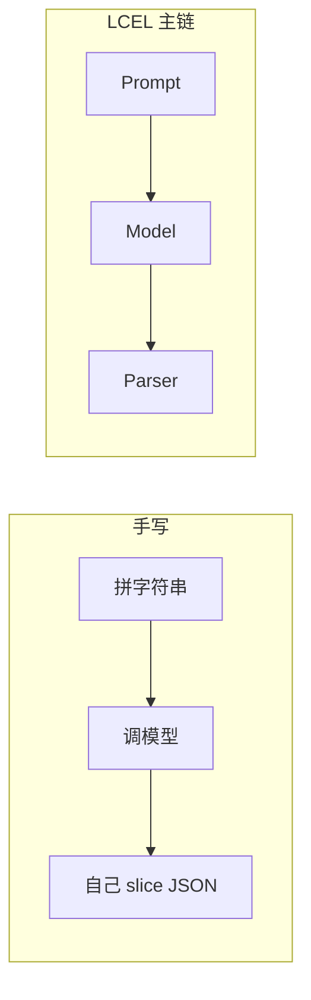
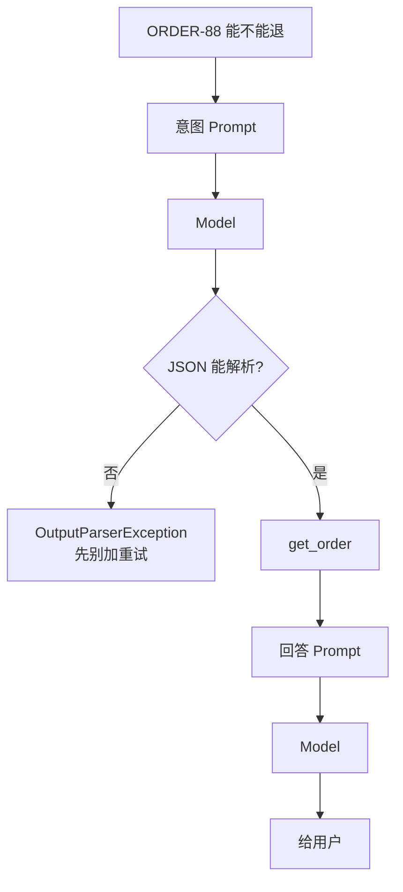

# 第 17 章 LangChain：生态很大，先抓住主链

> 本章定位：第五卷开篇。前四卷你手写了 Runtime、工具协议、记忆、RAG 和评估。读完本章，你要能说明 **LangChain 到底省了哪一段胶水**，认出 **Model / Prompt / Output Parser / Tool / Chain** 五件套，用 **LCEL（LangChain Expression Language）** 把它们接成一条管道，并承认 **封装会让调试变难**。
>
> 前置：第 4 章「模型输出是意图」、第 8 章结构化输出、第 13 章 RAG 公式。会 Python 和 Java 即可。
>
> 配套代码：`code/ch17/python/`（`langchain-core==1.6.1`）、`code/ch17/java/`（`langchain4j-core 1.18.0`）
>
> 图表假设：**模型是脚本，不是 GPT。** `PolicyChat` / `ScriptedChatModel` 按 Prompt 里已经出现的原文抽取回答，用来演示链，不演示智力。不需要 API Key。Java **没有** `|` 运算符；LangChain4j 用 `PromptTemplate` + `ChatModel` 顺序调用，概念对齐，不是一行翻译。生产里的 `AiServices` 注解代理本章故意不用——先看见每一步。现行事假仍是 **10 个工作日**，ORDER-88 未发货、ORDER-99 / TZ123 已发货。

---

## 17.1 LangChain 到底帮你省了什么

### 直觉解释

第 5–16 章你自己写过：拼系统提示、调模型、把输出抠成 JSON、再决定要不要检索或调 `get_order`。这些步骤 **每一章都在重复**。

**LangChain** 把重复的胶水收成零件：提示有模板，模型有统一 `invoke`，输出有解析器，多步可以 `|` 起来。它不提供「更聪明的模型」，也不保证 RAG 更准。第 16 章的金标，框架替不了你写。

生态很大：文档、组件、集成、一周一个新名字。先抓住 **主链（the main chain）**：

```
Prompt → Model → Output Parser
```

检索和工具是后来挂上去的车厢，不是另一辆车。

### 生活类比：水电工的成品管件

手写是截铜管、焊、试压。LangChain 是买来带丝扣的三通。你省了焊接，没省「水往哪流」。接错了，漏水点藏在接头里面，比裸管难找。所以本章既教你用管件，也教你拆回铜管。

### 原理剖析：框架是适配器农场

LangChain 的价值是 **同一套 Runnable 接口** 罩住不同厂商：换 `ChatOpenAI` 为国产兼容接口，链的其余部分少动。代价是：你要跟着它的版本碎（0.x 到 1.x 拆包拆得很凶）。本章只依赖 `langchain-core`，不装整棵 `langchain` 元包，就是为了少被拖走。

Java 同学请把 **LangChain4j** 当成同名近亲，不是同一个仓库的移植。面试时说「Python 用 LCEL，Java 用 LangChain4j 的 ChatModel」，比说「我们全栈 LangChain」诚实。

---

## 17.2 Model、Prompt、Output Parser、Tool、Chain

五个名词，第一次出现先中英对照：

| 零件 | 英文 | 它干什么 | 本章教具 |
| --- | --- | --- | --- |
| 模型 | Model / ChatModel | 吃消息，吐消息 | `PolicyChat` / `ScriptedChatModel` |
| 提示 | Prompt | 把变量填进系统/用户消息 | `ChatPromptTemplate` / `PromptTemplate` |
| 输出解析器 | Output Parser | 把模型文本变成 str / JSON / 对象 | `StrOutputParser`、`JsonOutputParser` |
| 工具 | Tool | 对外面的世界做副作用或查询 | `get_order` |
| 链 | Chain | 上面四件按顺序（或并行）接起来 | LCEL 的 `\|` / Java 顺序调用 |

还没上场、但简历里常被混进 LangChain 的东西：**回调（Callback）**、**记忆（Memory）**、**检索器（Retriever）**。它们都是往主链上挂的插件。先会主链，再挂。

第 4 章的那句话在这里仍然成立：模型输出是 **意图**，工具输出才是 **事实**。LangChain 只是给这句话配了 `JsonOutputParser` 和 `RunnableLambda`。

---

## 17.3 LCEL 与可组合管道

**LCEL** 是一套「能 `|` 的对象」：**可运行件（Runnable）**。左边 `invoke` 的返回值，成为右边的输入。

```python
chain = prompt | model | StrOutputParser()
chain.invoke({"question": "事假上限几天"})
```

字典写成 `{"context": retrieve, "question": passthrough}` 时，变成 **并行可运行件（RunnableParallel）**：两路一起算，再交给下一截。

它自动带上的能力（你暂时可以当赠品）：`batch`、`stream`、同一套回调。赠品不是你要在简历里夸的点。你要能证明的是：**把 `|` 拆回三次函数调用，结果一样。** 示例 2 里这行是刻意写的：

```text
手写三步 == LCEL ? True
```

Java 没有 LCEL。LangChain4j 的等价物是：`PromptTemplate.apply` → `ChatRequest` → `ChatModel.chat` → `aiMessage().text()`。概念一条，语法两套。

### 图 1：手写胶水 vs 主链



---

## 17.4 适合入门的三个官方模式

对照官方入门线，不是对照某一年的营销命名。

| 模式 | 官方直觉 | 本章文件 | 什么时候用 |
| --- | --- | --- | --- |
| 主链 | Prompt + Model + Parser | `01_main_chain` | 制度已经在模板里，或只做分类/改写 |
| RAG 链 | 先取资料再生成 | `02_lcel_rag` | 资料在文件/向量库，不能写死在提示里 |
| 工具链 | 模型选工具，工具回事实 | `03_tools_and_onion` | 订单状态、库存、权限等 **此刻** 的事实 |

「Stuff / Map-Reduce / Refine」是长文档问答的切法，属于 RAG 链的变体，不是第四种宗教。先会 Stuff（资料整段塞进提示），再谈拆文档。

RAG 链里的检索，本章用标题关键词，**不是** 第 15 章的混合检索。框架不替你把 Hit@1 变绿。

---

## 17.5 过度封装的代价：调试变难

接上工具之后，一条链的图节点会变成：

```text
Parallel → Lambda → ChatPromptTemplate → PolicyChat → JsonOutputParser → …
```

模型若回「当然可以退，三天到账。」，`JsonOutputParser` 抛 `OutputParserException`。根因是第 8 章就讲过的「模型没有遵守 JSON」，栈却先带你逛 `runnables/base.py` 好几圈。

**过度封装** 的三个信号：

1. 你说不清 `invoke` 此刻的输入字典有哪些键
2. 出了错，第一反应是「再包一层 Retry」而不是打印中间值
3. 简历写「精通 LangChain」，但无法在白板上把链画成三个函数

LangChain4j 的 **AiServices** 更进一步：一个 Java 接口加 `@UserMessage`，代理在背后拼 Prompt、调模型、解析返回值。方便，也更难单步。本章 Java 故意停在 `ChatModel.doChat`，就是让你看见代理后面是什么。

### 图 2：洋葱破了，从哪一层剥



---

## 实现：三条最小可运行链

### 环境要求

| 项目 | 版本 / 说明 |
| --- | --- |
| Python | 本章钉 `langchain-core==1.6.1`（`requirements.txt`）。2026-11-11 起 `langchain` 1.5 / `langchain-core` 1.8 要求 Python 3.11，本章不跟 |
| Java | 17+，Maven，`langchain4j-core 1.18.0` |
| API Key | 不需要 |
| 控制台 | PowerShell 中文可能乱码，看 Y/N 与退出码；可 `chcp 65001` |

安装时若看到 `chardet` / SLF4J 警告，可以忽略，不影响链。

**2026-11-12 核对：** Python 3.10 已于 2026-10 结束官方支持。`langchain` 1.5.0 与 `langchain-core` 1.8.0（2026-11-11）起最低要 Python 3.11。本章故意钉在 `langchain-core==1.6.1`，主链仍是 Prompt → Model → Parser。要跟官方最新包，先升到 3.11 并重跑三条示例，不要只改一行版本号。

### 对照表

| 问法 | 模式 1 主链 | 模式 2 RAG 链 | 模式 3 工具链 |
| --- | --- | --- | --- |
| 事假上限几天 | 模板里有 10 天，答 10 天 | 检索到现行事假，答 10 天 | 不应走订单工具 |
| 年假能卖吗 / 食堂几点 | 【不足】 | 检索空 → 【不足】 | — |
| ORDER-88 能不能退 | 模板没写订单 | 检索到未发货条款 | `get_order`：未发货可退 |
| TZ123 能否直接退 | — | 可走资料 | 工具：已发货，走售后 |

---

### 示例 1：主链

```bash
cd code/ch17/python
python -m pip install -r requirements.txt
python 01_main_chain.py
```

```powershell
cd code/ch17/java
mvn -q -DskipTests compile exec:java "-Dexec.mainClass=com.agentbook.ch17.MainChain"
```

---

### 示例 2：LCEL RAG / Java 顺序 RAG

```bash
python 02_lcel_rag.py
```

```powershell
mvn -q exec:java "-Dexec.mainClass=com.agentbook.ch17.SequentialRag"
```

Python 会打印 `手写三步 == LCEL ? True`。这是本章的及格线。

---

### 示例 3：工具链 + 洋葱破裂

```bash
python 03_tools_and_onion.py
```

```powershell
mvn -q exec:java "-Dexec.mainClass=com.agentbook.ch17.ToolsAndOnion"
```

Python 用真的 `JsonOutputParser` 接一句废话，抛 `OutputParserException`。Java 没有 LCEL 洋葱，异常停在你自己的 `isJsonObject`——对照着看，就知道框架多藏了几层。

**Python / Java 差异：** 概念五件套对齐。Python 用 LCEL 和官方 Parser；Java 用 LangChain4j 的 `PromptTemplate` + `ChatModel`，JSON 用 Jackson。不要在简历里写「Java 也上了 LCEL」。

---

## 踩坑提醒与职场视角

**坑 1：把 LangChain 当成 Agent 本身。** 它是零件箱。Agent 的循环、权限、金标仍是你的。

**坑 2：一上来装 `langchain` 全家桶。** 先 `langchain-core`。用到 OpenAI 再装 `langchain-openai`。社区包版本和 core 经常拧着。

**坑 3：在链里藏业务规则。** 「实习生不能看废止稿」是过滤器，第 16 章就讲过，不要写进 System Prompt 指望模型执行。

**坑 4：用 `ConversationBufferMemory` 当长期记忆。** 那是把历史塞回 Prompt。第 9 章的分层还在。

**坑 5：简历写精通，作业只跑通官方 Notebook。** 面试官会让你画 `|` 的数据长什么样。答不上来就是封装的受害者。

**坑 6：Java 说「我们对标 LangChain」。** 对标的是概念。依赖名是 `dev.langchain4j`，API 是 `ChatRequest`，不是 `RunnableSequence`。

### 简历上可以写的一句

> 用 langchain-core 的 LCEL 搭了 Prompt→Model→Parser 主链，检索和 get_order 作为链上车厢；能把同一条链拆回函数调用，并用解析失败证明模型输出仍是意图。

### 本章小结

- 框架省胶水，不省评估，不省权限。
- 先主链，再挂检索和工具。
- `|` 必须能拆回函数。
- 解析失败时先看模型原文，再看栈。
- LangChain 与 LangChain4j 是近亲，不是同一份源码。

---

## 17.7 常见面试考点

> **高频原题：**「LangChain 你用过吗？它解决什么，你为什么选它 / 为什么不选？」
>
> **90 秒答法：**
> 它把 Prompt、模型、解析器、工具收成 Runnable，用 LCEL 串成管道，换模型厂商时少改胶水。我只用 core，主链三截，检索和工具后挂。它不解决 Hit@1，也不解决 ACL。调试时我能把链拆回三次 invoke。Java 侧用 LangChain4j 的 ChatModel，不假装有 LCEL。订单状态仍走工具。
>
> **追问 1：**「LCEL 和旧的 `LLMChain` 啥关系？」  
> `LLMChain` 是老封装。新代码用 `|`。面试说到 Chain，最好补一句：现在的 Chain 就是 RunnableSequence。
>
> **追问 2：**「AgentExecutor 呢？」  
> 那是带循环的工具 Agent，第 18 章的图、第 3 章的 ReAct 才是它的脑。不要把 AgentExecutor 当主链入门。
>
> **追问 3：**「不用框架行不行？」  
> 行。第 1–16 章就是。团队要接多家模型、要统一回调和追踪时，框架才开始赚回复杂度。

---

## 17.8 课后练习（含答案提示）

**练习 1：换成 FakeListChatModel（必做）**  
示例 1 的 `PolicyChat` 换成 `FakeListChatModel(responses=["10 个工作日", "【不足】"])`。观察它 **不看问题、只轮换回复**。

- 提示：脚本模型和假列表模型都不是智力。一个看 Prompt，一个看队列。
- 面试句：教具要说清假设。

**练习 2：在 RAG 链中间打印（必做）**  
用 `chain = retrieve | prompt | model | parser` 的拆法，在检索后 `print(context)`。再把这一行收进 `RunnableLambda`。

- 提示：这就是生产里的 callback / tracing 雏形。第 26 章会回到可观测。
- 对照：出了错先打中间值，不要先加重试。

**练习 3：给工具链加一个未知单号（必做）**  
问 `ORDER-77`。让 `get_order` 回 `not_found`，模型说【不足】，不许编「一般可以退」。

- 提示：第 13 章监考规则在链里同样生效。
- 产品：工具错误码要进 Prompt，模型才会闭嘴。

**练习 4：60 秒口述（必做）**  
画出图 2，并解释为什么「当然可以退」必须死在 Parser，而不是死在用户气泡里。录音。

---

## 本章质量自检

| 检查项 | 结论 |
| --- | --- |
| 零基础读者能否不看前文就懂？ | 从成品管件讲起。 |
| 代码能否直接复制运行？ | 无 Key；有明确版本号。 |
| 是否有职场 / 面试落点？ | 五件套、拆链、简历句。 |
| 图表是否标注假设？ | 脚本模型；Java 无 LCEL。 |

---

## 你现在应该能做的事

- [ ] 用一句话说清 LangChain 省的是胶水不是智力
- [ ] 默写五件套，并指出检索/工具挂在哪
- [ ] 把 `prompt \| model \| parser` 拆回三次调用
- [ ] 在解析失败时指出该打模型原文，而不是加一层重试

下一章把这条直线弯成图：循环、分支、人工节点——LangGraph，以及它和你第 12 章手写状态机的对照。

回复 **「继续」** 进入第 18 章：《LangGraph：把 Agent 画成状态图》。
