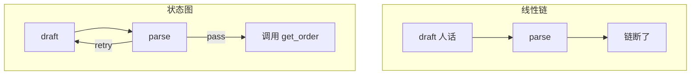
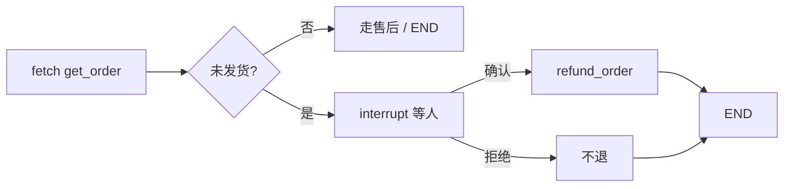

# 第 18 章 LangGraph：把 Agent 画成状态图

> 本章定位：第五卷第二站。第 17 章的主链是一根管子：Prompt → Model → Parser。读完本章，你要能说明 **为什么线性 Chain 不够用**，画出 **State / Node / Edge / 条件跳转**，给写工具加上 **人工节点（HITL）**，并用 **检查点（Checkpoint）** 按 `thread_id` 恢复。最后能把同一张图对照第 12 章的手写状态机。
>
> 前置：第 3 章 ReAct 循环、第 12 章 Session/确认、第 17 章主链。不需要 API Key。
>
> 配套代码：`code/ch18/python/`（`langgraph==1.2.11`）、`code/ch18/java/`（同构 `MiniGraph`，无第三方图库）
>
> 图表假设：**节点里的「模型」仍是脚本。** 第一次故意吐「当然可以退，三天到账。」用来逼出回边；第二次才给 JSON。`InMemorySaver` 只活在进程里，进程一关检查点就没了。Java **不是** LangGraph4j 一行翻译；`org.bsc.langgraph4j` 存在，但 API 是另一套方言。本章 Java 用手写运行时对齐概念。ORDER-88 未发货可退、ORDER-99 / TZ123 已发货须售后；写工具前必须确认，与第 12 章 `confirmed` 同一条军规。

---

## 18.1 为什么线性 Chain 不够用

### 直觉解释

管子只能往前流。Agent 却要：**看一眼 → 动手 → 再看一眼**。第 3 章的 ReAct、第 7 章的 Function Calling，骨子里都是回边。第 17 章工具链把「意图 JSON → get_order → 回答」写死成一次 `|`，第一次不是 JSON，整条链就死。

**状态图（State Graph）** 允许一条边指回已经走过的节点。这不是画得好看，是控制流从「管道」升级成「程序」。

### 生活类比：流水线 vs 车间白板

流水线：瓶子从灌装到旋盖，不许倒回去。车间白板：工序写在格子里，质检不合格就退回灌装。Agent 是车间。LangGraph 把白板做成可运行的对象：格子是 Node，箭头是 Edge，白板上的字是 State。

### 原理剖析：回边 = 循环

线性链：

```
draft → parse → （死或结束）
```

带条件回边的图：

```
draft → parse → 失败且未超次数 → draft
              → 成功 → END
```

示例 1 实测轨迹：`draft#0 → parse_fail → draft#1 → parse_ok`。管子做不到第二步。

---

## 18.2 State、Node、Edge、条件跳转

四个名词，第一次出现先中英对照：

| 零件 | 英文 | 它是什么 |
| --- | --- | --- |
| 状态 | State | 一张可变的黑板（TypedDict / Map） |
| 节点 | Node | 一次计算，返回要改写的字段 |
| 边 | Edge | 算完去哪 |
| 条件跳转 | Conditional Edge | 用当前 State 选下一跳 |

**Reducer（归约函数）** 决定字段怎么合并。本章 `trace` 用列表相加，其它字段覆盖。面试时能说清「为什么 messages 要用 `add` 而不是覆盖」，就比背 API 强。

条件边把 **一张图** 分成多条腿，不是复制三条链。请假走 `leave`，订单走 `order`，食堂走 `refuse`。业务变了，改路由函数，不改三份 Prompt。

### 图 1：管子没有回边，图有



---

## 18.3 循环、分支、人工节点

三种边，对应三种业务：

1. **循环：** 解析失败重试、ReAct 多步工具
2. **分支：** 请假 / 订单 / 拒答
3. **人工节点（Human-in-the-loop, HITL）：** 写工具前停住

第 12 章的 `empty → filled → proposed → confirmed` 就是一张业务图。LangGraph 没有替你发明确认，它只提供 **打断（interrupt）**：节点里调用 `interrupt(payload)`，图停住，payload 交给人；人用 `Command(resume=...)` 把值塞回这个调用。

**恢复时节点会从头再跑。** 所以 `get_order` 不能写在 `interrupt` 后面同一节点里当「已经发生的副作用」。先 `fetch`，再 `gate`。`fetch` 必须可重入。

ORDER-99 已发货：`gate` 直接说走售后，**不打断**——没有写工具，就不打扰人。

---

## 18.4 检查点与恢复

**检查点（Checkpoint）** 是某一步之后的整份 State +「下一跳是谁」。钥匙是 **`thread_id`**（线程/会话键），不是用户一句话。

本章 Python 用 `InMemorySaver`（文档里的 `MemorySaver` 是它的别名）。进程内好用，重启即丢。生产换 SQLite / Postgres saver，图的节点代码不用改。

```text
thread linqiu-order88 → 停在 gate
确认后 → 已执行 refund_order(ORDER-88)
thread linqiu-order99 → 不打断
```

这和第 12 章「双键隔离」是同一件事：`linqiu-order88` 和 `linqiu-order99` 各有一份黑板，不能串。

### 图 2：写工具前的人工节点



---

## 18.5 和手写状态机的对照

| | 第 12 章手写 Session | 本章 MiniGraph | LangGraph |
| --- | --- | --- | --- |
| 状态长什么样 | 槽位 + phase | `Map` / TypedDict | 带 Reducer 的 State |
| 怎么走下一步 | `if phase==...` | `add_edge` / `add_cond` | `add_conditional_edges` |
| 停下来等人 | 你自己 return | `Interrupt` | `interrupt()` |
| 凭什么恢复 | 你自己存 Redis | `thread_id` → Thread | Checkpointer + `thread_id` |
| 值在哪 | 你说了算 | 同左 | 协议统一，换存储后端 |

LangGraph **不是** 把 if/else 画得更好看。它卖的是：检查点协议、恢复语义、和追踪系统对接。示例 3 里手写 MiniGraph 与官方图对同一笔 ORDER-88：**先 PAUSED，确认后才执行写工具。** 你要能在白板上画出两边，才算会。

Java 官方近亲是 **LangGraph4j**（`org.bsc.langgraph4j`，本章撰稿时 1.8.x）。它用 `CompileConfig.interruptBefore`、`GraphInput.resume()`，和 Python 的 `interrupt()` / `Command` 不是同一份源码。简历上写清用的是哪一边。

---

## 实现：三张可运行的图

### 环境要求

| 项目 | 版本 / 说明 |
| --- | --- |
| Python | 3.10+，`langgraph==1.2.11` |
| Java | 17+，标准库 + 本章 `MiniGraph` |
| API Key | 不需要 |

```bash
cd code/ch18/python
python -m pip install -r requirements.txt
```

---

### 示例 1：链死、图活

```bash
python 01_chain_needs_loop.py
```

```powershell
cd code/ch18/java
mvn -q -DskipTests compile exec:java "-Dexec.mainClass=com.agentbook.ch18.ChainNeedsLoop"
```

链：`不是 JSON → 当然可以退，三天到账。`  
图：`draft#0 → parse_fail → draft#1 → parse_ok`，拿到 ORDER-88 未发货。

---

### 示例 2：一张图三条腿

```bash
python 02_state_branch.py
```

```powershell
mvn -q exec:java "-Dexec.mainClass=com.agentbook.ch18.StateBranch"
```

| 问法 | 轨迹 | 答案要点 |
| --- | --- | --- |
| 事假上限几天 | route:leave → leave → draft | 10 个工作日 |
| ORDER-88 能不能退 | route:order → ORDER-88 → draft | 未发货可退 |
| TZ123 是哪张单 | route:order → ORDER-99 → draft | 已发货走售后 |
| 食堂几点开门 | route:unknown → refuse | 【不足】 |

---

### 示例 3：检查点 + 人工确认

```bash
python 03_checkpoint_hitl.py
```

```powershell
mvn -q exec:java "-Dexec.mainClass=com.agentbook.ch18.CheckpointHitl"
```

Python 用真的 `interrupt` + `Command(resume="确认")` + `get_state`。Java / 手写 MiniGraph 用同一套 `thread_id`。

**Python / Java 差异：** Python 跑官方 LangGraph。Java 跑同构教具，用来对照第 12 章，不是「我们也上了 LangGraph」。生产 Java 若选 LangGraph4j，把 `interruptBefore("gate")` 映射到本章的人工节点即可。

PowerShell 的 `-Dexec.mainClass` 必须加引号。控制台中文乱码时看 `PAUSED` / `approved=true`。

---

## 踩坑提醒与职场视角

**坑 1：把整段业务写成一个超级节点。** 图就退化成链。fetch / gate / refund 要拆开。

**坑 2：在 `interrupt` 前面做不可重入的写操作。** 恢复会再跑一遍，订单会退两次。

**坑 3：不设 `thread_id` 就以为有记忆。** 检查点不知道存哪把钥匙。

**坑 4：`InMemorySaver` 写进生产。** 多副本、进程重启，会话蒸发。换持久 saver。

**坑 5：用图代替第 16 章的金标。** 图画得再对，Hit@1 也不会自己变绿。

**坑 6：简历写「我们用了 LangGraph」却说不清 next 是谁。** 面试官会问：打断之后 `get_state` 的 `next` 是什么。

### 简历上可以写的一句

> 用 LangGraph 把退款做成 fetch→人工确认→写工具 的状态图，InMemory/持久检查点按 thread_id 恢复；能对照手写状态机说明 interrupt 的重入语义。

### 本章小结

- 管子没有回边，Agent 需要图。
- State 是黑板，Node 改格子，Edge 选下一跳。
- 写工具前打断；恢复会重跑当前节点。
- `thread_id` 是检查点的钥匙。
- 框架卖协议，不卖 if/else。

---

## 18.6 常见面试考点

> **高频原题：**「LangChain 和 LangGraph 有什么区别？什么时候上图？」
>
> **90 秒答法：**
> LangChain 的 LCEL 适合一条管子：Prompt、模型、解析、偶尔一次检索。Agent 要循环、分支、人工确认时，我用 LangGraph：State 是黑板，节点改字段，条件边选下一跳。写工具前 `interrupt`，检查点按 thread_id 存。恢复时节点从头跑，所以副作用必须可重入。Java 侧我对齐同一张图，不一定用同名库。订单当前状态仍走工具，确认仍是产品规则，不是框架天赋。
>
> **追问 1：**「和手写状态机比，图多了什么？」  
> 统一的检查点、恢复、可视化、和追踪对接。业务 if/else 还是你写。
>
> **追问 2：**「recursion_limit 是什么？」  
> 防死循环。回边没画对时，图会把自己跑炸。先设小，再看轨迹。
>
> **追问 3：**「要不要把记忆也放进 State？」  
> 本轮黑板可以。跨会话长期记忆仍走第 9–11 章，不要把向量库塞进 TypedDict。

---

## 18.7 课后练习（含答案提示）

**练习 1：把重试次数改成 0（必做）**  
示例 1 的 `steps < 2` 改成 `steps < 1`。图应和链一样死在人话上。

- 提示：回边的次数是产品，不是框架默认。
- 对照：第 5 章重试预算。

**练习 2：拒绝退款（必做）**  
示例 3 `resume="拒绝"`。确认 `approved=False`，且没有「已执行 refund」。

- 提示：HITL 的两条出边都要测。
- 产品：拒绝也要写审计，不只是不退。

**练习 3：给食堂加一条边（必做）**  
`unknown` 不要直接 END，走到一个 `smalltalk` 节点回「我只会请假和订单」。再跑示例 2。

- 提示：改的是映射表，不是复制整张图。
- 面试句：扩展 = 加节点，不是加一条新链。

**练习 4：60 秒口述（必做）**  
画出图 2，并解释为什么 `get_order` 必须在 `interrupt` 前面。录音。

---

## 本章质量自检

| 检查项 | 结论 |
| --- | --- |
| 零基础读者能否不看前文就懂？ | 从流水线 vs 白板讲起。 |
| 代码能否直接复制运行？ | Python 有版本；Java 无 Key。 |
| 是否有职场 / 面试落点？ | HITL、thread_id、简历句。 |
| 图表是否标注假设？ | 脚本模型；Java 为同构教具。 |

---

## 你现在应该能做的事

- [ ] 说明线性链为何撑不住 ReAct
- [ ] 用 State / Node / Edge 讲清一张图
- [ ] 给退款加上打断，并用 thread_id 恢复
- [ ] 对照手写状态机，说出框架多卖的是协议

下一章换一种组织法：多智能体变成一场对话——AutoGen，以及它不适合什么业务。

回复 **「继续」** 进入第 19 章：《AutoGen：多智能体对话是一等公民》。
