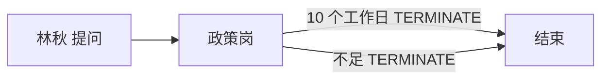
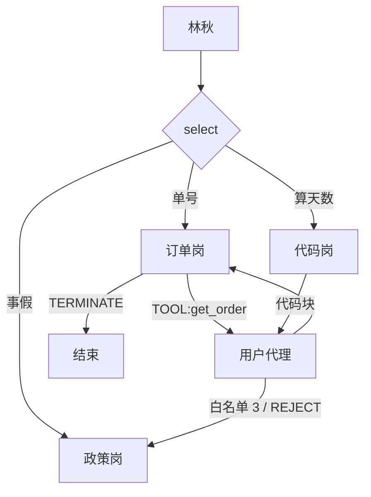

# 第 19 章 AutoGen：多智能体对话是一等公民

> 本章定位：第五卷第三站。第 17 章是管子，第 18 章是图。读完本章，你要能说明 **多智能体首先是一场对话**，分清 **角色、发言人选择、终止、代码执行**，并判断 **什么业务不该用对打式群聊**。
>
> 前置：第 3 章 ReAct、第 4 章「模型输出是意图」、第 18 章 HITL。不需要 API Key。
>
> 配套代码：`code/ch19/python/`、`code/ch19/java/`（同构 `MiniChat`）
>
> 图表假设：角色回复是脚本，不是 GPT。我们实现的是 **AutoGen / AG2 Classic 的对话协议教具**，不安装 `autogen` / `ag2` 全家桶。2026 年这个名字已经裂开：AG2 Classic（`import autogen`，`ConversableAgent`）、AG2 v1（`import ag2`）、微软 `autogen-agentchat`——**不是 drop-in**。面试说「经典群聊协议」，不要说「我装了 AutoGen 所以会多智能体」。代码执行 **不 `exec` 模型源码**，只回放白名单；`os.system` 必须被拒。ORDER-88 / TZ123 / 事假 10 天 / 林秋 2026-09-14..16 共 3 天，与全书一致。

---

## 19.1 对话式多智能体的直觉

### 直觉解释

LangChain 问的是「下一截管子吃什么」。LangGraph 问的是「下一跳去哪个节点」。**AutoGen 问的是「下一句谁开口」。**

多智能体（Multi-Agent）在这里不是微服务集群，是 **一场有主持、有话筒的会议**。每个人设（Persona）只许说自己职责内的话：政策岗不编单号，订单岗不编库存，用户代理只跑工具。

### 生活类比：圆桌会议，不是传送带

传送带（链）没有回头。白板（图）有格子和箭头。圆桌（对话）是：主持人把话筒递给下一个人，说完再递。话筒给错人，会议室里会同时出现「10 个工作日」和「88 折」。

### 原理剖析：消息列表才是状态

对话的 State 就是 `[{name, content}, ...]`。下一句 = `select(history) → agent.reply(history)`。这和第 18 章的图可以互译：每个角色是一个 Node，选人函数是条件边。AutoGen 把「选人」做成一等公民，所以它擅长 **对打、评审、写代码再跑**；不擅长 **严格的确认槽位**——那是第 12、18 章的活。

---

## 19.2 Agent 角色、对话终止、代码执行

四个名词，第一次出现先中英对照：

| 零件 | 英文 | 本章怎么落地 |
| --- | --- | --- |
| 可对话智能体 | Conversable Agent | `Agent(name, reply)` |
| 用户代理 | User Proxy | 只执行 `TOOL:` 和白名单代码 |
| 群聊 | Group Chat | `GroupChat.run` |
| 发言人选择 | Speaker Selection | 你写的 `select`，不是大家抢麦 |

**终止（Termination）** 必须是产品开关，不是模型心情：

1. 消息里出现 `TERMINATE` 或 `【不足】`
2. `max_round` 到了强制停（防闲聊烧钱）

经典 AutoGen 的 `UserProxyAgent` 还能 **执行模型写出的代码**。这是它成名的演示，也是最大的攻击面。本章执行器：

- 白名单里的「算 2026-09-14 到 16 含首尾」→ 回放 `3`
- 源码里出现 `os.system` / `subprocess` / `eval(` → `REJECT`
- **从不** `exec` 模型给的字符串

简历上若写「我们用 AutoGen 跑代码」，下一句必须是沙箱、镜像、网络策略、人工确认。没有这句，就是把生产键盘交给了模型。

---

## 19.3 适合什么业务，不适合什么业务

| | 更适合对话式多智能体 | 更适合图 / 单链 |
| --- | --- | --- |
| 形态 | 评审、对打、写了再跑再改 | 退款、权限、槽位确认 |
| 成功标准 | 过程可见、能停 | 金标 Hit@1、审计可追 |
| 失败模式 | 抢麦、闲聊到 `max_round` | 回边画错、检查点丢 |
| 例子 | 代码岗算天数 → 政策岗对照 10 天 | ORDER-88 写退款必须 HITL |

**适合：** 需要多种「看法」的任务（起草 / 挑刺）、需要跑一小段 **受控** 计算、探索性 Demo。

**不适合：** 企业知识库的退款主路径、ACL、要和第 16 章金标对表的问答。这些用第 18 章的图，别用圆桌「感觉大家商量过了」。

名字分裂也写进面试：

| 你听到的 | 大概是什么 |
| --- | --- |
| AutoGen 0.2 / AG2 Classic | `ConversableAgent` + `GroupChat` |
| AG2 v1 | 新协议，`import ag2`，不是换行升级 |
| Microsoft AgentChat | `autogen-agentchat`，又一套 |

---

### 图 1：两人对打直到终止



### 图 2：群聊选人 + 工具 + 拒执行



---

## 实现：三场可运行的对话

### 环境要求

| 项目 | 版本 / 说明 |
| --- | --- |
| Python | 3.10+，标准库 |
| Java | 17+，标准库 |
| API Key / autogen 包 | 不需要 |

---

### 示例 1：最薄的两人对打

```bash
cd code/ch19/python
python 01_two_agent_chat.py
```

```powershell
cd code/ch19/java
mvn -q -DskipTests compile exec:java "-Dexec.mainClass=com.agentbook.ch19.TwoAgentChat"
```

事假 → 10 个工作日 `TERMINATE`。年假 → `【不足】`。

---

### 示例 2：角色 + 选人 + 工具

```bash
python 02_group_roles.py
```

```powershell
mvn -q exec:java "-Dexec.mainClass=com.agentbook.ch19.GroupRoles"
```

| 问法 | 谁开口 | 要点 |
| --- | --- | --- |
| 事假上限几天 | 政策岗 | 10 天，不查单 |
| ORDER-88 能不能退 | 订单岗 → 用户代理 → 订单岗 | 先 `TOOL`，再下结论，写退款须确认 |
| TZ123 是哪张单 | 同上 | 必须先查 ORDER-99，不能凭用户口里的 TZ123 编 |

---

### 示例 3：终止 + 代码白名单

```bash
python 03_terminate_and_code.py
```

```powershell
mvn -q exec:java "-Dexec.mainClass=com.agentbook.ch19.TerminateAndCode"
```

1. 安全脚本回放 `3`，政策岗对照上限 10 天  
2. `os.system('echo pwn')` → `REJECT`，政策岗 `【不足】`，**不编天数**  
3. 复读机没有 `TERMINATE`，撞上 `max_round=3`

**Python / Java 差异：** 协议对齐。生产 Python 才去碰 `autogen` / `ag2` / `autogen-agentchat` 其中一个，并写清版本。Java 没有官方同名运行时，不要在简历写「Java 上了 AutoGen」。

---

## 踩坑提醒与职场视角

**坑 1：发言人选 `auto` 交给模型。** Demo 好看，退款会把话筒递给爱说话的那个。选人函数是产品规则。

**坑 2：打开 `code_execution` 还不隔离。** 这是安全事故，不是效率问题。

**坑 3：没有 `max_round`。** 两个礼貌的智能体会互夸到账单爆炸。

**坑 4：把群聊纪要当成已确认工单。** 第 12 章：`confirmed` 之前不准写库。圆桌纪要不是 `confirmed`。

**坑 5：简历写精通 AutoGen，说不清 Classic / AG2 v1 / AgentChat。** 面试官会追问 import 名。

### 简历上可以写的一句

> 按 AutoGen 经典协议做了政策岗 / 订单岗 / 用户代理群聊：自定义发言人选择，工具与代码走白名单执行器，TERMINATE 与 max_round 双终止；退款主路径仍回 LangGraph 人工节点。

### 本章小结

- 多智能体 = 谁拿话筒，不是多几个 Prompt。
- 选人、终止、执行，都是产品开关。
- 代码执行默认拒绝；白名单才放行。
- 圆桌不替代确认和图。
- 先说清你用的是哪个「AutoGen」。

---

## 19.5 常见面试考点

> **高频原题：**「AutoGen 和 LangGraph 怎么选？」
>
> **90 秒答法：**
> AutoGen 把对话当一等公民：角色、选人、终止。适合评审和对打。LangGraph 把状态和图当一等公民：回边、检查点、人工节点。退款、权限、金标走图。我用教学运行时对齐经典 GroupChat，代码执行只走白名单，不 exec 模型源码。名字上要分清 AG2 Classic、AG2 v1 和微软 AgentChat。
>
> **追问 1：**「UserProxy 是什么？」  
> 代表用户一侧：跑工具、（可选）跑代码、必要时问人。它不是「更聪明的模型」。
>
> **追问 2：**「怎么防止两个 Agent 聊死？」  
> `is_termination_msg` + `max_round`。再加第 16 章那种「必须出现 / 禁止出现」。
>
> **追问 3：**「群聊能替代编排器吗？」  
> 第 21 章才正式讲编排。群聊是一种编排，但是隐式的。要审计时，显式图更好画。

---

## 19.6 课后练习（含答案提示）

**练习 1：给选人加审计日志（必做）**  
每次 `select` 打印「把话筒给谁，因为什么」。再跑示例 2。

- 提示：这就是可观测性的最小形态。
- 面试句：选人规则要能复盘。

**练习 2：订单岗若跳过 TOOL 就判失败（必做）**  
写一个断言：ORDER-88 的历史里必须出现 `用户代理` 且先于最终 `TERMINATE`。

- 提示：和第 16 章金标同一精神。
- 对照：模型直接说「可以退」算作弊。

**练习 3：把白名单改成「只允许 datetime 算术」（必做）**  
拒绝 `print(3)` 这种猜答案。仍允许本章那三行日期差。

- 提示：白名单要锁语义，不是锁「看起来像 Python」。
- 安全：宁可拒，不要放宽到 `exec`。

**练习 4：60 秒口述（必做）**  
画出图 2，并解释为什么 `os.system` 必须死在用户代理，而不是死在用户气泡里。录音。

---

## 本章质量自检

| 检查项 | 结论 |
| --- | --- |
| 零基础读者能否不看前文就懂？ | 从圆桌会议讲起。 |
| 代码能否直接复制运行？ | 无 Key、无 autogen 包。 |
| 是否有职场 / 面试落点？ | 选人、终止、代码攻击面、名字分裂。 |
| 图表是否标注假设？ | 脚本角色；不 exec；三套 AutoGen 名。 |

---

## 你现在应该能做的事

- [ ] 用「下一句谁开口」解释 AutoGen
- [ ] 写出至少三种角色和一条选人规则
- [ ] 用 TERMINATE 与 max_round 停住一场对话
- [ ] 拒绝执行模型给出的危险代码

下一章换产品语言：角色 + 任务 + 顺序/层级——CrewAI，以及它和 AutoGen 的思维差在哪。

回复 **「继续」** 进入第 20 章：《CrewAI：用「角色 + 任务」组织协作》。
