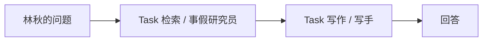
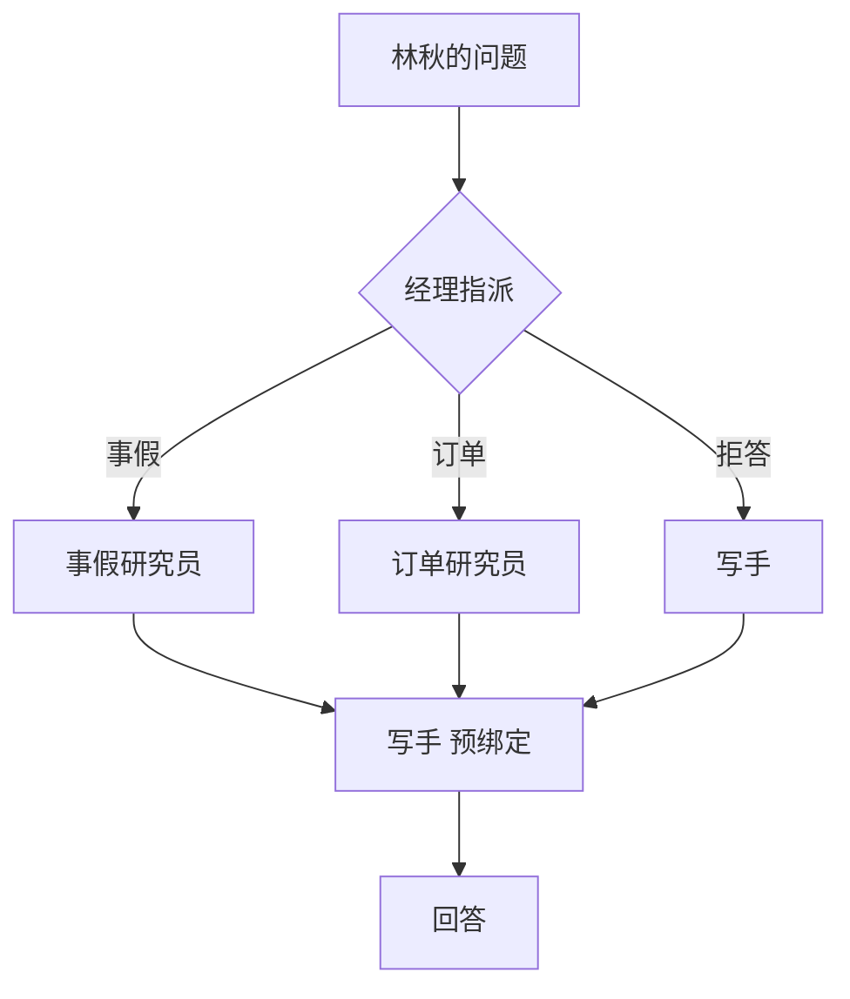

# 第 20 章 CrewAI：用「角色 + 任务」组织协作

> 本章定位：第五卷第四站。第 19 章的 Autogen 问「下一句谁开口」。读完本章，你要能用 **角色（Role）+ 任务（Task）+ 流程（Process）** 讲清一场协作，对比 **顺序流** 与 **层级流**，并说明它和圆桌对打的思维差在哪。
>
> 前置：第 19 章对话协议、第 16 章金标、第 18 章写工具须确认。不需要 API Key。
>
> 配套代码：`code/ch20/python/`、`code/ch20/java/`（同构 `MiniCrew`）
>
> 图表假设：角色是脚本，不是 GPT。我们实现的是 **CrewAI 产品语言教具**（`Agent` / `Task` / `Crew` / `kickoff` / `Process.sequential|hierarchical`），不安装 `crewai` 全家桶。官方 Crew 默认每个 Agent 背后是一次 LLM 调用；层级流还要 `manager_llm` 或 `manager_agent`。ORDER-88 未发货、ORDER-99 / TZ123 已发货、事假 **10 个工作日**，与全书一致。写手说「可退」**不等于** 已执行 `refund_order`。

---

## 20.1 角色、任务、流程的产品化抽象

### 直觉解释

CrewAI 把公司组织架构搬进代码：

- **角色（Agent）**：职称 + 目标 + 背景（role / goal / backstory），以及能用的工具
- **任务（Task）**：一件必须完成的事，带 **期望产出（expected output）**
- **团队（Crew）**：若干角色 + 若干任务
- **流程（Process）**：这张工单按什么规矩往下传
- **开工（kickoff）**：一次运行

它卖的不是更聪明的模型，是 **「谁负责哪件事」** 这句产品话。第 19 章的圆桌是会议纪要；这里是岗位说明书 + 工单。

### 生活类比：店长排班 vs 圆桌闲聊

圆桌：话筒传来传去，聊到谁累了谁停。排班：今天三件事——查制度、查订单、写回复；事假岗只查制度，写手只许引用前两张工单。客人问 ORDER-88，你却只排了「事假岗 → 写手」，单号就会落空。这就是示例 2 的顺序流事故。

### 原理剖析：任务输出是下一截的上下文

```
kickoff(question)
  → task1.output = agent1.work(task1, {})
  → task2.output = agent2.work(task2, {task1: output})
  → 返回最后一项
```

**期望产出** 是合同，不是 System Prompt 里的祝福。示例 3 用 `must_10` / `must_88` 验收，和第 16 章金标同一精神。

---

## 20.2 顺序流与层级流

| | 顺序流 Sequential | 层级流 Hierarchical |
| --- | --- | --- |
| 谁做计划 | 你。任务列表的顺序就是流水线 | **经理（Manager）** 运行时指派 |
| 任务要不要预绑定角色 | 要 | 检索类可不绑；写作类建议仍绑死 |
| 多出来的成本 | 无 | 每个未绑定任务多一次经理判断 |
| 典型事故 | 研究员写死，换一类问题就空 | 经理指派错人，比选错一条边更难查 |
| 官方还要求 | — | `manager_llm` 或 `manager_agent`，缺了校验失败 |

顺序流适合「永远先检索制度再写」这种稳定管道。层级流适合「来的是请假还是订单还不一定」。

官方 2026 年还推 **Flow**（带分支、重试、HITL 的事件流）。那已经靠近第 18 章的图。入门先把 Sequential / Hierarchical 讲清，简历不要写「我们上了 Flow」却说不出和 StateGraph 的差别。

### 图 1：顺序流是管子



### 图 2：层级流多一个经理



写手 **预绑定**：防止经理把「写一句可引用的话」派给只会查库的研究员。层级流不是把所有绑定都拆掉。

---

## 20.3 和 AutoGen 的思维差异

| | AutoGen 圆桌 | CrewAI 排班 | LangGraph 白板 |
| --- | --- | --- | --- |
| 一等公民 | 下一句谁开口 | 下一件事谁负责 | 下一跳去哪一格 |
| 状态 | 消息列表 | 任务输出字典 | TypedDict + 检查点 |
| 停下来 | TERMINATE / max_round | 任务列表走完 | END / interrupt |
| 适合 | 对打、评审 | 固定工种流水线 | 回边、HITL、退款 |

三者可以互译，但 **默认脑回路不同**。用错默认值：用圆桌跑退款会闲聊；用顺序 Crew 跑「既有请假又有订单」会绑死研究员；用图去跑「写文章互相挑刺」会把节点画成会议纪要。

面试加分句：「我能讲清为什么这里不用 AutoGen。」第 22 章会收成决策表。

---

## 实现：三场可运行的开工

### 环境要求

| 项目 | 版本 / 说明 |
| --- | --- |
| Python | 3.10+，标准库 |
| Java | 17+，标准库 |
| API Key / crewai 包 | 不需要 |

---

### 示例 1：顺序流

```bash
cd code/ch20/python
python 01_sequential_crew.py
```

```powershell
cd code/ch20/java
mvn -q -DskipTests compile exec:java "-Dexec.mainClass=com.agentbook.ch20.SequentialCrew"
```

事假 → 10 个工作日。年假 →【不足】。日志永远是 `research / 事假研究员 → write / 写手`。

---

### 示例 2：顺序绑死 vs 层级指派

```bash
python 02_seq_vs_hier.py
```

```powershell
mvn -q exec:java "-Dexec.mainClass=com.agentbook.ch20.SeqVsHier"
```

| 问法 | 顺序（研究员=事假岗） | 层级（经理指派） |
| --- | --- | --- |
| 事假上限几天 | 10 天 | 10 天 |
| ORDER-88 能不能退 | 【不足】检索落空 | 未发货可退，须确认 |
| TZ123 / 食堂 | — | 售后 / 【不足】 |

---

### 示例 3：任务合同

```bash
python 03_task_contract.py
```

```powershell
mvn -q exec:java "-Dexec.mainClass=com.agentbook.ch20.TaskContract"
```

四条 `expected` 全过才退出 0。写手说可退，仍不是第 18 章的 `refund_order`。

**Python / Java 差异：** 产品语言对齐。生产 Python 才装 `crewai`，每个 Agent 换真模型，层级流补 `manager_llm`。Java 没有官方同名运行时；Spring 里更像「一套 Job + 策略」，不要写「Java 上了 CrewAI」。

---

## 踩坑提醒与职场视角

**坑 1：把 backstory 写成小说。** 角色靠工具和任务合同，不靠身世。

**坑 2：顺序流复制三份 Crew「以示专业」。** 先问问题是不是真的永远同一条管子。

**坑 3：层级流不设经理。** 官方 `kickoff` 会校验失败。本章教具也会抛错。

**坑 4：经理把自己派去干活并编造事实。** 经理只许返回角色名。

**坑 5：用 Crew 替代确认。** 组织架构图不是 `phase=confirmed`。

**坑 6：简历写精通 CrewAI，作业只跑通官网研究团队 Demo。** 面试官会问 sequential 翻车时你怎么办。

### 简历上可以写的一句

> 按 CrewAI 的角色/任务/流程建模客服协作：顺序流处理稳定的制度问答，层级流由经理把检索指派给事假或订单研究员；用 expected 做任务合同，写工具仍回 LangGraph 人工节点。

### 本章小结

- 排班语言：谁负责哪件事。
- 顺序流你做计划，层级流经理做计划。
- 关键任务预绑定，别全交给经理。
- expected 是合同，不是祝福。
- 圆桌、排班、白板，默认脑回路不同。

---

## 20.5 常见面试考点

> **高频原题：**「CrewAI 和 AutoGen 有什么区别？」
>
> **90 秒答法：**
> AutoGen 的一等公民是对话：下一句谁开口。CrewAI 的一等公民是工单：下一件事谁负责。顺序流是我写死的管子，层级流多一个经理指派，经理本身也是一次模型调用，又贵又会指派错。退款、权限、回边我仍用 LangGraph。我能把同一笔 ORDER-88 在三种脑回路里画出来，并说明为什么顺序流把研究员绑成事假岗会检索落空。
>
> **追问 1：**「hierarchical 一定更强吗？」  
> 不一定。多一跳经理，延迟和费用上去。问题类型稳定时顺序流更干净。
>
> **追问 2：**「expected_output 有用吗？」  
> 对模型是软约束。验收必须像第 16 章那样在代码里断言。
>
> **追问 3：**「和 LangGraph 怎么选？」  
> 要检查点、HITL、回边，用图。只要工种流水线，用 Crew。两者都能手写，框架只是默认语言。

---

## 20.6 课后练习（含答案提示）

**练习 1：给顺序流加第三截「质检」（必做）**  
质检岗看到「5 天」或「88 折」就打回【不足】。用废止稿污染上下文，看它会不会拦。

- 提示：质检是任务，不是又一次闲聊。
- 对照：第 15 章重排、第 16 章 must_not。

**练习 2：让经理故意指错（必做）**  
ORDER-88 指派给事假研究员。观察写手是否【不足】。再改回。

- 提示：这就是层级流的主故障模式。
- 面试句：经理也要评估，不能只评估写手。

**练习 3：把 kickoff 结果对上第 16 章金标（必做）**  
四条问法跑示例 3，宏观 Hit 按「合同字段」算，不要按文采。

- 提示：Crew 不自动带评估。
- 产品：CI 红灯比「感觉协作更顺」重要。

**练习 4：60 秒口述（必做）**  
画出图 2，并解释写手为什么要预绑定。录音。

---

## 本章质量自检

| 检查项 | 结论 |
| --- | --- |
| 零基础读者能否不看前文就懂？ | 从店长排班讲起。 |
| 代码能否直接复制运行？ | 无 Key、无 crewai 包。 |
| 是否有职场 / 面试落点？ | 顺序翻车、经理成本、简历句。 |
| 图表是否标注假设？ | 脚本角色；官方要 LLM；可退≠已退。 |

---

## 你现在应该能做的事

- [ ] 用角色 / 任务 / 流程讲一场协作
- [ ] 指出顺序流绑死研究员时订单为什么空
- [ ] 说明层级流多出来的经理调用
- [ ] 把 CrewAI 和 AutoGen、LangGraph 的一等公民各说一句

下一章看托管运行时：OpenAI Assistants 的对象模型，以及它帮你省什么、锁你什么。

回复 **「继续」** 进入第 21 章：《OpenAI Assistants API：托管运行时的取舍》。
