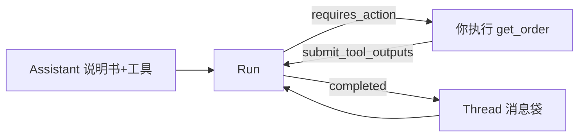
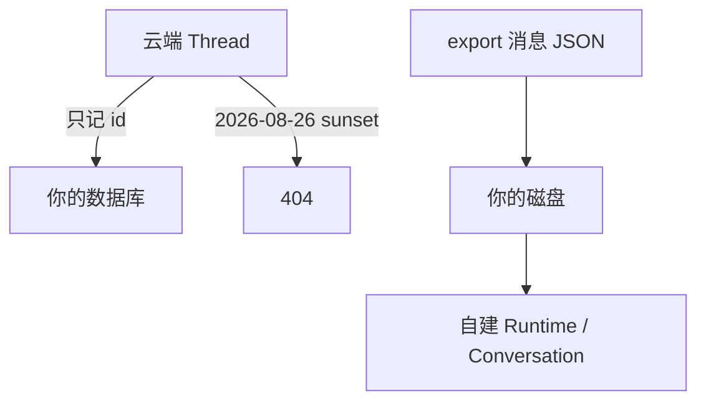

# 第 21 章 OpenAI Assistants API：托管运行时的取舍

> 本章定位：第五卷第五站。前四章谈自建链、图、圆桌、排班。读完本章，你要能画出 **Assistant / Thread / Run / Tool** 对象图，说明托管记忆和托管工具省了什么，以及 **供应商锁定、迁移、排障** 要付什么账。对照实验必须能回答：状态到底在谁家里。
>
> 前置：第 2 章 Runtime、第 4 章工具调用、第 12 章会话。不需要 API Key。
>
> 配套代码：`code/ch21/python/`、`code/ch21/java/`
>
> 图表假设：这是 **教学托管运行时**，不是 OpenAI 线上服务。模型仍是脚本。对象名对齐已日落的 Assistants API：**2026-08-26 正式关停**（今天写这一章时已经过了日落日）。继任是 **Responses API + Conversations API**（Assistant→Prompt，Thread→Conversation，Run→Response，Run Step→Item）。面试仍会问旧对象名，因为简历和存量代码里还有。ORDER-88 / TZ123 / 事假 10 天与全书一致。写退款须确认。

---

## 21.1 Assistant、Thread、Run、Tool 的对象模型

### 直觉解释

自建 Runtime 里，会话、工具循环、提示词散落在你的类里。Assistants 把它们收成供应商家里的四件套：

| 对象 | 英文 | 它是什么 |
| --- | --- | --- |
| 助手 | Assistant | 说明书 + 模型 + 工具清单 |
| 线程 | Thread | 一段对话的消息袋 |
| 运行 | Run | 对某个 Thread 按 Assistant 跑一次 |
| 工具 | Tool | 检索 / 代码解释器 / 函数调用 |

Run 是状态机：`queued → in_progress → requires_action | completed | failed`。`requires_action` 就是第 4 章的「模型输出是意图」：它停下来等你 `submit_tool_outputs`。

### 生活类比：把档案柜搬进银行保险箱

自己管档案柜：钥匙在你口袋，搬家自由，失火也是你的锅。放进银行保险箱：前台帮你编号，你只记一张条。银行改了编号规则或这门业务关张，条还在，柜子空了。

### 原理剖析：一次 Run 在干什么

```
create thread → add user message → create run
  → 若 requires_action：你本地执行 get_order → submit_tool_outputs
  → run.completed → 读 thread 最后一句
```

继任 API 把「轮询 Run 状态」收成「一次 Response 返回 output items，工具循环由你显式续上」。对象改名了，**循环没消失**。

### 图 1：托管对象图



---

## 21.2 托管记忆与托管工具的便利

托管真正省下的三件事：

1. **记忆：** Thread 替你存多轮，不用自己切窗口（切得对不对仍是产品问题）
2. **工具附件：** 官方检索、Code Interpreter 开箱
3. **对象存储：** 你的数据库只存 `thread_id`，看起来很瘦

便利的账单在下一节兑现。Code Interpreter 和第 19 章一样：能跑代码就是攻击面，权限和网络策略仍是你的。

---

## 21.3 供应商锁定、可迁移性、排障成本

**供应商锁定（Vendor lock-in）** 不是道德指控，是工程事实：核心状态的权威副本在别人的 API 里。

| 锁定点 | 日落时你失去什么 | 自建时你还剩什么 |
| --- | --- | --- |
| 只存 `thread_id` | 404。消息不在你库里 | Session JSON |
| 只会 `beta.threads` | 整条调用链重写 | 换模型适配器 |
| 排障靠 Run Step | 控制台关了就没故事 | 自己的 trace |

2026-08-26 不是假想题。官方迁移表：

| 旧 | 新 |
| --- | --- |
| Assistant | Prompt（配置；在控制台建版本，不再只用 API 新建） |
| Thread | Conversation |
| Run | Response |
| Run Step | Item |

2026-11-12 仍以这次关停为准：Assistants 没有复活。官方说明 Prompt 在控制台创建和回滚，应用代码拿 prompt id；编排、重试、工具循环仍在你的进程。没有自动把旧 Thread 搬进 Conversation 的官方推车。只换名字、不导出消息，日落后还是空库。

排障：托管出了错，你要会读 Run 状态和 Step；自建出了错，你要会读自己的日志。面试两套都要会说。

### 图 2：日落之后，id 不是数据



---

## 21.4 与自建 Runtime 的对比实验

### 环境要求

| 项目 | 版本 / 说明 |
| --- | --- |
| Python / Java | 3.10+ / 17+，标准库 |
| OpenAI Key | 不需要；线上 Assistants 已关 |

---

### 示例 1：对象模型

```bash
cd code/ch21/python
python 01_object_model.py
```

```powershell
cd code/ch21/java
mvn -q -DskipTests compile exec:java "-Dexec.mainClass=com.agentbook.ch21.ObjectModel"
```

事假一次 `completed`。ORDER-88 先 `requires_action`，`submit_tool_outputs` 之后才下结论。

---

### 示例 2：日落锁定

```bash
python 02_sunset_lockin.py
```

```powershell
mvn -q exec:java "-Dexec.mainClass=com.agentbook.ch21.SunsetLockin"
```

云端清空后，旧 `thread_id` 再取就是 404。`exported_thread.json` 还在。

---

### 示例 3：托管 vs 自建

```bash
python 03_hosted_vs_local.py
```

```powershell
mvn -q exec:java "-Dexec.mainClass=com.agentbook.ch21.HostedVsLocal"
```

四条问法答案一致。差别不在对错，在 **日落后谁还能答**，以及排障看哪一边的对象。

**Python / Java 差异：** 对象对齐。生产若接新 API，Python 用官方 SDK 的 `responses` / `conversations`；Java 用 HTTP 或社区 SDK。不要在 2026 年 9 月之后的简历写「线上跑着 Assistants」。

---

## 踩坑提醒与职场视角

**坑 1：简历写精通 Assistants，不知日落日。** 面试官会问「你们迁了没」。

**坑 2：数据库只有 thread_id。** 这是示例 2 的主角。

**坑 3：以为换 Responses 就没有工具循环。** 循环在你进程里，只是不再轮询 Run。

**坑 4：托管检索替代第 14–16 章。** 切块、权限、金标还是你的。

**坑 5：把 Code Interpreter 当免费沙箱。** 问清网络、文件系统、留存。

### 简历上可以写的一句

> 能讲清 Assistants 的 Thread/Run 与 Responses/Conversations 的映射；工具循环在 requires_action 或 output items 处交回本进程；会话权威副本落在自建库，不把 thread_id 当唯一备份。

### 本章小结

- 四件套是托管 Runtime 的皮肤。
- `requires_action` = 意图，不是事实。
- 托管省样板，锁状态。
- 2026-08-26 已日落；继任要会映射。
- 自建不是落后，是你还能回答的底气。

---

## 21.5 常见面试考点

> **高频原题：**「Assistants API 和自己写 Agent 有什么区别？现在还能用吗？」
>
> **90 秒答法：**
> Assistants 把说明书、会话和一次运行收成供应商对象，Run 在 requires_action 停下来等我交工具结果。它 2026-08-26 已日落，新代码走 Responses + Conversations，名字换了，工具循环还在。我会把消息导出到自己库。退款确认、ACL、金标从不托管给供应商当默认正确。
>
> **追问 1：**「Thread 和你们第 12 章 Session 谁说了算？」  
> 产品以自建 Session 为准。Thread 最多当缓存。双键隔离、confirmed，供应商不管。
>
> **追问 2：**「迁移最容易漏什么？」  
> 历史消息、tool call_id 对齐、以及你包在轮询外面的超时/重试。
>
> **追问 3：**「为什么还要学旧对象？」  
> 存量代码、面试题、事故复盘都还在用这些词。映射表比假装没发生过更值钱。

---

## 21.6 课后练习（含答案提示）

**练习 1：给 Run 加上 failed（必做）**  
工具返回 `查无此单` 时进入 `failed` 或 completed+【不足】。两种语义写进注释：哪个该重试，哪个不该。

- 提示：失败码是产品，不是 HTTP 500 的同义词。
- 对照：第 4 章意图 / 第 16 章正确。

**练习 2：写一张映射卡（必做）**  
Assistant/Thread/Run/Step → Prompt/Conversation/Response/Item。不看正文默写。

- 提示：面试 30 秒题。
- 职场：贴在迁移 PR 里。

**练习 3：自建 Session 增加 version（必做）**  
用第 12 章乐观锁：同一 thread 并发 submit 两次，后到的拒绝。托管 API 不替你做这笔。

- 提示：锁定不只是「数据在谁家」，还有「并发谁赢」。
- 安全：退款尤其要。

**练习 4：60 秒口述（必做）**  
画出图 2，并解释为什么「库里只有 thread_id」在日落后等于没有会话。录音。

---

## 本章质量自检

| 检查项 | 结论 |
| --- | --- |
| 零基础读者能否不看前文就懂？ | 从银行保险箱讲起。 |
| 代码能否直接复制运行？ | 无 Key；线上 API 已关，教具可跑。 |
| 是否有职场 / 面试落点？ | 日落日、映射表、导出。 |
| 图表是否标注假设？ | 教学托管；脚本模型；继任 API 改名。 |

---

## 你现在应该能做的事

- [ ] 画出 Assistant / Thread / Run / Tool
- [ ] 用 requires_action 解释工具循环
- [ ] 说出 2026-08-26 日落和四组新名字
- [ ] 对比托管与自建：谁拥有状态、出了错看谁

第五卷还差一张总表：什么时候用链、图、圆桌、排班、托管——以及怎么说「为什么不用 X」。

回复 **「继续」** 进入第 22 章：《框架选型决策指南》。
