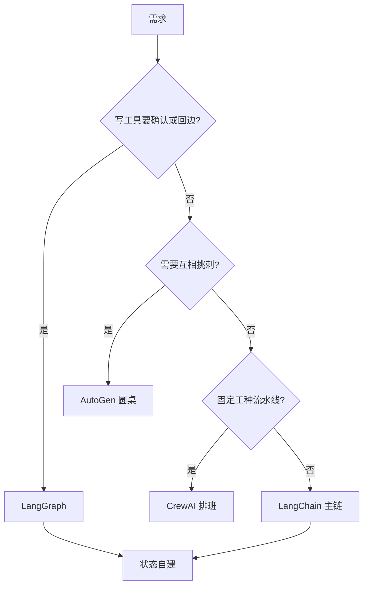
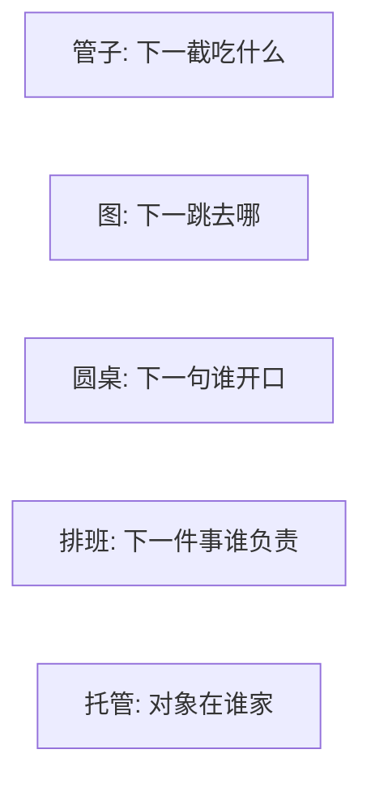

# 第 22 章 框架选型决策指南

> 本章定位：第五卷收官。第 17–21 章各教了一种默认语言：管子、图、圆桌、排班、托管。读完本章，你要能在约束下选出默认语言，并说出 **为什么不用另外四个**。选型不是入教。
>
> 前置：第 17–21 章的一等公民。不需要 API Key。
>
> 配套代码：`code/ch22/python/`、`code/ch22/java/`
>
> 图表假设：评分权重是 **课堂约定**，不是官方排名或论文结论。改权重，首选会翻——这正是要点。林秋三份简历项目：知识库问答、退款协作、可观测生产 Agent。ORDER-88 写退款须 HITL；Assistants 已于 2026-08-26 日落。

---

## 22.1 选型不是信仰，是约束条件下的工程决策

### 直觉解释

「我们全栈 LangGraph」和「我们不用框架」一样，经常是信仰。工程问题是：**在这些约束下，默认用哪种语言最省事、最不容易选错下一跳。**

默认语言可以换。换的理由是约束变了，不是上周读了另一篇博客。

### 生活类比：出门选交通工具

下雨、赶飞机、带着拉杆箱——选出租车。周末去公园——走路。把出租车纹在脑门上，并不更专业。

框架也一样：事假问答是自行车；ORDER-88 退款是带刹车的车（图 + 人工节点）；制度对打是圆桌；固定出稿是排班；三天演示曾经是托管，日落之后主链教具更稳。

### 原理剖析：先写约束，再写框架名

约束四件套：

1. **会不会死循环 / 要不要确认**（可控性）
2. **几天必须看见东西**（交付周期）
3. **团队会不会画图、会不会 Java**（技能）
4. **状态能不能只活在供应商家**（生态 / 锁定）

框架名是输出，不是输入。

---

## 22.2 团队技能、交付周期、可控性、生态

| 约束 | 问自己一句 | 偏谁 |
| --- | --- | --- |
| 技能 | 团队的默认隐喻是管子、图、会议还是工单？ | 靠近已有隐喻 |
| 工期 | 3 天演示还是 20 天主路径？ | 短：主链；长且要确认：图 |
| 可控 | 写工具前能否停？金标能否红灯？ | 图 / 自建 Session |
| 生态 | 对象会不会改名或关停？ | 自建状态；少把 id 当备份 |

Java 团队：LangChain4j / 手写图更贴。AutoGen、CrewAI 没有同等官方 Java 运行时——示例里给它们减分，是约束，不是歧视。

---

## 22.3 「能讲清为什么不用 X」比「用过 X」更加分

面试清单里写满框架，下一句是「那退款为什么不用 AutoGen？」答不上来，清单是负分。

加分句模板：

> 这个需求的约束是 A。所以默认语言是 Y。不用 X，因为 X 的一等公民是 Z，会在这里翻车。

示例 2 按场景把四句「不用」打出来，供你改成自己的口吻。

---

## 22.4 一张可直接带进面试的决策表

课堂实测（改 `catalog.py` / `Catalog.java` 权重会变）：

| 场景 | 问法 | chain | graph | chat | crew | hosted | 首选 |
| --- | --- | --- | --- | --- | --- | --- | --- |
| 企业知识库 | 事假上限几天 | 6 | 2 | -1 | -1 | -3 | 主链 |
| 未发货退款 | ORDER-88 能不能退 | 2 | 7 | -3 | -2 | -3 | 状态图 |
| 制度对打 | 旧稿 5 天还写不写 | 2 | 2 | 3 | 1 | -3 | 圆桌 |
| 固定出稿 | 检索再写一句 | 3 | 2 | -1 | 6 | -3 | 排班 |
| 三天演示 | 先让老板看见 | 5 | 0 | 0 | 0 | 4 | 主链 |

日落后托管仍有分，但赢不了「自己能跑的主链」。这是 2026 年 9 月的约束，不是永远。

林秋简历三项目：知识库→主链；退款协作→图；可观测生产→还是图（检查点 + 自建状态）。

### 图 1：先约束，后框架



### 图 2：一等公民对照



---

## 实现：三份可运行的决策卡

### 环境要求

| 项目 | 版本 / 说明 |
| --- | --- |
| Python / Java | 3.10+ / 17+，标准库 |
| API Key | 不需要 |

---

### 示例 1：打分

```bash
cd code/ch22/python
python 01_score_constraints.py
```

```powershell
cd code/ch22/java
mvn -q -DskipTests compile exec:java "-Dexec.mainClass=com.agentbook.ch22.ScoreConstraints"
```

---

### 示例 2：为什么不用

```bash
python 02_why_not.py
```

```powershell
mvn -q exec:java "-Dexec.mainClass=com.agentbook.ch22.WhyNot"
```

---

### 示例 3：面试三张卡

```bash
python 03_interview_card.py
```

```powershell
mvn -q exec:java "-Dexec.mainClass=com.agentbook.ch22.InterviewCard"
```

**Python / Java 差异：** 同一张权重表。把它当成你们组的 RFC 草稿，而不是要背的标准答案。

---

## 踩坑提醒与职场视角

**坑 1：先定框架再找需求来证明。** 把约束表留空的选型会，开完等于没开。

**坑 2：把课堂分当成行业排名。** 简历写「LangGraph 7 分」会被笑。要写约束和不用谁。

**坑 3：一个仓库只准一种框架。** 知识库主链 + 退款图，是正常拼盘。

**坑 4：把托管当免运维。** 第 21 章日落就是考题。

**坑 5：Java 简历写精通 AutoGen/CrewAI。** 说清是概念对齐还是真跑了哪个包。

### 简历上可以写的一句

> 按约束选型：知识库用 LCEL 主链，退款用 LangGraph（HITL+检查点），评审用对话协议；能说明为什么主路径不用圆桌和托管 Thread。

### 本章小结

- 框架是默认语言，不是信仰。
- 先写约束四件套。
- 加分句是「不用 X，因为…」。
- 拼盘合法；全栈某一商标不合法。
- 权重可改，决策过程要留痕。

---

## 22.5 常见面试考点

> **高频原题：**「这些框架你怎么选？」
>
> **90 秒答法：**
> 我先写约束：要不要确认和回边、几天交付、状态能不能只放供应商、团队默认隐喻是什么。事假问答我用主链；ORDER-88 退款用图，因为管子停不下写工具；对打用圆桌；固定出稿用排班。Assistants 已日落，三天演示我也宁可主链加脚本。我能讲清不用的那几个会在哪翻车。
>
> **追问 1：**「会不会过度设计？」  
> 会。没有回边却上图，就是示例里的负分。从主链长出来，约束出现再加节点。
>
> **追问 2：**「手写可以吗？」  
> 可以。第 1–16 章就是。框架赚的是默认协议和入职对齐，不是智力。
>
> **追问 3：**「你们线上现在用哪个？」  
> 按子系统说，不要说公司宗教。知识库一套，退款一套。

---

## 22.6 课后练习（含答案提示）

**练习 1：改权重（必做）**  
把 `own_state` 对 hosted 的 -3 改成 0。看 hackathon 会不会翻盘。改回去。

- 提示：权重就是价值观。改分要在 RFC 里留一句为什么。
- 面试句：数字是约定，不是真理。

**练习 2：加一个场景「实习生问事假但语料有废止稿」（必做）**  
约束加上 ACL + 金标。看首选还是不是纯主链。

- 提示：第 16 章会把「只要管子」打回。
- 对照：主链 + 过滤，仍可能赢过圆桌。

**练习 3：把三张面试卡背下来再改口吻（必做）**  
不要背分数，背约束和「不用」。录音 90 秒。

- 提示：示例 3 是骨架。
- 职场：对经理讲约束，对面试官讲不用。

**练习 4：60 秒口述（必做）**  
画出图 1，用 ORDER-88 走一遍。录音。

---

## 本章质量自检

| 检查项 | 结论 |
| --- | --- |
| 零基础读者能否不看前文就懂？ | 从出门选车讲起。 |
| 代码能否直接复制运行？ | 无 Key，一张权重表。 |
| 是否有职场 / 面试落点？ | 为什么不用 X、三张简历卡。 |
| 图表是否标注假设？ | 权重为课堂约定；托管已日落。 |

---

## 你现在应该能做的事

- [ ] 不先报框架名，先报四条约束
- [ ] 给事假 / 退款 / 对打 / 出稿各选一个默认语言
- [ ] 对每个首选说出至少两个「不用」
- [ ] 用三张卡讲简历项目，而不是报商标清单

第五卷到此结束。下一卷进入「一个人忙不过来」：编排器、工人、共享黑板——以及一个工人挂了怎么办。

回复 **「继续」** 进入第 23 章：《Orchestrator 模式：主编排负责制》。
