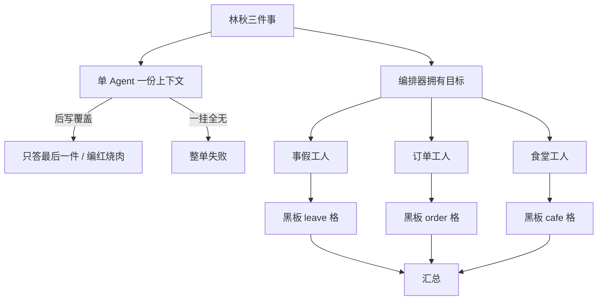
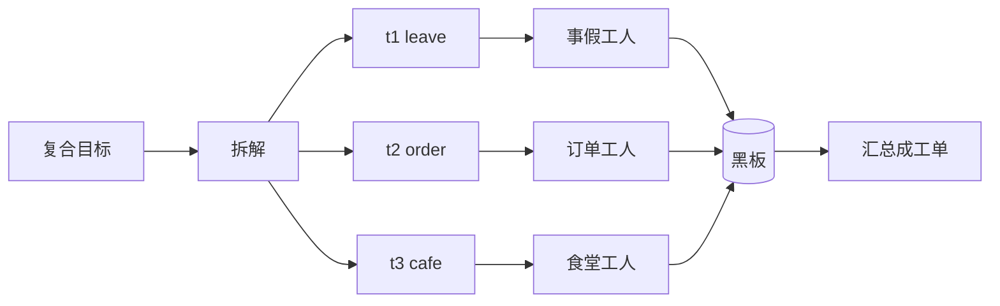

# 第 23 章 Orchestrator 模式：主编排负责制

> 本章定位：第六卷第一站。第五卷教你选默认语言：管子、图、圆桌、排班、托管。读完本章，你要能讲清 **一个人忙不过来时，谁拥有目标**：编排器（Orchestrator）拆任务、工人（Worker）干活、共享黑板（Shared Blackboard）收卷；以及 **一个工人挂了，整单是死还是部分成功**。
>
> 前置：第 3 章单循环、第 18 章图的下一跳、第 19 章圆桌、第 20 章排班、第 22 章「退款协作走图」。不需要 API Key。
>
> 配套代码：`code/ch23/python/`、`code/ch23/java/`（同构 `MiniOrch`）
>
> 图表假设：编排器的拆解是 **规则**，不是大模型规划器；工人是脚本，不是 GPT。黑板活在进程里。教学里工人 **串行** 派工，方便 Python / Java 对拍；生产里才进线程池。食堂超时是教具抛出的异常，不是真的 HTTP。ORDER-88 未发货可退、ORDER-99 / TZ123 已发货须售后；写退款须确认，**可退 ≠ 已调用 `refund_order`**。林秋事假 **2026-09-14..16 共 3 天**，上限 **10 个工作日**。

---

## 23.1 单 Agent 的能力天花板

### 直觉解释

一只 Agent 能办事，是因为它有目标、工具和循环。但它只有 **一张嘴、一份上下文、一次失败口径**。林秋一口气问三件：「事假上限几天？ORDER-88 能不能退？食堂有没有红烧肉？」单脑常见两种死法：

1. **后写覆盖：** 先想起事假，又看见订单，最后只答订单；再看见食堂，连红烧肉都编出来。
2. **一挂全无：** 食堂菜单接口超时，事假和订单其实已经查到了，却对用户说「系统出错」。

这不是模型不够大。是 **目标没有被拆成可独立交卷的格子**。

### 生活类比：主编排 vs 一个人兼三岗

报社出早报：记者跑现场、编辑改稿、校对盯错字，主编决定今天头版是哪三条、哪一条可以缺。让主编自己去跑现场、改稿、下厨，不是「全能」，是事故。

客服 Agent 同理。事假是法务岗，订单是售后岗，食堂是后勤岗。你需要一个 **主编排**，不是一个更会聊天的超人。

### 原理剖析：天花板在结构，不在参数量

单 Agent 的上下文是一份糊。工具结果往里倒，模型用「最近、最亮」的名词做答案。这和第 14 章「切太粗」、第 20 章「顺序流把研究员绑成事假岗」是同一类病： **一份上下文服务多个互不相关的目标**。

面试时别说「所以我们上了多智能体」。先说清单脑死在哪：覆盖、污染、单点失败。结构对了，两只工人也比一只「超级 Agent」稳。

---

## 23.2 编排器、工人、共享黑板

三个名词，第一次出现先中英对照：

| 零件 | 英文 | 它是什么 |
| --- | --- | --- |
| 编排器 | Orchestrator | **拥有目标的人**。负责拆解、派工、汇总、决定失败怎么收场 |
| 工人 | Worker | 只干自己那一类事。不和别的工人聊天 |
| 共享黑板 | Shared Blackboard | 一块按任务 id 分格的布告栏。工人只写自己的格子 |

编排器不是「又一只会聊天的 Agent」。它是老板。工人之间 **不互聊**——这是和第 19 章圆桌最大的差别。圆桌没有老板，话筒传来传去；主编排有老板，工单从主编手里发出去，再回到主编手里。

和第 20 章层级流也不一样。经理指派的是「谁来做 **已经写好的** 那张工单」。编排器先问「 **该有几张工单**」，再派工，最后按失败策略汇总。层级流是排班；主编排是负责制。

| | 单 Agent | Orchestrator | Crew 层级流 | AutoGen 圆桌 | LangGraph | Swarm（第 24 章） |
| --- | --- | --- | --- | --- | --- | --- |
| 谁拥有目标 | 自己 | **编排器** | 经理指派已有任务 | 没有老板 | 图 + 状态 | 当前拿话筒的人 |
| 工人之间 | 无工人 | **不互聊，只写黑板** | 经任务输出字典 | 直接对话 | 经 State | 交接 / 路由 |
| 失败 | 整只死 | **可隔离或整单失败** | 一环空则后环空 | 看谁还肯说 | 看边怎么画 | 看路由还在不在 |
| 适合 | 单目标问答 | 复合办理、部分成功 | 固定工种流水线 | 对打、评审 | 回边、HITL | 去中心、动态交接 |

退款写工具仍走第 18 章的图：编排器可以得出「ORDER-88 可退」， **不能** 替人点确认。

### 图 1：单脑一张嘴 vs 主编排分格



教学假设：箭头是派工，不是工人私聊。食堂格可以失败，另两格仍在。

---

## 23.3 任务拆解与结果汇总

**任务拆解（Task Decomposition）** 把一句人话变成任务清单。每条任务有 `id`、`kind`、`query`。`kind` 是合同：事假工人不许改订单格。

**结果汇总（Result Aggregation / Gather）** 只读黑板，不让写手再闭卷发挥。格子是「10 个工作日」，汇总就写 10；格子是「【无资料】」，汇总就写不足。第 16 章金标在这里变成： **报告里出现的事实必须能指回某一格**。

教学拆解是规则（看见「事假」就加 leave，看见「ORDER」就加 order）。生产里常变成一次结构化输出：模型吐 JSON 任务列表，校验器核对 `kind` 白名单。 **拆解是规划，不是执行。** 规划错了，工人再勤快也在办错的案。

林秋「2026-09-14..16 共 3 天」加上 ORDER-88 加上食堂，清单应是三格，不是一只超级工人。

### 图 2：拆解 → 派工 → 写黑板 → 汇总



教学假设：派工串行。生产并行时，汇总仍以黑板为准，不以「谁先返回」为准。

---

## 23.4 失败隔离：一个工人挂了怎么办

**失败隔离（Failure Isolation）** 不是重试。重试是同一格再来一次。隔离是：**这一格死了，别的格子还能交卷。**

对照 **快速失败（Fail-fast）**：任何一格失败，对用户说整单失败， **已经查到的格子也不返回**。黑板上也许写着事假成功——那是内部痕迹，不是给林秋的答案。

| 策略 | 用户看见 | 典型场景 |
| --- | --- | --- |
| 隔离 / 部分成功（Partial Success） | 事假 10 天、ORDER-88 可退须确认、食堂【失败隔离】 | 查询类、可降级 |
| 快速失败 | 【整单失败】 | 资金、权限、必须原子的办理 |

食堂菜单超时，事假和退款查询仍该告诉林秋。真要调用 `refund_order`，失败策略往往反过来：支付没落，不能对用户说「其他都办好了」。 **隔离是产品决策，不是框架默认值。**

工人异常必须停在工人这一层。编排器进程被食堂的 `TimeoutError` 打死，叫没有隔离，叫没写 `try`。

---

## 实现：三场可运行的主编排

### 环境要求

| 项目 | 版本 / 说明 |
| --- | --- |
| Python | 3.10+，标准库 |
| Java | 17+，标准库 |
| API Key | 不需要 |

PowerShell 里 `-D` 参数请加引号。控制台中文乱码时先 `chcp 65001`，逻辑仍按下面的验收句判断。

---

### 示例 1：单脑覆盖 vs 分格交卷

```bash
cd code/ch23/python
python 01_single_ceiling.py
```

```powershell
cd code/ch23/java
mvn -q -DskipTests compile exec:java "-Dexec.mainClass=com.agentbook.ch23.SingleCeiling"
```

| 问法 | 单 Agent | 编排器 |
| --- | --- | --- |
| 事假上限 + ORDER-88 | 只剩订单一句 | 两格都在报告里 |
| 再加上食堂 | 编「有红烧肉」 | 食堂格【无资料】，不编菜单 |

验收应看到：`solo 丢掉事假`、`solo 编了红烧肉`、`编排两问都在`、`编排不编菜单`。

---

### 示例 2：拆解进黑板，汇总只读格子

```bash
python 02_decompose_gather.py
```

```powershell
mvn -q exec:java "-Dexec.mainClass=com.agentbook.ch23.DecomposeGather"
```

清单必须是 `leave / order / cafe` 三格。汇总含「3 天」「10 个工作日」「ORDER-88 未发货」，食堂是【无资料】。写手不许重新闭卷。可退仍不是退款已执行。

---

### 示例 3：食堂超时，隔离还是整单失败

```bash
python 03_isolate_failure.py
```

```powershell
mvn -q exec:java "-Dexec.mainClass=com.agentbook.ch23.IsolateFailure"
```

本例食堂是最后一格，所以快速失败时黑板上仍可能看见事假、订单 `ok`——那是内部痕迹。对林秋的报告必须是【整单失败】，不能漏出 10 天和 ORDER-88。隔离策略则两格交卷，食堂标【失败隔离】。

若失败发生在清单中间，后面的任务会标【跳过】，代码里已经写了这条边。

**Python / Java 差异：** 产品语言对齐。Python 食堂超时用 `TimeoutError`；Java 用 `RuntimeException` 模拟，报告里都带超时三个字。这是同构教具，不是某个云厂商的 Orchestrator API，简历不要写「我们上了 MiniOrch」。

---

## 踩坑提醒与职场视角

**坑 1：把编排器再做成一只超级工人。** 主编排自己去查订单、自己编红烧肉，黑板就是摆设。

**坑 2：工人互调。** 事假工人发现话题里有单号，顺手调 `get_order`，隔离立刻破功，上下文又糊回一锅。要加能力，加工人，或让编排器加一张工单。

**坑 3：黑板用一份大字符串。** 没有格子就没有隔离。必须按 `task.id` 分槽。

**坑 4：把隔离当成重试。** 重试解决瞬时故障；隔离解决「这格本来就不是那格」。超时先隔离，再决定这格要不要重试。

**坑 5：查询失败和写工具失败用同一策略。** ORDER-88 查到「可退」可以部分成功；`refund_order` 失败通常要快速失败，并且走第 18 章 HITL。

**坑 6：简历写「多智能体编排」作业却是三只 Chatbot 互道早安。** 面试官会问：目标谁拥有？一格超时你怎么办？

### 简历上可以写的一句

> 复合客服用编排器拆成事假 / 订单 / 旁路查询三格，工人只写自己的黑板；查询超时做失败隔离，写退款仍回图上的人工确认。能说明为什么这里不用圆桌互聊。

### 本章小结

- 单 Agent 的天花板是一份上下文、一次失败口径。
- 编排器拥有目标；工人不互聊；黑板按格写。
- 拆解是合同，汇总只读格子。
- 隔离 ≠ 重试；快速失败是产品口径。
- 可退 ≠ 已退。主编排不替代 HITL。

---

## 23.6 常见面试考点

> **高频原题：**「Orchestrator 模式是什么？和 Multi-Agent 聊天有什么区别？」
>
> **90 秒答法：**
> 编排器拥有目标：先拆成几张工单，再派给对口工人，工人不互相说话，只往黑板上自己的格子写结果，最后由编排器汇总。圆桌没有老板，下一句谁开口是一等公民；排班经理指派的是已经写好的任务；图关心下一跳去哪一格。林秋同时问事假和 ORDER-88，单脑会后写覆盖，主编排会两格都交卷。食堂接口挂了，我按产品决定隔离还是整单失败——查询类我隔离，写退款我仍要人工确认。
>
> **追问 1：**「工人为什么不能互调工具？」  
> 互调等于把隔离拆掉。需要另一类事实，应该回到编排器加一张工单。
>
> **追问 2：**「这和 LangGraph 的 supervisor 有何不同？」  
> 同一家族。图是实现手段：下一跳去工人节点还是汇总节点。主编排是负责关系：谁拥有目标、失败谁拍板。我可以手写编排器，也可以把编排器画成一张图。
>
> **追问 3：**「部分成功怎么对用户说才不撒谎？」  
> 成功的格子讲事实，失败的格子讲失败，不许用成功格去脑补失败格。食堂没查到就不能说有红烧肉。

---

## 23.7 课后练习（含答案提示）

**练习 1：给 ORDER-99 / TZ123 加一格（必做）**  
把示例 2 的问法改成「事假上限 + TZ123」。验收：报告含售后，不含「可整单退款」，不含红烧肉。

- 提示：`kind=order` 已能对上 ORDER-99。不要新造工人除非你要拆「物流」和「售后」。
- 面试句：同一工人可以服务同一类事实，拆的是目标不是品牌名。

**练习 2：失败发生在中间（必做）**  
改拆解顺序，让食堂成为第一格，再跑示例 3 的快速失败。黑板上事假、订单应是【跳过】。

- 提示：`miniorch.py` / `MiniOrch.decompose` 里判断「食堂」的 `if` 挪到最前。
- 对照：快速失败不只藏报告，还会取消后续派工。

**练习 3：两格成功才汇总（必做）**  
加一条产品规则：`ok` 的格子少于 2，按整单失败收场。食堂隔离后若只剩一格成功，用户应看到【整单失败】。

- 提示：改 `gather`，不要改工人。策略属于编排器。
- 职场：阈值是 SLA，要写进 RFC，不要写进 Prompt。

**练习 4：60 秒口述（必做）**  
画出图 1，用林秋三问走一遍单脑覆盖、隔离、快速失败。录音。不要报框架名。

---

## 本章质量自检

| 检查项 | 结论 |
| --- | --- |
| 零基础读者能否不看前文就懂？ | 从报社主编排讲起。 |
| 代码能否直接复制运行？ | 无 Key；三份示例带验收。 |
| 是否有职场 / 面试落点？ | 谁拥有目标、隔离 vs 整单、可退 ≠ 已退。 |
| 图表是否标注假设？ | 规则拆解、串行派工、教学超时。 |

---

## 你现在应该能做的事

- [ ] 说出单 Agent 的两种死法：后写覆盖、一挂全无
- [ ] 画出编排器、工人、黑板，并强调工人不互聊
- [ ] 把复合问法拆成 `kind` 合同，汇总只读格子
- [ ] 按产品选择隔离或快速失败，不把查询失败和写工具失败混为一谈

下一章换一种诱惑：去掉老板，让工人彼此交接——以及为什么多数业务办理不该这么做。

回复 **「继续」** 进入第 24 章：《Swarm 与消息路由》。
