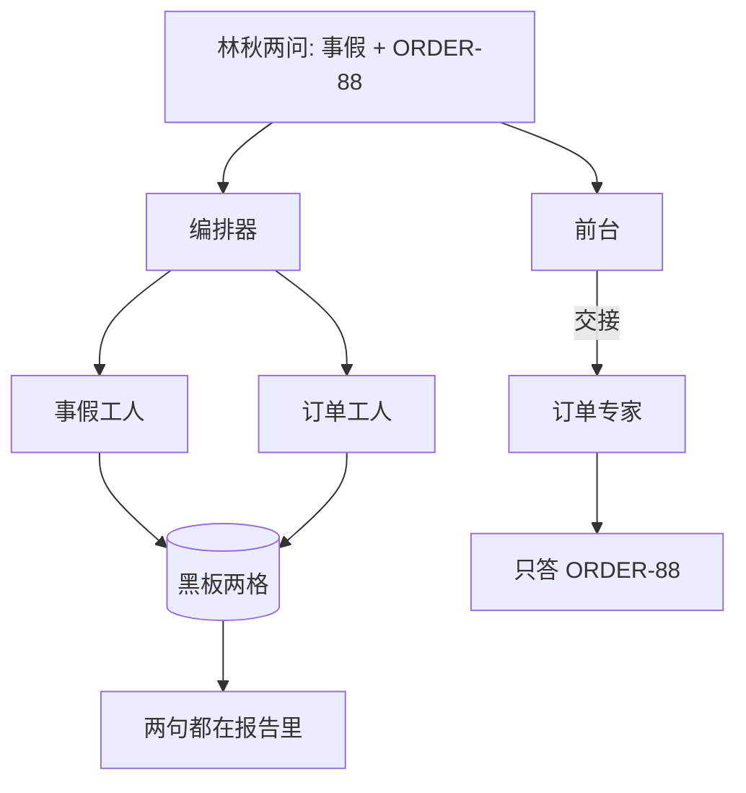
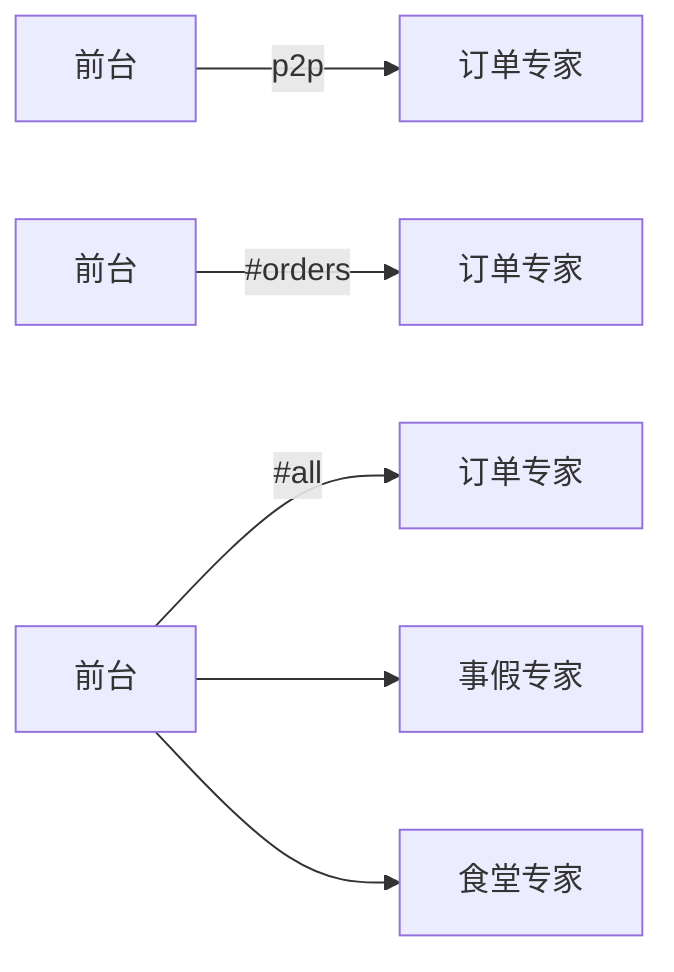

# 第 24 章 Swarm 与消息路由

> 本章定位：第六卷第二站。第 23 章的主编排 **拥有目标**：拆工单、派工人、读黑板。读完本章，你要能讲清另一种诱惑—— **去掉老板，让当前拿话筒的人把会话交出去**；以及交接（Handoff）、路由规则（Routing Rule）、消息总线（Message Bus）各自会在哪翻车。最后能说清 **什么时候不该上多 Agent**。
>
> 前置：第 19 章圆桌、第 23 章主编排、第 18 章写工具须确认。不需要 API Key。
>
> 配套代码：`code/ch24/python/`、`code/ch24/java/`（同构 `MiniSwarm`）
>
> 图表假设：交接是函数返回值，不是一次真实 Function Calling。路由白名单写死在代码里。总线是进程内列表，不是 Kafka / NATS。教学交接 **只换人，不改写林秋原话**。OpenAI 的 Swarm 实验库已并入 Agents SDK，本章 **不安装** `openai-swarm` / `openai-agents`。ORDER-88 未发货可退、ORDER-99 / TZ123 已发货须售后；写退款须确认，**可退 ≠ 已办理退款**。事假上限 **10 个工作日**。前台路由顺序是课堂约定：食堂 > 订单 > 事假。

---

## 24.1 去中心化协作的诱惑与代价

### 直觉解释

**蜂群（Swarm）** 把「谁现在说话」当成一等公民。没有主编排。前台听完林秋的话，把 **话筒（Turn / Microphone）** 交给事假专家或订单专家；专家可以答完，也可以再交给别人。

诱惑很具体：不用先拆三张工单，会话中途换话题只要换人。代价同样具体： **没有人拥有复合目标**。林秋同时问事假和 ORDER-88，前台只能交一次话筒，后接的人把前面那问吃掉。第 23 章的黑板没有了，也就没有部分成功。

### 生活类比：医院分诊 vs 主编排派工

分诊台按主诉把你送到内科或外科。你同时心口疼和手腕骨折，分诊台仍只能先送一科。主编排会开两张单，内科外科各写各的格子。

客服蜂群就是分诊。它适合「这场对话现在该换专家」，不适合「一张嘴里塞三件必须都办完的事」。

### 原理剖析：话筒只有一只

去中心化协作（Decentralized Collaboration）省掉了老板，也就省掉了拆解和汇总。每一跳只有一个 `current`。示例 1 里前台的路由顺序是食堂 > 订单 > 事假——这是课堂约定，用来逼出「后亮的名词抢走话筒」。不是医院真实分诊协议。

面试别说「Swarm 更先进」。先说你丢了什么：目标所有权、失败隔离、引用回格子。

---

## 24.2 交接（Handoff）与路由规则

**交接（Handoff）**：当前 Agent 停止说话，指定下一个名字。教学里它是 `Reply.handoff`；Agents SDK 里常做成一个会返回另一个 Agent 的工具。话筒换了，林秋原话还在——专家必须重新读原问，不能只看见「请订单专家接一下」。

**路由规则（Routing Rule）**：谁可以把话筒给谁。白名单不是礼貌，是权限。订单专家若能交给「退款机器人」，而退款机器人只会说「已办理」，这就是示例 3 的事故。

**跳数（Hop）**：话筒换手一次算一跳。必须有 `max_hops`。两只专家把复合问法互相甩，没有上限就会死循环。这和第 2 章「循环必须有终止条件」是同一条军规。

| | 主编排（第 23 章） | 蜂群 Swarm | 圆桌 AutoGen |
| --- | --- | --- | --- |
| 谁拥有目标 | 编排器 | **当前拿话筒的人** | 没有老板 |
| 怎么换人 | 派工，工人不互聊 | **交接** | 选下一个开口的人 |
| 状态 | 黑板分格 | 多半是同一段对话 | 消息列表 |
| 复合三问 | 三格都能交卷 | 只剩接话的那一岗 | 可能聊到三件，也可能跑题 |
| 失败 | 隔离或整单失败 | 看路由还在不在 | 看谁还肯说 |

### 图 1：主编排分格 vs 蜂群交话筒



教学假设：前台看见订单就不把话筒给事假岗。不是模型「更懂订单」，是路由顺序写死了。

---

## 24.3 消息总线、主题、点对点

交接是「我知道下一个名字」。系统一大，专家不该互相写死对方的函数名。这时才出现 **消息总线（Message Bus）**。

三种投递，第一次出现先中英对照：

| 方式 | 英文 | 谁能看见 |
| --- | --- | --- |
| 点对点 | Point-to-Point, P2P | 只有名叫这个的人 |
| 主题 | Topic / Pub-Sub | 订阅了该主题的人 |
| 广播 | Broadcast | 订了 `#all` 的所有人 |

点对点最安全，也最死：前台必须知道「订单专家」四个字。主题把名字换成合同：`orders` 是售后事实，`leave` 是制度事实。广播最省事，也最脏——食堂岗订了 `#all`，ORDER-88 也会被它编成红烧肉。

### 图 2：三种投递



教学假设：扇出是内存列表。生产里才是 Kafka 分区或 NATS subject。没订阅者的主题等于把订单扔进走廊。

---

## 24.4 什么时候不该上多 Agent

多 Agent 不是编制越大越专业。先问目标是不是 **一只手、一份上下文就办得完**。

| 需求 | 默认 | 为什么不要 Swarm |
| --- | --- | --- |
| 事假上限几天 | 单 Agent + 检索 | 交接是多余跳数 |
| 事假 + ORDER-88 都要答 | 主编排 | 一只话筒吃不掉两项目标 |
| ORDER-88 写退款 | 状态图 + HITL | 退款机器人会把「可退」说成「已退」 |
| 5 天旧稿还写不写 | 圆桌 | 蜂群没有对打，只有换人 |
| 会话中途从请假改口问单号 | Swarm + 白名单 | 这才是分诊该干的活 |

加分句：**「这里不用多 Agent，因为目标没有换人的必要。」** 比清单里写过 Swarm 更值钱。

---

## 实现：三场可运行的蜂群

### 环境要求

| 项目 | 版本 / 说明 |
| --- | --- |
| Python | 3.10+，标准库 |
| Java | 17+，标准库 |
| API Key / openai-agents | 不需要 |

PowerShell 里 `-D` 参数请加引号。控制台中文乱码时先 `chcp 65001`，以验收句为准。

---

### 示例 1：合法交接 vs 话筒被抢走

```bash
cd code/ch24/python
python 01_handoff_vs_pingpong.py
```

```powershell
cd code/ch24/java
mvn -q -DskipTests compile exec:java "-Dexec.mainClass=com.agentbook.ch24.HandoffVsPingpong"
```

| 问法 | 轨迹 | 用户听见 |
| --- | --- | --- |
| 事假上限几天 | 前台 → 事假专家 | 10 个工作日 |
| ORDER-88 能不能退 | 前台 → 订单专家 | 未发货可退，须确认 |
| 两问一起 | 前台 → 订单专家 | **丢掉事假** |
| 再加食堂 | 前台 → 食堂专家 | 【无资料】，不编红烧肉 |

复合办理请回第 23 章。蜂群在这里是故意翻车。

---

### 示例 2：点对点、主题、广播

```bash
python 02_bus_topic_p2p.py
```

```powershell
mvn -q exec:java "-Dexec.mainClass=com.agentbook.ch24.BusTopicP2p"
```

`#orders` 只有订单专家订阅，食堂听不见。`#all` 三人都能听见，食堂岗在教学开关下会编红烧肉。默认用点对点或窄主题。

---

### 示例 3：甩锅、白名单、假装已退

```bash
python 03_when_not_multi.py
```

```powershell
mvn -q exec:java "-Dexec.mainClass=com.agentbook.ch24.WhenNotMulti"
```

| 场景 | 结果 |
| --- | --- |
| 两只专家互交复合问法 | 【超过 max_hops=6】 |
| 订单专家想交退款机器人，白名单挡住 | 【非法交接】 |
| 放开路由 | 「已为 ORDER-88 办理退款」—— **目标成功，业务错误** |

**Python / Java 差异：** 产品语言对齐。生产 Python 若接 Agents SDK，交接会变成工具调用，轨迹进 Trace。Java 没有同名官方运行时；Spring 里更像「策略表 + 消息队列」，不要写「Java 上了 Swarm」。

---

## 踩坑提醒与职场视角

**坑 1：把前台做成第二只主编排。** 前台若拆三张工单再汇总，你写的是第 23 章，别叫 Swarm。

**坑 2：交接改写用户原话。** 「请订单专家接一下」一旦覆盖林秋的句子，专家只能编。教学运行时故意始终传入原问。

**坑 3：没有白名单。** 谁都能交给退款机器人，等于谁都能口头批准资金。

**坑 4：没有 max_hops。** 甩锅是去中心化的默认病，不是边角。

**坑 5：用广播冒充解耦。** `#all` 不是解耦，是把食堂订进订单频道。

**坑 6：简历写精通 Swarm，作业却是三只 Bot 互道早安。** 面试官会问：复合问法谁丢了？退款怎么没被交接执行掉？

### 简历上可以写的一句

> 会话中途换专家用交接 + 路由白名单 + max_hops；复合办理仍走编排器分格，写退款回图上的人工确认。能说明为什么默认不用广播主题。

### 本章小结

- 蜂群的一等公民是话筒，不是目标。
- 交接换人；白名单是权限；max_hops 是刹车。
- 点对点 / 窄主题默认，广播是污染源。
- 单意图不要多 Agent；复合办理不要 Swarm；写工具不要口头机器人。
- 话筒交出去了 ≠ 退款已执行。

---

## 24.5 常见面试考点

> **高频原题：**「Swarm 和 Orchestrator 有什么区别？什么时候不该上多 Agent？」
>
> **90 秒答法：**
> 主编排拥有目标：拆工单、工人只写黑板、失败可以隔离。蜂群没有老板，当前拿话筒的人决定交出去。林秋同时问事假和 ORDER-88，蜂群只能交一次话筒，另一问就丢了。我用交接处理「会话中途换专家」，用白名单禁止订单岗把话筒给会说「已退款」的机器人，用 max_hops 防止甩锅。单意图问答我不上多 Agent；写退款我仍走图和人工确认。
>
> **追问 1：**「Handoff 和 Function Calling 是一回事吗？」  
> 不是。Function Calling 是当前 Agent 伸出手。Handoff 是把整场会话的控制权交出去。工具结果还回来；交接通常不回来，除非对方再交回来。
>
> **追问 2：**「消息队列算 Swarm 吗？」  
> 队列是投递。Swarm 是「谁拥有下一句」。没有交接语义的 Topic，只是普通微服务。
>
> **追问 3：**「OpenAI Swarm 还能写进简历吗？」  
> 写交接和路由，不要写一个已并入 Agents SDK 的实验库商标。说清你跑的是官方 SDK 还是自建白名单。

---

## 24.6 课后练习（含答案提示）

**练习 1：TZ123 走售后（必做）**  
把示例 1 的问法改成「物流 TZ123 到哪了」。验收：轨迹到订单专家，报告含 ORDER-99 / 售后，不含「可整单退款」。

- 提示：`oid()` 已能对上 TZ123。不要为物流再开一只专家，除非你真要拆主题。
- 面试句：换人按事实种类，不按名词新鲜感。

**练习 2：把 max_hops 改成 3（必做）**  
重跑示例 3 甩锅。轨迹应更短，仍以【超过 max_hops】收场。

- 提示：刹车是运行时参数，不是 Prompt 里的「请不要死循环」。
- 对照：第 2 章的最大步数。

**练习 3：食堂取消订阅 `#all`（必做）**  
改 `cafe_expert` 的 topics，只留 `cafe`。再跑示例 2 的广播，食堂不应再编红烧肉。

- 提示：污染来自订阅，不来自食堂有没有嘴巴。
- 职场：默认订阅表要进 RFC，和权限表放一起。

**练习 4：60 秒口述（必做）**  
画出图 1，用林秋两问对比主编排和蜂群。再说一句「这里不用多 Agent」。录音。

---

## 本章质量自检

| 检查项 | 结论 |
| --- | --- |
| 零基础读者能否不看前文就懂？ | 从医院分诊讲起。 |
| 代码能否直接复制运行？ | 无 Key；三份示例带验收。 |
| 是否有职场 / 面试落点？ | 谁拥有目标、白名单、不该上多 Agent。 |
| 图表是否标注假设？ | 规则路由、内存总线、教学交接不改写原话。 |

---

## 你现在应该能做的事

- [ ] 用一句话说清 Swarm 与主编排：话筒 vs 目标
- [ ] 给交接加上白名单和 max_hops
- [ ] 在点对点、主题、广播里选出默认投递
- [ ] 对单意图 / 复合办理 / 写工具说出「不用多 Agent」的理由

下一章把人请回来：哪些动作必须等人点头，超时了怎么降级。

回复 **「继续」** 进入第 25 章：《人类介入（Human-in-the-loop）》。
