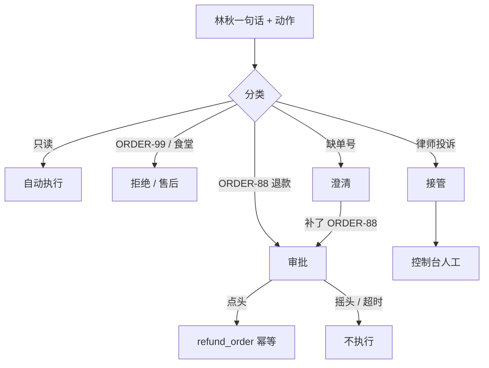
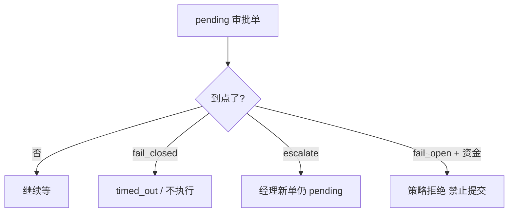

# 第 25 章 人类介入（Human-in-the-loop）

> 本章定位：第六卷收官。第 18 章给你 **打断（interrupt）** 这根钉子，第 12 章给你 `proposed → confirmed`。读完本章，你要能讲清 **哪些动作必须等人点头**，把等人分成 **审批、澄清、接管、回放** 四种，并给超时选一条产品口径：失败关闭、升级，而不是「等不及就退了」。
>
> 前置：第 12 章槽位、第 18 章人工节点、第 23 章主编排。不需要 API Key。
>
> 配套代码：`code/ch25/python/`、`code/ch25/java/`（同构 `MiniHitl`）
>
> 图表假设：人的决定由脚本传入，没有真的钉钉 / 工单系统。时钟可拨快。写工具只有 `approved` 之后才执行，按单号 **幂等**。资金动作禁止 `fail_open`。这不是 LangGraph 官方 API。ORDER-88 未发货可退、ORDER-99 / TZ123 已发货须售后；**模型说「当然可以退，三天到账」仍是意图，不是确认。** 林秋事假 **2026-09-14..16 共 3 天**，上限 **10 个工作日**。

---

## 25.1 哪些动作必须等人点头

### 直觉解释

Agent 会说话，不等于能替公司花钱。 **人类介入（Human-in-the-loop, HITL）** 不是「模型不够聪明再找人」，是 **风险过线就必须停**。只读可以自动：查事假上限、查 ORDER-88 状态。写操作要人：`refund_order`、`create_leave`。缺槽位先问人：林秋说「我想退款」却没单号。情绪和法务要交人：出现「律师 / 投诉」。

### 生活类比：柜员、保安、经理

银行柜员可以告诉你余额，不能自己把钱打走。保安可以问你找谁，不能替你签字。经理可以接管窗口。Agent 是柜员。HITL 是柜员规章，不是「再训练一下就会自觉」。

### 原理剖析：看动作风险，不看句子像不像人话

分类器先看 **动作（Action）** 的风险档：

| 风险 | 英文 | 例子 | 要不要人 |
| --- | --- | --- | --- |
| 只读 | Read | `get_order` / `search_policy` | 不用 |
| 资金 | Money | `refund_order(ORDER-88)` | **审批** |
| 写库 | Write | `create_leave` | **审批** |
| 缺槽 | — | 「我想退款」没单号 | **澄清** |
| 冲突 | — | 律师 / 投诉 | **接管** |
| 无工具 | — | 食堂红烧肉 | 拒绝，不叫人 |

ORDER-99 已发货：分类是拒绝走售后， **不建写工单**。没有写工具，就不要打扰值班的人。这和第 18 章「未发货才 `interrupt`」是同一条边。

---

## 25.2 审批、澄清、接管、回放

四种等人，第一次出现先中英对照：

| 模式 | 英文 | 人干什么 | Agent 干什么 |
| --- | --- | --- | --- |
| 审批 | Approval | 点头或摇头 | 只在点头后执行写工具 |
| 澄清 | Clarification | 补槽位 | 补完 **仍须审批**，澄清 ≠ 批准 |
| 接管 | Takeover | 把键盘拿过来 | **停手**，不能再自己 `approve` |
| 回放 | Replay | 看当时发生了什么 | 按检查点重放；写工具走 **幂等** |

第 18 章的 `interrupt` 只实现了「停住」。产品上你还要说清：停下来是等批准、等补一句、等值班员接管，还是事后审计。四种工单不要做成一个「等一下」按钮。

### 图 1：写工具前必须分岔



教学假设：分类是规则。生产里可用小模型做分流，但资金档必须仍走白名单，不能只靠 Prompt。

---

## 25.3 产品形态：工单、IM、控制台

等人要有地方按按钮。渠道不是技术细节，是 SLA 和审计。

| 渠道 | 英文 | 适合 | 不适合 |
| --- | --- | --- | --- |
| 工单 | Ticket | 审批、留痕、对班次 | 林秋还在对话框里等一句槽位 |
| 即时消息 | IM | 澄清、对用户本人 | 资金审批（容易点错、难审计） |
| 控制台 | Console | 接管、回放、升级给经理 | 让用户自己点「确认退款」却不留工单号 |

示例 2 的课堂约定：ORDER-88 审批走工单，缺单号澄清走 IM，接管和回放走控制台。你换钉钉 / Slack / 自建后台都可以， **不要把退款批准做成聊天里一闪而过的 Yes**。

回放对着 `ticket_id` / 第 18 章的 `thread_id`，不是对着「再问一遍同样的话」。再问一遍会新开一张单，可能把已经退过的 ORDER-88 再推一次——所以执行层必须幂等。

---

## 25.4 超时策略与降级

人不是永远在线。 **超时（Timeout）** 必须事先写成口径，不能临场看心情。

| 策略 | 英文 | 用户看见 | 典型 |
| --- | --- | --- | --- |
| 失败关闭 | Fail-closed | 当拒绝 | **退款、改权限** |
| 失败开放 | Fail-open | 当批准 | 只读降级、展示缓存； **资金禁止** |
| 升级 | Escalate | 还在等，但换人批 | 值班员超时交给经理； **仍未执行** |

降级（Degradation）是「少做一点还说得清」，不是「偷偷做完」。查询超时可以回「制度库暂不可用」。退款超时等于拒绝。升级只是换审批人，不是自动 `refund_order`。

### 图 2：超时不是第三种点头



教学假设：时钟是教具里的 `Clock.advance`。生产用真实截止时间和值班表。

---

## 实现：三场可运行的等人

### 环境要求

| 项目 | 版本 / 说明 |
| --- | --- |
| Python | 3.10+，标准库 |
| Java | 17+，标准库 |
| API Key | 不需要 |

PowerShell 里 `-D` 参数请加引号。控制台中文乱码时先 `chcp 65001`，以验收句为准。

---

### 示例 1：必须点头的是风险档

```bash
cd code/ch25/python
python 01_must_nod.py
```

```powershell
cd code/ch25/java
mvn -q -DskipTests compile exec:java "-Dexec.mainClass=com.agentbook.ch25.MustNod"
```

| 场景 | 分类 |
| --- | --- |
| 查制度 / 查 ORDER-88 | auto |
| 退 ORDER-88 / 请假落单 | approve |
| 退 ORDER-99 / 食堂 | refuse |
| 「我想退款」没单号 | clarify |
| 找律师 | takeover |
| 「当然可以退，三天到账」+ ORDER-88 | **仍是 approve** |

---

### 示例 2：四种模式四条渠道

```bash
python 02_four_modes.py
```

```powershell
mvn -q exec:java "-Dexec.mainClass=com.agentbook.ch25.FourModes"
```

审批通过后执行一次 `refund_order(ORDER-88)`。澄清补上单号 **仍须再批**；再批撞上已执行，走幂等。接管之后不能再 `approve`。回放打印当时快照，不二次退款。

---

### 示例 3：超时关闭、升级、禁止 fail_open

```bash
python 03_timeout_degrade.py
```

```powershell
mvn -q exec:java "-Dexec.mainClass=com.agentbook.ch25.TimeoutDegrade"
```

只读不建单。退款单拨快时钟后失败关闭，日志里没有执行。升级会多一张经理单，状态仍是 `pending`。提交时若写 `fail_open`，直接抛「资金动作禁止 fail_open」。

**Python / Java 差异：** 产品语言对齐。生产 Python 可把 `pending` 接到 LangGraph `interrupt`；Java 可接到工单表 + 状态机。简历写清渠道和超时口径，不要写「我们上了 MiniHitl」。

---

## 踩坑提醒与职场视角

**坑 1：把模型的肯定句当成确认。** 「当然可以退」是意图。落库看人点头并且工具成功。

**坑 2：澄清按钮写成批准。** 林秋回了 ORDER-88，只是槽位满了。资金仍要第二下。

**坑 3：在打断前做不可重入的写。** 第 18 章说过：恢复会再跑。先 fetch，再等人，执行必须幂等。

**坑 4：退款超时 fail_open。** 这是事故，不是高可用。教具在提交时就拒绝。

**坑 5：接管后 Agent 还在后台调工具。** 接管 = 停手。否则控制台只是旁路观摩。

**坑 6：简历写 HITL，演示却是 `input("确认吗")`。** 面试官会问工单号、超时口径、幂等键。

### 简历上可以写的一句

> 写工具按风险分流：只读自动，退款走工单审批，缺槽走 IM 澄清，投诉接管到控制台；超时失败关闭，升级不自动执行；回放按单号幂等。能说明模型输出不是确认。

### 本章小结

- HITL 看动作风险，不看语气。
- 审批 / 澄清 / 接管 / 回放是四种产品，不是一个按钮。
- 工单留痕，IM 补槽，控制台接管。
- 退款超时 = 拒绝；升级 ≠ 自动通过。
- 可退 ≠ 已退。幂等保护回放。

第六卷到此结束。一个人忙不过来时：主编排拥有目标，蜂群只交话筒，关键写操作必须把人请回来。

---

## 25.5 常见面试考点

> **高频原题：**「哪些动作必须 Human-in-the-loop？超时了怎么办？」
>
> **90 秒答法：**
> 只读可以自动。资金、改权限、不可逆写库必须审批。槽位不全先澄清，澄清不等于批准。出现投诉或法务关键词，控制台接管，Agent 停手。ORDER-88 未发货可退，仍要人点头才调用 `refund_order`；ORDER-99 已发货，不建写工单。超时我用失败关闭，升级只是换审批人。fail_open 不准用在退款。回放走幂等，避免退两次。模型说「可以退」只是意图。
>
> **追问 1：**「这和 LangGraph interrupt 是什么关系？」  
> interrupt 是钉子。工单、渠道、超时口径是产品。我可以手写状态机，也可以把 pending 接到 `Command(resume=...)`。
>
> **追问 2：**「会不会所有工具都等人，系统没法用？」  
> 会。所以先做风险表。查询、检索不要叫人。打扰人的预算和第 28 章的延迟是同一笔账。
>
> **追问 3：**「人点错了怎么办？」  
> 拒绝路径、审计字段、幂等键、回放。点错是事故演练题，不是「模型再聪明一点」。

---

## 25.6 课后练习（含答案提示）

**练习 1：拒绝路径（必做）**  
在示例 2 里对 ORDER-88 审批单 `reject`。验收：文案含【已拒绝】，`executed` 里没有该单。

- 提示：`resume(..., "reject")`。两条出边都要测，和第 18 章作业同一精神。
- 面试句：HITL 没有拒绝边，就只是装饰。

**练习 2：升级单再超时（必做）**  
示例 3 升级出经理单后，再 `advance` 一次并 `tick`。经理单应按失败关闭，仍然不执行。

- 提示：经理单的 `timeout_policy` 已是 `fail_closed`。
- 对照：升级不是无限延期。

**练习 3：请假写工具（必做）**  
给 `create_leave` 走审批。点头后日志出现 `create_leave`；回放不得再插第二条假单。

- 提示：幂等键用 `create_leave:create_leave` 或改成请假单号。
- 职场：写库和退款同一套闸门，只是渠道文案不同。

**练习 4：60 秒口述（必做）**  
画出图 1，用 ORDER-88 / ORDER-99 / 「我想退款」/ 「找律师」走一遍。录音。强调模型肯定句不是确认。

---

## 本章质量自检

| 检查项 | 结论 |
| --- | --- |
| 零基础读者能否不看前文就懂？ | 从银行柜员讲起。 |
| 代码能否直接复制运行？ | 无 Key；三份示例带验收。 |
| 是否有职场 / 面试落点？ | 风险表、四模式、超时口径、简历项目 2。 |
| 图表是否标注假设？ | 脚本决定、拨快时钟、资金禁 fail_open。 |

---

## 你现在应该能做的事

- [ ] 按风险表说出哪些动作必须等人
- [ ] 分清审批、澄清、接管、回放，不把四个按钮合成一个
- [ ] 给退款选择失败关闭，并拒绝资金 fail_open
- [ ] 用幂等解释回放为什么不会退第二次

下一卷进入工程化：评测、Trace、账单和安全。先能看见「挺聪明」，再证明可上线。

回复 **「继续」** 进入第 26 章：《评测体系与 LangSmith》。
