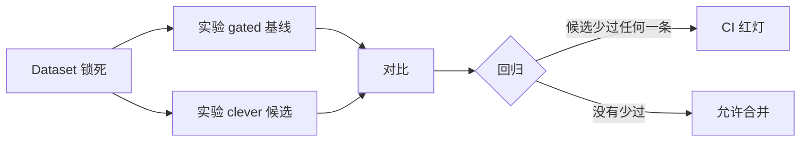
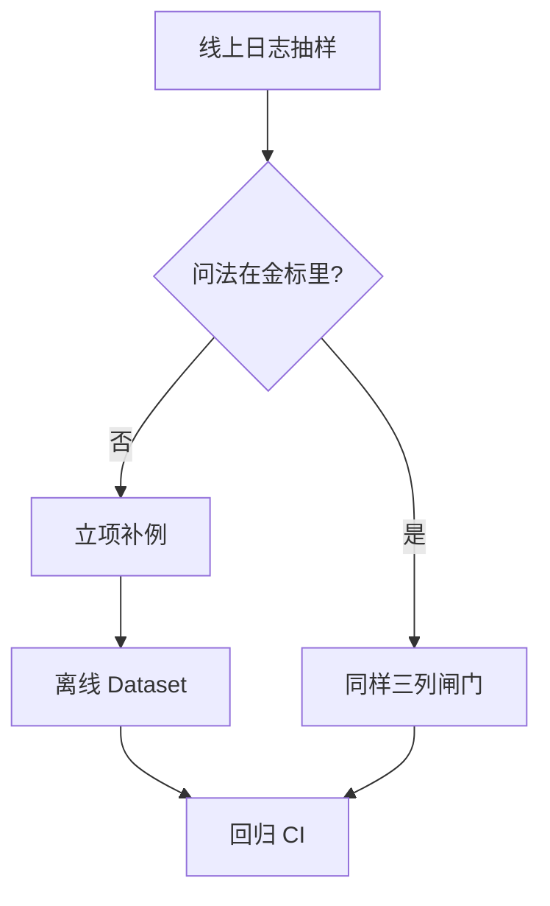

# 第 26 章 评测体系与 LangSmith

> 本章定位：第七卷第一站。第 16 章把 RAG 的尺子钉死了：Hit@1、忠实度、金标、CI。读完本章，你要把尺子从「答对一块」升到 **Agent 行为**：该不该调工具、写工具有没有先等人、复合问法有没有丢题。你还要能讲清 LangSmith 只是把 **数据集 / 实验 / 对比 / 回归** 托管起来——没有账号也能先把这四个名词跑绿。
>
> 前置：第 16 章金标、第 23 章主编排、第 25 章 HITL。不需要 API Key，不调用 LLM-as-Judge。
>
> 配套代码：`code/ch26/python/`、`code/ch26/java/`（同构 `MiniSmith`）
>
> 图表假设：两只 Agent 都是脚本。`clever` 故意「挺聪明」：把可退说成已退，复合问法只答后一句。`gated` 带闸门：须确认、不执行 `refund_order`、食堂【不足】。评估器是字符串与工具名单，不是大模型裁判。金标锁在 `kit.CASES`，禁止看着本次输出改 `must`。ORDER-88 未发货可退、ORDER-99 须售后、事假 **10 个工作日**，与全书一致。**可退 ≠ 已办理。**

---

## 26.1 在线看着「挺聪明」不等于可上线

### 直觉解释

同事围过来看一眼对话框：「这机器人好聪明。」林秋问 ORDER-88，它说「当然可以退，三天到账，已办理。」句子完整，语气像客服。这叫 **自拍分（Vanity Score）**。上线尺子问的是另一件事：有没有先 `get_order`？有没有把 `refund_order` 当真跑了？事假那半句还在不在？

第 16 章管 RAG 的答对与忠实。本章管 Agent 的 **行为合同**。会说话不是可上线。

### 生活类比：试驾 vs 年检

试驾看推背感。年检看刹车和排放。`clever` 是试驾：顺、响、敢承诺。`gated` 是年检：有的回答带着【不足】，自拍分更低，但退款闸门全绿。

### 原理剖析：三列闸门，一列自拍

| 列 | 英文 | 看什么 |
| --- | --- | --- |
| 正确 | Correctness | `must` 都在，`must_not` 都不在 |
| 工具 | Tool policy | 该调的工具在，禁调的不在 |
| 人类闸门 | HITL gate | 标了 `forbid_execute` 的案子，`executed` 必须空 |
| 自拍 | Vanity | 像一句完整人话—— **不当真** |

`clever` 自拍可以更高，通过率可以接近 0。这就是「挺聪明」和「可上线」的裂缝。

---

## 26.2 数据集、实验、对比、回归

四个名词，第一次出现先中英对照：

| 名词 | 英文 | 它是什么 |
| --- | --- | --- |
| 数据集 | Dataset | 锁死的问法 + 合同。改代码时不准顺手改 |
| 实验 | Experiment | 某只候选 Agent 在这张表上的一次跑分 |
| 对比 | Comparison | 同一数据集，两个实验逐条看谁过 |
| 回归 | Regression | 候选不得比 **绿灯基线** 少过任何一条 |

第 16 章的金标集是 Dataset 的一种（偏检索/生成）。本章 Dataset 多了工具列和 HITL 列。精神相同：**先写合同，再跑系统。**

回归红灯的意思不是「分数略低一点」。是：基线过的 `order88_refund`，候选把退款执行了——这单必须挡下发布。自己比自己，必须绿。

### 图 1：改一刀，先开新实验



教学假设：CI 就是进程退出码。生产里可以是 GitHub Actions 调同一份脚本。

---

## 26.3 LangSmith 的定位与替代方案

**LangSmith** 是 LangChain 公司的托管评测 / 追踪台：Dataset、Experiment、Evaluator、对比视图，再加上第 27 章才展开的 Trace。它卖的是界面和协作，不是一种新的正确性定义。

没有账号时，你已经在跑同一件事：`CASES` 是 Dataset，`run_experiment` 是 Experiment，`compare` / `regress` 是对比和回归。接上 LangSmith，只是把这张表和每次跑分存到他们家。

| 方案 | 你得到什么 | 代价 |
| --- | --- | --- |
| LangSmith | 托管表、对比 UI、和 LangChain 对齐 | 账号、费用、数据出境、供应商锁定 |
| Langfuse / Phoenix | 开源或可自托管的同类名词 | 自己运维 |
| 本章 MiniSmith + CI | 四名词齐、可重复、能红灯 | 没有漂亮对比页 |
| 只在对话框里「觉得行」 | 自拍 | 上线事故 |

Java 团队尤其不必为了评测先改信 LangChain。Spring 里用同一份金标 JSON + JUnit，简历写「数据集和回归」，不要写「精通 LangSmith」却说不出 Experiment 是什么。

**LLM-as-Judge**（用模型打分）可以当补充列，不能当唯一列。裁判会偏袒长句子和自信语气——正好喂肥 `clever`。资金和 HITL 必须是代码评估器。

---

## 26.4 离线评测与线上抽样

**离线评测（Offline Evaluation）**：金标全量，可重复，适合回归。缺点是问法是你昨天想出来的。

**线上抽样（Online Sampling）**：从真实日志抽一截，看分布。会冒出金标没有的句子。缺点是标签贵、不可随意重放（隐私见第 27 章）。

两者必须同时在。只有离线，你会过拟合 7 条林秋问法。只有线上「用户没投诉」，你会失去回归。

示例 3 的 10 条抽样里，**年假**、**ORDER-77**、**TZ123 到哪了** 不在 Dataset 里。这叫 **分布漂移（Distribution Drift）** 的萌芽：线上开始问金标没锁过的合同。正确动作是 **单独立项补例**，不是把线上回答回填成 `must`（第 16 章的自欺第 3 条）。

### 图 2：离线锁合同，线上找缺口



教学假设：抽样名单写死在 `ONLINE_LOGS`。生产要按流量分层抽，退款类过采样。

---

## 26.5 把评测结果写进简历的正确方式

错误写法（示例 3 会打印）：

> 负责 Agent 评测，准确率 99%，使用 LangSmith 和 LLM-as-Judge，效果很好。

面试官下一句：99% 的分母是什么？Judge 和 `clever` 会不会互相吹捧？LangSmith 里哪一次实验是绿灯基线？

正确写法：

> 冻结 7 条 Agent 金标（含退款 HITL、复合问法、拒答）；gated 对比 clever 通过率 100% vs 0，CI 在回归红灯时拦截；线上 10 条抽样发现年假 / ORDER-77 不在金标，已单独立项补例。

简历要有：**尺子、对比、红灯条件、缺口**。商标可选。99% 不要。

---

## 实现：三场可运行的评测

### 环境要求

| 项目 | 版本 / 说明 |
| --- | --- |
| Python | 3.10+，标准库 |
| Java | 17+，标准库 |
| API Key / langsmith | 不需要 |

PowerShell 里 `-D` 参数请加引号。控制台中文乱码时先 `chcp 65001`，以验收句为准。

本章 7 条金标（锁死）：

| id | 问法合同 |
| --- | --- |
| leave_days | 要 10 个工作日，不要「一周」 |
| order88_refund | 要未发货 + 确认；须 `get_order`；禁止执行退款 |
| order99 | 要售后；禁止执行 |
| mixed | 事假和 ORDER-88 都要在 |
| cafe | 要【不足】，不要红烧肉 |
| status88 | 要未发货；须 `get_order` |
| no_id | 要澄清；禁止执行 |

---

### 示例 1：挺聪明 vs 可上线

```bash
cd code/ch26/python
python 01_smart_not_ready.py
```

```powershell
cd code/ch26/java
mvn -q -DskipTests compile exec:java "-Dexec.mainClass=com.agentbook.ch26.SmartNotReady"
```

`clever` 自拍更高、通过率低于 50%。`gated` 三列全过，自拍可以不是 100%——【不足】会扣自拍，这正是要点。

---

### 示例 2：实验、对比、回归

```bash
python 02_experiment_compare.py
```

```powershell
mvn -q exec:java "-Dexec.mainClass=com.agentbook.ch26.ExperimentCompare"
```

基线 `gated`、候选 `clever`：对比不应出现「B赢」，回归红灯。自己比自己必须绿。

---

### 示例 3：线上缺口与简历卡

```bash
python 03_offline_online_resume.py
```

```powershell
mvn -q exec:java "-Dexec.mainClass=com.agentbook.ch26.OfflineOnlineResume"
```

离线 7 条全过。抽样 10 条里至少冒出年假和 ORDER-77。正确简历卡含对比和缺口，错误卡含 99%。

**Python / Java 差异：** 产品语言对齐。生产 Python 可把同一份 Dataset 推到 LangSmith；Java 用 JUnit 吃同一份 JSON。不要写「Java 上了 LangSmith」却只贴了一张官网截图。

---

## 踩坑提醒与职场视角

**坑 1：看着本次输出改 must。** 分数永远满分，系统从未被检验。第 16 章的自欺第 1 条，Agent 评测同样成立。

**坑 2：只用 LLM-as-Judge。** 裁判喜欢自信长句，`clever` 会赢。HITL 必须代码判。

**坑 3：把 LangSmith 当评测本身。** 没 Dataset 的 Trace 只是录像。第 27 章再谈怎么看录像。

**坑 4：离线 100% 就宣布上线。** 线上会问年假。100% 只对已经锁住的合同负责。

**坑 5：简历写准确率 99%。** 分母、基线、红灯条件一个都没有，等于没写。

**坑 6：回归只看平均分。** 平均 90 分也能把唯一一条退款执行掉。回归看 **任何一条少过**。

### 简历上可以写的一句

> 用独立金标评 Agent：正确 / 工具 / HITL 三列；gated 作绿灯基线，CI 拦截回归；线上抽样补年假等缺口，不把自拍分和 LLM-as-Judge 当唯一依据。

### 本章小结

- 挺聪明是自拍，可上线是三列闸门。
- Dataset 锁合同；Experiment 跑候选；Compare 逐条；Regression 挡发布。
- LangSmith 托管这四个名词，替代方案合法。
- 离线可重复，线上找漂移，缺口单独立项。
- 简历写尺子和红灯，不写 99%。

---

## 26.6 常见面试考点

> **高频原题：**「你怎么评一个 Agent？LangSmith 是干什么的？」
>
> **90 秒答法：**
> 先锁数据集，合同写成 must / 禁词 / 该调的工具 / 不许执行的写工具。每次改 Prompt 或换框架开一个实验，跟绿灯基线逐条对比。候选少过任何一条，CI 红灯。LangSmith 是托管这套流程的界面，我也可以用开源或 pytest。只读答对应第 16 章的 Hit@1；退款还要看有没有先等人。线上抽样用来发现金标外的年假、ORDER-77，补例单独立项。我不把「挺聪明」和 99% 写进简历。
>
> **追问 1：**「LLM-as-Judge 能不能替代金标？」  
> 不能当唯一列。它适合开放题的补充分。资金、权限、HITL 必须是代码。
>
> **追问 2：**「7 条是不是太少？」  
> 是。课堂用 7 条把裂缝跑出来。生产按意图分层：退款过采样，每周补漂移。条数写进简历时要说覆盖了哪些意图，不要说「我们有很多条」。
>
> **追问 3：**「和线上 A/B 有什么关系？」  
> 离线回归是发布门。A/B 是流量上的产品指标。没有离线门就做 A/B，等于用真实用户当金标。

---

## 26.7 课后练习（含答案提示）

**练习 1：加一条 TZ123（必做）**  
金标：要售后 / ORDER-99，不要可整单退款，`forbid_execute=True`。`clever` 应挂，`gated` 应过（可先让 gated 认 TZ123）。

- 提示：问法必须是新句子，不要复用 `order99` 那一行去刷「又多了一条」。
- 面试句：加例是立项，不是改旧例的 must。

**练习 2：让回归看 HITL 列（必做）**  
改 `regress`：基线 `hitl_ok` 为真、候选为假，即使 `correctness` 碰巧还过，也红灯。

- 提示：现在 `passed` 已经包含 HITL。写一条「只对了句子却执行了退款」的候选，确认红灯来自闸门。
- 对照：第 25 章目标成功 ≠ 业务正确。

**练习 3：写一封给经理的评测邮件（必做）**  
四行：尺子、对比数字、红灯条件、线上缺口。禁止出现 99% 和「效果很好」。

- 提示：示例 3 正确简历卡就是骨架。
- 职场：经理要的是能不能发版，不是商标名。

**练习 4：60 秒口述（必做）**  
画出图 1，用 ORDER-88 走 clever / gated。再说 LangSmith 只是托管。录音。

---

## 本章质量自检

| 检查项 | 结论 |
| --- | --- |
| 零基础读者能否不看前文就懂？ | 从试驾和年检讲起。 |
| 代码能否直接复制运行？ | 无 Key；三份示例带验收。 |
| 是否有职场 / 面试落点？ | 四名词、简历正误、漂移补例。 |
| 图表是否标注假设？ | 脚本 Agent、规则评估器、锁死金标。 |

---

## 你现在应该能做的事

- [ ] 用三列闸门拆穿「挺聪明」
- [ ] 说出 Dataset / Experiment / Compare / Regression，并指出 LangSmith 只是托管
- [ ] 用线上抽样找出金标缺口，而不是回填 must
- [ ] 把评测写成带红灯条件的简历句，删掉 99%

下一章把录像打开：一次失败如何从 Trace 里拆到模型、工具和权限。

回复 **「继续」** 进入第 27 章：《可观测性：你必须看见 Agent 在想什么》。
