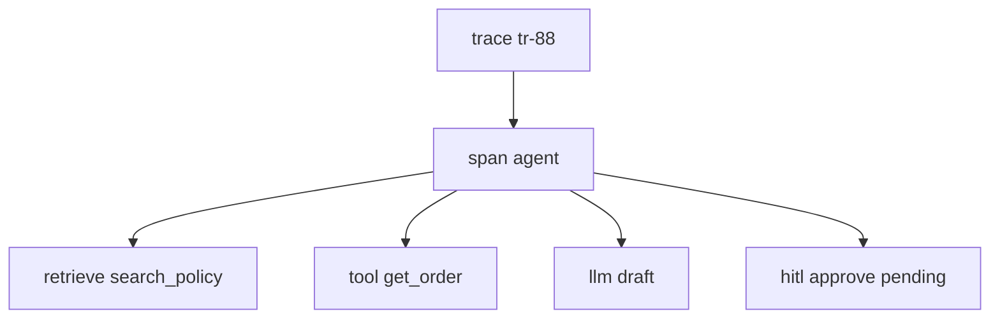
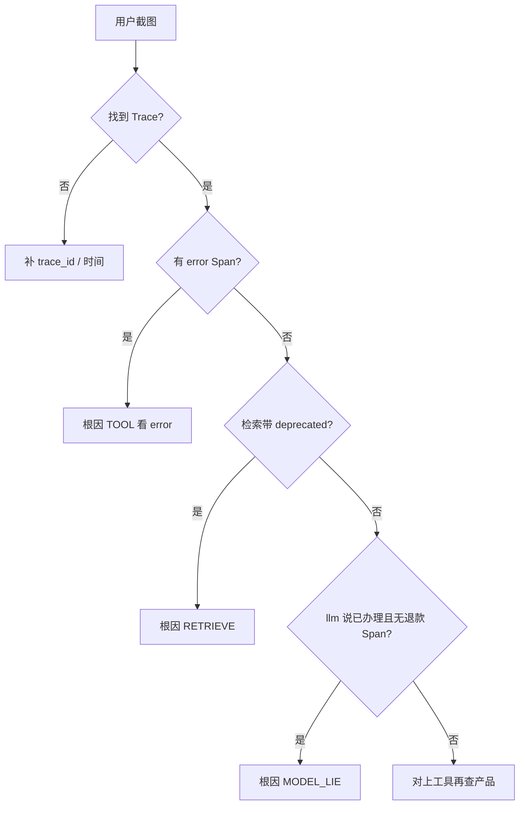

# 第 27 章 可观测性：你必须看见 Agent 在想什么

> 本章定位：第七卷第二站。第 26 章告诉你「挺聪明」不是上线尺子。读完本章，你要能把一次请求画成 **追踪（Trace）** 树，树上每一步是 **跨度（Span）**，工具调用和 Token 都挂在树上；知道日志里 **该留单号、不该留手机号**；并能用四问在 **5 分钟**内把失败拆到工具、模型撒谎或检索到了废止稿。LangSmith 是 LLM 专用 UI，不是现有 APM 的替代品。
>
> 前置：第 16 章废止稿、第 25 章 HITL、第 26 章实验。不需要 API Key。
>
> 配套代码：`code/ch27/python/`、`code/ch27/java/`（同构 `MiniTrace`）
>
> 图表假设：轨迹是脚本写进内存的，不是真的 OpenTelemetry SDK / LangSmith。Token 按 **字符数** 计，不是 tiktoken，不能拿来对账单。身份证、手机、卡号是课堂假数据。ORDER-88 未发货可退，写退款须确认，**可退 ≠ 已办理**。事假现行 **10 个工作日**，废止稿 **5 天**。

---

## 27.1 Trace、Span、Tool Call、Token

### 直觉解释

对话框只给你最后一句。排障需要 **这一次请求里每一步干了什么**。 **可观测性（Observability）** 就是把黑盒拧开：一次用户请求是一条 **追踪（Trace）**，每一步是一个 **跨度（Span）**。模型调用、工具调用、检索、人工闸门，都是 Span，用 `kind` 区分。

**工具调用（Tool Call）** 不是另一种对象，是 `kind=tool` 的 Span：名字、参数（脱敏后）、状态、耗时。 **Token** 挂在 `kind=llm` 的 Span 上：进了多少、出了多少。第 28 章才谈账单；本章先能 **加总**。

### 生活类比：快递运单

用户看见「您的包裹已签收」——这是对话框。运单号、每个中转站、哪一站超时，才是 Trace。你不能站在门口猜：是分拣超时，还是快递员写错了「已签收」。

### 原理剖析：先画树，再问红灯

| 名词 | 英文 | 它是什么 |
| --- | --- | --- |
| 追踪 | Trace | 一次请求，一把 `trace_id` |
| 跨度 | Span | 树上的一步，有父节点、耗时、状态 |
| 工具调用 | Tool Call | `kind=tool` 的 Span |
| 令牌 | Token | 模型进出的计量，教学里按字符数 |

示例 1 的健康树：`agent → retrieve / get_order / llm / hitl`。没有 `refund_order`——闸门还在 pending。用户若看见「已办理」，而树上没有成功的退款 Span，那是模型撒谎，不是工具真退了。

### 图 1：一次 ORDER-88 问询的树



教学假设：检索到事假条款是陪跑，主事实仍是 `get_order`。生产里不要把无关检索挂进同一棵会误导的树——该记就记，但 `name` 必须老实。

---

## 27.2 日志里该有什么、不该有什么（隐私）

日志是给排障的人看的，不是给下一任攻击者看的备份。

| 该留 | 不该留 |
| --- | --- |
| `trace_id` / `span_id` | 手机号、身份证、邮箱、银行卡 |
| 工具名、ORDER-88、耗时、状态 | 未脱敏的整段 Prompt / 工具参数 |
| Token 进出、错误类型 | 会话全文当「方便复现」 |
| 租户 / 哈希后的 user_id | 明文密码、Cookie、Authorization |

林秋作为 **演示业务名** 可以留——你要靠它把第 12 章的双键对上。手机号必须糊成 `[PHONE]`。课堂假卡号以 `6222` 开头，便于和 18 位身份证分开。

**隐私（Privacy / PII）** 不是法务附录。一次把身份证打进日志，比一次幻觉更难向安全组交代。第 29 章谈注入和越权；本章先把嘴管住。

---

## 27.3 一次失败如何 5 分钟定位

对着对话框猜，一小时也猜不完。对着树问四句，五分钟够用：

1. **哪条 Trace？** 用 `trace_id` 或「谁 + 几点」
2. **哪个 Span 红了？** `status=error`
3. **`kind` 是什么？** 工具 / 模型 / 检索 / 闸门
4. **用户看见的那句话，树上对得上吗？**

三条课堂事故：

| 用户看见 | 树上 | 根因 |
| --- | --- | --- |
| 系统出错 | `refund_order` timeout 3000ms | **TOOL** |
| 已办理，三天到账 | 只有 llm，没有成功的 `refund_order` | **MODEL_LIE** |
| 事假 5 天 | retrieve `deprecated=true` 废止稿 | **RETRIEVE** |

第 26 章的 `clever` 就是 MODEL_LIE：自拍分高，树上没有写工具。第 16 章的废止稿就是 RETRIEVE：答案「对」了资料，资料不该被看见。

### 图 2：五分钟四问



教学假设：定位器按这个顺序写死。生产里还要看权限 Span、第 25 章的 HITL 决定。

---

## 27.4 与现有 APM / 日志平台对接

你们公司多半已经有 **应用性能监控（APM, Application Performance Monitoring）**：Zipkin、Jaeger、SkyWalking、Datadog。不要为了 Agent 再买一套互不相认的 ID。

对接合同就三列：

| 字段 | 对齐谁 |
| --- | --- |
| `trace_id` / `span_id` / `parent_span_id` | OpenTelemetry |
| `name` / `kind` / `status` / `latency_ms` | 现有 Span |
| `tokens_in` / `tokens_out` / `error` | **属性（Attribute）**，不要另开一张表把 ID 弄丢 |

**LangSmith** 适合看 Prompt 和评估实验（第 26 章）。它不是 APM。Java 团队把同一行 JSON 丢进现有日志平台，比「我们上了 LangSmith」更能过架构评审。

示例 3 会打印一行 OTEL 示意。字段齐了就能对接；本章 **不安装** 任何导出 SDK。

---

## 实现：三场可运行的看见

### 环境要求

| 项目 | 版本 / 说明 |
| --- | --- |
| Python | 3.10+，标准库 |
| Java | 17+，标准库 |
| API Key / OTEL / LangSmith | 不需要 |

PowerShell 里 `-D` 参数请加引号。控制台中文乱码时先 `chcp 65001`，以验收句为准。

---

### 示例 1：把树打印出来

```bash
cd code/ch27/python
python 01_trace_span_token.py
```

```powershell
cd code/ch27/java
mvn -q -DskipTests compile exec:java "-Dexec.mainClass=com.agentbook.ch27.TraceSpanToken"
```

应看到 `agent` 根下 retrieve / tool / llm / hitl，合计 Token > 0， **没有** `refund_order`。

---

### 示例 2：脱敏

```bash
python 02_redact_privacy.py
```

```powershell
mvn -q exec:java "-Dexec.mainClass=com.agentbook.ch27.RedactPrivacy"
```

原文能抓到 phone / id / email / bank。脱敏后这些消失，ORDER-88 和林秋还在。

---

### 示例 3：5 分钟定位 + APM 示意行

```bash
python 03_five_min_locate.py
```

```powershell
mvn -q exec:java "-Dexec.mainClass=com.agentbook.ch27.FiveMinLocate"
```

三条事故分别定位到 TOOL / MODEL_LIE / RETRIEVE。timeout 那条会导出带 `trace_id` 和 `parent_span_id` 的 JSON 行。

**Python / Java 差异：** 产品语言对齐。生产 Python 可挂 OpenTelemetry 或 LangSmith tracer；Java 挂 Micrometer Tracing / OTEL Java agent。简历写「同一套 trace_id」，不要写「我们发明了 Agent 专用日志格式」。

---

## 踩坑提醒与职场视角

**坑 1：只记用户可见的那句话。** 没有树，MODEL_LIE 和真退款分不清。

**坑 2：把整段 Prompt 打进 INFO。** 里面一定有证件号。排障用 `trace_id` 去安全存储里拉，不在应用日志里裸奔。

**坑 3：工具超时却去改 Prompt。** 先看红 Span 的 `kind`。TOOL 不是幻觉。

**坑 4：LangSmith 和 APM 各用各的 ID。** 周五夜里对不上账。

**坑 5：Token 用字符数对财务。** 本章是教具。第 28 章再谈供应商账单。

**坑 6：简历写「做了可观测」却只有 `print(answer)`。** 面试官会请你当场找一条 timeout。

### 简历上可以写的一句

> Agent 每次请求出一棵 Trace：模型 / 工具 / 检索 / HITL 都是 Span；日志留单号和错误类型，证件脱敏；能在 5 分钟内把「已办理」判成模型撒谎，把「系统出错」判成工具超时，`trace_id` 与现有 APM 对齐。

### 本章小结

- Trace 是一次请求，Span 是一步，Tool Call 是一种 Span。
- 先画树，再问红灯的 `kind`。
- 单号留下，证件糊掉。
- 五分钟四问：Trace、红 Span、kind、对得上吗。
- APM 收同一套 ID；LangSmith 是专用 UI。

---

## 27.5 常见面试考点

> **高频原题：**「一次 Agent 失败你怎么定位？日志里为什么不能打全文？」
>
> **90 秒答法：**
> 一次请求一条 Trace，模型、工具、检索、人工闸门都是 Span。我先按 trace_id 拉开树。红的 tool span 就是超时或下游挂了，不是幻觉。模型说已办理但没有成功的 refund_order，是撒谎，和第 25 章「意图不是确认」同一条。检索带了废止稿，是资料门禁，不是生成器。日志里留工具名、ORDER-88、延迟、Token、错误类型，手机和身份证必须脱敏。LangSmith 方便看 Prompt，但 trace_id 要和 Zipkin / 现有 APM 是同一个。
>
> **追问 1：**「和普通微服务 Trace 有何不同？」  
> 多了 llm Span 的 Token 和 output 摘要，多了 HITL Span。骨架仍是 OTEL 的父子关系。
>
> **追问 2：**「output 记不记？」  
> 记摘要和是否含禁词，不记证件。示例 2 是底线。
>
> **追问 3：**「5 分钟找不到怎么办？」  
> 缺 `trace_id` 就先补埋点，不要加更多 print。没有树，加日志只是加噪音。

---

## 27.6 课后练习（含答案提示）

**练习 1：给健康树补一条拒绝回放（必做）**  
人点了 reject。树上应有 `hitl decision=rejected`，且仍无 `refund_order`。

- 提示：复制 `healthy_refund_trace`，改 HITL 属性。
- 面试句：拒绝也是事件，必须看得见。

**练习 2：脱敏漏网（必做）**  
在 RAW_LOG 里再塞一个 `+86 138-0013-8000`。现有正则可能漏。补一条规则或先归一化再脱敏。

- 提示：脱敏是产品，不是一条正则写完就下班。
- 对照：第 29 章还会有人故意把证件写进用户问题。

**练习 3：把 OTEL 行对上你们公司的字段名（必做）**  
列一张表：本章 `latency_ms` 对应你们平台的哪个键。缺的键标「没有」。

- 提示：没有 `parent_span_id` 就画不成树。
- 职场：这张表比「我们调研了 LangSmith」更能过评审。

**练习 4：60 秒口述（必做）**  
画出图 2，用「已办理」和「系统出错」各走一遍。录音。

---

## 本章质量自检

| 检查项 | 结论 |
| --- | --- |
| 零基础读者能否不看前文就懂？ | 从快递运单讲起。 |
| 代码能否直接复制运行？ | 无 Key；三份示例带验收。 |
| 是否有职场 / 面试落点？ | 五分钟四问、脱敏、APM 对齐。 |
| 图表是否标注假设？ | 脚本轨迹、字符 Token、假证件。 |

---

## 你现在应该能做的事

- [ ] 画出 Trace 树，并指出 Tool Call 和 Token 挂在哪
- [ ] 说出日志里该留 / 不该留的各三项
- [ ] 用四问把失败分到 TOOL / MODEL_LIE / RETRIEVE
- [ ] 把 `trace_id` 对齐到现有 APM，而不是另起炉灶

下一章顺着 Token 和耗时往下算：账单从哪来，延迟拆到哪一层。

回复 **「继续」** 进入第 28 章：《成本与延迟优化》。
