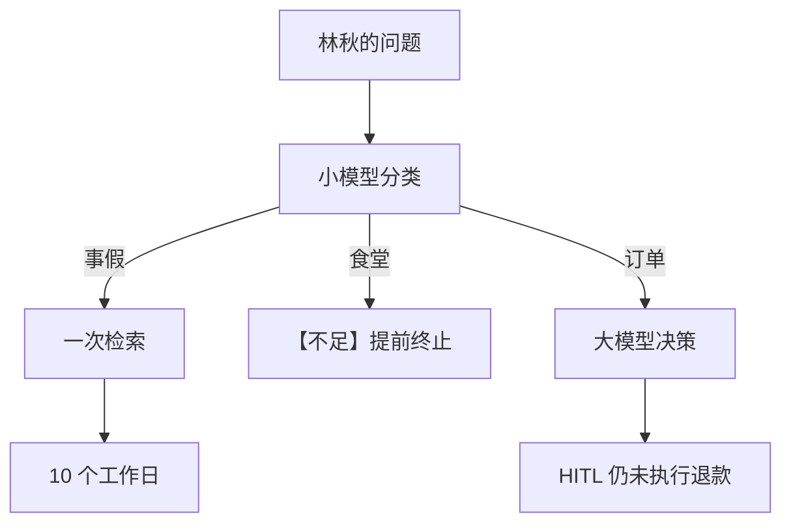
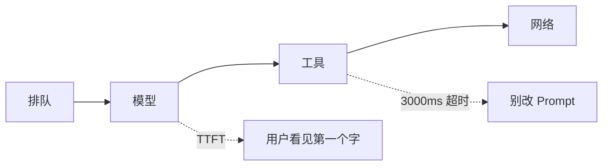

# 第 28 章 成本与延迟优化

> 本章定位：第七卷第三站。第 27 章能看见 Token 和耗时。读完本章，你要能说出 **账单四列**（输入、输出、重试、检索），用 **小模型分流、大模型决策**，并会用缓存、批处理、流式、提前终止；延迟则拆成 **排队 / 模型 / 工具 / 网络**。3 秒超时去改 Prompt，是找错科室。
>
> 前置：第 25 章 HITL、第 27 章 Trace。不需要 API Key。
>
> 配套代码：`code/ch28/python/`、`code/ch28/java/`（同构 `MiniBill`）
>
> 图表假设：Token 按 **字符数** 计，不是 tiktoken。单价是课堂约定的 **教学币**，不是 2026 年某家官网价。流式只改 **首字时间（TTFT, Time To First Token）**，不改账单。`fat` 故意长 Prompt、检索 3 次、再重试 2 次。ORDER-88 未发货可退，写退款须确认，**可退 ≠ 已退**；食堂【不足】应提前终止，不调 `get_order`。事假 **10 个工作日**。

---

## 28.1 账单从哪里来：输入、输出、重试、检索

### 直觉解释

同事说「换个便宜模型就能省钱」。有时对，有时你真正烧掉的是：把整本制度贴进 Prompt、检索三次、解析失败再重试两轮。 **成本（Cost）** 先拆四列，再谈优化。

| 列 | 英文 | 什么在烧 |
| --- | --- | --- |
| 输入 | Input tokens | 系统提示 + 历史 + 检索拼进去的字 |
| 输出 | Output tokens | 模型吐出的字，往往比输入贵 |
| 重试 | Retry | 同一问再跑一遍，四列都会再计 |
| 检索 | Retrieval | 向量库 / 搜索 API 按次或按量 |

第 27 章的 Token 是树上的计量。本章把它乘上单价。教学单价写在 `RATES` 里，面试时要说「这是约定，线上用供应商账单」。

### 生活类比：出租车打表

上车（输入）、行驶（输出）、绕路重跑（重试）、过路费（检索）。你不能只换一辆「更便宜的车」却天天绕城三圈。

### 原理剖析：先看哪一列最大

`fat` 把「请结合全部历史与制度全文」重复八遍，每问检索 3 次、大模型重试 2 次。`lean` 短问、检索至多 1 次、不重试。示例 1 会看到：浪费路径的 **重试列和检索列** 单独就压过节俭路径的合计。

---

## 28.2 模型分级：小模型做分类，大模型做决策

**模型分级（Model Cascade / Routing）**：小模型做 **分类（Classification）**——这是事假、订单还是食堂；大模型只在 **高风险决策** 出场，比如 ORDER-88 能不能退。

这不是「小模型更笨所以食堂交给它」。是 **动作风险**：食堂该提前说【不足】，不必请贵模型编红烧肉。退款决策仍要大模型，并且第 25 章的人还没点头就不能执行 `refund_order`。

| 问法 | 全大模型 | 分级 |
| --- | --- | --- |
| 事假上限几天 | 大模型 + 检索 | 小模型 + 一次检索 |
| ORDER-88 能不能退 | 大模型 | 小模型分流后 **仍上大模型** |
| 食堂红烧肉 | 大模型 | 小模型直接【不足】 |

小模型的工具白名单里 **不准出现** `refund_order`。分级省的是钱，不是闸门。

### 图 1：贵的算力留在闸门前



教学假设：分类是规则级小模型脚本。生产里才是真的 8B / 小规格接口。

---

## 28.3 缓存、批处理、流式、提前终止

四件省钱或省体感的工具，第一次出现先中英对照：

| 手段 | 英文 | 省什么 | 不省什么 |
| --- | --- | --- | --- |
| 缓存 | Cache | 第二次制度问答的模型费和模型耗时 | 第一次；写工具结果不能当真理缓存 |
| 批处理 | Batch | 三条相似问法的重复前缀 | 不相关的订单 + 食堂硬拼 |
| 流式 | Streaming | **首字时间**，用户觉得快 | Token 账单几乎不变 |
| 提前终止 | Early stop | 食堂不再调 `get_order` | 该查的订单不能省 |

ORDER-88 的状态以工具为准，不要把上周的「未发货」缓存到退款执行。制度「10 个工作日」可以缓存，但要带版本，废止稿第 16 章讲过。

---

## 28.4 延迟拆解：排队、模型、工具、网络

**延迟（Latency）** 和账单不是同一张表。账单高，用户可能只等 200ms（缓存）。账单低，用户可能等 3 秒（工具超时）。

| 段 | 英文 | 典型 |
| --- | --- | --- |
| 排队 | Queue | 限流、线程池、供应商排队 |
| 模型 | Model | 生成 Token 的时间 |
| 工具 | Tool | `get_order` / `refund_order` / 检索 |
| 网络 | Network | 到模型和到工具的往返 |

第 27 章那次 `refund_order` timeout **3000ms** 是工具段。去压 Prompt，是找错科室。

**首字时间（TTFT）** ≈ 排队 + 到第一个 Token。流式让 TTFT 变短，总耗时仍是四段之和。面试时能把「感觉快了」和「账单少了」拆开，就比背「我们上了流式」强。

### 图 2：先拆四段，再动手



教学假设：网络段单独标出，实际上常叠在模型和工具的 HTTP 里。拆开是为了不把下游慢写成「模型不行」。

---

## 实现：三场可运行的对照

### 环境要求

| 项目 | 版本 / 说明 |
| --- | --- |
| Python | 3.10+，标准库 |
| Java | 17+，标准库 |
| API Key | 不需要 |

PowerShell 里 `-D` 参数请加引号。控制台中文乱码时先 `chcp 65001`，以验收句为准。

---

### 示例 1：账单四列

```bash
cd code/ch28/python
python 01_bill_sources.py
```

```powershell
cd code/ch28/java
mvn -q -DskipTests compile exec:java "-Dexec.mainClass=com.agentbook.ch28.BillSources"
```

同一组三问：事假、ORDER-88、食堂。`fat` 更贵，重试列 > 0，检索列也更高。`lean` 重试为 0。

---

### 示例 2：分级

```bash
python 02_model_cascade.py
```

```powershell
mvn -q exec:java "-Dexec.mainClass=com.agentbook.ch28.ModelCascade"
```

全程大模型对照 `all_large`。分级后食堂没有 large 行，ORDER-88 仍有 large 行，事假只有 small，两侧都 **没有** `refund_order`。

---

### 示例 3：缓存、批处理、流式、四段延迟

```bash
python 03_cache_latency.py
```

```powershell
mvn -q exec:java "-Dexec.mainClass=com.agentbook.ch28.CacheLatency"
```

同一句事假第二次 `cached` 且金额 0。三条制度问法批处理比串行便宜。食堂工具列表里没有 `get_order`。超时拆解里 3000 在 tool。流式账单不变，TTFT < 总耗时。

**Python / Java 差异：** 产品语言对齐。生产用供应商账单和真实 tokenizer。Java 侧限流和批处理常落在网关 / 线程池，和模型商标无关。

---

## 踩坑提醒与职场视角

**坑 1：只换便宜模型，不拆四列。** 长 Prompt 和重试会把小模型也烧穿。

**坑 2：小模型直接退款。** 分级省钱，不撤闸门。

**坑 3：缓存订单状态。** 未发货会变成已发货。缓存制度，不缓存资金事实。

**坑 4：把流式写成「降低了成本」。** 它降低的是首字时间。

**坑 5：3 秒超时去精简 System Prompt。** 先看第 27 章树上哪一段红。

**坑 6：简历写「优化了 50%」没有分母。** 要写：相对哪条基线、哪一列、金标有没有回归（第 26 章）。

### 简历上可以写的一句

> 账单拆输入/输出/重试/检索四列；制度问答走小模型 + 缓存，退款决策才上大模型且不执行写工具；延迟按排队/模型/工具/网络拆，能说明 3 秒超时在工具段。对比实验带金额，不把流式说成省钱。

### 本章小结

- 账单四列：输入、输出、重试、检索。
- 小模型分流，大模型决策，写工具仍须人。
- 缓存制度，不缓存资金事实。
- 流式改 TTFT，不改账单。
- 延迟四段；超时先看工具。

---

## 28.5 常见面试考点

> **高频原题：**「Agent 的钱和延迟都花在哪？你怎么降？」
>
> **90 秒答法：**
> 钱先拆四列：输入 Token、输出 Token、重试、检索。林秋问事假，我不该把制度全文和三次检索都喂给大模型。我用小模型分类：食堂提前【不足】，制度问答可缓存，ORDER-88 才上大模型做决策，执行退款仍要人点头。延迟拆排队、模型、工具、网络。第 27 章那次 3 秒是 refund_order 超时，不是 Prompt 太长。流式让用户先看见字，账单几乎不变。优化要对照实验，回归不能红。
>
> **追问 1：**「输出为什么比输入贵？」  
> 供应商常这样定价。所以少让模型发表情包长文，结构化短输出更省。
>
> **追问 2：**「批处理会不会串单？」  
> 会。只批同一类只读问法。ORDER-88 和食堂不要批在一起。
>
> **追问 3：**「限流算哪一段？」  
> 排队。被限流时模型还没开始，账单可能是 0，延迟已经很难看。

---

## 28.6 课后练习（含答案提示）

**练习 1：给 fat 去掉重试（必做）**  
重跑示例 1。看四列里哪一列掉得最多。

- 提示：`add_llm(..., retry=2)` 改 0。
- 面试句：先砍重试，再谈换模型。

**练习 2：年假问法走分级（必做）**  
`route` 加上年假 → `other` 或新档，lean 应【不足】且不上 large。补一条第 26 章式金标。

- 提示：线上抽样冒出的年假，不该默默交给大模型编造。
- 对照：第 26 章漂移补例。

**练习 3：把 3000ms 画进你们的延迟预算（必做）**  
假设 SLA 是总耗时 < 800ms。工具 3000 时哪一段超标？写一句降级：失败关闭，不重试退款。

- 提示：第 25 章资金禁止 fail_open。
- 职场：超时重试会同时烧钱和烧延迟。

**练习 4：60 秒口述（必做）**  
画出图 1 和图 2。用食堂 / 事假 / ORDER-88 各走一遍。录音。

---

## 本章质量自检

| 检查项 | 结论 |
| --- | --- |
| 零基础读者能否不看前文就懂？ | 从出租车打表讲起。 |
| 代码能否直接复制运行？ | 无 Key；三份示例带验收。 |
| 是否有职场 / 面试落点？ | 四列账单、分级、TTFT、简历项目 3。 |
| 图表是否标注假设？ | 教学币、字符 Token、脚本分流。 |

---

## 你现在应该能做的事

- [ ] 把一笔费用拆成输入 / 输出 / 重试 / 检索
- [ ] 说明为什么食堂不上大模型，ORDER-88 仍要上
- [ ] 分清缓存、批处理、流式、提前终止各自省什么
- [ ] 把 3 秒超时指到工具段，而不是 Prompt

下一章把刀刃翻过来：提示注入、工具滥用、越权检索——以及事故在面试里怎么讲。

回复 **「继续」** 进入第 29 章：《安全与权限边界》。
