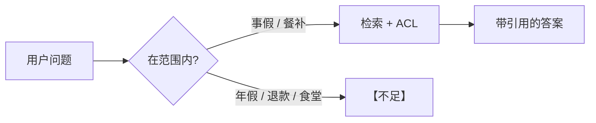
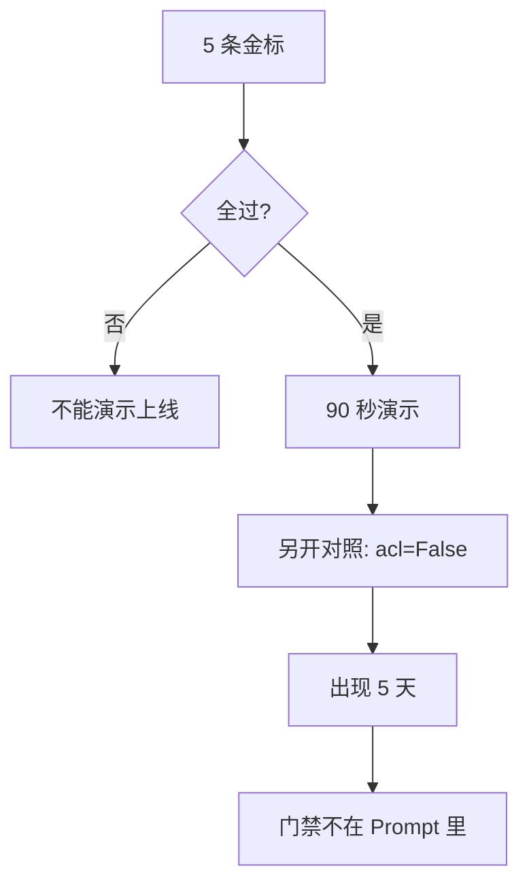

# 第 30 章 简历项目 1：企业知识库问答 Agent

> 本章定位：第八卷第一站。前七卷的零件已经齐了。读完本章，你要能用 **一个两周切片** 讲清企业知识库问答：业务痛点是口口相传的 5 天，不是「我接了向量库」；范围内带 **引用** 和 **ACL**，范围外说【不足】；金标 5 条进 CI；简历四行用 STAR，演示时主动打开关 ACL 的对照病。
>
> 前置：第 13–16 章 RAG、第 26 章评测、第 29 章 ACL。不需要 API Key。
>
> 配套代码：`code/ch30/python/`、`code/ch30/java/`
>
> 图表假设：检索是 **关键词打分**，不是生产 Embedding。金标锁在 `evalkit`，禁止看着输出改 must。现行事假 **10 个工作日**，废止稿 **5 天** 且 `acl=hr`。ORDER-88 / 年假 / 食堂 **不在本项目范围**——那是项目 2 或「不足」。可退 ≠ 已退，本章根本不调 `refund_order`。

---

## 30.1 项目故事：业务痛点而不是技术炫技

### 直觉解释

面试官听过太多「我用 LangChain 做了 RAG」。他们要听的是：**谁在痛、痛成什么样、你两周改变了哪一条错误答案。**

故事：同事口头说事假 5 天，废止稿还躺在共享盘里。实习生一问模型，闭卷也编 5 天，开卷若不过滤 ACL，照样抄到废止稿。HR 真正要的是：问「最多几天」必须答 **10 个工作日**，并且能指回现行条款。

向量库、框架名是手段。痛点是 **5 天还在流传**。

### 生活类比：前台的过期告示

大厅还贴着「停水通知（已过期）」。客人问还停不停，前台如果把过期告示念一遍，就是事故。你做的是：新告示带编号，旧告示只有后勤能进档案室。

### 原理剖析：先写谁不能再答错

项目 1 的成功标准只有一句：**实习生问事假天数，不得出现 5 天，必须带引用。** 其余都是为这一句服务。

---

## 30.2 范围裁剪：两周能做完的版本

两周不是「少做一点」，是 **故意不做什么**。

| 做 | 不做（写进说明书） |
| --- | --- |
| 现行事假、餐补 | 年假、食堂、退款、工单 |
| 引用 `[leave10]` | 多跳 Agent、写工具 |
| intern / hr 的 ACL | 单点登录全家桶 |
| 5 条金标 + 退出码 | LLM-as-Judge、99% 准确率 |
| 关 ACL 对照病 | 把对照病当成线上配置 |

年假和 ORDER-88 一律【不足】。面试官追问退款，你说「那是项目 2，写工具必须 HITL」。这比硬接一个假退款更像工程师。

### 图 1：两周切片的边界



---

## 30.3 技术点：RAG + 引用 + 权限过滤 + 基础评测

四个词，简历里都要能指到代码：

1. **RAG：** 开卷。先检索再开口。本章用关键词，生产换 Embedding， **金标尺子不变**。  
2. **引用：** 答案里出现 `[leave10]` / `[meal]`，能指回块 id。  
3. **权限过滤：** intern 只见 `public`。关 ACL 是对照，能复现 5 天泄漏。  
4. **基础评测：** 5 条 must / must_not，全过才退出 0。泄漏对照 **不进** 发布门。

| 金标 id | 合同 |
| --- | --- |
| leave_days | 10 个工作日 + `[leave10]`，不要 5 天 |
| leave_max | 同上，打「最多几天」 |
| meal | 30 元 + `[meal]` |
| year / order | 【不足】 |

### 图 2：发布门只认开着的 ACL



教学假设：hr 开 ACL 仍可能看见废止稿，但打分给 deprecated 减权，答题走现行。关 ACL 时教具故意「可见就抄」，用来复现 5 天泄漏。看见 ≠ 引用；门禁必须在检索前。

---

## 30.4 简历上的 4 行写法（STAR）

**STAR** = 情境 Situation、任务 Task、行动 Action、结果 Result。四行，不要一段形容词。

示例 3 打印的四行可以直接改口吻，但不要改事实：

1. 情境：口口相传 5 天，实习生能翻到废止稿  
2. 任务：两周只读问答，必须引用 + 角色过滤  
3. 行动：检索 + `[id]`；intern 只见 public；5 条金标进 CI  
4. 结果：实习生稳定 10 个工作日 + `[leave10]`；关 ACL 对照可复现泄漏  

禁止：准确率 99%、精通 LangChain、赋能数字化。第 26 章写过。

---

## 30.5 演示脚本与追问预案

90 秒只做四下，顺序不要倒：

1. 成功：实习生问上限 → `[leave10]` + 10 天  
2. 裁剪：年假、ORDER-88 →【不足】  
3. **主动** 关 ACL → 5 天泄漏  
4. 打开金标表 5 条 PASS，声明没改 must  

追问三句背熟：

- Embedding？切片用关键词，换向量不换尺子。  
- 和 ChatGPT？闭卷会编；我们开卷且拒答。  
- 退款？项目 2，HITL。

---

## 实现：三场可运行的作品集切片

### 环境要求

| 项目 | 版本 / 说明 |
| --- | --- |
| Python | 3.10+，标准库 |
| Java | 17+，标准库 |
| API Key / 向量库 | 不需要 |

PowerShell 里 `-D` 参数请加引号。控制台中文乱码时先 `chcp 65001`。

---

### 示例 1：范围和对照病

```bash
cd code/ch30/python
python 01_two_week_scope.py
```

```powershell
cd code/ch30/java
mvn -q -DskipTests compile exec:java "-Dexec.mainClass=com.agentbook.ch30.TwoWeekScope"
```

范围内带 `[leave10]`。年假、退款【不足】。关 ACL 出现 5 天。hr 开 ACL 仍优先现行。

---

### 示例 2：金标 CI

```bash
python 02_rag_cite_eval.py
```

```powershell
mvn -q exec:java "-Dexec.mainClass=com.agentbook.ch30.RagCiteEval"
```

5 条全过退出 0。这就是简历里那句「CI 红灯拦截」。

---

### 示例 3：STAR + 演示词

```bash
python 03_star_demo_script.py
```

```powershell
mvn -q exec:java "-Dexec.mainClass=com.agentbook.ch30.StarDemoScript"
```

把打印稿读顺，改成你的公司名词。不要加 99%。

**Python / Java 差异：** 同构切片。生产 Python 可换 Chroma，Java 可换 Spring + 你们的检索服务。面试讲尺子和 ACL，不讲「我用了哪个商标」。

---

## 踩坑提醒与职场视角

**坑 1：简历第一句写框架名。** 第一句写 5 天的事故。  
**坑 2：范围外硬答。** 【不足】是作品，不是缺陷。  
**坑 3：不敢演示泄漏对照。** 不敢复现，面试官会以为你没门禁。  
**坑 4：金标跟着 Demo 改。** 第 16、26 章的自欺。  
**坑 5：把项目 1 做成退款。** 两周装不下 HITL，装了会稀。  
**坑 6：仓库里只有 Notebook。** 至少要有能退出 0 的评测脚本。

### 简历上可以写的一句

> 两周做成企业制度问答：开卷检索带块引用，实习生 ACL 过滤废止稿；5 条金标进 CI；范围外拒答。能复现关 ACL 后的 5 天泄漏，证明门禁不在 Prompt。

### 本章小结

- 故事是 5 天还在流传。  
- 两周只做只读问答。  
- 引用、ACL、金标、【不足】四件套。  
- STAR 四行，演示先成后对照。  
- 退款留给项目 2。

---

## 30.6 课后作业：写出你的项目说明书（含答案提示）

**作业 1：一页说明书（必做）**  
复制示例 3 的 STAR，把「林秋 / 事假」换成你熟悉的制度（报销、入职、VPN）。金标至少 4 条，含一条【不足】和一条对照泄漏。

- 提示：先写痛点句，再写不做清单。  
- 面试句：不做清单比技术栈更像设计。

**作业 2：把关键词检索换成你第 13 章的哈希检索（必做）**  
金标一条都不能改。若红灯，修检索，不修 must。

- 提示：第 26 章回归。  
- 对照：换引擎，尺子不动。

**作业 3：90 秒录音（必做）**  
按演示脚本录一遍。超时就删形容词。

**作业 4：画图 1 贴进 README（必做）**  
仓库首页只放边界图和如何跑示例 2。不要放 API Key。

---

## 本章没有单独的「面试原题盒」

本章本身就是面试稿。若被问「你的 RAG 项目是什么」，把 30.4 四行 + 30.5 四步讲完即可。加分句仍是第 26 章那句：不写 99%。

---

## 本章质量自检

| 检查项 | 结论 |
| --- | --- |
| 零基础读者能否不看前文就懂？ | 从过期告示讲起。 |
| 代码能否直接复制运行？ | 无 Key；三份示例带验收。 |
| 是否有职场 / 面试落点？ | STAR、演示脚本、对照病。 |
| 图表是否标注假设？ | 关键词检索、金标锁死、退款不做。 |

---

## 你现在应该能做的事

- [ ] 用一句话讲痛点：5 天还在流传  
- [ ] 说出两周做与不做  
- [ ] 跑绿 5 条金标，并复现关 ACL 泄漏  
- [ ] 用四行 STAR 和 90 秒脚本演示

下一章把退款接回来：编排、工具、人工审批，以及一条能演示的失败路径。

回复 **「继续」** 进入第 31 章：《简历项目 2：多 Agent 业务办理工作流》。
