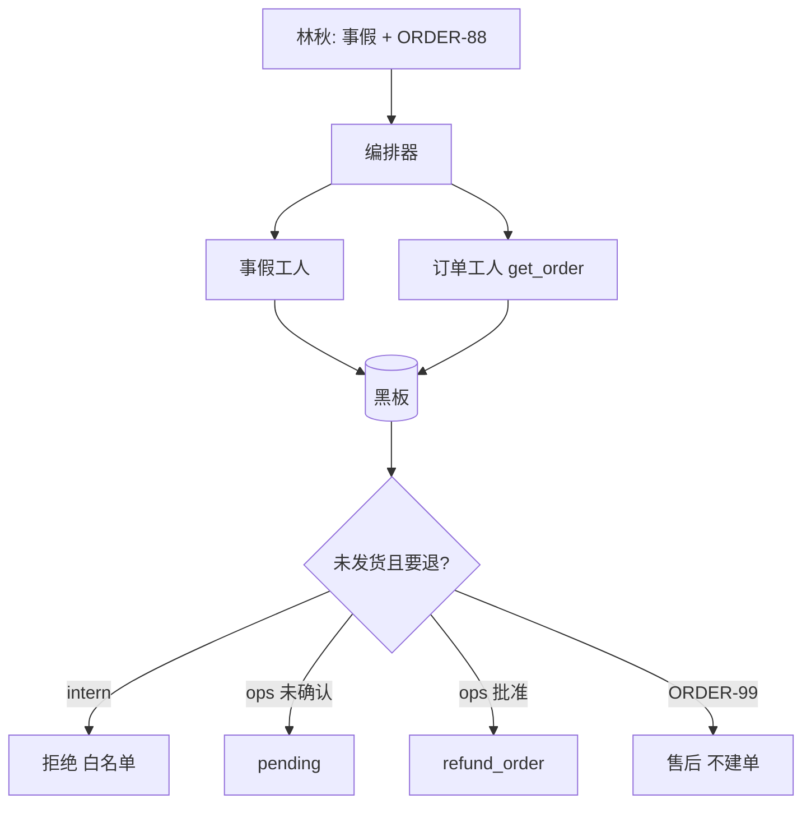
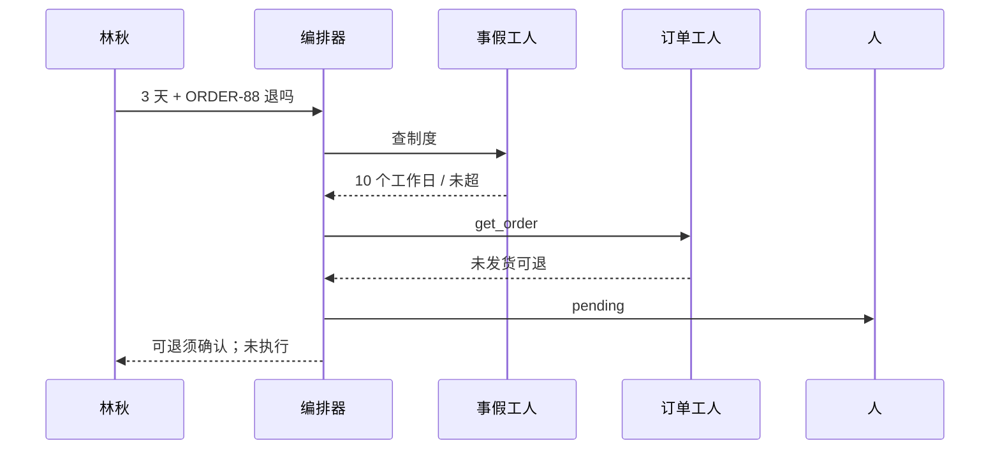

# 第 31 章 简历项目 2：多 Agent 业务办理工作流

> 本章定位：第八卷第二站。项目 1 只读制度。读完本章，你要能把 **跨系统办理** 讲成工单，而不是三个机器人聊天：编排器分格、工具查事实、写退款必须 **HITL**；并且能当场演示 **四条失败路径**。这是简历项目 2 的加分点。
>
> 前置：第 23 章主编排、第 24 章 Swarm、第 25 章人类介入、第 30 章范围裁剪。不需要 API Key。
>
> 配套代码：`code/ch31/python/`、`code/ch31/java/`
>
> 图表假设：工人是脚本。林秋 **2026-09-14..16 共 3 天**，上限 **10 个工作日**。ORDER-88 未发货可退，ORDER-99 / TZ123 已发货须售后。**可退 ≠ 已退。** intern 不在 `refund_order` 白名单。食堂超时是教具，用来演示失败隔离。

---

## 31.1 项目故事：跨系统办理，而不是「三个机器人聊天」

### 直觉解释

面试官听过「我做了多智能体，客服、质检、经理会开会」。下一句是：林秋同时问事假和 ORDER-88，**哪一张工单被办完了？** 若只有群聊记录，这不是项目 2。

痛点：制度在知识库，订单在 OMS，退款在支付。旧客服要么只答一句，要么直接说「已办理」。你要做的是 **一笔办理汇报**：事假格、订单格、审批格。

### 生活类比：医院会诊单 vs 微信群

会诊单上内科写内科的、影像写影像的，最后主任签字才能开刀。微信群里三个人打招呼，病人的片子没人贴。项目 2 是会诊单。

### 原理剖析：目标属于编排器

第 23 章：编排器拥有目标。第 24 章：蜂群只有话筒。项目 2 选主编排，因为复合办理要 **部分成功**，不要一只话筒把事假吃掉。

---

## 31.2 编排、工具、人工审批

三件套，简历里都要能指到：

| 零件 | 干什么 | 不干什么 |
| --- | --- | --- |
| 编排器 | 拆格、汇总、决定失败策略 | 自己编红烧肉、自己退款 |
| 工具 | `search_policy` / `get_order` 出事实 | 句子里的「已办理」 |
| HITL | ORDER-88 写退款前停住 | 把澄清当成批准 |

实习生可以问「能不能退」，不能批准。`agent_ops` 不点确认，只有 `pending`。ORDER-99 **不建写单**——没有写工具，就不要打扰人（第 18、25 章）。

### 图 1：办理流，人在写边上



---

## 31.3 可演示的失败路径（这点很加分）

成功路径人人会：查到未发货，点确认，执行。加分的是你 **主动打开失败**：

| 路径 | 用户看见 | 树上/格子 |
| --- | --- | --- |
| ORDER-99 强行批准 | 售后 | `executed` 为空 |
| ORDER-88 不确认 | 可退，须确认 | `pending` |
| 点拒绝 | 【已拒绝】 | 无写工具 |
| intern 带确认 | 【拒绝】白名单 | 无写工具 |
| 食堂超时 | 【失败隔离】 | 事假格、订单格仍在 |

「系统出错」不是失败路径。失败路径必须能指到 **哪一格、哪一张单**。

---

## 31.4 简历写法与架构图

STAR 四行（示例 3 可打印）：

1. 情境：同时问事假和退款，旧系统只答一句或谎称已退  
2. 任务：跨系统办理，写操作必须人批  
3. 行动：分格 + 白名单 + 99 不建单 + 隔离 + 可拒绝  
4. 结果：未确认只有 pending；四条失败可复现  

架构图就是图 1。图上必须能指出 **人出现在哪条边**。画三个笑脸机器人握手，减分。

### 图 2：ORDER-88 未确认时序



作业是把这张图用你的工具重画一遍，标上 `thread_id` / 审批单号。

---

## 实现：三场可运行的办理切片

### 环境要求

| 项目 | 版本 / 说明 |
| --- | --- |
| Python / Java | 3.10+ / 17+，标准库 |
| API Key | 不需要 |

PowerShell 里 `-D` 请加引号。

---

### 示例 1：闲聊 vs 办理

```bash
cd code/ch31/python
python 01_orch_not_chat.py
```

```powershell
cd code/ch31/java
mvn -q -DskipTests compile exec:java "-Dexec.mainClass=com.agentbook.ch31.OrchNotChat"
```

同一句复合问法：闲聊只剩「要不要退款呀」；办理有 3 天和 ORDER-88，实习生 `executed` 为空。

---

### 示例 2：失败四件套

```bash
python 02_failure_paths.py
```

```powershell
mvn -q exec:java "-Dexec.mainClass=com.agentbook.ch31.FailurePaths"
```

99 批准也不执行；88 待确认；拒绝不执行；实习生确认也拒；食堂隔离后另两格仍在。

---

### 示例 3：STAR + 时序提纲

```bash
python 03_star_sequence.py
```

```powershell
mvn -q exec:java "-Dexec.mainClass=com.agentbook.ch31.StarSequence"
```

把 SEQ 画进作品仓库。90 秒演示按 1→5 走，不要先秀批准成功。

**Python / Java 差异：** 同构切片。生产可把编排器画成 LangGraph，审批单进工单系统。简历写「人在哪条边」，不写「上了三个 Agent」。

---

## 踩坑提醒与职场视角

**坑 1：演示只走批准成功。** 面试官会问 99 怎么办。  
**坑 2：三个 Chatbot 互报工号。** 没有格子就没有项目。  
**坑 3：intern 点确认就能退。** 白名单不是装饰。  
**坑 4：食堂失败整单空白。** 第 23 章隔离。  
**坑 5：简历写多智能体协作，图上没有人。**  
**坑 6：和项目 1 做成同一个仓库糊成一锅。** 只读问答 / 写办理，两张边界图。

### 简历上可以写的一句

> 跨系统办理用编排器分格：事假与订单并行，ORDER-88 写退款须 HITL；ORDER-99 不建写单；实习生即使确认也拒绝；食堂超时失败隔离。四条失败路径可演示。

### 本章小结

- 项目 2 是工单，不是群聊。  
- 编排 + 工具 + 人。  
- 失败路径比成功路径值钱。  
- 图上要有人。  
- 可退 ≠ 已退。

---

## 31.5 课后作业：补齐你的时序图（含答案提示）

**作业 1：重画图 2（必做）**  
补上 `ticket_id`、角色、是否执行。拒绝边和 99 边各画一条。

- 提示：人是参与者，不是注释。  
- 面试句：指着 pending 那一刀。

**作业 2：加一条「缺单号」（必做）**  
「我想退款」应澄清，不建 `refund_order`。

- 提示：第 25 章澄清 ≠ 批准。  
- 对照：示例 2 的白名单是另一条边。

**作业 3：90 秒录音（必做）**  
按 SCRIPT 1→5。超时就删成功批准。

**作业 4：对照项目 1 写三句「为什么是两个项目」（必做）**  
只读 / 可写、金标 / 工单、ACL / HITL。

---

## 本章质量自检

| 检查项 | 结论 |
| --- | --- |
| 零基础读者能否不看前文就懂？ | 从会诊单讲起。 |
| 代码能否直接复制运行？ | 无 Key；三份示例带验收。 |
| 是否有职场 / 面试落点？ | 失败四件套、STAR、时序作业。 |
| 图表是否标注假设？ | 脚本工人、教学超时、可退 ≠ 已退。 |

---

## 你现在应该能做的事

- [ ] 用一句话区分办理流和三个机器人聊天  
- [ ] 画出人在写边上的架构  
- [ ] 当场复现 99 / pending / 拒绝 / 越权 / 隔离  
- [ ] 把时序图补进仓库

下一章把脚本升级成服务：鉴权、配额、Trace、成本看板——简历项目 3。

回复 **「继续」** 进入第 32 章：《简历项目 3：可观测、可限流的生产级 Agent 服务》。
