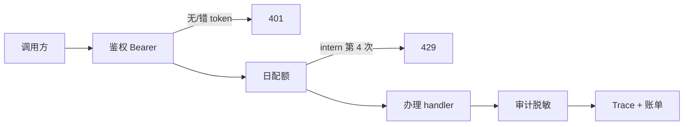
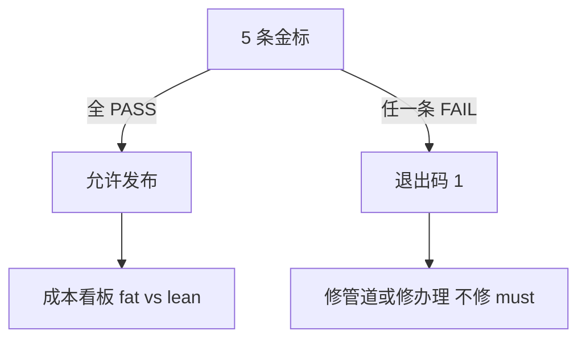

# 第 32 章 简历项目 3：可观测、可限流的生产级 Agent 服务

> 本章定位：第八卷第三站。项目 2 是本机办理脚本。读完本章，你要能把脚本收成 **服务（Service）**：门口查工牌、每天限次数、录像打码，并且能指着 **追踪（Trace）**、金标回归和 **成本看板（Cost dashboard）** 讲工程判断。简历只把 **一个** 框架做深。
>
> 前置：第 26 章评测、第 27 章可观测、第 28 章成本、第 31 章办理流。不需要 API Key。
>
> 配套代码：`code/ch32/python/`、`code/ch32/java/`
>
> 图表假设：本课 **不拉 HTTP 端口**，语义按 FastAPI 中间件 / Spring 过滤器。Token 按 **字符数** 计，单价是 **教学币**，不是官网价。林秋 **2026-09-14..16 共 3 天**，上限 **10 个工作日**。ORDER-88 未发货可退，**可退 ≠ 已退**。intern 日配额 3 次，不在 `refund_order` 白名单。手机号 `13800138000` 是课堂假数据。

---

## 32.1 从脚本到服务：鉴权、配额、审计

### 直觉解释

项目 2 你在自己电脑上跑 `python 01_orch_not_chat.py`。同事一问「接口在哪」，你把脚本发过去——谁都能调，林秋的手机号进了日志，实习生连打四次把账单打穿。脚本能跑，不等于能上线。

**服务** 是把办理流放进一条固定管道。第一次出现先中英对照：

| 名词 | 英文 | 门口干什么 |
| --- | --- | --- |
| 鉴权 | Authentication | 工牌无效，不让进 |
| 配额 / 限流 | Quota / Rate limiting | 今天份已用完，请明天来 |
| 审计 | Audit | 留单号和脱敏问句，不留手机号 |

### 生活类比：自家厨房 vs 食堂窗口

自家厨房：你进门就炒，油烟机不记谁来过。食堂窗口：看工牌、每餐限一份、监控只留背影。项目 3 是食堂窗口，不是把厨房灶台搬到走廊。

### 原理剖析：先拦人，再办事

无 token → **401**。intern 第 4 次 → **429**，前三次仍按办理流走，**不会**因为限流就把 ORDER-88 说成已退。写退款的闸门还在第 25、31 章：人没点头就不执行。

示例 1 的对照病：脚本把 `13800138000` 印在 `raw=` 后面；服务审计里只剩 `[PHONE]`。

### 图 1：请求先过三道门



---

## 32.2 Trace、评测回归、成本看板

服务如果只能回 200，排障时你仍在猜。第 27 章：一次请求一把 `trace_id`，树上要有 `auth` / `quota` / `llm`。第 26 章：金标进 CI，退出 1 就不能部署。第 28 章：同一句 ORDER-88，胖路径和瘦路径必须能对照。

本课实测（教学币，不是官网价）：

| 路径 | 教学币 | 检索 | 重试 |
| --- | ---: | ---: | ---: |
| fat | 9.28 | 3 | 2 |
| lean | 1.96 | 1 | 0 |

`fat` 把「请结合全部历史与制度全文」贴十二遍再重试两轮。`lean` 小模型路由、至多一次检索、大模型只做短上下文。面试时要说：**数字是课堂约定，线上对供应商账单。**

五条金标（示例 2 退出 0）：

1. 事假答 **10 个工作日**，不得出现 5 天  
2. ORDER-88 可退，`executed` 为空  
3. 无 token → 401  
4. intern 第 4 次 → 429  
5. 同一问 lean 比 fat 便宜，且 fat 高于 8 教学币  

「挺聪明」不能当第六条。

### 图 2：金标不过，镜像不过



---

## 32.3 Java Spring Boot 或 Python FastAPI 二选一做深

面试官听过「两边我都会」。下一句是：**中间件链上，鉴权挂在哪一层？** 答不出，两个商标都减分。

本章 **把 FastAPI 做深**：管道名写死在 `PIPELINE` 里，生产就是 `HTTPBearer` + `Depends(quota)` + 中间件打 `trace_id`。Java 读者不要再堆一个「也会 Spring」——把同一条管道画成 `OncePerRequestFilter` / `HandlerInterceptor` / MDC + Micrometer / Actuator。

| 本课管道 | FastAPI（做深） | Spring Boot（对照） |
| --- | --- | --- |
| `request_id` | 中间件写 `trace_id` | MDC + Filter |
| `auth_bearer` | `HTTPBearer` / `Depends` | Security Filter |
| `quota_daily` | `Depends(quota)` | HandlerInterceptor |
| `handler` | 路由函数 | Controller |
| `audit_redact` | 后置中间件 | OncePerRequestFilter 出口 |
| `bill_span` | Span + 教学币 | Micrometer 计数器 |

本课不拉端口，避免演示卡在防火墙。简历写的是 **同一条管道**，不是「我启动了 uvicorn」。

不要两边各写三行。选浅的那一边，从简历上删掉。

---

## 32.4 简历写法：突出工程判断

工程判断不是「我用了可观测」。是你能指着三张图说：**谁被拦、谁被限、钱烧在哪一列。**

STAR 四行（示例 3 可打印）：

1. 情境：办理流只能本机跑，联调泄漏手机号，配额能被打穿  
2. 任务：收成服务，留下 Trace 和成本看板  
3. 行动：FastAPI 管道做深；5 条金标进 CI；fat/lean 对照  
4. 结果：401 / 429 可复现；lean **1.96** 对 fat **9.28**；写退款仍须 HITL  

加分句：限流返回 429，**不**把业务改成「已办理」。钱不能 `fail_open`（第 25、29 章）。

### 面试官追问（当场答）

> 问：为什么不把 FastAPI 和 Spring Boot 都写上？  
> 答：二选一做深。管道是鉴权、配额、审计、账单；换框架只换挂钩，不换顺序。  
> 问：429 了订单怎么办？  
> 答：配额耗尽拒绝新请求。已经查到的 ORDER-88 仍是可退未执行，不会因为限流冒充已退。

---

## 实现：三场可运行的服务切片

### 环境要求

| 项目 | 版本 / 说明 |
| --- | --- |
| Python / Java | 3.10+ / 17+，标准库 |
| API Key / 端口 | 不需要 |

PowerShell 里 `-D` 请加引号。

---

### 示例 1：脚本 vs 服务

```bash
cd code/ch32/python
python 01_script_vs_service.py
```

```powershell
cd code/ch32/java
mvn -q -DskipTests compile exec:java "-Dexec.mainClass=com.agentbook.ch32.ScriptVsService"
```

脚本泄漏手机号；服务无 token 是 401；intern 第 4 次 429；审计只剩 `[PHONE]`；ORDER-88 的 `executed` 仍为空。

---

### 示例 2：Trace、金标、看板

```bash
python 02_trace_eval_board.py
```

```powershell
mvn -q exec:java "-Dexec.mainClass=com.agentbook.ch32.TraceEvalBoard"
```

树上有 `auth` / `quota` / `llm`。ops 不确认只有 pending。看板 lean **1.96**、fat **9.28**。5 条金标全过才退出 0。

---

### 示例 3：STAR + 三张截图说明

```bash
python 03_star_screenshots.py
```

```powershell
mvn -q exec:java "-Dexec.mainClass=com.agentbook.ch32.StarScreenshots"
```

把三张「截图说明」贴进作品仓库。90 秒按 1→5 走：先对照病，再门禁，最后看板。不要先打开成功 200 就结束。

**Python / Java 差异：** 同构内核。生产 Python 挂 FastAPI，Java 挂 Spring Filter。面试讲管道顺序和金标退出码，不讲「我用了哪个商标」。

---

## 踩坑提醒与职场视角

**坑 1：简历第一句写 FastAPI。** 第一句写脚本泄漏和配额打穿。  
**坑 2：两个框架各写三行。** 二选一做深。  
**坑 3：演示只秀 200。** 加分的是 401 / 429 / fat-lean。  
**坑 4：限流时随口说已退款。** 429 是门口，不是办理结果。  
**坑 5：审计留 Authorization 明文。** 只留 `actor` 哈希和 `trace_id`。  
**坑 6：看板上写官网价。** 必须声明教学币。  
**坑 7：和项目 1、2 糊成一个仓库首页。** 只读问答 / 写办理 / 服务门禁，三张边界图。

### 简历上可以写的一句

> 把跨系统办理收成服务：Bearer 鉴权、实习生日配额 3 次、审计脱敏；请求带 Trace；5 条金标进 CI。同一问 lean 1.96 教学币对照 fat 9.28；无 token 401、超额 429；写退款仍须 HITL。

### 本章小结

- 脚本能跑 ≠ 能上线。  
- 鉴权、配额、审计是三道门。  
- Trace、金标、看板要能指到数字。  
- 框架二选一做深。  
- 可退 ≠ 已退；限流 ≠ 已办理。

---

## 32.5 课后作业：准备 3 张监控截图说明（含答案提示）

**作业 1：按示例 3 重拍三张图（必做）**  
用你熟悉的工具（日志平台、Grafana、甚至终端录像）各拍一张：401、429、fat/lean + 金标。每张图下写三行：标题、画面、你要指的点。

- 提示：指的点必须是脱敏、配额分子分母、教学币声明。  
- 面试句：把鼠标停在 `[PHONE]` 和 `quota_used=3` 上各停两秒。

**作业 2：把内核挂进你选的那一个框架（必做）**  
FastAPI 或 Spring Boot 只挂一层，路由仍调用本课 `handle`。不要同时交两份。

- 提示：管道名不要改。  
- 对照：换挂钩，不换顺序。

**作业 3：90 秒录音（必做）**  
按 SCRIPT 1→5。超时就删「微服务」「云原生」这类形容词。

**作业 4：对照项目 1 / 2 写三句「为什么是三个项目」（必做）**  
只读+ACL / 写办理+HITL / 服务门禁+看板。

---

## 本章质量自检

| 检查项 | 结论 |
| --- | --- |
| 零基础读者能否不看前文就懂？ | 从食堂窗口讲起。 |
| 代码能否直接复制运行？ | 无 Key、无端口；三份示例带验收。 |
| 是否有职场 / 面试落点？ | STAR、三张截图说明、二选一。 |
| 图表是否标注假设？ | 不拉端口、教学币、可退 ≠ 已退。 |

---

## 你现在应该能做的事

- [ ] 用一句话区分脚本和带门禁的服务  
- [ ] 当场复现 401、429、审计脱敏  
- [ ] 指着 fat/lean 看板和 5 条金标讲部署门禁  
- [ ] 简历只保留一个框架，并准备三张截图说明

三个简历项目到此齐了。下一章把面试官会问的题按概念、设计、排障、代码、行为拆开练。

回复 **「继续」** 进入第 33 章：《高频面试题精讲》。
