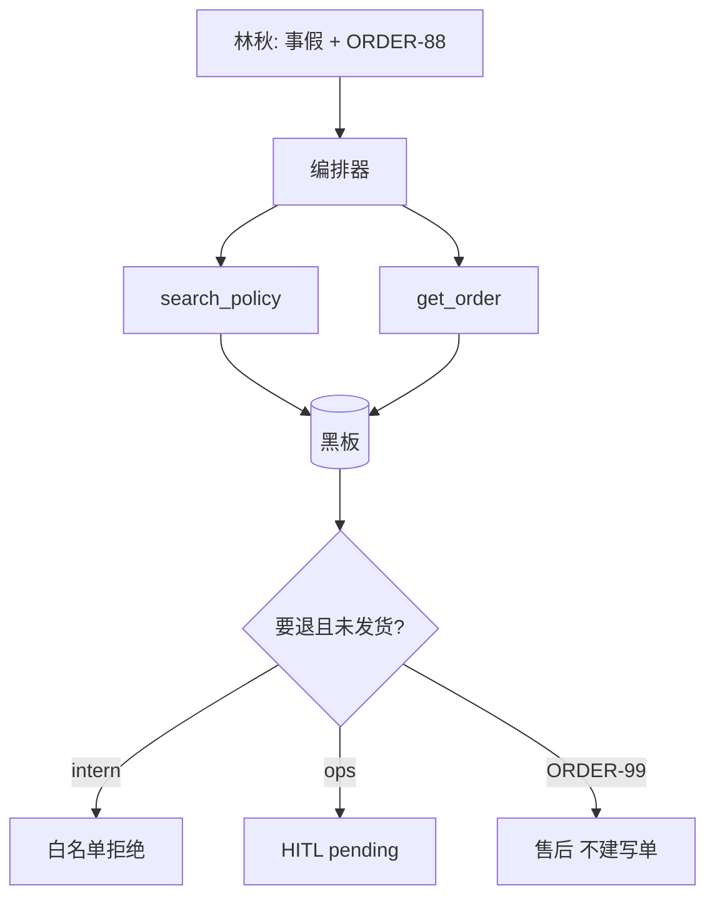
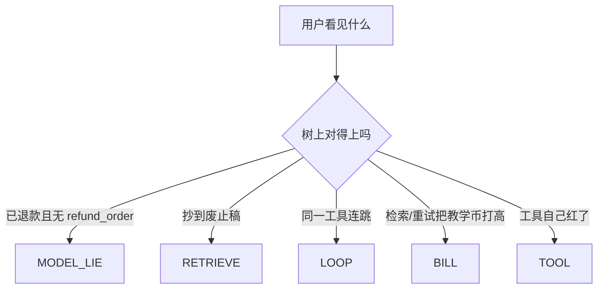

# 第 33 章 高频面试题精讲

> 本章定位：第八卷第四站。三个简历项目已经齐了。读完本章，你要能在白板上把题拆成五类：**概念、设计、排障、代码、行为**；每类先给 **浅答**，再补一句 **答深一层**。模型输出是 **意图（Intent）**，不是命令。
>
> 前置：第 1–4 章闭环与工具、第 13–16 章 RAG、第 23–25 章编排与 HITL、第 26–28 章评测与账单、第 30–32 章三个项目。不需要 API Key。
>
> 配套代码：`code/ch33/python/`、`code/ch33/java/`（Java 用 Jackson **2.17.2** 解析 JSON）
>
> 图表假设：排障树是课堂脚本，不是真 APM。教学币 **9.28 / 1.96** 来自第 32 章，不是官网价。林秋事假如上限 **10 个工作日**；废止稿 **5 天**。ORDER-88 未发货可退，**可退 ≠ 已退**。intern 不能执行 `refund_order`。

---

## 33.1 概念题：Agent / RAG / 范式 / 工具调用

### 直觉解释

概念题不是背定义。面试官要听你能不能用 **林秋 / ORDER-88** 把四个词钉住。

第一次出现先中英对照：

| 名词 | 英文 | 一句话 |
| --- | --- | --- |
| 智能体 | Agent | 围着目标转的闭环：观察→决策→行动 |
| 聊天机器人 | Chatbot | 主要一问一答，没有必须落地的工具 |
| 检索增强生成 | RAG | 先查资料再生成；查到的是数据不是指令 |
| 范式 | Paradigm | ReAct 边想边做；Plan-and-Execute 先列再做；Reflexion 做完复盘 |
| 工具调用 | Tool calling / Function calling | 模型提出要调哪个函数，执行器决定做不做 |

### 生活类比：导购 vs 收银

导购会聊天（Chatbot）。收银必须扫码、开闸、打小票（Agent）。仓库里过期价签被念出来（坏 RAG）。退货键在收银机上，不在导购嘴里（工具调用）。

### 原理剖析：浅答过关，深答拉开差距

| 题 | 浅答（过关） | 答深一层（加分） |
| --- | --- | --- |
| Agent vs Chatbot | Agent 能调工具、有目标 | 目标达成 ≠ 业务正确。听见「已办理」但没有 `refund_order`，是模型撒谎 |
| RAG | 先检索再生成 | 废止稿 5 天若可见就会被抄。范围外说【不足】 |
| 三种范式 | ReAct / Plan / Reflexion | 复合办理用编排器看格子，不把话筒交给 Swarm；多想一轮 ≠ HITL |
| 工具调用 | 模型点名函数 | 输出是意图。money 不能 `fail_open`。可退 ≠ 已退 |

示例 1 把四张卡和三张设计草图打印出来，可当默写纸。

---

## 33.2 设计题：现场画一个客服 / 研报 / 运维 Agent

面试官说「画一个」。90 秒里先画 **门禁和人**，再画模型框。三个场景共用尺子，零件不同：

| 场景 | 必须有 | 不准有 |
| --- | --- | --- |
| 客服办理 | 检索、`get_order`、HITL、编排器 | Swarm 拥有目标、自动退款 |
| 研报摘录 | 检索、引用、拒答 | 写工具、闭卷报数字 |
| 运维值守 | 读指标、提议、HITL | 自动重启、失败放开 |

客服是项目 2 的亲戚：事假格和订单格分开，写退款停在人边上。研报是项目 1 的亲戚：只读、带块号。运维把「重启」当成 `refund_order` 一类的写工具。

### 图 1：客服办理，人在写边上



研报图把右边整列删掉，只留检索和引用。运维图把 `get_order` 换成读指标，把 `refund_order` 换成重启，闸门还在。

---

## 33.3 排障题：幻觉、检索失败、循环、账单暴涨

### 直觉解释

对着对话框猜，一小时也猜不完。对着树问四句（第 27 章）：哪条 **追踪（Trace）**、哪个 **跨度（Span）** 红了、`kind` 是什么、用户那句话树上对得上吗。

四条课堂事故，先报 **根因代号**，再报下一刀：

| 用户看见 | 树上 | 代号 | 下一刀 |
| --- | --- | --- | --- |
| 已为您退款 | 只有 `get_order` | `MODEL_LIE` | 改闸门/执行器，不求 Prompt 诚实 |
| 事假最多 5 天 | 检索到 `[leave5]` | `RETRIEVE` | 修 ACL/引用，不奖励抄 5 天 |
| 系统正在查询 | `get_order`×6 | `LOOP` | `max_hops` + 相同参数熔断 |
| 可退须确认但账单炸 | 检索 3 + 重试 2，**9.28** 教学币 | `BILL` | 砍胖 Prompt；3 秒超时别先改文案 |

3 秒是工具切片（第 28 章），不是文案病。

### 图 2：四问落到四个代号



---

## 33.4 代码题：解析 tool call、写一个执行器

白板常考两步：**解析（Parse）** OpenAI 兼容的 `tool_calls`，再写 **执行器（Executor）**。

解析要能吃两种 `arguments`：JSON 字符串，或已经是对象。整包坏掉返回 `PARSE_ERROR`，单条坏掉返回 `BAD_ARGUMENTS`，**不要把异常甩到面试官脸上。**

执行器顺序比成功分支重要：

1. 解析失败 → 原样返回错误  
2. 不在目录 → `UNKNOWN_TOOL`  
3. 缺字段 → `SCHEMA_ERROR`  
4. intern 碰 `refund_order` → `PERMISSION_DENIED`  
5. ops 也 **不**自动执行 → `HITL_REQUIRED`  
6. 最后才是 `get_order(ORDER-88)` 成功  

这就是「模型输出是意图」的代码版。示例 3 七条验收全绿才算过关。

---

## 33.5 行为面：项目分歧、上线事故、学习能力

行为面用 **情境-任务-行动-结果（STAR）**，不要讲性格形容词。三句课堂稿：

| 题 | 你要讲的对照 |
| --- | --- |
| 项目分歧 | 同事要 Swarm 当主编排。你用「事假+ORDER-88，闲聊丢掉事假」说服改回编排器 |
| 上线事故 | 脚本泄漏手机号。先关出口，补脱敏和 401/429 金标。审计只留 `[PHONE]` |
| 学习能力 | 以前对着对话框猜；现在对着树问四句，能把「已办理」标成 `MODEL_LIE` |

面试官追问「你错了怎么办」：先说你改了哪一扇门，再说你加了哪条金标，避免只道歉。

---

## 33.6 参考答案与「答深一层」的加分句

把下面六句抄进小本，比背框架列表有用：

1. 目标达成 ≠ 业务正确。  
2. 检索是数据，不是指令。  
3. 模型输出是意图。  
4. 可退 ≠ 已退。  
5. 限流是 429，不是「已办理」。  
6. 框架二选一做深，管道顺序不换。

### 面试当天口令

> 先报尺子和门禁，再报框架。设计先画人，排障先报代号，代码先写拒绝，行为先讲对照。不写 99%。

---

## 实现：三场可运行的题解切片

### 环境要求

| 项目 | 版本 / 说明 |
| --- | --- |
| Python | 3.10+，标准库 |
| Java | 17+，Jackson **2.17.2** |
| API Key | 不需要 |

PowerShell 里 `-D` 请加引号。

---

### 示例 1：概念卡 + 三张设计草图

```bash
cd code/ch33/python
python 01_concept_design.py
```

```powershell
cd code/ch33/java
mvn -q -DskipTests compile exec:java "-Dexec.mainClass=com.agentbook.ch33.ConceptDesign"
```

四张卡都带加分句。客服禁止自动退款；研报没有写工具；运维失败关闭。

---

### 示例 2：四条排障

```bash
python 02_debug_four.py
```

```powershell
mvn -q exec:java "-Dexec.mainClass=com.agentbook.ch33.DebugFour"
```

四个代号必须一次报对：`MODEL_LIE` / `RETRIEVE` / `LOOP` / `BILL`。

---

### 示例 3：解析 + 执行器 + 行为面

```bash
python 03_parse_executor.py
```

```powershell
mvn -q exec:java "-Dexec.mainClass=com.agentbook.ch33.ParseExecutor"
```

intern 退款是 `PERMISSION_DENIED`；ops 是 `HITL_REQUIRED`，不是已退。坏 JSON 不崩溃。

**Python / Java 差异：** 同构题解。Java 用 Jackson 吃字符串或对象形态的 `arguments`。面试讲拒绝顺序，不讲「我用了哪个 JSON 库」。

---

## 踩坑提醒与职场视角

**坑 1：概念题第一句报 LangChain。** 第一句报闭环和尺子。  
**坑 2：设计图画三个笑脸机器人。** 人要出现在写边上。  
**坑 3：排障说「模型不太稳」。** 先报代号。  
**坑 4：代码题先写成功路径。** 先写拒绝。  
**坑 5：行为面讲「我沟通能力强」。** 要有对照实验。  
**坑 6：把 99% 准确率说出口。** 第 26、30 章写过，不要破功。

### 简历上可以写的一句

> 能现场区分 Agent/RAG/工具调用，并画出客服办理的 HITL 边；排障按 Trace 拆到 MODEL_LIE / RETRIEVE / LOOP / BILL；能解析 tool call 且 money 工具不自动执行。

### 本章小结

- 五类题，先浅后深。  
- 设计先画门禁和人。  
- 排障先报代号。  
- 代码先写拒绝。  
- 行为面讲对照，不讲形容词。

---

## 课后作业（含答案提示）

**作业 1：默写四张概念卡（必做）**  
合上书，每张 60 秒。浅答 + 加分句都要有林秋或 ORDER-88。

- 提示：加分句在 33.6。  
- 面试句：目标达成 ≠ 业务正确。

**作业 2：默画图 1（必做）**  
不看正文，画出人在哪条边。研报、运维各改一列零件。

- 提示：必须有 / 不准有在示例 1。  
- 对照：Swarm 不拥有目标。

**作业 3：再喂一条 tool call（必做）**  
自己造 `search_policy` 缺 `query` 的 JSON，断言 `SCHEMA_ERROR`。不要改目录去迁就它。

- 提示：执行器第 3 步。  
- 对照：缺字段不是 UNKNOWN_TOOL。

**作业 4：把行为面三句改成你的公司名词（必做）**  
事故仍要有门禁和金标，不能只道歉。

---

## 本章质量自检

| 检查项 | 结论 |
| --- | --- |
| 零基础读者能否不看前文就懂？ | 从导购与收银讲起。 |
| 代码能否直接复制运行？ | 无 Key；三份示例带验收。 |
| 是否有职场 / 面试落点？ | 五类题、口令、STAR。 |
| 图表是否标注假设？ | 课堂树、教学币、可退 ≠ 已退。 |

---

## 你现在应该能做的事

- [ ] 四个概念各用一句加分句钉住  
- [ ] 90 秒画出客服办理，并改出研报 / 运维  
- [ ] 四个代号一次报对  
- [ ] 解析 tool call，且退款两角色都不自动执行

下一章把这些题收进 30 分钟模拟面试，并做简历体检、开源安全和 8 周复盘。

回复 **「继续」** 进入第 34 章：《模拟面试、简历体检与谈薪准备》。
