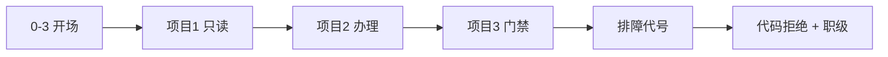
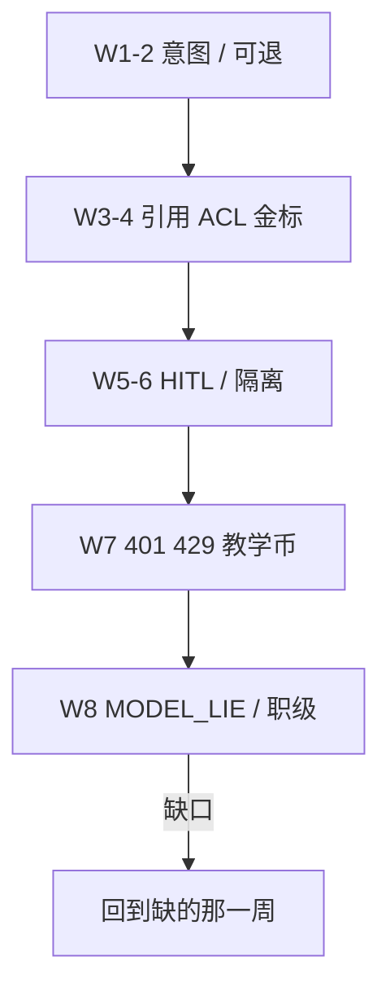

# 第 34 章 模拟面试、简历体检与谈薪准备

> 本章定位：第八卷收官，也是全书正文最后一站。读完本章，你要能按表走完 **30 分钟模拟面试（Mock interview）**，用教学 **职位描述（JD, Job Description）** 体检简历，把作品仓库开源到 **不泄漏密钥和手机号**，并分清 **初级 / 中级** 各要交出什么。谈薪只对齐职级证据，**不编造年薪**。
>
> 前置：第 30–33 章三个项目和题型。不需要 API Key。
>
> 配套代码：`code/ch34/python/`、`code/ch34/java/`
>
> 图表假设：课堂打分不是某家 HR 官方分。扫描是正则教具，不是生产密钥扫描器。`sk-TEACHFAKE01` 是假 Key。林秋 / ORDER-88 必须标明教学。事假现行 **10 个工作日**，废止稿 **5 天**。fat / lean 教学币 **9.28 / 1.96**。**可退 ≠ 已退。**

---

## 34.1 30 分钟模拟面试脚本

### 直觉解释

模拟面试不是「再聊一遍项目」。它是 **计时对词**：每段只许讲尺子、对照和门禁。超时就删形容词。

| 分钟 | 英文提醒 | 你要落地的词 |
| --- | --- | --- |
| 0–3 | Opening | 三个项目各一句：只读+引用 / 办理+HITL / 服务门禁 |
| 3–10 | Project 1 | 10 个工作日；关 ACL 抄 5 天；金标退出码 |
| 10–16 | Project 2 | 主动打开 99 / pending / 拒绝 / 越权 / 隔离 |
| 16–22 | Project 3 | 401、429、`[PHONE]`、fat / lean |
| 22–26 | Debug | 「已办理」且无 `refund_order` → `MODEL_LIE` |
| 26–30 | Code + level | 先写拒绝；用证据对齐职级，不报价 |

### 生活类比：体检抽血，不是自拍

自拍只挑好看的角度。体检按表抽血：缺一项就写缺口，不准用滤镜补。弱稿「准确率 99%，两边框架都很熟，已经退款」课堂分是 **−6**。强稿把三项目和 `MODEL_LIE` 钉住，课堂分是 **10**。

### 原理剖析：最后四分钟谈职级，不谈数字

**谈薪（Compensation conversation）** 在模拟里只做一件事：把证据映射到初级或中级预期。你可以说「我能独立守住金标和失败路径」。你不说「我要 XX 万」。编造年薪比说错事假天数更伤信誉。

### 图 1：三十分钟只走一条时间线



---

## 34.2 简历体检清单（对照真实 JD）

教学 JD 要出现这六个词：**引用、ACL、HITL、金标、Trace、配额**。简历上没有的词，面试官会当成你没做。

禁写：`99%`、`FastAPI 和 Spring 都很熟`、任何 `sk-`。缺 STAR / 对照结果，也打回。

| 病句 | 改成 |
| --- | --- |
| 准确率 99% | 金标 5 条进 CI，关 ACL 会抄 5 天 |
| 两边框架都很熟 | 二选一做深 FastAPI（或只写 Spring） |
| 已帮用户退款 | ORDER-88 可退，未确认不执行 |
| 对接了 Key | 仓库只有 `.env.example` |

示例 2：病简历一串红灯；可投简历问题列表为空。把你的真实简历贴进同一把尺子。

---

## 34.3 作品仓库怎么开源才安全

开源像把钥匙挂在门口。教学名「林秋」可以留，但必须写明 **课堂 / 教学**。手机号、真实订单、`.env` 里的赋值，不行。

脏仓库课堂命中：未标明教学的业务名、`sk-TEACHFAKE01`、明文 `13800138000`。干净仓库：`README` 写教学假设、`.env.example` 空值、审计只留 `[PHONE]`。

扫描是教具。上线前仍要用你们公司的密钥扫描和人工复查。不要把第 29 章的注入句子当攻击手册开源。

---

## 34.4 初级 / 中级岗位的预期差异

同一份作品，职级看你 **守住什么**。

| | 初级 | 中级 |
| --- | --- | --- |
| 项目 | 能讲清一个项目的边界和金标 | 三项目都能指到门禁，并解释为什么是三个 |
| 失败 | 能复现，不只能演示成功 | 能从 Trace 拆到四个代号 |
| 钱 | 知道模型输出是意图 | money 不 `fail_open`；429 ≠ 已办理 |
| 框架 | 做一个能跑 | 拒绝双框架都浅，管道顺序说得清 |

谈薪时用上表，不用行情表。对方问期望，先问职责：谁守金标、谁值班看 Trace、写工具谁批。职责对不上，数字没有意义。

---

## 34.5 你的 8 周复盘：还缺哪一块就补哪一块

### 图 2：缺哪一周的口令，回哪一周



弱稿五周全缺。强稿口令齐。你的录音若缺「隔离」，回第 31 章补食堂超时，不要再学第四个框架。

全书八块知识（概念、API、记忆、RAG、框架、多智能体、工程、求职）都已经落到三项目和题型上。缺的是演示，不是书单。

---

## 实现：三场可运行的收官切片

### 环境要求

| 项目 | 版本 / 说明 |
| --- | --- |
| Python / Java | 3.10+ / 17+，标准库 |
| API Key | 不需要 |

PowerShell 里 `-D` 请加引号。

---

### 示例 1：30 分钟脚本 + 强弱稿打分

```bash
cd code/ch34/python
python 01_mock_30min.py
```

```powershell
cd code/ch34/java
mvn -q -DskipTests compile exec:java "-Dexec.mainClass=com.agentbook.ch34.Mock30Min"
```

六段加总 30 分钟。弱稿因 99% 和双框架扣分。强稿不报价。

---

### 示例 2：简历对照教学 JD

```bash
python 02_resume_jd.py
```

```powershell
mvn -q exec:java "-Dexec.mainClass=com.agentbook.ch34.ResumeJd"
```

把打印出的必须词抄到你的简历里，缺哪个补哪个。

---

### 示例 3：开源扫描 + 职级 + 8 周缺口

```bash
python 03_oss_gap.py
```

```powershell
mvn -q exec:java "-Dexec.mainClass=com.agentbook.ch34.OssGap"
```

脏仓库至少三处泄漏；`.env.example` 放行。缺哪一周口令，回哪一周。

**Python / Java 差异：** 同构尺子。生产换公司扫描器。面试讲你删了什么，不讲「我会正则」。

---

## 踩坑提醒与职场视角

**坑 1：模拟面试超时仍在介绍框架史。** 删形容词。  
**坑 2：简历写 99%。** 第 26、30、33 章反复写过。  
**坑 3：开源带 `.env`。** 只交 `.env.example`。  
**坑 4：谈薪先报数字。** 先对齐职级证据。  
**坑 5：初级简历写成中级口吻。** 不会拆 Trace 就不要写「我负责可观测体系建设」。  
**坑 6：缺口靠再看一本新书。** 回对应周补演示。

### 面试当天口令

> 三个项目各一句。先对照病，再门禁。排障报代号。代码先拒绝。谈薪对齐职级，不报价。不写 99%。

### 简历上可以写的一句

> 8 周交付三个可演示项目：带 ACL 与金标的制度问答、HITL 办理流（失败路径可复现）、可鉴权限流的服务。开源仓库无密钥、无明文手机号。

### 本章小结

- 30 分钟按表走，不自拍。  
- 简历对照 JD，禁写 99% 和双框架。  
- 开源先扫手机号和 Key。  
- 初级守金标，中级守 Trace 与钱。  
- 缺哪一周补哪一周。

---

## 课后作业（含答案提示）

**作业 1：按脚本录一通 30 分钟（必做）**  
超时就停。对照示例 1 强弱稿，给自己打课堂分。低于 8 分回第 33 章默写。

- 提示：最后四分钟禁止出现「万」。  
- 面试句：我用金标和 429 对齐职级。

**作业 2：把你的简历跑进示例 2 的尺子（必做）**  
问题列表必须清空。真 JD 若多了「图数据库」，写进不做清单，不要假接。

- 提示：六个必须词在 34.2。  
- 对照：病简历是反面教材。

**作业 3：扫描将要公开的仓库（必做）**  
至少处理 `.env`、日志、截图里的手机号。林秋若出现，加「教学」二字。

- 提示：示例 3 的干净仓库。  
- 对照：第 27 章该留单号、不留手机号。

**作业 4：圈一个 8 周缺口并补演示（必做）**  
只补一块。补完再投。

---

## 本章质量自检

| 检查项 | 结论 |
| --- | --- |
| 零基础读者能否不看前文就懂？ | 从体检抽血讲起。 |
| 代码能否直接复制运行？ | 无 Key；三份示例带验收。 |
| 是否有职场 / 面试落点？ | 模拟脚本、JD、开源、职级、谈薪。 |
| 图表是否标注假设？ | 课堂分、假 Key、教学币、可退 ≠ 已退。 |

---

## 你现在应该能做的事

- [ ] 不看稿走完 30 分钟六段  
- [ ] 简历通过六个必须词，且无 99%  
- [ ] 公开仓库扫干净  
- [ ] 说清自己是初级还是中级，缺哪一周就补哪一周

正文 34 章到此结束。目录里的附录（术语表、接口速查、阅读导航、仓库模板）可作查表，不挡你投递。

若还要附录，回复 **「继续」**。准备投递的话：打开三个项目的演示脚本，按第 34 章计时走一遍，再点发送。
