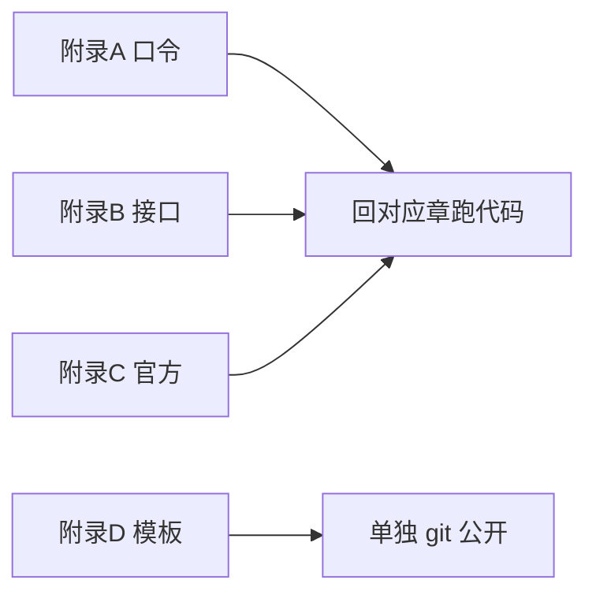
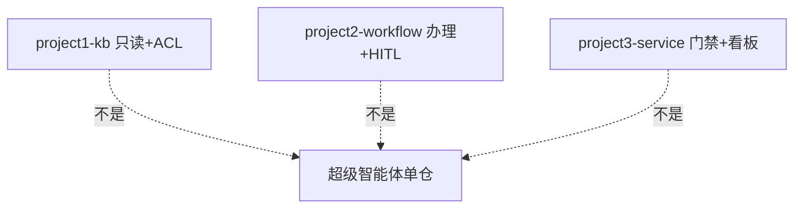

# 附录（全书查表）

> 正文 34 章已完。附录是查表，不挡投递。四份互相独立，缺哪张打开哪张。
>
> 配套检查：`code/appendix/python/`、`code/appendix/java/`
>
> 教学假设：术语是课堂口径。接口表截止 2026-09。模板无 Key、不拉端口。林秋 / ORDER-88 须标明教学。**可退 ≠ 已退。**

---

## 四份地图

| 附录 | 文件 | 干什么 |
| --- | --- | --- |
| A | [术语表](./附录A-术语表.md) | 中英对照 + 排障代号 |
| B | [模型与接口](./附录B-常用模型与接口速查.md) | Responses 优先；Assistants 已日落 |
| C | [阅读导航](./附录C-推荐阅读与官方文档导航.md) | 官方链接对照章节 |
| D | [仓库模板](./附录D-三个简历项目开源仓库模板.md) | 三个可公开骨架 |

### 图 1：查表不替代演示



### 图 2：三个作品仓不要糊成一个



| 你想… | 打开 |
| --- | --- |
| 默写 HITL / Trace | 附录 A |
| 新代码还写 Assistants | 附录 B，停手 |
| 官方文档入口 | 附录 C |
| 今晚公开仓库 | 附录 D + 示例 3 |

---

## 实现：三场附录自检

### 示例 1：口令是否还在

```bash
cd code/appendix/python
python 01_glossary_must.py
```

```powershell
cd code/appendix/java
mvn -q -DskipTests compile exec:java "-Dexec.mainClass=com.agentbook.appendix.GlossaryMust"
```

### 示例 2：日落对照

```bash
python 02_api_cheat.py
```

```powershell
mvn -q exec:java "-Dexec.mainClass=com.agentbook.appendix.ApiCheat"
```

### 示例 3：三份模板安全扫描

```bash
python 03_template_safe.py
```

```powershell
mvn -q exec:java "-Dexec.mainClass=com.agentbook.appendix.TemplateSafe"
```

---

## 面试官追问

> 问：附录和项目哪份进简历？  
> 答：简历只放三个作品仓的链接。本教程仓库是教材，不把 `.env` 和全书练习日志公开。

---

## 课后作业

**作业 1：** 默写附录 A 的代号表。  
**作业 2：** 用附录 B 检查你存量代码有没有 Assistants 客户端。  
**作业 3：** 复制一份 `templates/project1-kb`，单独 `git init`，跑示例 3 的尺子。

全书到此可以合上。投递前按第 34 章走 30 分钟。
